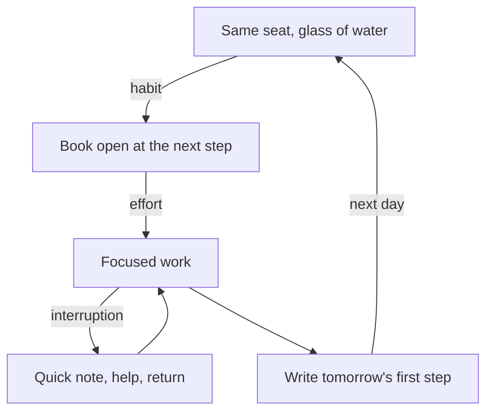

## Forty minutes and nothing done

Five weeks after day 15, Dina's English habit is working. On most working days, after she sends her last test report, she opens her English book without thinking about it. The habit has grown from one exercise into a 30-minute study block, from about 12:40 to 13:10, before she makes lunch for her mother. Her tracker shows ticks on most days.

But two days last week went wrong in a way the ticks do not show. On Monday she sat down at 12:40, opened the book, and picked up her phone to check one message from a colleague. When she looked up it was 13:20. She had read one paragraph. On Wednesday she was ten minutes into a hard exercise when her mother called her from the next room. She went to help, and when she came back she closed the book. "Today is ruined," she thought. "I will do a proper block tomorrow."

Both days she had started. The habit had done its job and brought her to the table with the book open. What went wrong was what happened after the start. This chapter is about protecting that part.

## A habit starts the work; the work is still work

It helps to be clear about what a habit can and cannot do for study. Researchers have separated two parts of a habit: the start, where a cue sets the behaviour going, and the doing, where every step runs by itself. In one study, the starting part was what predicted how often people did the behaviour. For study and focused work, that is the useful part. A habit can get you to the desk with the right page open. The thinking is still work.

This fits a finding you met in module 1. In diary studies, people did many simple habits while thinking about something else, but complex activities like studying needed more thought, even when they were repeated often. So do not expect a study habit to make study feel easy. Expect it to make starting easy, and then plan for the effort.

Planning for it is worth doing. In one set of studies, students with strong self-control also had stronger study habits, and those habits helped explain their better grades. The students did not win by forcing themselves through each session. They had habits that made starting the normal thing to do.

## Four things that protect a study block

**A start signal.** This is a small action you do every time, right before the block: close the work laptop, fill a glass of water, sit in the same seat. It is the cue for the block, and it means you never have to decide to begin. Dina's signal is the glass of water after her last report.

**Protected time.** Choose a length you can protect on most days, and say it to the people you live with. Thirty minutes that happen most days are worth more than two hours that rarely do. Protected does not mean nobody may speak to you. It means you have planned what happens if they do.

**The phone out of the room.** A phone face down on the table is still a phone within reach. Module 3 showed how a few extra steps change what people do. Put it on a shelf in another room. If someone may need you urgently, make sure they can call your name, or tell them when you will check.

**Tomorrow's first step, written at the end.** The last minute of each block is for one line: the exact place to start next time. "Next: lesson 12, exercise 3." Without it, the first ten minutes of the next block go on deciding what to do, which is the hardest part to start.

Two more protections matter in fellows' conditions. **Offline materials:** download lessons and save pages while the power and the internet are on, and keep a printed page or a paper notebook for days when they are not. **Interruptions handled kindly:** in a family home, someone will need you. Write where you stopped, help, and come back. A ten-second note keeps the block alive.

For remote workers there is one more point. If your clients or your company live in another time zone, their clock moves your day around, especially when their clocks change for summer or winter. Anchor your study block to an event in your own day, such as "after I send my last report" or "after I open the shop", not to the client's clock.

Dina's mother calls her about halfway through a block. Predict what helps the block most.

```predict
prompt: "Fifteen minutes into her English block, Dina's mother calls her from the next room for help. Which choice protects the habit better?"
options:
  - id: note-return
    label: "Note where she stopped, help, come back"
  - id: stop-today
    label: "Stop for today and do a full block tomorrow"
correctOptionId: note-return
explanation: "Helping her mother is part of Dina's day, not a failure of the block. A ten-second note, 'stopped at question 6', lets her return without deciding where she was, and the block ends a few minutes late instead of being lost. Stopping for today turns one interruption into a missed day."
```

Step through one block from start to end. Before step 6, check your prediction.

<InteractiveCanvas slug="dina-study-block" />

**What this shows:** one 30-minute study block and what protects it: a start signal, the phone in another room, a written next step, and a quick note when someone needs her. **Try this:** find the two steps where Dina writes something down, and imagine the block without each one. **What changed:** the interruption cost five minutes of helping and ten seconds of writing, and the block ended at 13:15 instead of 13:10, where on Wednesday the same kind of call had cost the whole day's study. **Limits of the model:** this block had one short interruption; on days with many, or with a long one, the smallest version counts and the next block starts from the note.

## Dina's block, designed step by step

Here is how Dina rebuilt her block after last week. Each step answers one thing that went wrong.

**The day before: prepare offline.** Besides the phone, Dina plans for a second risk: weak internet at midday. Each evening, while the power is on, she checks that tomorrow's lesson is in her paper book, not only online. If a listening exercise needs the internet, she downloads it the evening before.

**12:40: the start signal.** She sends her last report, closes the work laptop, fills a glass of water and sits at the same end of the table. She does not decide to study. The signal decides.

**12:41: the phone leaves the room.** It goes on the kitchen shelf, face down. Her mother is in the next room and can call her by voice, and her brother knows she checks her phone after lunch. So nobody needs the phone for half an hour, and Monday's 40 minutes cannot happen again by accident.

**12:42: read the next step.** Yesterday's last line says "Next: lesson 12, exercise 3, the past tense." She opens the page and begins. No deciding, no browsing.

**During the block: the effort is normal.** The exercise is hard. Hard does not mean the block is going badly. It means she is learning.

**If someone needs her: note, help, return.** When her mother calls at 12:55, she writes "stopped at question 6", helps for about five minutes, comes back, reads the note and carries on. This is the step that would have saved Wednesday.

**13:15: write tomorrow's first step.** "Next: question 7, then read page 40 aloud." The block ends with tomorrow's start already decided.

Notice that none of these steps asks Dina to try harder. Each one removes a decision or a distraction, or keeps an interruption small. On hard days she still has her smallest version: read one paragraph aloud. That keeps the habit going even when the block cannot happen.

## The start is a habit; the middle is effort

The diagram shows how the parts fit together over one day and into the next.



Look at the labels on the arrows. The first arrow is marked "habit": that part runs by itself once the signal is learned. The second is marked "effort": that part always takes thought, and no habit removes it. The loop through the note shows an interruption as a detour that comes back, not an exit. And the last arrow joins today's block to tomorrow's, because the written first step is what makes the next start automatic. The habit sits at both ends of the block; the effort sits in the middle.

## Where people go wrong

**Waiting to feel focused.** Focus usually arrives a few minutes after you start, not before. Let the signal start you, and let the focus follow.

**Phone face down on the table.** It is still within reach, and one buzz is enough to pick it up. Another room is a real distance; face down is not.

**Treating an interruption as the end.** In a family home, interruptions are part of the day. A note and a return keep the block; giving up for the day turns a few minutes into a missed day.

**Starting without a next step.** "Study English" is a subject, not a step. The first minutes go on deciding, and deciding is where many blocks die. Write the step at the end of the previous block.

**Depending on the internet.** If the block needs a connection and the connection fails, the block fails. Download and print while you can.

**Blocks that are too long.** Two hours sounds serious and rarely survives a week with a job and a family. Grow the block slowly, once the shorter one runs on most days.

<Callout type="tip" title="Tell the people you live with">
Say it once, kindly: "From 12:40 to 13:10 I study. If you need me, call me; I will come." People help a plan they know about.
</Callout>

## Try it today

Choose your start signal for your course habit or a study block, or use Dina's: a glass of water and the same seat. Decide where your phone will go, in another room, and tell one person in your home when your block is. At the end of today's session, write one line: tomorrow's first step. If your study needs the internet, download tomorrow's material tonight while you have power. Keep the block short enough that you could protect it on your busiest normal day.

## Check your understanding

```quiz
type: mcq
question: "Duaa, the pharmacy student who shares a flat with two cousins, studies for 40 minutes after lunch at the kitchen table. For one week she noted where the time went, on average: 15 minutes on her phone after it buzzes, 8 minutes choosing what to study, 2 minutes chatting with her cousins, and 15 minutes of study. Which one change aims at her biggest loss?"
options:
  - "Put her phone in another room for the 40 minutes"
  - "Write tomorrow's first step at the end of each block"
  - "Ask her cousins to stay out of the kitchen while she studies"
  - "Make the block 60 minutes long, so more study fits in"
correct: 0
explanations:
  - "Right. Her phone takes 15 of her 40 minutes, more than anything else. Another room puts a real distance between her and the buzz."
  - "This is a good change too, and it would save the 8 minutes of choosing. But the phone costs her more, 15 minutes a block."
  - "Her cousins cost her about 2 minutes. Asking them to stay out of a shared kitchen would be hard and would change little."
  - "A longer block with the same leaks would lose the same time to the phone and to choosing. Fix the leaks first."
```

```quiz
type: mcq
question: "Wael designs logos for clients abroad from a desk in his family's shop. His clients write to him all afternoon, and his main client's daily call is at 16:00 in winter and 17:00 in summer, when the client's clocks change. His mornings are quiet: he opens the shop's shutter at 8:00 every day, and clients rarely write before noon. He wants a daily 45-minute block for his portfolio. Which anchor fits best?"
options:
  - "Right after the client's daily call, whatever time it ends"
  - "Whenever the afternoon is quiet and no messages are coming"
  - "After he opens the shutter at 8:00, before clients write"
  - "At 15:00 by his own clock, one hour before the winter call"
correct: 2
explanations:
  - "The call moves when the client's clocks change, and calls can run long. This anchor follows the client's day, not his own."
  - "A quiet moment is not a cue. His afternoons are full of messages, so this block would depend on luck."
  - "Right. Opening the shutter happens every day at a fixed point in his own day, and his mornings are quiet. The block will not move with the client's clock."
  - "At 15:00 clients are writing to him, so the block would be interrupted, and the time is set by the client's call, not by his own day."
```

**Next:** A daily rhythm: placing habits on prayer times, meals and other fixed points, through the seasons and on days that change.
