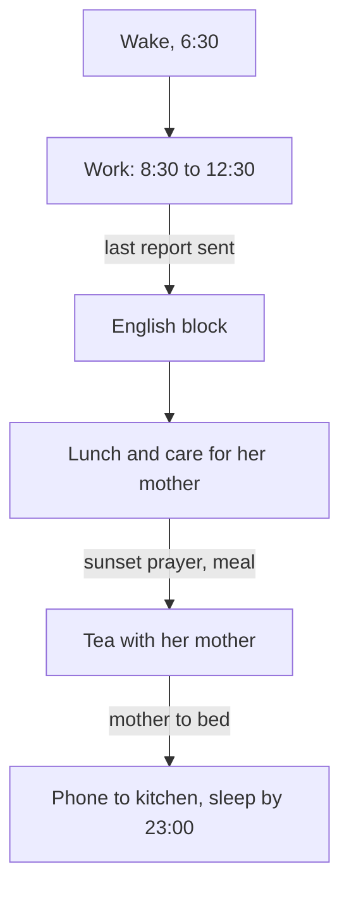

## The alarm that rang at the wrong time

By early summer, Dina's English block and her sleep habit both run on most days. One small thing has gone wrong, though, and it is the thing she cares about most.

For years, Dina and her mother have drunk mint tea together after the evening meal. It is their quiet time: fifteen minutes, phones away, talking about the day. Last winter, when Dina's work and study got busy, her brother suggested a way to protect it. He set a phone alarm for 18:00 with the words "tea with mother". In winter it worked perfectly. The alarm rang just after the meal, and the two of them sat down.

Now it is summer, and the alarm rings while Dina is in the kitchen, cooking the evening meal and helping her mother. She turns it off and means to sit down later. Some evenings the tea happens late. Many evenings it does not happen at all. Nothing about Dina or her mother has changed. The clock time stayed the same, and the day moved around it.

## Fixed points make good anchors

Every day has fixed points: things that happen every day, at a known moment, in a known place. Waking up. The start of a work shift. Meals. The school run. For many fellows, prayer times are fixed points too, five a day. You met anchors in module 2: an anchor is something you already do every day, which a new habit can follow. Fixed points make good anchors because they happen every day at a known moment, and habit research advises choosing cues that are like that: daily, predictable and in a stable place.

Some fixed points are tied to the clock: a work shift that starts at 8:30, a school bell at 13:30. Others are tied to events that move. Prayer times follow the sun, so they move through the year. In Dina's family, the evening meal comes after the sunset prayer, so the meal moves too. In this example, the sunset prayer is at about 16:45 in winter and about 19:45 in summer: three hours later.

A habit tied to an event moves with that event. A habit tied to a clock time stays at the same number, while the day around it moves. That is what happened to Dina's tea. Tea "after the evening meal" would have moved to about 20:45 in summer and stayed in its place in the evening. Tea "at 18:00" stayed at 18:00, which moved it from the calm hour after the meal into the busiest hour of her afternoon.

Be careful not to overstate this. Research has not shown that event cues work better than clock cues in general. A 2024 review of habit studies found that cues based on a clock time and cues based on a routine worked about equally well in the studies that compared them. The point here is fit with your own day. A clock time is fine if you check it when the season changes. An event is fine only if it really happens every day. Choose the anchor that keeps the habit in the right part of your day all year.

## Sleep, health and family time

**Sleep.** Health agencies advise most adults to sleep at least seven hours and to keep a regular time for going to bed and getting up. They also advise switching off screens at least 30 minutes before bed and avoiding caffeine in the afternoon and evening. That is the basic guidance, and it is enough for planning habits. Dina's sleep habit follows a fixed point: "After I help my mother to bed, I put my phone on the kitchen shelf." Her mother goes to bed between 22:00 and 22:30 all year, so Dina is in bed by 23:00 and up at 6:30.

**Health.** The same method works for small health habits: tie them to a fixed point and keep them small. A short walk after lunch, a bottle of water filled when you sit down to work. Choose one at a time, as chapter 6.2 showed.

**Family time.** Time with the people you live with can be a habit too, and it deserves the same care as a study block. Dina's tea with her mother is a habit with a cue, a routine and a reward. It has to be protected like any other habit, or the busy parts of the day will take it.

**When the day changes.** Some days do not look like any normal day: guests stay all evening, the family moves home, a month brings different work hours. On those days, keep the anchor and shrink the habit to its smallest version. One paragraph of English instead of a 30-minute block. Five minutes of tea instead of fifteen. After a move, expect some habits to need rebuilding in the new place; module 3 showed that this is normal.

```predict
prompt: "Dina could tie her tea to 'after the evening meal' or to 'an alarm at 18:00'. In winter both plans land at the same moment. Which one do you expect still to fit her evening in summer?"
options:
  - id: alarm
    label: "Tea at 18:00 with the alarm"
  - id: after-meal
    label: "Tea after the evening meal"
correctOptionId: after-meal
explanation: "In summer, in this example, the sunset prayer moves to about 19:45 and the meal ends at about 20:45. Tea after the meal follows it, so it stays in the calm part of the evening. The alarm still rings at 18:00, which is now two hours before the meal, while Dina is cooking and caring for her mother."
```

Step through winter, then summer. Before step 5, check your prediction.

<InteractiveCanvas slug="prayer-time-anchors" />

**What this shows:** one habit written two ways, after an event and at a clock time, followed from winter to summer. **Try this:** think of a clock-time habit of your own, or Dina's 18:00 alarm, and name an event in the day that it could follow instead. **What changed:** in winter both plans landed together; in summer the event plan moved three hours with the prayer and the meal, while the clock plan stayed at 18:00 and fell into the busy hour. **Limits of the model:** the times are this example's, real prayer times depend on place and date, and research found clock cues and routine cues about equally effective in general; the point is fit with your day.

## Dina's day, mapped

After the tea problem, Dina maps her whole day. Here is her method, step by step.

**Step 1: list the fixed points.** She writes every point that happens on most days, with the time in winter and in summer.

| Fixed point | Winter, about | Summer, about | Habit on it |
|---|---|---|---|
| Wake up | 6:30 | 6:30 | none yet |
| Last test report sent | 12:30 | 12:30 | English block |
| Lunch with her mother | 13:30 | 13:30 | parked: 10-minute walk after lunch |
| Sunset prayer, then evening meal | 16:45, meal ends 17:45 | 19:45, meal ends 20:45 | tea with her mother |
| Her mother goes to bed | 22:00 to 22:30 | 22:00 to 22:30 | phone to the kitchen, sleep by 23:00 |

**Step 2: mark what moves.** Work and lunch stay at the same clock time all year. The sunset prayer and the meal move by about three hours. Her mother's bedtime hardly moves.

**Step 3: tie each habit to the fixed point it belongs with.** English follows her last report. Tea follows the meal, not the clock. Sleep follows her mother's bedtime. She deletes the 18:00 alarm.

**Step 4: check for clashes.** In summer, the meal ends at about 20:45 and tea follows. Her mother goes to bed at about 22:00 to 22:30. That still leaves time between tea and bed, so the habits do not crowd each other. In winter, the evening is long and calm, with plenty of space.

**Step 5: write the changed-day versions.** Guests: five minutes of tea, and English shrinks to one paragraph aloud. A day with her mother at an appointment: the English block moves to after the evening meal for that day only. She writes these on the back of her card, so a changed day does not mean starting from nothing.

Notice what the map does. It turns "I will find time" into "this habit follows that moment". Each habit has a home in the day, and the homes do not compete.

## The rhythm of one summer day

The diagram shows Dina's summer day as a chain of fixed points, with each habit attached to one of them.



Read the labels on the arrows: each one is the fixed point that starts the next habit. The chain does not need free time. It hangs on things that already happen every day. In winter the middle arrow, the prayer and the meal, moves three hours earlier, and tea moves with it, while the rest of the chain stays where it is. That is a rhythm: the order holds even when the clock times shift.

## Where people go wrong

**Anchoring to a clock time and never checking it.** A habit set in winter may drift into the wrong part of a summer day. Check clock-time habits when the season or your work hours change.

**Anchoring to something that does not happen every day.** A weekly class, a visit that comes "most days" or power hours that change every week are weak anchors. Choose a point that happens daily.

**Treating family time as what is left over.** Time with family often gets the minutes that remain after everything else, which on busy days is none. Give it a fixed point.

**Stopping everything on a changed day.** Guests or a move do not cancel your habits; they shrink them. Keep the anchor and do the smallest version.

**Making prayer a technique.** Prayer times are fixed points in many fellows' days, and a habit can follow one, the same way it can follow a meal. That is all this chapter claims.

<Callout type="tip" title="A seasonal check">
When the season changes, or your work hours do, read your habit list once. For each habit, ask: does its anchor still land in the right part of my day?
</Callout>

## Try it today

Map your own day, or Dina's if you prefer. Write the fixed points of a normal day in a short list, and mark which ones move through the year. Put your course habit on the fixed point it follows, and check that it lands in a calm part of the day in both winter and summer. If any habit is tied to a clock time, ask whether an event would keep it in place better. Finally, write one line for a changed day: what the smallest version is, and which anchor it keeps.

## Check your understanding

```quiz
type: mcq
question: "Karim, who works early shifts at a bakery, wants to call his grandmother for 10 minutes every evening. In winter he set an alarm for 19:00, just after his family's evening meal, which comes after the sunset prayer. In this example, the sunset prayer in summer is about three hours later than in winter, and the meal moves with it. What should he change before summer?"
options:
  - "Keep 19:00, since one fixed time is easy to remember"
  - "Call only on Fridays, when his evenings are free"
  - "Tie the call to 'after the evening meal' instead"
  - "Set a second alarm at 19:30 in case he misses the first"
correct: 2
explanations:
  - "In summer, 19:00 will come before the meal, so the call lands in a different part of his evening and may clash with it."
  - "Once a week is a different habit. The facts give no reason to drop the daily call, only to move its anchor."
  - "Right. The meal follows the sunset prayer all year, so a call after the meal moves with it and stays in the same calm part of the evening."
  - "A second alarm is another reminder at a clock time. In summer both alarms would still ring before the meal."
```

```quiz
type: mcq
question: "Sana, the tailor's apprentice, reads 5 pages of her sewing book after lunch each day. Next week her aunt's family of four will stay with her family for 6 days, and lunch will be busy and crowded. Which plan fits this chapter's advice for a changed day?"
options:
  - "Pause the habit for the 6 days, and start again when they leave"
  - "Keep the anchor and read just 1 page after lunch each day"
  - "Read 10 pages a day the week before, to get ahead"
  - "Move the habit to 5:00 in the morning while they stay"
correct: 1
explanations:
  - "Pausing for 6 days makes a 6-day gap, and a longer gap makes restarting harder."
  - "Right. The guests change the day, not the anchor: lunch still happens. A smaller version keeps the habit going until the normal day returns."
  - "Reading ahead does not keep the habit going during the visit, and it asks for more effort at a busy time."
  - "A new time with no anchor, at an hour she is not used to, is unlikely to happen on crowded days."
```

**Next:** A graded quiz with five short cases on choosing a habit, study and focused work, and daily rhythm.
