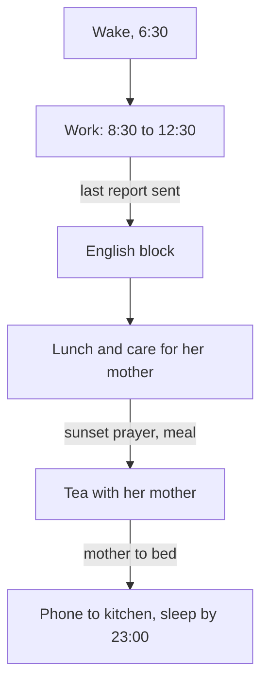

## The alarm that rang at the wrong time

By early summer, Dina's English block and her sleep habit both run on most days. One small thing has gone wrong, though, and it is the thing she cares about most.

For years, Dina and her mother have drunk mint tea together after the evening meal. It is their quiet time: fifteen minutes, phones away, talking about the day. Last winter, when Dina's work and study got busy, her brother suggested a way to protect it. He set a phone alarm for 18:00 with the words "tea with mother". In winter it worked perfectly. The alarm rang just after the meal, and the two of them sat down.

Now it is summer, and the alarm rings while Dina is in the kitchen, cooking the evening meal and helping her mother. She turns it off and means to sit down later. Some evenings the tea happens late. Many evenings it does not happen at all. Nothing about Dina or her mother has changed. The clock time stayed the same, and the day moved around it.

Suppose the tea had been written another way from the start: "after the evening meal" instead of "at 18:00". Make a prediction before you read on.

```predict
prompt: "In this example, the sunset prayer is at about 16:45 in winter and about 19:45 in summer, and Dina's family always eats after it. The meal takes about an hour. If the tea had been tied to 'after the evening meal' instead of the 18:00 alarm, when would it start on a summer evening?"
options:
  - id: after-meal
    label: "Around 20:45, right after the meal"
  - id: same-time
    label: "Around 18:00, as it was in winter"
correctOptionId: after-meal
explanation: "The meal follows the sunset prayer, so in summer it ends at about 20:45, and tea after the meal starts then, in the same calm part of the evening as in winter. Only a clock time stays at 18:00. This does not make one kind of cue better in general; it shows that each kind lands in a different place when the day moves."
```

Step through winter, then summer. Before step 5, check your prediction.

<InteractiveCanvas slug="prayer-time-anchors" />

**What this shows:** one habit written two ways, after an event and at a clock time, followed from winter to summer. **Try this:** think of a clock-time habit of your own, or Dina's 18:00 alarm, and ask where it lands in each season. **What changed:** in winter both plans landed together; in summer the event plan moved with the prayer and the meal, while the clock plan stayed at 18:00 and fell into the busy hour. **Limits of the model:** the times are this example's, and research found clock cues and routine cues about equally effective in general; the point is fit with your day.

## Fixed points make good anchors

Every day has fixed points: things that happen every day, at a known moment, in a known place. Waking up. The start of a work shift. Meals. The school run. For many fellows, prayer times are fixed points too, five a day. You met anchors in module 2: an anchor is something you already do every day, which a new habit can follow. Fixed points make good anchors because they happen every day at a known moment, and habit research advises choosing cues that are like that: daily, predictable and in a stable place.

Some fixed points are tied to the clock: a work shift that starts at 8:30, a school bell at 13:30. Others are tied to events that move. Prayer times follow the sun, so they move through the year. In Dina's family, the evening meal comes after the sunset prayer, so the meal moves too.

A habit tied to an event moves with that event. A habit tied to a clock time stays at the same number, while the day around it may move. That is what happened to Dina's tea. Tea "after the evening meal" would have moved to about 20:45 in summer and stayed in its place in the evening. Tea "at 18:00" stayed at 18:00, which moved it from the calm hour after the meal into the busiest hour of her afternoon.

Be careful not to overstate this. Research has not shown that event cues work better than clock cues in general. A 2024 review of habit studies found that cues based on a clock time and cues based on a routine worked about equally well in the studies that compared them. The point here is fit with your own day. A clock time works well if the part of the day it belongs to stays at that time, or if you check it when the season changes. An event works well only if it really happens every day. Choose the anchor that keeps the habit in the right part of your day all year.

## Sleep, health and family time

**Sleep.** Health agencies advise most adults to sleep at least seven hours and to keep a regular time for going to bed and getting up. That is the basic guidance, and it is enough for planning habits. Dina's sleep habit follows a fixed point: "After I help my mother to bed, I put my phone on the kitchen shelf." Her mother goes to bed between 22:00 and 22:30 all year, so Dina is in bed by 23:00 and up at 6:30, which gives her seven and a half hours.

**Health.** The same method works for small health habits: tie them to a fixed point and keep them small. A short walk after lunch, a bottle of water filled when you sit down to work. Choose one at a time, as chapter 6.2 showed.

**Family time.** Time with the people you live with can be a habit too, and it deserves the same care as a study block. Dina's tea with her mother has a cue, a routine and a reward. It has to be protected like any other habit, or the busy parts of the day will take it.

**When the day changes.** Some days do not look like any normal day: guests stay all evening, the family moves home, a month brings different work hours. On those days, keep the anchor and shrink the habit to its smallest version. One paragraph of English instead of a 30-minute block. Five minutes of tea instead of fifteen. After a move, expect some habits to need rebuilding in the new place; module 3 showed that this is normal.

## Map your own day first

Before you look at Dina's map, try it yourself, the way chapter 5.3 asked you to count a card before seeing the answer. On a piece of paper, list the fixed points of a normal day in your life, or in Nada's if you prefer: what happens every day, and at about what time. Mark each one that moves through the year, such as a prayer time or a meal that follows one. Then write your course habit next to the fixed point it follows. Keep your list; you will compare it with Dina's below.

## Dina's day, mapped

After the tea problem, Dina maps her whole day. Here is her method, step by step.

**Step 1: list the fixed points.** She writes every point that happens on most days, with the time in winter and in summer.

| Fixed point | Winter, about | Summer, about | Habit on it |
|---|---|---|---|
| Wake up | 6:30 | 6:30 | none yet |
| Last test report sent | 12:30 | 12:30 | English block |
| Lunch with her mother | 13:30 | 13:30 | parked: 10-minute walk after lunch |
| Sunset prayer, then evening meal | 16:45, meal ends 17:45 | 19:45, meal ends 20:45 | tea with her mother |
| Her mother goes to bed | 22:00 to 22:30 | 22:00 to 22:30 | phone to the kitchen, sleep by 23:00 |

**Step 2: mark what moves.** Work and lunch stay at the same clock time all year. The sunset prayer and the meal move by about three hours. Her mother's bedtime hardly moves.

**Step 3: tie each habit to the fixed point it belongs with.** English follows her last report, which stays at 12:30, so a clock time would work there too. Sleep follows her mother's bedtime. For the tea, Dina had two choices: keep an alarm and change its time each season, or tie the tea to the meal. She chooses the meal, because it follows the change without her having to remember, and she deletes the 18:00 alarm.

**Step 4: check for clashes.** In summer, the meal ends at about 20:45 and tea follows. Her mother goes to bed at about 22:00 to 22:30. That still leaves time between tea and bed, so the habits do not crowd each other. In winter, the evening is long and calm, with plenty of space.

**Step 5: write the changed-day versions.** Guests: five minutes of tea, and English shrinks to one paragraph aloud. A day with her mother at an appointment: the English block moves to after the evening meal for that day only. She writes these on the back of her card, so a changed day does not mean starting from nothing.

Now compare your own list with Dina's. Did you mark which points move? Does each habit sit on a point that happens every day? Notice what the map does. It turns "I will find time" into "this habit follows that moment". Each habit has a home in the day, and the homes do not compete.

## The rhythm of one summer day

The diagram shows Dina's summer day as a chain of fixed points, with each habit attached to one of them.



Read the labels on the arrows: each one is the fixed point that starts the next habit. The chain does not need free time. It hangs on things that already happen every day. In winter the middle arrow, the prayer and the meal, moves three hours earlier, and tea moves with it, while the rest of the chain stays where it is. That is a rhythm: the order holds even when the clock times shift.

## Common rhythm mistakes

**Setting a clock time and never checking it.** A habit set in winter may land in the wrong part of a summer day. Check clock-time habits when the season or your work hours change.

**Anchoring to something that does not happen every day.** A weekly class, a visit that comes "most days" or power hours that change every week are weak anchors. Choose a point that happens daily.

**Treating family time as what is left over.** Time with family often gets the minutes that remain after everything else, which on busy days is none. Give it a fixed point.

**Stopping everything on a changed day.** Guests or a move do not cancel your habits; they shrink them. Keep the anchor and do the smallest version.

**Making prayer a technique.** Prayer times are fixed points in many fellows' days, and a habit can follow one, the same way it can follow a meal. That is all this chapter claims.

<Callout type="tip" title="A seasonal check">
When the season changes, or your work hours do, read your habit list once. For each habit, ask: does its anchor still land in the right part of my day?
</Callout>

## Try it today

Finish the map you started above, for your own day or Nada's. Check that your course habit lands in a calm part of the day in both winter and summer. If a habit is tied to a clock time, decide whether you will change the time each season or tie it to an event that moves with the day; either can work. Finally, write one line for a changed day: what the smallest version is, and which anchor it keeps.

## Check your understanding

```quiz
type: mcq
question: "Manar, the nursing student, wants a 10-minute walk as her next habit. She has four possible anchors: when the power comes on, which changes every week; after her Saturday clinic shift; when her sisters go out, which is on some days; and after lunch with her family, at about 14:00 every day. Which anchor fits a daily walk?"
options:
  - "When the power comes on, since that happens most days"
  - "After her Saturday clinic shift, since it is fixed each week"
  - "When her sisters go out, since the flat is quiet then"
  - "After lunch with her family, at about 14:00 every day"
correct: 3
explanations:
  - "Power hours change every week, so this anchor moves around her day. An anchor that moves is weaker than one that stays."
  - "The clinic shift is fixed, but it comes once a week. A daily habit needs an anchor that happens every day."
  - "Her sisters go out only on some days, so on the other days the cue never comes."
  - "Yes. Lunch happens every day at about the same time and place, so it is a fixed point the walk can follow."
```

```quiz
type: mcq
question: "Wael now does a 45-minute portfolio block after his first coffee at the shop. Next week his cousin's family of five will stay with his family for 6 days, and the shop will be busy every morning. He will still make his first coffee each day. Which plan fits this chapter's advice for a changed day?"
options:
  - "Pause the block for the 6 days and restart when they leave"
  - "Keep the coffee anchor and do 10 minutes each morning"
  - "Do 90 minutes a day the week before, to get ahead"
  - "Move the block to 5:00, before the family wakes up"
correct: 1
explanations:
  - "Pausing for 6 days makes a 6-day gap, and a longer gap makes the next start harder."
  - "That fits. The guests change the day, not the anchor: his first coffee still happens. A smaller version keeps the habit going until the normal week returns."
  - "Working ahead does not keep the habit going during the visit, and it asks for much more effort before a busy week."
  - "A new time with no anchor, at an hour he is not used to, is unlikely to happen on crowded days."
```

**Next:** A practice check with five short cases on choosing a habit, study and focused work, and daily rhythm.
