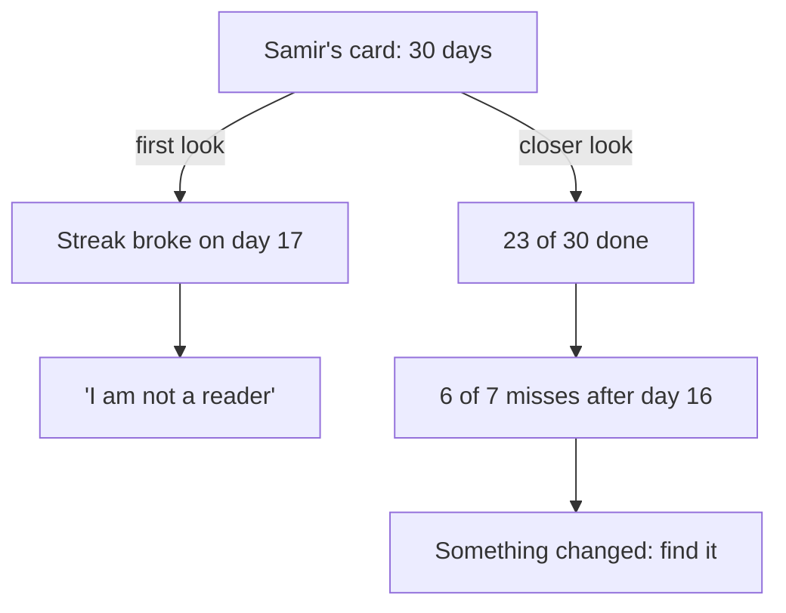

<BigWordAlert term="Habit review" plainEnglish="Looking back at your tracker after a set time, such as 30 days, to see how often you did the habit, what caused the missed days, and what to change next." whyItMatters="Without a review, a month of tracking is only a card full of ticks. With one, it tells you what to keep and what to change, so the next month goes better." />

## A card on the table

It is the 31st evening of Samir's plan. The family has just finished the evening meal. His mother is making tea, and his younger sister is clearing the plates. The power is on tonight, and the light over the table is bright. Samir sits down by the window with a small paper card in his hand.

Samir is 26. He builds small websites for clients as a freelancer, and he wants to take on bigger projects. Bigger projects need databases, and he knows only the basics. A friend lent him a printed book about databases, about 400 pages long. For months it sat on the shelf. Every week he told himself he would start it "when things are calmer". Things did not get calmer.

So 30 days ago he tried something different. He used what he had learned in this course. On the first page of the card he wrote one sentence. "After I clear my plate from the evening meal, I sit at the table by the window and read 10 pages of my database book." Ten pages take him about 20 minutes. He kept the book on the shelf next to the table, with a pencil inside as a bookmark. He kept the card inside the book. Every evening he drew a tick or a cross, and on a cross he wrote a few words about why.

Like every person in this course, Samir is fictional. His month, though, is a very ordinary one. It has good weeks and hard weeks, a broken streak, and a card full of small notes.

## What the card says

Here is Samir's card, week by week. A day is "done" when he read his 10 pages.

| Week | Days done | Missed days and his notes |
|---|---|---|
| Days 1 to 7 | 6 of 7 | Day 7: "Friday, meal at my uncle's, book at home" |
| Days 8 to 14 | 7 of 7 | None. Day 14: "Friday, meal at home" |
| Days 15 to 21 | 4 of 7 | Days 17 and 18: "power off after the meal, too dark". Day 21: "Friday at my uncle's" |
| Days 22 to 28 | 5 of 7 | Days 24 and 27: "power off, too dark". Day 22 was done: "power off, borrowed my sister's lamp" |
| Days 29 to 30 | 1 of 2 | Day 29: "client call ran late, ate at 22:30" |

Samir's eyes go first to the middle of the card. From day 8 to day 16 he read every evening: nine days in a row. It was the longest run of ticks he had ever kept for anything. Then, on day 17, the power went off just after the meal. The room was dark and he could not read. On day 18 the same thing happened. Two crosses in a row, and the run of nine was gone.

## His first reading

Samir remembers how day 19 felt. He looked at the two crosses and thought, "I broke it. Maybe I am just not a person who reads technical books." He nearly left the book on the shelf that night. In the end he read, but it felt heavy, and he wrote "hard to start again" on the card.

Tonight, looking at the whole card, that old feeling comes back. There are seven crosses. The second half of the month looks worse than the first. He starts to think that the plan worked for two weeks and then fell apart, and that he should probably stop.

This is a very common way to read a tracker. The eye goes to the broken streak and the crosses. Then the mind turns them into a story about the person: "I am lazy", "I am not a reader", "I always give up". You met this trap in module 5. One slip feels like proof of failure, and the feeling makes giving up more likely. A review is a way to read the same card more carefully, before you make a decision based on that feeling.

```predict
prompt: "Samir's nine-day run broke on day 17, and he missed day 18 too. Looking at his whole card, did his month show a habit forming?"
options:
  - id: no-broken
    label: "No, the broken streak shows it did not form"
  - id: yes-strong
    label: "Yes, 23 of 30 days is a strong month"
correctOptionId: yes-strong
explanation: "Count the ticks: 6, 7, 4, 5 and 1 make 23 days done out of 30. Module 1 showed that one missed day does not undo progress, and module 5 taught you to count days done, not only days in a row. A run of nine that ends is still nine evenings of reading. The card also holds more than ticks: the notes on the misses point to something that changed in his evenings, not in him."
```

## A closer look

Samir takes a breath and does what this module will teach you to do. First he counts. He read on 23 of the 30 evenings. That is at least 230 pages of a book he had left on the shelf for months. Whatever else the card says, 23 of 30 is not a failure.

Next he looks at when the crosses fell. In the first half of the month, days 1 to 15, there is only one cross, on day 7. In the second half, days 16 to 30, there are six. That difference is real, and it is worth understanding. But it does not have to mean that Samir got lazy. It could mean that something around him changed.

Then he reads his own notes, the few words he wrote on each cross. Four of the seven say the same thing: "power off, too dark". All four come after day 16. Samir remembers why. From day 17 the power schedule changed. Before, the power came in the evenings. After, it often came in the mornings and went off soon after the evening meal. His habit had a clear cue, the end of the meal, and a clear place, the table by the window. It had no plan for a dark room.

Two more crosses say "Friday at my uncle's". On those Fridays the family ate at his uncle's home, and the book stayed on the shelf at home. On the other two Fridays the family ate at home, and he read. One last cross was a late client call. That leaves no cross that says "did not feel like it".

There is one more thing in the notes, and Samir almost misses it. On day 22 the power was off too, but there is a tick. He borrowed his sister's small lamp and read by it. So on five dark evenings, he read on the one evening he had a light. That small note is a clue about what to change.

The last thing Samir notices is not on the card at all. It is in how the habit feels. In the first week he wrote "had to push myself" twice and "nearly forgot" once. In the last week he wrote nothing like that. Tonight, he cleared his plate and sat down at the table before he had even thought about it. The habit is easier to start than it was. Module 5 showed why that matters: the habit itself gets easier fastest in the first weeks, while results such as skill can take longer to show.

The diagram shows the two ways Samir read the same card. The first look stops at the broken streak and turns it into a judgement about himself. The closer look counts, finds when the misses fell, and ends with a question he can answer.



What to notice: both paths start from the same card. The first path has only two steps, and it ends with a feeling, not an action. Nothing in "I am not a reader" tells Samir what to do tomorrow. The second path takes longer, and it uses the numbers and the notes. It ends with something he can check and change. The data never changed between the two readings. Only the way of reading it changed.

## Why this matters for study and work

A habit review is a small skill, but it shows up everywhere. A student looks back at a month of revision before an exam and asks which weeks went well and why. A freelancer looks back at a month of client work and asks why three deliveries were late. A remote team looks back at two weeks of work and decides what to keep and what to change. In each case the useful questions are the same. How often did it happen? When did it go wrong? What caused it? What is the one change we will try next?

People who can do this calmly are valuable, at work and at home. They do not blame themselves or others for every cross. They also do not ignore the crosses. They treat each missed day as information, look for a pattern, and change one thing at a time. That is what Samir is about to do with his card.

It also protects the habit itself. Many people stop a good habit after a hard week, because they read their tracker the first way. They see the broken streak, feel that they failed, and drop it. A careful review often shows that the habit was working. Only one part of the plan needed a fix, such as a light for dark evenings or a smaller version for busy days.

## What this module covers

This last module brings the course together. In chapter 7.2 you will follow Samir's review step by step. You will count the days done, find when the misses happened, and read the notes for causes. You will compare the first half of the month with the second, and decide whether to keep, change or drop the habit. You will also see why the next change should be one change, tested for about two weeks, and not three changes at once.

Chapter 7.3 is a mixed review. It gives you five fresh cases from across the course and asks which tool you would use first. Choosing the right tool is a skill of its own, and it is a skill you will need long after the course ends.

Chapter 7.4 is the capstone. You will design, run and review your own 30-day habit plan, using everything from modules 1 to 6. If you prefer not to use your own life, or your month was too disrupted to track, you can review a provided case instead. There are three: Nada's vocabulary sentence, which you may know from earlier gates, Ziad's evening walk, and Rasha's phone, which stays outside her bedroom at night. Nobody has to share anything personal.

Chapter 7.5 is the final gate. You will build your own habit toolkit, with one line for each tool in the course. You will also look back at the habit you described in module 1 and write a plan for your next 30 days.

<LearningObjectives items={["Count the days done in a 30-day tracker and find the longest gap", "Find when the missed days happened and what caused them, using the notes", "Decide whether to keep, change or drop a habit, with one change at a time", "Choose which habit tool to use first in a fresh case", "Design, run and review a 30-day habit plan, or review a provided case"]} />

## Key words

| Word | Plain English |
|---|---|
| **Pattern** | Misses that keep happening in the same kind of situation, such as dark evenings or busy days |
| **First half, second half** | Days 1 to 15 against days 16 to 30, to see whether something changed during the month |
| **Keep, change or drop** | The three decisions at the end of a review: carry on as it is, change one part, or stop the habit for now |
| **Two-week test** | Trying one change for about two weeks and counting what happens, before deciding whether it helped |
| **Capstone** | The final project of the course, where you use all the tools together on one habit |

## What is in this module

| Chapter | You will practise |
|---|---|
| 7.2 | Reading Samir's 30 days: counts, patterns, causes and one change at a time |
| 7.3 | Choosing which tool to use first, in five fresh cases from across the course |
| 7.4 | Your capstone: a 30-day plan and review, yours or a provided case |
| 7.5 | The course checklist, your habit toolkit and your next 30 days |

**Next:** How to read 30 days of tracking, step by step, and choose one change for the next month.
