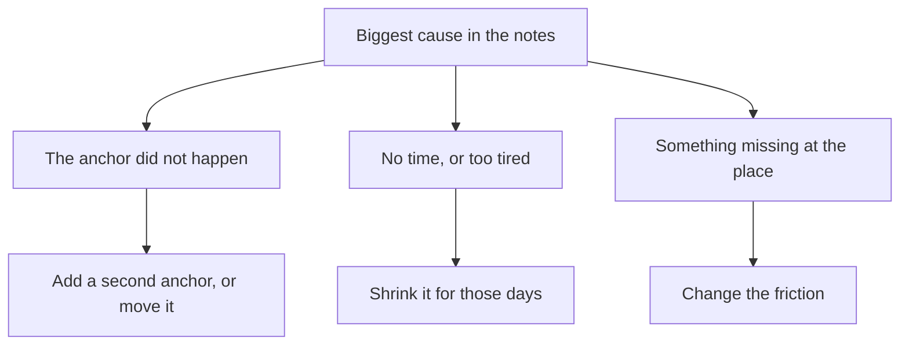

## Samir opens the card again

The next evening, Samir clears his plate, sits at the table and opens the database book. He reads his 10 pages first. Then he takes out the card and a pencil. Last night he stopped believing that his month had failed. Tonight he wants to decide what to do next.

His first idea is to change everything. He could read in the mornings instead. He could buy a new notebook for notes, read 15 pages instead of 10, and start a free online course at the same time. It all sounds like a fresh start. Then he remembers what he learned in module 6 about starting five things at once. He puts the pencil down and decides to read the card properly first.

This chapter teaches you how to read a tracker so that it tells you what to do next. You need nothing more than your card, a pencil and about 15 minutes.

## Five questions for a month of tracking

A habit review answers five questions, in order. Each one uses something you already have: the ticks, the crosses and the few words you wrote on each missed day.

The first question is **how often did I do it?** Count the days done out of the days you tracked. Then find the longest gap, the most days in a row you missed. Module 5 taught you to count both. Days done shows how strong the month was. The longest gap shows where the habit came closest to stopping, because a longer gap makes the next start harder.

The second question is **when did the misses happen?** Look for a shape. Split your days in half and count the misses in each half. If one half has many more, ask what changed between them. Then look across the week. Do the misses fall on the same day, such as Fridays? Or on the same kind of day, such as market days or exam days?

The third question is **what caused them?** Read the notes on the crosses and group them. "Power off", "no breakfast at home" and "guests stayed late" are causes. Count how many misses each cause explains. The cause with the most misses usually deserves the first change. If you have no notes, this step is much harder, which is why module 5 asked you to add a few words to every miss.

The fourth question is **keep, change or drop?** Keep the habit as it is if it is working and the misses are rare and scattered. Change one part if a clear cause explains several misses. Drop the habit, for now, if it no longer matters to you or costs more than it gives. If you change something, change one thing.

The fifth question is **how will I know if the change helped?** Decide before you start. Choose what you will count, for how long, and what result would tell you the change worked. About two weeks is often long enough to see a hint.

## Your turn first: Omar's card

From here on, the course gives you a little less help before you try, on purpose. Before you see Samir's review, try the first three questions yourself on a short card.

Omar runs his family's hardware shop. His habit: "After I lock the shop shutter at 20:00, I listen to one English podcast episode on the walk home." The episodes are saved on his phone. Here are his first 14 days. Use a pencil and paper, and answer three questions before you read on: how many days done, the longest gap, and which cause explains the most misses.

| Day | Done? | Note |
|---|---|---|
| 1 | Done | |
| 2 | Done | |
| 3 | Missed | Phone battery empty |
| 4 | Done | |
| 5 | Done | |
| 6 | Missed | Walked home with my neighbour, we talked |
| 7 | Done | |
| 8 | Missed | Phone battery empty |
| 9 | Done | |
| 10 | Done | |
| 11 | Done | |
| 12 | Missed | Power off all day, battery empty |
| 13 | Missed | Battery empty again |
| 14 | Done | |

Here is how your answers should look. Omar did the habit on 9 of 14 days. His longest gap was 2 days, days 12 and 13. Four of his five misses say "battery empty", and one says he walked home talking with his neighbour. So his biggest cause is a phone with no charge at 20:00. The walk with his neighbour is not a problem to fix; it is a pleasant evening that happens now and then.

If your counts were different, count again slowly, one row at a time. A common slip is to count the misses and forget to subtract them from 14. Another is to call the neighbour the cause because that note is the longest. Count notes, do not weigh them.

## Where this comes from

You might think an expert could simply tell you which change will work. Research suggests it is not that easy. A team of researchers led by Katy Milkman tested 54 different four-week programmes with more than 60,000 gym members. Nearly half of the programmes raised gym visits while they ran. Fewer than one in ten made a difference that could still be measured after they ended. Experts were also asked to predict which programmes would work, and they could not.

If experts could not predict which of 54 programmes would work for gym members, nobody can be sure which change will work for your habit in your home. That is not bad news. It means your own tracker is a better guide than anyone's guess. Try one change, count what happens, and let the result decide.

This is also why you change one thing at a time. If Samir changes the time, the book and the number of pages in the same month, and the month goes better, he will not know which change helped. If it goes worse, he will not know which change hurt. One change gives a clear answer. Three changes give a guess.

Two weeks is a hint, not proof. Fourteen days is a small number, and the weeks may differ in ways you did not plan: a busy work week, a visit from relatives, a new power schedule. So you look again after the next two weeks, and again at the end of the month. Each look makes the answer a little more certain.

## Step through Samir's review

You met Samir's card in chapter 7.1. Four of his seven misses say "power off, too dark", all after the power schedule changed on day 17 and the evenings went dark. Before you step through, decide what his one change should be.

```predict
prompt: "Samir's anchor is the end of the evening meal. Four of his seven misses were dark evenings after the power schedule changed. What should his one change be?"
options:
  - id: keep
    label: "Keep the anchor and fix the dark evenings"
  - id: move
    label: "Move his reading to an hour when it is light"
correctOptionId: keep
explanation: "At home with the power on, Samir read on 22 of 23 evenings, so his anchor works very well. Moving it would throw away a cue that works, to fix a problem that comes only on dark evenings. On day 22, the one dark evening when he had a lamp, he read. So the change belongs at the place: a light for the dark evenings."
```

The stepper walks through Samir's review, one question at a time. Try to say each answer before the step shows it.

<InteractiveCanvas slug="thirty-day-review" />

**What this shows:** one month read in order, from counts to one change and a two-week test.

**Try this:** at step 4, check your guess from above. At step 7, ask what Samir would learn next month if he changed three things at once.

**What changed:** at each step the question got narrower. "How did the month go?" became "will a charged lamp help on dark evenings?"

**Limits of the model:** real months can have two causes of the same size, and notes can be missing. Two weeks may hold only a few of the days you want to test, so the answer is less certain.

## How Samir chose his change

The stepper gives Samir's counts. What it moves through quickly is the choice in step 4, and that choice is the hardest part of any review. Here is the reasoning in full.

Samir looked at three possible changes for the dark evenings. He could move the anchor to after lunch, when there is daylight. But after lunch he works for clients, and his evening anchor already works on 22 of 23 ordinary evenings. He could shrink the habit on dark evenings to one page by the light of his phone. But on power-cut evenings the phone battery matters more than usual, because it may need to last until morning. Or he could change the friction: make reading in the dark easier.

His notes held a clue. On day 22 the power was off, he borrowed his sister's small lamp, and he read. On the four dark evenings without a lamp, he did not. So he chose this change: he charges a small lamp while the power is on and keeps it on the shelf next to the book. The Friday visits to his uncle explain only 2 misses, so he wrote them down for the next review.

Before he started, Samir wrote his test on the back of the card. For the next two weeks he will count the dark evenings and how many of them he still reads on. Before the change, he read on 1 of 5. If he reads on most of the dark evenings in the next two weeks, the lamp probably helped. If the two weeks bring only one or two dark evenings, he will keep counting for two more weeks before he decides.

Now go back to Omar. His biggest cause, an empty battery, is also something missing at the place. He could charge his phone at the shop counter while the power is on in the afternoon. On days when the power is off all day, that will not work. A backup that needs no phone would help then: saying yesterday's new words aloud on the walk. If he has to pick one change first, the charging plan covers most of his misses. That is the same kind of reasoning Samir used, on a different habit.

## The cause chooses the change

Samir did not pick his change because it sounded good. He picked it because of what caused the misses. The diagram shows how the kind of cause points to the kind of change.



Read it from the top. If the anchor did not happen, the fix is a second anchor for those days, as you saw in module 2, or a new anchor. Think of a fellow with no breakfast at home, and so no cup to wash. If the anchor happened but there was no time or energy, the fix is a smaller version for those days. Sometimes the anchor happened and there was time, but something was missing at the place: light, the book, or a phone with no charge. Then the fix is to change what is easy and what is hard there. Samir's dark evenings and Omar's empty battery both belong on the right side.

The diagram leaves out one decision: drop. You drop a habit when it no longer matters in your life right now, or when it costs more than it gives. Dropping is a decision, not a failure. It is not the right answer for a habit that works on 22 of 23 ordinary evenings.

## Common mistakes when reading a month

**Reading only the streak.** A broken streak hides the real count. Samir's longest run ended on day 17, but the month still had 23 days done. Count days done first, then look at the streak.

**Reading with blame.** A note that says "lazy" or "failed again" tells you nothing about what to change. A note that says "power off" or "guests until midnight" does. If your old notes are full of blame, ask yourself what was happening around you that day, and write that instead.

**Changing three things at once.** It feels like taking the habit seriously. In fact it makes the next review impossible to read. One change, tested, then the next.

**Fixing the easiest cause first.** Samir could have solved the Friday visits by taking the book to his uncle's. That is easy, but it explains only 2 misses. Start with the cause that explains the most misses, unless an easier fix for a smaller cause takes almost no effort.

**Judging too early.** Three good days after a change prove very little. Three bad days do not prove it failed. Wait for about two weeks, and look again after that.

**Dropping a working habit after one hard week.** Many good habits are dropped in a week of power cuts or visitors. Before you drop a habit, look at the ordinary days. If it works on most of them, the habit is fine; the hard days need a plan.

<Callout type="tip" title="Write the cause, not a judgement">
On a missed day, write what happened around you in a few words: "power off", "relatives came", "exam day". Next month, those words are the data for your review.
</Callout>

## Your card tonight

If you have tracked your course habit since module 2, take out your card or open your notes app tonight. Count your days done and your longest gap. Count the misses in each half. Group your notes by cause, and write the biggest cause at the bottom. You do not need to choose a change yet; the capstone will ask for that. If you have not tracked a habit, or prefer not to use your own, use a provided card. Nada's days 1 to 18 from the module 5 checklist (gate 5) work well. The steps are the same, and they take about 15 minutes.

## Check your understanding

```quiz
type: mcq
question: "Yasmin works at a phone repair counter in the market. After lunch at work, she listens to one English lesson. She missed 9 of the last 30 days: 6 notes say 'market day, no lunch break', 2 say 'earphones at home', 1 says 'ill'. She rides the bus home every evening. What should she change first?"
options:
  - "Put her earphones in her work bag each evening, so she does not forget them"
  - "On market days, listen to the lesson on the bus ride home instead"
  - "Change the anchor, the lessons and the time of day, all in one go"
  - "Drop the habit, because 9 missed days shows it is not working"
correct: 1
explanations:
  - "The earphones explain only 2 of the 9 misses. It is a sensible small fix, but the biggest cause, market days, would still cost her 6 lessons a month."
  - "Correct. Market days explain 6 of the 9 misses: on those days her anchor, a lunch break, does not happen. The bus ride happens every day, so it makes a good second anchor for market days."
  - "Three changes at once would make her next review impossible to read. If the month went better, she would not know which change helped."
  - "She did the habit on 21 of 30 days, and on ordinary days it works well. The misses come from one clear situation, which needs a plan, not an end to the habit."
```

```quiz
type: mcq
question: "Yasmin tried the bus on market days for two weeks. Before the change, she listened on 2 of 8 market days. In the two weeks there were 4 market days, and she listened on 3. Her other days stayed about the same as before. What can she say now?"
options:
  - "It worked, so she can stop counting her market days now"
  - "It did not help, since she missed one of the 4 market days"
  - "It seems to help, so she keeps it and keeps counting"
  - "She cannot tell yet, since two things changed at the same time"
correct: 2
explanations:
  - "Four market days is a small number. Two weeks gives a hint, and the next weeks may be different, so she should keep counting."
  - "She listened on 3 of 4 market days, against 2 of 8 before the change. One miss does not mean the change failed; the share of market days done went up a lot."
  - "That fits the facts. 3 of 4 market days done, against 2 of 8 before, is a good sign, and her other days stayed the same. With only 4 market days it is a hint, so she keeps the change and looks again in two weeks."
  - "She changed only one thing: where she listens on market days. Her other days stayed the same, which makes the comparison clearer."
```

**Next:** A practice check. Five fresh cases from across the course: for each one, choose which tool to use first.
