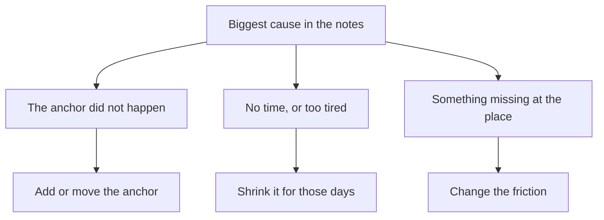

## Samir opens the card again

The next evening, Samir clears his plate, sits at the table and opens the database book. He reads his 10 pages first. Then he takes out the card and a pencil. Last night he stopped believing that his month had failed. Tonight he wants to decide what to do next.

His first idea is to change everything. He could read in the mornings instead. He could buy a new notebook for notes, read 15 pages instead of 10, and start a free online course at the same time. It all sounds like a fresh start. Then he remembers what he learned in module 6 about starting five things at once. He puts the pencil down and decides to read the card properly first.

This chapter teaches you how to read a month of tracking so that it tells you what to do next. You need nothing more than your card, a pencil and about 15 minutes.

## Five questions for 30 days

A habit review answers five questions, in order. Each one uses something you already have: the ticks, the crosses and the few words you wrote on each missed day.

The first question is **how often did I do it?** Count the days done out of 30. Then find the longest gap, the most days in a row you missed. Module 5 taught you to count both. Days done shows how strong the month was. The longest gap shows where the habit came closest to stopping, because a longer gap makes restarting harder.

The second question is **when did the misses happen?** Look for a shape. Split the month in half and count the misses in days 1 to 15 and days 16 to 30. If one half has many more, ask what changed between them. Then look across the week: do the misses fall on the same day, such as Fridays, or on the same kind of day, such as market days or exam days?

The third question is **what caused them?** Read the notes on the crosses and group them. "Power off", "no breakfast at home" and "guests stayed late" are causes. Count how many misses each cause explains. The cause with the most misses usually deserves the first change. If you have no notes, this step is much harder, which is why module 5 asked you to add a few words to every miss.

The fourth question is **keep, change or drop?** Keep the habit as it is if it is working and the misses are rare and scattered. Change one part if a clear cause explains several misses. Drop the habit, for now, if it no longer matters to you or costs more than it gives. If you change something, change one thing.

The fifth question is **how will I know if the change helped?** Decide before you start. Choose what you will count, for how long, and what result would tell you the change worked. About two weeks is often long enough to see a hint.

## Why your own data is the test

You might think an expert could simply tell you which change will work. Research suggests it is not that easy. A team of researchers led by Katy Milkman tested 54 different four-week programmes with more than 60,000 gym members. Nearly half of the programmes raised gym visits while they ran. Fewer than one in ten made a difference that could still be measured after they ended. Experts were also asked to predict which programmes would work, and they could not.

If experts could not predict which of 54 programmes would work for gym members, nobody can be sure which change will work for your habit in your home. That is not bad news. It means your own tracker is a better guide than anyone's guess. Try one change, count what happens, and let the result decide.

This is also why you change one thing at a time. If Samir changes the time, the book and the number of pages in the same month, and the month goes better, he will not know which change helped. If it goes worse, he will not know which change hurt. One change gives a clear answer. Three changes give a guess.

Two weeks is a hint, not proof. Fourteen days is a small number, and the weeks may differ in ways you did not plan: a busy work week, a visit from relatives, a new power schedule. So you look again after the next two weeks, and again at the end of the month. Each look makes the answer a little more certain.

## Step through Samir's review

Before you step through, make a guess. In the first half of the month Samir missed one day. In the second half he missed six.

```predict
prompt: "Samir missed 1 day in days 1 to 15 and 6 days in days 16 to 30. Before you step through, what do you expect his notes to show?"
options:
  - id: situation
    label: "Something in his evenings changed"
  - id: interest
    label: "He began to lose interest in reading"
correctOptionId: situation
explanation: "Four of his six later misses say 'power off, too dark', and the power schedule moved to the evenings from day 17. The other two were a Friday at his uncle's and a late client call. None of his notes says 'did not feel like it'. When one half of a month is much worse, look first for what changed around you, before you decide something changed in you."
```

The stepper below walks through Samir's review, one question at a time. Try to say each answer before the step shows it.

<InteractiveCanvas slug="thirty-day-review" />

**What this shows:** one month of tracking, read in order. Count the days done, find when the misses fell, and group the notes by cause. Then choose one change for the biggest cause, and test it for two weeks before deciding again. **Try this:** at step 3, check the guess you made above. Then look at step 7 and ask what Samir would learn next month if he changed three things at once. **What changed:** at each step the question got narrower, from "how did the month go?" to "will a charged lamp help on dark evenings?". A vague worry became one change and one count. **Limits of the model:** real months can have two causes of the same size, and notes can be missing. Two weeks may hold only a few of the days you want to test. The steps still work, but the answer is less certain.

## Samir's month, step by step

Here is the same review written out, with the reasoning at each step. Samir's card from chapter 7.1 is the data.

**How often?** He read on 23 of 30 evenings: 6, 7, 4 and 5 in the four full weeks, and 1 in the last two days. His longest run was 9 evenings, days 8 to 16. His longest gap was 2 evenings, days 17 and 18. A gap of two is short, and he restarted on day 19. So the month was strong, and his restarts worked.

**When?** Days 1 to 15: 14 done, 1 missed. Days 16 to 30: 9 done, 6 missed. Check the sum: 14 and 9 make 23 done, and 1 and 6 make 7 missed. Something made the second half harder. Across the week, two of the misses were Fridays, but the other two Fridays were done. So Friday alone is not the pattern.

**What caused them?** Samir groups his notes in a small table.

| Cause in the notes | Misses | Days | Which half |
|---|---|---|---|
| Power off after the meal, too dark | 4 | 17, 18, 24, 27 | All in the second half |
| Friday meal at his uncle's home | 2 | 7, 21 | One in each half |
| A client call ran late | 1 | 29 | Second half |
| Total | 7 | | 1 in the first half, 6 in the second |

The dark evenings explain 4 of the 7 misses, more than the other two causes together. They are also new: they began when the power schedule changed on day 17, and nothing says the schedule will change back soon. So they are likely to come again next month.

Now look at the evenings that went well. Samir was at home with the power on for 23 evenings: 30, minus 5 dark evenings, minus 2 evenings at his uncle's. He read on 22 of those 23. The only miss was the late call. So his anchor, the end of the evening meal at home, works very well. The trouble starts when the room is dark.

**Keep, change or drop?** Samir looks at three possible changes for the dark evenings. He could move the anchor to after lunch, when there is daylight. But his anchor already works on 22 of 23 ordinary evenings, and after lunch he works for clients. Moving it would throw away a cue that works. He could shrink the habit on dark evenings to one page by the light of his phone. But on power-cut evenings his phone battery matters more than usual. Or he could change the friction: make reading in the dark easier.

His notes contain a clue. On day 22 the power was off, he borrowed his sister's small lamp, and he read. On the four dark evenings without a lamp, he did not. So he chooses this change: he will charge a small lamp while the power is on and keep it on the shelf next to the book. The Friday visits explain only 2 misses, so he writes them down for the next review and leaves them for now.

**How will he know?** Before he starts, Samir writes his test on the back of the card. For the next two weeks he will count the dark evenings and how many of them he still reads on. Before the change, he read on 1 of 5 dark evenings, and that one was with a lamp. If he reads on most of the dark evenings in the next two weeks, the lamp probably helped. He will also check that his ordinary evenings stay as good as they were. If the two weeks bring only one or two dark evenings, he will keep counting for two more weeks before he decides.

## The cause chooses the change

Samir did not pick his change because it sounded good. He picked it because of what caused the misses. The diagram shows how the kind of cause points to the kind of change.



Read it from the top. If the anchor did not happen, the fix is a second anchor for those days, or a new one. Think of a fellow with no breakfast at home, and so no cup to wash. If the anchor happened but there was no time or energy, the fix is a smaller version for those days. Sometimes the anchor happened and there was time, but something was missing at the place: light, the book, or a phone in the wrong room. Then the fix is to change what is easy and what is hard there. Samir's dark evenings belong on the right side: the meal ended, he had time, but there was no light.

The diagram leaves out one decision: drop. You drop a habit when it no longer matters in your life right now, or when it costs more than it gives. Dropping is a decision, not a failure. It is not the right answer for a habit that works on 22 of 23 ordinary evenings.

## Where people go wrong

**Reading only the streak.** A broken streak hides the real count. Samir's longest run ended on day 17, but the month still had 23 days done. Count days done first, then look at the streak.

**Reading with blame.** A note that says "lazy" or "failed again" tells you nothing about what to change. A note that says "power off" or "guests until midnight" does. If your old notes are full of blame, ask yourself what was happening around you that day, and write that instead.

**Changing three things at once.** It feels like taking the habit seriously. In fact it makes the next review impossible to read. One change, tested, then the next.

**Fixing the easiest cause first.** Samir could have solved the Friday visits by taking the book to his uncle's. That is easy, but it explains only 2 misses. Start with the cause that explains the most misses, unless an easier fix for a smaller cause takes almost no effort.

**Judging too early.** Three good days after a change prove very little. Three bad days do not prove it failed. Wait for about two weeks, and look again after that.

**Dropping a working habit after one hard week.** Many good habits are dropped in a week of power cuts or visitors. Before you drop a habit, look at the ordinary days. If it works on most of them, the habit is fine; the hard days need a plan.

<Callout type="tip" title="Write the cause, not the verdict">
On a missed day, write what happened around you in a few words: "power off", "relatives came", "exam day". Next month, those words are the data for your review.
</Callout>

## Try it today

If you have tracked your course habit since module 2, take out your card or open your notes app tonight. Count your days done and your longest gap. Count the misses in each half. Group your notes by cause, and write the biggest cause at the bottom. You do not need to choose a change yet; the capstone will ask for that. If you have not tracked a habit, or prefer not to use your own, use a provided card. Nada's days 1 to 18 from gate 5 work well, and so does Samir's card from chapter 7.1. The steps are the same, and they take about 15 minutes.

## Check your understanding

```quiz
type: mcq
question: "Layla, 24, works at a tailor's shop. Her habit: after lunch at the shop, she listens to one 10-minute English lesson. Her tracker: 21 of 30 done. Notes on the 9 misses: 6 say 'market day, no lunch break, ate at my machine', 2 say 'earphones at home', 1 says 'ill'. She rides the bus home for 20 minutes every day. What should she change first?"
options:
  - "Put her earphones in her work bag each evening, so she never forgets them"
  - "On market days, listen to the lesson on the bus home instead"
  - "Change the anchor, the lessons and the time of day, all at once"
  - "Drop the habit, because 9 missed days shows it is not working"
correct: 1
explanations:
  - "The earphones explain only 2 of the 9 misses. It is a sensible small fix, but the biggest cause, market days, would still cost her 6 lessons a month."
  - "Right. Market days explain 6 of the 9 misses: the anchor, a lunch break, does not happen on those days. The bus ride happens every day and gives her 20 free minutes, so it makes a good second anchor for market days."
  - "Three changes at once would make her next review impossible to read. If the month went better, she would not know which change helped."
  - "21 of 30 is a strong month, and on ordinary days her habit works well. The misses come from one clear situation, which needs a plan, not an end to the habit."
```

```quiz
type: mcq
question: "Layla tried the bus anchor on market days for two weeks. Before, she missed 6 of 8 market days. In the 14 days after the change there were 4 market days, and she listened on the bus on 3. On the other 10 days she listened on 9, about the same as before. What can she say now?"
options:
  - "It is proven to work, so she can stop counting market days now"
  - "It failed, because she still missed one of the 4 market days"
  - "It seems to help: keep it and watch for two more weeks"
  - "She cannot tell, because she changed two things at the same time"
correct: 2
explanations:
  - "Four market days is a small number. Two weeks is a hint, not proof, and the next weeks may be different, so she should keep counting."
  - "She listened on 3 of 4 market days, against 2 of 8 before the change. One miss is not a failure; the share of market days done went up a lot."
  - "Right. 3 of 4 market days done, against 2 of 8 before, is a good sign, and her ordinary days stayed the same. With only 4 market days, it is a hint, so she keeps the change and looks again in two weeks."
  - "She changed only one thing: where she listens on market days. Her ordinary days stayed the same, which makes the comparison clearer."
```

**Next:** A mixed review. Five fresh cases from across the course: for each one, choose which tool to use first.
