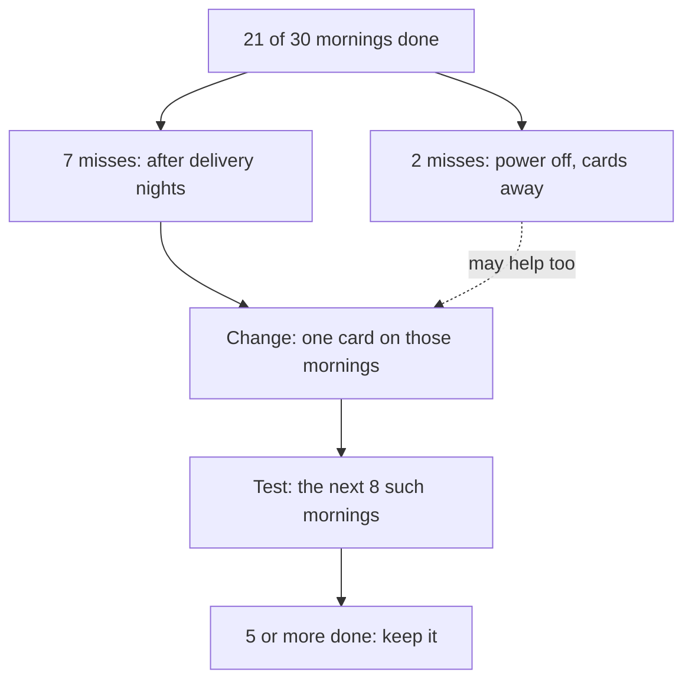

## Your turn

This is the capstone of the course. You will review one 30-day habit plan from start to finish. That means the habit, the surroundings around it, the tracker with its missed days, the restarts, and what you will do next. You will not need any new tools. You will use the tools you already have, in order, on one habit, and write down what you find.

You have two choices. You can review your own plan: the course habit you started in module 2, or any other habit you have been tracking. Or you can review one of three provided cases further down this page: Nada's vocabulary sentence, Ziad's evening walk, or Rasha's phone outside the bedroom. Each provided case has a full 30-day tracker and a short answer from an AI chat tool that makes one mistake from the course. The provided cases are there so that nobody has to share anything personal, and nobody has to wait. Choosing one is not an easier path; reading 30 days of notes carefully takes real work.

Be clear about the calendar. At the course's pace, most fellows reach this chapter with about two to three weeks of tracking, not 30 days. That is expected, and it is not a problem. Design your plan for 30 days, review the real days you have, and say how many days your review covers. A review of 18 honest days is better than a review of 30 imagined ones. Or review a provided month now. Either way, keep your plan running after the course, and send your mentor the full 30-day review later if you like.

Some months are too disrupted to show a habit forming. A move, a family duty or weeks of power cuts can leave a tracker with more crosses than ticks. That is not a reason to hide your data or to give up on the capstone. Your mentor reads the quality of your review and your restart plan, not the number of ticks. A careful review of a hard month can meet every line of the rubric.

Plan for about 90 minutes, and you do not need to finish in one sitting. Read the worked example first, then choose your habit or case, then write the five parts one at a time. When you are done, you will walk a mentor through your review in about five minutes.

## The five parts

1. **The habit:** written as a cue (an if-then plan or an anchor) and a small first step, with why this habit matters to you now.
2. **The surroundings:** what you made easier, what you made harder, and the backup and smallest versions for hard days.
3. **The tracker:** days done out of the days you tracked, the longest gap, when the misses happened, and what the notes say caused them. Say what the AI answer got wrong.
4. **The restarts:** what happened after each miss, and what helped or did not help.
5. **The decision:** keep, change or drop, with one change for the next 30 days and how you will know whether it helped.

Each part comes from a module. The habit uses modules 1 and 2: a cue, a small first step and an anchor. The surroundings use module 3, and module 4 if your habit is one you want to weaken. The tracker and the restarts use module 5. The decision uses chapter 7.2, and the daily rhythm from module 6 if your habit has to fit around other parts of your day. The order matters. If you skip the notes in part 3, your decision in part 5 becomes a guess. If you skip part 4, you miss how the habit survived its hard days.

## Worked example: Fares's morning lessons

Fares is 28. He works at his family's farm stall from 7:00, selling vegetables, and he wants to find remote bookkeeping work for small shops. Clients ask for spreadsheet skills, so he downloaded a free online spreadsheet course to his phone. Like everyone in this course, Fares is fictional. Here is the summary of his 30-day tracker.

| Days | Done | Missed days and his notes |
|---|---|---|
| 1 to 7 | 5 of 7 | Days 4 and 7: "delivery until midnight, slept again after the prayer" |
| 8 to 14 | 6 of 7 | Day 11: "delivery night, too tired". Day 14 was done: "delivery came early, slept by 22:00" |
| 15 to 21 | 3 of 7 | Days 15 and 16: "power off two days, phone empty, cards at the stall". Days 18 and 21: "delivery night" |
| 22 to 28 | 5 of 7 | Days 25 and 28: "delivery night, slept again" |
| 29 to 30 | 2 of 2 | None |

Fares asked an AI chat tool about his tracker. Here is its answer.

> Your tracker shows that mornings do not suit you: you missed 9 mornings out of 30. Move all your practice to the evening, when you have more energy, and you will see better results.

**Part 1: the habit.** Fares wrote his habit as an anchor and a small step. "After I finish the dawn prayer, I sit at the kitchen table and do one 10-minute lesson from my spreadsheet course." The prayer happens every morning at a known moment, and he is always at home for it, so it makes a strong anchor. The habit matters now. Two shop owners at the market have asked whether he can keep their accounts, and he wants to say yes by the end of the season.

**Part 2: the surroundings.** He made the habit easier in three ways. His phone charges on the kitchen table overnight. He downloads the next lesson in the evening while the power is on, and his earphones live in the table drawer. He made the unwanted choice harder: the video app sits in a folder on the last screen of his phone. His backup version, for mornings when the phone is empty, is to read his paper formula cards for 10 minutes. His smallest version is to read one formula card. There was a weak point he only saw later: the cards lived in his work bag, and the bag sometimes stayed at the stall overnight.

**Part 3: the tracker.** He did the lesson on 21 of 30 mornings: 5, 6, 3, 5 and 2 across the rows. His longest gap was 2 days, days 15 and 16. The halves were close: 11 of 15 done in days 1 to 15, and 10 of 15 in days 16 to 30. So the problem did not grow or shrink over the month. It came back every week.

The notes explain it. Twice a week, on Monday and Thursday nights, the stall takes a delivery of stock that lasts until about midnight. That gave him 8 mornings after a delivery night: days 4, 7, 11, 14, 18, 21, 25 and 28. He missed 7 of those 8. The one he did, day 14, was the night the delivery came early. His other 2 misses were days 15 and 16, when the power was off, his phone was empty, and his cards were at the stall. On every other morning, 20 of them, he did the lesson every time.

So the AI answer is wrong. It looked at the total of 9 misses and decided that mornings do not suit Fares. But his ordinary mornings were done 20 times out of 20. The misses come from one kind of morning, after a late delivery, plus two days without power. Moving all his practice to the evening would throw away an anchor that works every ordinary day, to fix a problem that affects two mornings a week.

**Part 4: the restarts.** After every delivery-night miss, Fares did the lesson the very next morning: days 5, 8, 12, 19, 22, 26 and 29. The daily anchor helped here, because the next prayer always came within a day. After the two power-cut days, he restarted on day 17, when the power came back and he brought the cards home. What did not help was the backup living in his bag. On the days he needed it, it was somewhere else.

**Part 5: the decision.** Fares keeps the habit and makes one change. On mornings after a delivery night, the smallest version counts: after the prayer he reads one formula card at the table, and then he may go back to sleep. To make that possible, the cards now live on the kitchen table, not in his bag. That is one change with one purpose: a version that fits his most tired mornings. It may also help on power-cut days, but that is not what he is testing.

He decides in advance how he will know. In the next 30 days there will be about 8 mornings after delivery nights. Before the change, he did 1 of 8. If he does at least 5 of the next 8, in any version, the change helped. He will also check that his ordinary mornings stay close to 20 out of 20. After two weeks he will have only about 4 such mornings, so he will treat that as a hint and wait for the full month.

The diagram shows Fares's review, from the count to the test.



The solid arrows are the main line of the review. The biggest cause, 7 misses after delivery nights, leads to the one change, and the change leads to a test with a number decided in advance. The dotted arrow shows a side benefit he will notice but not count: cards on the table are also there when the phone is empty. Notice what the diagram leaves out. There is no box for "move everything to the evening" and no box for "try harder". Neither one follows from the notes.

## Choosing your habit or case

If you review your own plan, you need three things. You need the habit as you wrote it, even if you changed it along the way. You need your tracker: a paper card, a notebook page or a list in a notes app. It should have a tick or a cross for each day and a few words on the misses. And you need one piece of outside advice to check, as the provided cases do. Choose either route; both count the same. You can write down one piece of popular habit advice you have heard from friends, family or social media, and check it against the course. Or, if you like, describe your tracker to an AI chat tool, using made-up names and no private details, and check its answer. The AI route is optional.

If your notes are thin, do not invent them. Say which misses have notes and which do not, and use what you remember honestly. Change any names, and leave out private details about other people in your home.

If you prefer to use a provided case, you do not need to read all 90 rows before you choose. Here is what each case is about, in one line:

- **Case 1, Nada:** a 3-minute study habit tied to her breakfast routine, in a month with four days of long power cuts.
- **Case 2, Ziad:** a 15-minute evening walk around a job whose shift sometimes runs late, with a long stop early in the month.
- **Case 3, Rasha:** weakening a late-night phone habit, in a home that often has guests at the end of the week.

Pick the one that interests you, then read its table carefully. Each AI answer makes a different mistake. Your mentor may give you a case by your learner number, for example by its last digit, so that a group works on all three. If your mentor does this, use the case you are given, or your own plan.

## Provided case 1: Nada's vocabulary sentence

You may know Nada from the gates of modules 2, 3, 5 and 6. She is 22, studies accounting and lives with her family. Her habit: "After I wash my breakfast cup, I open my English vocabulary notebook and write one sentence with a new word." It takes about 3 minutes. The notebook and a pencil live on the shelf next to the drying rack, open at today's page. Her full version is one sentence with a new word. Her smallest version, for mornings with no time or no light, is to read yesterday's sentence aloud. She tracks each day with a tick or a cross and a few words on a paper card inside the notebook.

Days 15 to 18 were four days of long power cuts, when the family often ate breakfast on the way out of the house. After day 18 she wrote a restart plan. On day 19 she would do the smallest version. From day 20 she would use a second anchor for mornings with no breakfast at home: "after I fill my water bottle". Here is her full card.

| Day | Done? | Note |
|---|---|---|
| 1 | Done | Full. First day, took 4 minutes |
| 2 | Done | Full |
| 3 | Done | Full |
| 4 | Done | Full |
| 5 | Done | Full. Nearly forgot, then saw the notebook by the rack |
| 6 | Done | Full |
| 7 | Done | Full |
| 8 | Done | Full. Started without thinking |
| 9 | Missed | Relatives came for breakfast, forgot |
| 10 | Done | Full |
| 11 | Done | Full |
| 12 | Done | Full |
| 13 | Done | Full |
| 14 | Done | Full |
| 15 | Missed | No breakfast at home |
| 16 | Done | Smallest version: no light, read yesterday's sentence aloud |
| 17 | Missed | No breakfast at home |
| 18 | Missed | No breakfast at home |
| 19 | Done | Smallest version, as in my restart plan |
| 20 | Done | Full. Second anchor ready: after I fill my water bottle |
| 21 | Done | Full. No breakfast at home, wrote after filling my water bottle |
| 22 | Done | Full. No breakfast at home again, water bottle anchor worked |
| 23 | Done | Full |
| 24 | Done | Full |
| 25 | Missed | Relatives stayed all day |
| 26 | Done | Full |
| 27 | Done | Full |
| 28 | Missed | Exam day, left at 6:30 |
| 29 | Done | Full |
| 30 | Done | Full. Easy now, it starts by itself |

Nada asked an AI chat tool what her month showed. Here is its answer.

> You missed 6 days out of 30, so this habit did not form. A habit needs 21 days in a row to become automatic. Start a new 21-day challenge tomorrow, and this time do not miss a single day.

## Provided case 2: Ziad's evening walk

Ziad is 27 and works at a print shop. His shift ends at 18:00, but on days with big print orders it runs late, sometimes until after 21:00. He wanted to move more, because he sits most of the day. His habit: "After the evening meal, I put on my shoes and walk to the end of the street and back." The walk takes about 15 minutes.

Ziad made the walk easier in two ways. His shoes wait by the front door, and his younger brother walks with him on most evenings. He did not plan a smaller version, and he had no plan for the evenings when his shift ran late. He tracked on the calendar on his bedroom wall, with a few words in the box for each day.

| Day | Done? | Note |
|---|---|---|
| 1 | Done | Home 18:30, walked with my brother |
| 2 | Done | Walked with my brother |
| 3 | Done | Walked alone, felt good |
| 4 | Missed | Big order, shift ran late, home 21:15, too tired |
| 5 | Missed | Home 18:30. Already broke it, no point |
| 6 | Missed | Home 18:30. Already broke it |
| 7 | Missed | Home 18:30. Will start again next week |
| 8 | Missed | Home 18:30. Felt bad, did not go |
| 9 | Done | Brother asked me to come, walked |
| 10 | Done | Walked with my brother |
| 11 | Missed | Big order, home 21:30, too tired |
| 12 | Done | Walked. Brother said one missed day is fine |
| 13 | Done | Walked |
| 14 | Done | Walked, the rain stopped just in time |
| 15 | Done | Walked |
| 16 | Done | Walked alone |
| 17 | Done | Walked |
| 18 | Missed | Big order, home 21:00, too tired |
| 19 | Done | Walked |
| 20 | Done | Walked, easier to start now |
| 21 | Missed | Big order, home 21:45 |
| 22 | Done | Walked |
| 23 | Done | Walked |
| 24 | Done | Walked |
| 25 | Missed | Big order, home 21:15, ate and slept |
| 26 | Done | Walked |
| 27 | Done | Walked |
| 28 | Done | Walked with my brother |
| 29 | Missed | Big order, home 21:30 |
| 30 | Done | Walked |

Ziad asked an AI chat tool why he kept missing walks. Here is its answer.

> You are missing walks because you lack willpower and discipline. Tell yourself every evening that you will walk no matter how tired you are. With stronger willpower, you will stop making excuses.

## Provided case 3: Rasha's phone outside the bedroom

Rasha is 25 and works as a teaching assistant at a primary school from 7:30. For months she watched series episodes on her phone in bed until 1:00 or later, and she went to school tired. This month she worked on weakening that habit. Her plan: "At 23:00, I plug my phone into the charger in the kitchen and leave it there until morning." She moved the charger to the kitchen, so the phone has a home outside her room. She keeps a small battery radio by her bed and listens quietly for a few minutes when she wants to wind down. Her backup, for a work message late at night, is to reply in the kitchen and leave the phone there.

A night is "done" when the phone stayed in the kitchen all night. Rasha lives with her parents, her brothers and her sister, who shares her room. The family often has guests on Thursday and Friday nights. She tracked on a card stuck to the fridge.

| Night | Done? | Note |
|---|---|---|
| 1 | Done | Phone in the kitchen at 23:00, radio for ten minutes, slept at 23:40 |
| 2 | Missed | Talking with my sister at 23:00, forgot the kitchen, watched until 1:00 |
| 3 | Done | Plugged it in on my way to brush my teeth |
| 4 | Done | Kitchen at 23:00, listened to the radio |
| 5 | Done | Kitchen at 23:00 |
| 6 | Missed | Thursday, guests until 00:30, phone in my hand, took it to bed |
| 7 | Missed | Friday, guests until 1:00, watched until 2:00 |
| 8 | Done | Kitchen at 23:00 |
| 9 | Done | Kitchen at 23:00, less tired at school |
| 10 | Done | Kitchen at 23:00 |
| 11 | Done | Kitchen at 23:00 |
| 12 | Done | Kitchen at 23:00 |
| 13 | Missed | Thursday, guests until midnight, phone came to bed |
| 14 | Missed | Friday, guests until 00:30 |
| 15 | Done | Kitchen at 23:00 |
| 16 | Missed | Work message at 23:20, replied in bed, kept watching |
| 17 | Done | Kitchen at 23:00 |
| 18 | Done | Kitchen at 23:00 |
| 19 | Done | Kitchen at 23:00, did not even think about it |
| 20 | Done | Thursday, no guests, kitchen at 23:00 |
| 21 | Missed | Friday, guests until 00:30 |
| 22 | Done | Kitchen at 23:00 |
| 23 | Done | Kitchen at 23:00 |
| 24 | Done | Kitchen at 23:00 |
| 25 | Done | Kitchen at 23:00 |
| 26 | Done | Kitchen at 23:00 |
| 27 | Missed | Thursday, guests until 1:00 |
| 28 | Done | Friday, guests until 00:30. Put the phone in the kitchen at 23:00 anyway, sat with them without it |
| 29 | Done | Kitchen at 23:00 |
| 30 | Done | Kitchen at 23:00 |

Rasha asked an AI chat tool what to do about the nights she missed. Here is its answer.

> Your phone is clearly too strong for you. Delete every app except calls, and use your willpower to stay off it at night. If you really wanted to stop, you would.

For every provided case, the tracker is complete and the notes are honest. The mistake in each AI answer is in the reasoning, not in the numbers. Your job in part 3 is to name the mistake and to show, with the tracker, what the data really points to. Count carefully, and check every count twice.

## How your mentor will read it

Your mentor uses the table below, one line for each part, with three levels on each line. They are not looking for perfect English. They are looking for evidence that you used each tool. Two different reviews of the same case can both be Met, as long as each claim is backed by the tracker.

| Part | Met | Partly | Not yet |
|---|---|---|---|
| 1. The habit | A moment you could point to, a first action someone could watch, and one reason it matters now | One of the three is missing or vague, such as "in the evening" | No cue, or a goal instead of a habit |
| 2. The surroundings | What was made easier or harder, or what was missing, plus a backup or smallest version (or one you would add) | Only one of these two | Nothing about the surroundings |
| 3. The tracker | Days done, longest gap and a count for each cause from the notes; the AI's mistake with one number that shows it | Counts given, but one cause has no count, or the AI's mistake has no number | No counts, or agrees with the AI |
| 4. The restarts | What happened the day after at least two misses or kinds of miss, and one thing that helped or did not | Restarts described only in general, with no days | Nothing about restarts |
| 5. The decision | A decision backed by a number; one change; what to count, for how long, and what result means it helped | A reasoned decision, but two or more changes, or no test | No decision, or none linked to the data |

**Pass rule:** parts 3 and 5 must be Met, and no part can be Not yet.

A provided case may have nothing that was made harder, as in Nada's and Ziad's months. Then say what was made easier, what was missing, and what you would add; that meets part 2. A month that was too disrupted is read the same way as any other. If your tracker shows 9 days done out of 30, part 3 can still be Met: honest counts, the causes from your notes, and the longest gap. Parts 4 and 5 are then about your restart plan: a smallest version that fits your hardest days, the cue you will restart at, and one change you will test. Your mentor is checking how well you read and plan, not how good your month was.

For your own plan, your mentor cannot check your card. So say where each number comes from: "from my paper card", "from my notes app", "my notes on days 12 to 14 are missing, so this part is from memory". A count that names its source can meet part 3.

## Your five-minute walk-through

After your mentor reads your review, you will talk them through it in about five minutes, about one minute for each part. Your mentor will then ask some of these questions. Prepare a short answer to each one before you meet. The right column shows what a good answer does.

| Defence question | A good answer |
|---|---|
| What caused most of your missed days, and how do you know? | Names the cause and its count from the notes, such as "7 of my 9 misses say delivery night" |
| What did you change after a miss? | Says what happened on the next day, and what made the restart easier or harder |
| Why is your next change one change, not three? | Explains that one change lets the next review show whether it helped |
| What will your hardest-day version be next month? | Describes a smallest version that fits the worst day, and the cue it starts from |

The questions are not traps. They are the questions a careful mentor, manager or client asks before they trust a plan. If you cannot answer one yet, it tells you which part of your review to strengthen.

If your review does not pass yet, your mentor replies with one or two short questions about the weakest part. You answer them in writing, and you may add a voice note as an extra. Your mentor then reads that part again. One round of questions is normal. It is part of the work, not a failure.

## Submit your plan and review

Write the five parts in order, with a number or a short heading for each. Write your answer in plain English. Short sentences are fine. You may add a voice note link as an extra.

```openquestion
prompt: "Your 30-day plan and review: your own plan (say how many days you tracked) or provided case 1, 2 or 3 (say which). Check that your answer has all five parts, in order. 1. The habit: the cue, the small first step, and why it matters now. 2. The surroundings: what was made easier or harder, or what was missing, and the backup and smallest versions. 3. The tracker: days done, the longest gap, a count for each cause from the notes, and what the AI answer or popular advice got wrong. 4. The restarts: what happened after the misses, and what helped or did not. 5. The decision: keep, change or drop, one change, and how you will know whether it helped (what to count, for how long, and what result would mean it worked)."
required: true
minWords: 250
allowSpeechInput: true
allowUrl: true
urlRequired: false
urlLabel: "Voice note link (optional)"
urlHint: "An audio link your mentor can open without signing in. Audio only is fine."
modelAnswer: "Mentor key for the provided cases. Case 1, Nada: 24 of 30 done, 2 of them the smallest version (days 16 and 19); 6 misses (days 9, 15, 17, 18, 25, 28); longest gap 2 days (17 and 18). Halves: 13 of 15 in days 1 to 15, 11 of 15 in days 16 to 30. Pattern: 3 misses when the anchor disappeared, 'no breakfast at home' (days 15, 17, 18, all in the four days of long power cuts, days 15 to 18); 2 with relatives visiting (9, 25); 1 on an exam day (28). After the second anchor from day 20, no 'no breakfast' misses, and days 21 and 22 show it working. Restarts: the next day after day 9; the smallest version on day 16; the restart plan on day 19. The AI's mistake: the 21-day myth and the idea that misses mean failure and a reset. Missing one day did not undo progress in research, 24 of 30 is a strong month, and starting over would throw away a second anchor that works. Part 2 for Nada: nothing was made harder; accept 'what was made easier and what was missing' as Met. Accept: keep the habit and the second anchor, with one change for visit days or exam days (for example, the smallest version when relatives come), or growing the habit a little because it now starts by itself, if it is one change with a test. Not accept: start again, drop the habit, or several changes at once. Case 2, Ziad: 20 of 30 done; 10 misses; longest gap 5 days (days 4 to 8). Two causes: every late-shift day was missed, 6 of 6 (days 4, 11, 18, 21, 25, 29); and 4 misses on ordinary days, home at 18:30, right after his first miss (days 5 to 8, 'already broke it'). On all other ordinary days he walked: 20 of 24 ordinary days, every one from day 9 on. Restarts: after day 4 he stopped for four days until his brother asked him on day 9; after every later miss he walked the next day (days 12, 19, 22, 26, 30). His brother and the thought 'one missed day is fine' helped; all-or-nothing thinking did not. The AI's mistake: blaming willpower. The notes show a situation (late shifts) and a thinking trap after a slip; promising to walk no matter how tired fixes neither. Part 2 for Ziad: nothing was made harder; accept the shoes, his brother and the missing smallest version as Met. Accept: keep the walk, with one change for late-shift days, such as a smallest version (to the corner and back after the late meal) or an if-then plan for late shifts, tested on the next late-shift days (before: 0 of 6). Also accept a written rule to restart at the next cue if the learner argues the 5-day gap was the costliest pattern and notes he already restarted the next day from day 11 on. Not accept: more willpower, dropping the walk, or changing his shifts. Case 3, Rasha: 22 of 30 nights done; 8 misses; longest gap 2 nights (6 and 7, and 13 and 14). Causes: guest nights, 6 misses (6, 7, 13, 14, 21, 27) out of 7 guest nights; on night 28 she put the phone in the kitchen at 23:00 anyway and it worked. Forgetting, 1 (night 2); from night 3 she plugged it in on her way to brush her teeth. A work message, 1 (night 16). On the 22 nights that are not a Thursday or a Friday, the plan worked 20 times. The AI's mistake: willpower and deleting every app. Her plan to remove the cue already works on most nights; the misses come from one situation, and deleting every app would also remove what she needs for work. Accept: keep the kitchen charger, with one change for guest nights, such as 'if guests are here at 23:00, I put the phone in the kitchen as usual and sit with them without it', or 'when the guests leave, the phone goes to the kitchen before I go to my room', tested on the next 6 to 8 guest nights (before: 1 of 7). Not accept: willpower, deleting everything, or several changes at once. For a learner's own plan: expect about two to three weeks of data at the course's pace; read days done out of the days tracked, and look for counts with a named source. A disrupted month passes on the quality of the review and the restart plan. Rubric. Part 1, the habit. Met: a moment you could point to, a first action someone could watch, and one reason it matters now. Partly: one of the three missing or vague. Not yet: no cue, or a goal instead of a habit. Part 2, the surroundings. Met: what was made easier or harder, or what was missing, plus a backup or smallest version (or one the learner would add). Partly: only one of these two. Not yet: nothing about the surroundings. Part 3, the tracker. Met: days done, longest gap and a count for each cause from the notes, and the AI's mistake with one number that shows it. Partly: counts given, but one cause has no count, or the AI's mistake has no number. Not yet: no counts, or agrees with the AI. Part 4, the restarts. Met: what happened the day after at least two misses or kinds of miss, and one thing that helped or did not. Partly: restarts only in general, with no days. Not yet: nothing about restarts. Part 5, the decision. Met: a decision backed by a number from the tracker, exactly one change, and what to count, for how long, and what result means it helped. Partly: a reasoned decision, but two or more changes, or no test. Not yet: no decision, or none linked to the data. Pass rule: parts 3 and 5 Met, and no part Not yet. Follow-up: one or two questions about the weakest part; the learner answers in writing. Model answer for a different case. 1. Ola works at a clinic desk until 14:00 on most days. Habit: 'After I take off my work shoes at home, I put my phone on the high shelf and study my nursing notes for 20 minutes.' It matters because her certificate exam is in four months. 2. Easier: the notes stay open on the table from the morning. Harder: the phone goes on the high shelf. Backup: printed notes by the window if the power is off. Smallest: read one page of notes. 3. 19 of 30 done; longest gap 3 days (days 12 to 14, my son had a fever and I stayed with him). 8 misses on the 8 days I worked the long shift until 17:00 and came home tired. On every other day, 19 of 19, I studied. The AI told me to study at 5:00 before work instead. That is wrong: my anchor works every ordinary day, and the misses come from one kind of day. 4. After each long shift I studied the next day. After the 3-day gap I restarted on day 15 with the smallest version, then the full block on day 16. The phone on the shelf helped; nothing helped on long-shift days. 5. Keep, with one change: on long-shift days, one page of notes after I take off my shoes counts. Before: 0 of 8 long-shift days done. If I do 5 or more of the next 8, the change helped. I will look after two weeks, about 4 long-shift days, as a hint, and decide at the end of the month."
```

**Next:** The course checklist, your habit toolkit, a look back at the habit you described in module 1, and your plan for the next 30 days.
