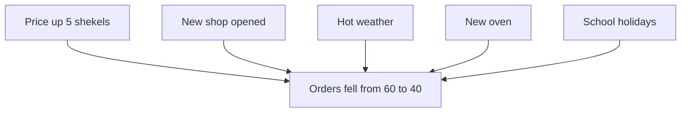

<BigWordAlert term="Cause" plainEnglish="Something that makes another thing happen, or makes it more likely to happen." whyItMatters="If you act on the wrong cause, you spend time and money and the problem stays. Finding the real causes is the first step to fixing anything." />

## Twenty missing orders

Huda runs a small bakery from her home kitchen. She makes birthday cakes, date biscuits and trays of sweet pastries. Customers order by message, and her son delivers the orders on foot around the neighbourhood. This story takes place last summer. Huda, her family and every case in this course are made up, but the problem is a very common one.

Huda writes every order in a notebook: the date, the customer, what they ordered and the price. In a normal month she gets about 60 orders. Last month she got 40. That is 20 orders fewer, a drop of one third. For a small home business, that is a lot of lost income, and Huda is worried.

On Friday evening the family sits together, and Huda shows them the notebook. She asks one simple question: "Why did this happen?" Within ten minutes she has five answers. Each one comes from a different person, and each person is sure.

## Five people, five causes

Her mother speaks first. "It is your prices. You raised the birthday cake from 45 to 50 shekels at the start of the month. People noticed." Her mother has always felt that Huda charges too much, so this answer feels right to her.

Her brother Khaled shakes his head. "No. It is the new bakery on the main road. It opened a few weeks ago. It has a big sign and a nice window, and your customers walk past it every day."

Her husband Omar points at the window. "It is the heat. Nobody wants cake when it is this hot. People want cold drinks, not cream." He is wiping his face as he says it, and everyone laughs.

Her daughter Lina is quieter. "I think it is the new oven," she says. "You bought it at the end of the first week. Since then, some cakes have come out a little dry. I did not want to say it before." Huda is surprised, and a little hurt.

Finally, their neighbour Samira, who has come for tea, adds her view. "School is out. When school is open, teachers order cakes for class parties. Now there are no class parties." Samira's son is a teacher, so she knows this world well.

## Why every answer sounds right

Look closely at the five answers. Each person picked one cause, and each cause is a real event. The price did go up. The new shop did open. The weather is hot. The oven is new. The school holidays did start. All of these things happened at about the same time as the drop, so each answer fits the facts, at least at first look.

Each person also picked the cause that is closest to their own life. Her mother worries about money. Khaled walks past the new shop every day. Omar feels the heat. Lina eats the cakes. Samira hears about schools from her son. People notice the causes they already know about. That is normal, and it is one reason why one person's answer is rarely the whole story.

The family argument has a bigger problem. Everyone talks about which cause is the right one, as if there can only be one. Nobody asks whether two or three causes worked together. Nobody asks how big each cause is. And nobody opens the notebook to check.

There is one more idea hidden in the argument. A coincidence is when two things happen at about the same time, with no link between them. Some of the five events may be coincidences: they happened in the same month as the drop, but did nothing to cause it. Telling a real cause from a coincidence is one of the main skills in this course.

Before you read on, make a guess about the first answer.

```predict
prompt: "Huda's mother says the price rise caused the drop. Suppose Huda puts the cake price back to 45 shekels. Will her orders go back to 60 a month?"
options:
  - id: not-sure
    label: "Maybe not, other causes may be at work"
  - id: yes
    label: "Yes, the price went up just before the drop"
correctOptionId: not-sure
explanation: "If several causes worked together, undoing one of them brings back only part of what was lost. And the price rising just before the drop does not prove that it caused the drop. You will learn to check both ideas in this module."
```

## What a wrong guess costs

This is not only a family argument. Each answer leads to a different action, and each action has a cost. If Huda believes her mother, she lowers the price. In this example she sells about 30 birthday cakes a month. Taking 5 shekels off each one means giving up 30 x 5 = 150 shekels a month. If the price was not the main cause, she loses that money and the orders stay low.

If she believes Khaled, she might spend money on a sign or on adverts to fight the new shop. If she believes Omar, she might do nothing and wait for cooler weather. If she believes Lina, she will learn to use the new oven properly. If she believes Samira, she might look for new customers to replace the school orders during the summer. Five causes lead to five different plans, and only some of them will help.

This is the main reason to care about causes. A fix is only as good as the cause it is aimed at. When you aim at the wrong cause, you lose in two ways. You lose what you spent on the fix that does not work. And the real problem keeps going, week after week.

## The same problem at work

You will meet Huda's problem again and again at work, with different names. A client's online shop gets fewer visitors this month, and the client is sure it is because of the new logo. An app starts crashing more often, and a teammate is sure it is the last update. A small NGO (a group that works for a social cause, not for profit) gets fewer volunteers, and the manager is sure it is the new sign-up form.

In each case, someone offers one cause quickly and with confidence. Sometimes they are right. Often they have found only one cause out of several, or a thing that simply happened at the same time. If you are the person who asks "how do we know?" and "what else changed?", you become very useful to a client or a team. You can stop a team from spending a week on the wrong fix.

This module gives you a few simple habits for that moment. You do not need statistics or special tools. You need a pen, the facts you can find, and the patience to ask a few more questions before you choose.

## A picture of the argument

The diagram shows the family's five answers as five arrows into one box. Each arrow says "this caused that". Notice that each person drew only one arrow, and nobody drew an arrow between two causes.



The picture raises three questions that the family did not ask. First, which of these arrows are real causes, and which are only things that happened at the same time? Second, how big is each arrow: does it explain 1 missing order, or 12? Third, are some causes linked to each other, so that one only matters because of another? By the end of this module, you will be able to ask all three about a problem like Huda's.

## What Huda does next

Huda does not choose a side that evening. She thanks everyone, and after they leave she opens her notebook again. She decides to look at three things. Which customers ordered less this month? When in the month did the drop start? And what do customers say when she asks them kindly?

That small decision is the main habit of this course. Huda moves from "who has the best story?" to "what does the evidence show?" In the next chapters you will follow her. You will see that the answer is not one cause but a few, each with its own size. You will also see that at least one of the family's guesses does not fit the facts at all.

## What you will practice

<LearningObjectives items={["Draw a chain of causes from a problem back to where it started", "Tell a direct cause from a contributing cause", "List several possible causes before you choose one", "Explain why 'it came first' is not proof that it was the cause", "Draw a cause chain for a problem you have seen"]} />

## Key words

| Word | Plain English |
|---|---|
| **Effect** | What happens because of a cause |
| **Cause chain** | Causes linked in order, each one leading to the next, ending at the problem |
| **Direct cause** | The last link before the effect: what made it happen right then |
| **Contributing cause** | A cause that helped the problem happen but was not enough on its own |

## What is in this module

| Chapter | You will practice |
|---|---|
| 1.2 | Drawing a chain of causes, and telling a direct cause from a contributing one |
| 1.3 | Listing several causes before you choose, and seeing how big each one is |
| 1.4 | Asking for more evidence than "it came first" |
| 1.5 | Drawing a cause chain for a problem you have seen, or for a provided case |

Each chapter starts with a case, shows the method working on it step by step, and then shows where the method goes wrong. The questions at the end use new cases, so you practice the idea and not only the story. Take your time with the worked examples. They matter more than the definitions.


**Next:** Huda draws her first cause chain, and finds out what a direct cause is.
