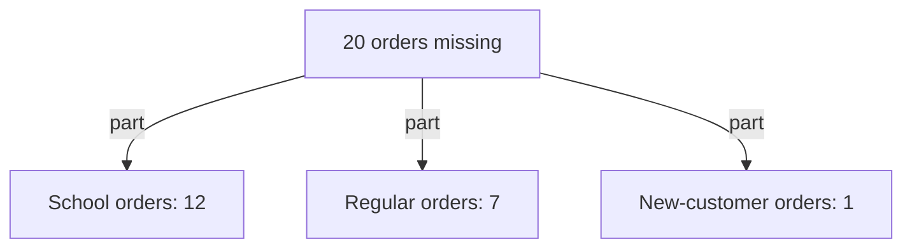

## "The new oven did it"

Lina's guess from chapter 1.1 stayed with Huda. Some cakes did come out dry. But "the new oven caused the drop in orders" is a big jump. An oven does not stop people from ordering. Something must happen in between: the oven does something, that leads to something else, and only at the end do the orders fall.

When someone says "A caused B", it is worth asking: "How, exactly?" The answer is usually a chain of smaller steps. In this chapter you learn to draw that chain, starting from the problem and working back. You also learn to use the two kinds of link from the key words in chapter 1.1: the direct cause and the contributing causes. By the end, you will be able to draw a chain for Huda's bakery and decide where to stop.

## The idea in plain words

In chapter 1.1, the meaning of "cause" had the words "more likely" in it. That matters. In work and daily life, most causes raise the chance of something. They do not make it certain. A dry cake makes a customer less likely to order again. It does not mean that every customer stops.

A cause chain is built in a fixed order. You start with the problem, written exactly, with numbers if you have them. If the problem has several parts, you split it into those parts first. Then, for each part, you ask: "What made this happen directly?" You write the answer above it, with an arrow pointing down. Then you ask the same question about that answer, and you keep going. Each arrow means "this led to that".

Remember the two kinds of link from chapter 1.1. The direct cause sits right before the problem. Contributing causes help, but none of them is enough alone. This chapter shows what they look like in a real chain. Often two contributing causes meet. Neither one alone would have caused the problem, but together they did.

The last idea is where to stop. You could keep asking "why?" forever. A useful rule is to stop at a cause you can act on: something you, your team or your client can actually change. Going further back usually leads to things nobody can change, like the time of year or a choice made years ago.

## Step through Huda's chain

Before you read the chain in writing, step through it. One question matters most in this chapter, so commit to an answer first. Some of Huda's cakes came out dry after she got a new oven, and her daughter Lina blames the oven.

```predict
prompt: "Huda's old oven never made dry cakes with the same recipe and baking times. Lina says the new oven is the whole cause of the dry cakes. Is she right?"
options:
  - id: alone
    label: "Yes, the cakes were fine until the oven changed"
  - id: together
    label: "No, the oven and the old times worked together"
correctOptionId: together
explanation: "The new oven is hotter, but a hotter oven with shorter baking times makes good cakes. The old baking times were fine in the old oven. The dry cakes needed both: a hotter oven and unchanged times. Each is a contributing cause."
```

The stepper below follows the two biggest parts of the drop back to their causes. Try to say the next cause before each step shows it. Step 7 shows whether your prediction was right.

<InteractiveCanvas slug="huda-order-drop-chain" />

**What this shows:** the two biggest parts of Huda's drop, the school orders and the regular orders, each traced back to its causes, with the evidence for every arrow. **Try this:** at step 3, Huda stops at a cause she cannot change; ask what she can still do about it. **What changed:** at each step the cause moved further from the missing orders and closer to something Huda can check. At step 7 a second cause joined the hot oven: the old baking times. **Limits of the model:** it shows only 16 of the 20 missing orders. The price, the customer who was away and the one unknown order are left out.

## The chain in writing, with its evidence

**Step 1: write the effect exactly.** Huda does not write "business is bad". She writes: "Last month I got 40 orders. A normal month is about 60. So 20 orders are missing." Writing the number down matters. It tells her what the chain must explain: 20 orders, not "fewer customers" in general.

**Step 2: break the effect into parts.** Huda goes through the notebook and sorts the orders into three groups she already uses. In this example, a normal month brings about 12 orders from teachers for class parties, about 40 from regular customers, and about 8 from new customers. Last month brought 0 from teachers, 33 from regulars and 7 from new customers. She checks both sums: 12 + 40 + 8 = 60, and 0 + 33 + 7 = 40.

These groups are not causes yet. They are the parts of the effect: they show where the 20 orders went missing. Twelve school orders are missing. Seven regular orders are missing. One new-customer order is missing. That is 12 + 7 + 1 = 20, which matches the effect. Already the problem looks different. It is not "the bakery lost its customers". It is two or three smaller problems, each with its own size, and each needs its own chain of causes.

The diagram shows the split. None of the three boxes is a cause. Each one is a piece of the effect, with its size.



The sizes tell Huda where to dig first. The school part and the regular part hold 19 of the 20 missing orders between them. A chain that explained only the one missing new customer would explain almost nothing, however carefully it was drawn.

**Step 3: find the direct cause of each part.** The school part is easy. There were no class parties, because schools closed for the summer holidays at the start of the month. That is the direct cause of the 12 missing school orders. It is not a guess. The school calendar shows it, and the teachers who usually order told Huda they would order again in the autumn.

The regular part needs more work. Huda messages each regular customer who ordered less and asks politely whether anything was wrong. Four of them say, kindly, that their last cake was a bit dry. Two say the new price is a little high for them now. One was away visiting family. Four plus two plus one is seven, which matches the seven missing regular orders. So this part has three direct causes: dry cakes, the higher price and a customer who was away. The one missing new-customer order has no known cause yet.

**Step 4: follow the longest branch further.** Why were the cakes dry? The new oven arrived at the end of the first week. Huda puts a cheap oven thermometer inside it. In this example, it runs about 20 degrees Celsius hotter than the dial says. She kept using her old baking times. A cake that was perfect in the old oven stays the same time in a hotter oven, and comes out dry.

Here two contributing causes meet, as the stepper showed.

The hotter oven alone would not make dry cakes if Huda had shortened the baking time. The old baking times alone made good cakes for years in the old oven. Together, they made dry cakes. So Lina's answer ("it is the oven") is half of the picture. Someone who said "Huda got careless" would also have only half of it, and would have blamed a person instead of a process.

**Step 5: decide where to stop.** Huda can act on the baking time today. She can test the new oven, write down new times, and bake a test cake before each big order. She cannot act on the school calendar. But she can act on what follows from it: next summer she can plan for the missing school orders, for example with trays for family gatherings. The chain shows her where her actions will work and where they will not.

## Where chains go wrong

**Jumping links.** "The new shop took my customers" is one arrow that hides many steps. Did customers see the shop? Did they try it? Did they like it more? Each step is a claim that can be checked. When a link feels like a jump, ask "how, exactly?" and write the steps in between. If you cannot fill them in, the link is still a guess.

**Guesses that look like facts.** On paper, a guessed arrow and a checked arrow look the same. So mark each one. Huda writes "checked" next to the arrows with evidence and "guess" next to the others. Then she knows which arrows to check next, and anyone who reads her chain knows how far to trust it.

**Stopping at a symptom.** "Customers stopped ordering" is true, but it is not a cause you can act on. It describes the problem again in other words. Keep going until you reach something that you, or someone you can talk to, can change.

**Going too far back.** "If Huda had never bought a new oven" or "if schools did not have holidays" may be true, but they are not useful. Nobody can act on them now. A useful place to stop is usually the first cause you can act on and check.

**One chain only.** Huda's problem has at least two branches. If she had followed only the oven branch, she would fix the cakes and then be confused when orders stayed well below 60 all summer. Always ask: "Does this chain explain the whole effect, or only part of it?" The numbers help here. Four orders from the oven branch cannot explain a drop of 20.

## Check your understanding

```quiz
type: mcq
question: "Yasmin teaches English online from her flat. Her Tuesday class started 15 minutes late, because her laptop restarted to install an update just before class. Weeks ago, she switched off the reminders that warn her about updates. Which is a contributing cause, not the direct cause?"
options:
  - "She switched off the update reminders weeks ago"
  - "The laptop was installing an update at class time"
  - "Her students joined the online class on time"
  - "The 15 minutes her students spent waiting"
correct: 0
explanations:
  - "Right. Switching off the reminders helped the problem happen, because she was not warned. On its own it did not delay the class; the update at class time did."
  - "This is the direct cause: the last link before the late start. The question asks for a cause further back that helped it happen."
  - "This is true, but it did not help cause the late start. Students joining on time is not part of the chain."
  - "The students waiting is part of the effect, not a cause. It describes the late start again in other words."
```

```quiz
type: mcq
question: "Karim's team of three, at a furniture shop's office, sends a client a sales report every Friday at noon. It has been late for three weeks. The numbers arrive late because a teammate copies them by hand from five shop files on Friday morning. Which link can the team act on themselves?"
options:
  - "The client wants the report every Friday at noon"
  - "The report has been late for three weeks now"
  - "Friday mornings are busy for everyone at work"
  - "Numbers are copied by hand on Friday morning"
correct: 3
explanations:
  - "The deadline is the client's choice. The team could ask to change it, but it is not a step they control on their own."
  - "This is the symptom, the problem itself. It describes what went wrong, not a cause the team can change."
  - "This is vague and is not a link in Karim's chain. A useful stopping point is a specific step the team can change."
  - "Right. Copying by hand on the same morning is a step in the team's own process. They can start earlier, or find a faster way to collect the numbers."
```


**Next:** Huda's mother still says it was the price. Why blaming one cause is a trap, and how to list causes before you choose.
