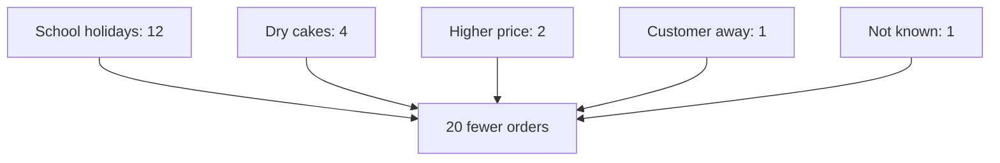

<BigWordAlert term="Single-cause trap" plainEnglish="The habit of blaming one cause when several causes worked together." whyItMatters="If you fix one small cause out of several, the problem only gets a little better, and you may wrongly decide that fixing things does not work." />

## "Just lower the price"

Huda's mother has not changed her mind. On Saturday she calls again. "I keep telling you. Put the cake back to 45 shekels and they will all come back." She sounds sure, and she is Huda's mother, so it is hard to argue.

Huda now has more facts than her mother does. From the chain in chapter 1.2, she knows that 20 orders are missing. She knows that 12 of them were school orders, lost to the summer holidays. She knows that only two of the seven regular customers who ordered less mentioned the price. If she lowers the price, she gives up about 150 shekels a month to win back, at most, two orders.

Her mother has fallen into a very common trap. She found one real cause and treated it as the whole answer. This chapter is about that trap: why it is so tempting, and the simple habit that protects you from it.

## The idea in plain words

Most outcomes have several causes working together. A shop loses customers for more than one reason. A project is late for more than one reason. Experts who study accidents and failures say they are seldom the result of a single root cause. Treating a small cause as the main cause is a kind of <GlossaryTerm term="oversimplification" definition="Making something sound simpler than it really is, by leaving out important parts." />.

So why do we keep looking for one cause? Because one cause makes a simple story. It is easy to tell, easy to remember, and it points to one clear fix. It also feels good to be the person who found "the answer". And once we have named a cause out loud, we tend to defend it, even when new facts arrive.

The protection is a habit: list before you choose. Before you decide what caused something, write down every possible cause you can think of, check each one, and see how much of the problem each one explains. Only then do you choose where to act. Often you will act on more than one cause.

## Listing before choosing: six steps

**Step 1: write the effect with its size.** "20 orders fewer than a normal month" is better than "orders fell". The size tells you when your list of causes is complete: the causes you find should add up to roughly the whole effect.

**Step 2: collect every possible cause, without arguing.** Ask everyone, and write down every answer, including ones you think are wrong. Huda's list has the five family guesses (price, new shop, heat, oven, holidays) plus what she learned from customers (one was away visiting family). Arguing comes later. At this step, a longer list is better.

**Step 3: for each cause, write what evidence would show it.** If the heat is a cause, home orders should be lower on the hottest days. They should also be lower than in other hot summers. If the new shop is a cause, then some customers should mention it, and the drop should start after it opened. Writing this down turns a feeling into something you can check.

**Step 4: check the evidence and give each cause a size.** Look in your notebook, your messages, your records. For each cause, estimate how much of the effect it explains, in the same units as the effect.

**Step 5: look for causes that work together.** Some causes only matter because of another one. The dry cakes needed both a hotter oven and the old baking times. Note these pairs, because fixing either half may be enough.

**Step 6: choose where to act.** Start with the biggest cause you can act on. Then look at the smaller ones that are cheap to fix. Leave causes with no evidence on the list, marked "not shown", in case new facts appear.

## Step through Huda's checks

Huda now does the six steps at the kitchen table, one cause at a time. Before you watch her, make a guess about one of the family's causes. Her husband Omar said the heat was to blame. Huda has her notebook from the summer before, which was just as hot.

```predict
prompt: "Omar says the heat is a cause of the drop. Huda opens her notebook for the summer before, which was just as hot. What do you expect it shows about her home orders that summer?"
options:
  - id: fell
    label: "They fell that summer, as they did this one"
  - id: steady
    label: "They held steady that summer"
correctOptionId: steady
explanation: "In this example her home orders did not fall the summer before, even though it was just as hot. If heat cut her orders, it should have cut them then too. So the heat shows no sign of being a cause this time."
```

The stepper below follows Huda as she checks each cause against her records, her customers and her oven. Watch the count of explained orders under each step. Step 6 shows whether your prediction was right.

<InteractiveCanvas slug="huda-causes-add-up" />

**What this shows:** each cause on Huda's list checked against evidence, with a running count of how many of the 20 missing orders it explains. **Try this:** at step 8, compare the biggest cause with the price. Which fix would win back more orders? **What changed:** the count grew from 0 to 12 with the holidays, to 16 with the dry cakes and to 19 with the price and the trip. The heat and the new shop added nothing, because no evidence supports them yet. **Limits of the model:** customers' reasons are not perfect evidence, and a simple count does not show causes that work together.

## Huda's list, worked through

Here is the same list as a table. It shows each cause, the evidence she checked, and how many of the 20 missing orders it explains in this example.

| Cause | Evidence Huda checked | Missing orders it explains |
|---|---|---|
| School holidays | School calendar; teachers' messages | 12 |
| Dry cakes (hot oven and old times) | Four customers said so; oven thermometer | 4 |
| Higher cake price | Two customers said so | 2 |
| A customer was away | The customer said so | 1 |
| Not known | One new customer fewer than usual | 1 |
| Hot weather | The summer before was as hot, and home orders did not fall | No sign so far |
| New shop | No customer mentioned it | Not shown yet |

She checks the sum: 12 + 4 + 2 + 1 + 1 = 20. Her list now explains the whole drop. That is a good sign that she has not missed a big cause, although it is not proof. People's reasons are evidence, but not perfect evidence: a polite customer may give a kind reason instead of the real one.

Look at how the picture has changed. The school holidays explain more than half of the drop on their own. That is the biggest cause, and nobody can undo it. But Huda only started making cakes for class parties the autumn before, so this is her first summer without them. Knowing that, she can plan: for example, by offering trays for summer family gatherings to replace some of the lost school orders.

The holidays leave 8 orders unexplained, so Huda does not stop there. Stopping at the biggest cause would be the single-cause trap again, just with a different cause. 
The second biggest cause, dry cakes, explains 4 orders. It is also the cheapest to fix: a thermometer, new baking times and a few test cakes. The price explains 2 orders. Lowering it would cost about 150 shekels a month, which is a lot for two orders, so Huda keeps the new price for now and watches it. The customer who was away will probably come back on her own. The one missing new customer may be nothing more than an ordinary month: one order more or less is normal.

Two causes have no evidence yet. The hot weather does not seem to matter, because the summer before was just as hot and her home orders did not fall. The new shop has not been mentioned by anyone. Huda does not throw these out. She marks them "not shown" and decides to look at the timing of the drop next, which you will see in chapter 1.4.

Look also at step 5. Two customers mentioned the price, and four mentioned dry cakes. Perhaps some customers would happily pay 50 shekels for a perfect cake, but not for a dry one. If so, the price and the oven work together, and fixing the cakes may also fix the price complaints. Huda cannot tell from messages alone, so she writes it down as a question to check later.

## The causes add up

The diagram shows the causes Huda found, each with its size, all feeding the one effect. Compare it with the picture in chapter 1.1, where five arrows of unknown size pointed at one box.



The lesson of the diagram is in the numbers on the arrows. Several causes are real, but they are not equal. Her mother's cause is one of the smallest arrows. Lina's cause is the second biggest, and the cheapest to fix. The biggest arrow is one that nobody in the family had treated as important at first, except the neighbour.

## A second example: a late website

The trap is the same at work. Ahmad is a freelance web developer. He delivered a client's website one week late. The client says: "You are just slow." Ahmad lists the causes instead of arguing. The client sent the text for the pages 4 days late. Setting up the web hosting took 2 days longer than planned, because the client's account details were wrong. Ahmad was ill for 1 day. Four plus two plus one is seven days: the whole week.

"You are slow" is a single cause, and it is aimed at a person. The list shows that the biggest part, 4 days, came from late text, and Ahmad can act on it. In his next contract he writes that the deadline moves by the same number of days if the content arrives late. He also asks for the account details in the first week. His own day of illness is real too, but it is the smallest part.

## Where listing goes wrong

**A long list that nobody checks.** Fifteen causes on paper look serious, but without evidence they are fifteen guesses. The list is a starting point. The value comes from steps 3 and 4.

**Treating every cause as equal.** A cause that explains 12 orders and one that explains 1 order do not deserve the same time or money. Always give each cause a size, even a rough one.

**"Everything is a cause, so nothing can be done."** This is the opposite mistake. Several causes does not mean no action. It means you choose the biggest cause you can act on, and the cheap small fixes.

**Stopping when the first cause is found.** As Huda's list shows, even the biggest cause can leave a large part of the problem unexplained.

## Check your understanding

```quiz
type: mcq
question: "Rana sells handmade bags online from her home in a small town. She got 90 orders in March, 30 fewer than in February. Her partner says: 'It is the new delivery fee. Nothing else matters.' What should Rana do first?"
options:
  - "Remove the delivery fee and see if orders come back"
  - "Agree, since the fee was the biggest change in March"
  - "List all possible causes, then check each one"
  - "Ask ten customers if they like the delivery fee"
correct: 2
explanations:
  - "This acts on one cause before checking any others. If the fee explains only a few orders, she loses income and the problem stays."
  - "The biggest change is not always the biggest cause. Agreeing now is the single-cause trap."
  - "Right. Listing every possible cause and checking each one shows how much the fee explains, and whether other causes matter more."
  - "This checks only the fee. Customers may also dislike the fee and still not order less because of it."
```

```quiz
type: mcq
question: "Mariam tutors maths at home in her town. This term she has 10 fewer students. Six moved to a cheaper online class, three finished their final exams and one moved to another city. A friend says a price cut will win them all back. At most how many could it bring back?"
options:
  - "3"
  - "9"
  - "10"
  - "6"
correct: 3
explanations:
  - "Three is the number who finished their exams. They no longer need maths tutoring, at any price."
  - "This adds the six and the three. The three who finished their exams will not come back for a lower price."
  - "This assumes every student left because of the price. That is the single-cause trap."
  - "Right. Only the six who moved to a cheaper class left because of price. Finished exams and a move to another city will not change with a lower price."
```


**Next:** Khaled says the new shop opened, and then the orders fell. Why "after" is not the same as "because".
