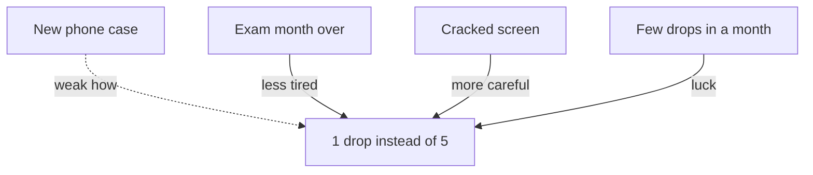

## "The shop opened, then the orders fell"

Huda's brother Khaled is sure he is right. "Think about it," he says. "The new bakery opened. Then your orders fell. What more do you need?" To Khaled, the order of events is the proof. First the shop, then the drop, so the shop caused the drop.

This kind of reasoning is everywhere, and it feels very natural. We see one thing happen, then another, and our mind joins them with an arrow. Sometimes the arrow is real. Often it is not. In this chapter you learn why "it came after" is a weak reason on its own, and which extra questions turn a guess into a likely cause. You will use Huda's notebook, a phone case and a lucky shirt.

## The idea in plain words

"It happened after, so it happened because" is such a common reasoning mistake that it has a name: <GlossaryTerm term="post hoc" definition="Short for an old Latin phrase meaning 'after this, so because of this'. It is the mistake of thinking that what came first must be the cause." />. The order of events is not proof of a cause. Many things happen before any effect. Most of them have nothing to do with it.

Think about a normal morning. You wake up, check your phone, drink tea, and then your laptop will not start. Did the tea break the laptop? Of course not. But change the story a little: you install a new app, and then your laptop will not start. Now the arrow feels real. Yet the order of events is exactly the same kind of evidence in both stories. What makes the app a better suspect is not the order. It is that we can imagine how an app could stop a laptop from starting.

So "after" is a clue, not proof. It tells you where to start looking. To go further, you need more evidence. The good news is that the extra evidence is usually simple to find, if you know what to ask.

## Four questions to ask after "after"

**Did the effect really start after the change?** People remember timing badly. Check the dates in your records, not your memory. Sometimes the problem started before the change, which almost rules the change out as the first cause.

**Is there a "how"?** Can you draw a chain of steps from the change to the effect, like the chains in chapter 1.2? If nobody can say how the change could cause the effect, be careful. If there is a clear "how", look for evidence of each step.

**What happens without the change?** Compare with times, places or people where the change did not happen. If the same effect appears without the change, the change is not needed to explain it.

**What else changed at the same time?** Several things usually change together. Each one is a rival suspect. List them, as you learned in chapter 1.3, before you give the credit or the blame to one.

A fifth question helps when you can wait: does it happen again? A real cause tends to produce its effect again and again. A coincidence usually does not repeat.

## Huda checks the timing

Khaled's claim gives Huda a clear test. The new shop opened at the start of week 3. If the shop caused the drop, the orders should fall after it opened. Before you look at her notebook, make a guess.

```predict
prompt: "The new shop opened at the start of week 3. If the shop really caused the drop, in which week should Huda's orders start to fall?"
options:
  - id: week-three
    label: "In week 3, after the shop opened"
  - id: week-one
    label: "In week 1, at the start of the month"
correctOptionId: week-three
explanation: "A cause has to come before its effect. If the shop took her customers, the orders should drop from week 3 onwards, not before. Now look at what the notebook really shows."
```

The stepper below walks through Huda's notebook week by week, then tests two "it came first" claims against the dates. Step 5 shows whether your prediction matches what the notebook says.

<InteractiveCanvas slug="after-is-not-because-timeline" />

**What this shows:** Huda's month week by week, and two claims tested against the dates: the new shop and the new oven. **Try this:** at step 6, list what besides timing makes the oven a likely cause. **What changed:** at step 5 the shop claim failed, because the drop began two weeks before the shop opened. At step 6 the oven claim passed the timing test, but timing only kept it on the list. **Limits of the model:** four weeks is a short record, and a slow cause, like a new shop, can still show its effect later.

In this example, a normal week brings about 15 orders: about 3 from schools and about 12 from home customers, regulars and new ones together. The four weeks brought 12, 9, 10 and 9 orders. She checks the total: 12 + 9 + 10 + 9 = 40, which matches the month. Now she reads the weeks slowly. The drop started in week 1, two weeks before the shop opened. In week 1 only the school orders were missing: 15 minus 3 is 12. In week 2 the orders fell further, to 9. Then the shop opened, and the next two weeks were 10 and 9: no worse than the week before it opened.

So the first question already weakens Khaled's claim. The drop began before the shop existed, and it did not get worse after the shop opened. The shop may still matter later, because some effects come with a delay. Huda will keep watching. But "the shop opened, then the orders fell" is not what the notebook shows.

The same weeks also test Lina's oven idea. The oven arrived at the end of week 1, and the home orders fell in week 2. That timing fits. But notice: fitting timing is not proof either. The oven idea is strong for other reasons too. It has a "how": a hotter oven with the old times dries the cakes. Four customers said so, and the thermometer showed the heat. Timing is one piece of evidence among several. Even with all of it, the oven is a likely cause, not a proven one. A likely cause is good enough to act on, as long as you watch what happens after you act. In module 3 you will learn to test a cause fairly, which is a strong way to find out more.

## A phone case and a lucky shirt

Majd bought a thick new case for his phone. In the month before, he dropped his phone five times. In the month after, he dropped it once. He tells his friends that the case makes him drop his phone less.

Ask the four questions. The timing is right. But is there a "how"? A case is made to protect a phone when it falls, not to stop it falling. Perhaps a case with a better grip is easier to hold, so there is a possible "how", but it is weak. What else changed? The month before was Majd's exam month: he was tired and studied late on the sofa. On the fifth drop his screen cracked, and since then he has been much more careful. Any of these could explain the change. And with so few drops, one quiet month may simply be luck.

The diagram puts Majd's claim next to its rivals. Each arrow is a possible reason for the quieter month. Only the dotted one is the case, and its "how" is the weakest.



The case came before the quieter month, but so did the end of the exams and the cracked screen. The order of events cannot choose between them. To find out, Majd would need a comparison: a few more months, or a friend with the same case and the same habits. Until then, "the case made me drop it less" is a guess.

Dana wore her blue shirt to a job interview last year and got the job. Now she calls it her lucky shirt and wears it to every interview. Before the shirt, she went to five interviews and got one offer. This year, wearing the shirt, she went to five interviews and got two offers. That looks like a step up, but two offers against one, from five interviews each, is a very small difference. Luck alone can do that. This year Dana also had more experience, and she practiced her answers with a friend. Those changes have a clear "how". The shirt does not.

The shirt is harmless. Dana enjoys wearing it, and it may make her feel calm. The danger comes when the same thinking runs a business or a team. A manager who changes a rule and then sees a good month may keep a costly rule that did nothing. A freelancer who raises prices and then gets a big client may raise prices again, when the client came from an old recommendation.

## Where this goes wrong

**Throwing away every timing clue.** "After is not because" does not mean the change is innocent. Lina's oven came first and was a real cause. The rule is not "ignore timing". The rule is "do not stop at timing".

**Forgetting delays.** Some causes take time to show their effect. A new shop may pull customers away slowly, over months. If you check too soon, you may wrongly clear a real cause. Decide how long you will watch before you decide.

**Trusting memory over records.** People often say "it started right after" when the records show it started earlier. Look at dates, messages and notebooks before you build a story.

**Changing many things at once.** If you change three things in one week, every one of them comes "before" the result. The order of events then tells you almost nothing about which one worked. Module 3 begins with exactly this problem.

## Check your understanding

```quiz
type: mcq
question: "Yamen works at a bank desk in his town. Three weeks ago he started drinking green tea every morning, and since then his afternoon headaches have stopped. He tells everyone the tea cured them. Which extra fact would most weaken the idea that the tea is the cause?"
options:
  - "Green tea is popular with many people in his city"
  - "His headaches began a year ago, in a busy month"
  - "He also stopped working late that same week"
  - "He drinks the tea with a little honey most days"
correct: 2
explanations:
  - "How popular the tea is says nothing about whether it stopped Yamen's headaches."
  - "When the headaches began does not tell us why they stopped now. It does not compete with the tea as a cause."
  - "Right. Another change at the same time is a rival cause. Working late could explain the headaches, and stopping could explain why they went away."
  - "The honey is part of the same morning drink. It does not offer a different explanation for why the headaches stopped."
```

```quiz
type: mcq
question: "Jad's team of four builds a booking app for a bus company. They changed their code review rule on Monday. On Wednesday the app crashed for many users. A teammate says: 'The new rule caused it. Undo it now.' What is the best first check?"
options:
  - "Wait to see if the app crashes again next week"
  - "Undo the new rule at once to stop more crashes"
  - "Ask the team to vote on whether the rule is bad"
  - "Check when the crashing code was reviewed"
correct: 3
explanations:
  - "Waiting does not test the claim, and users suffer in the meantime. A quick check of the code is possible now."
  - "This acts on timing alone. If the crash has another cause, undoing the rule changes nothing and the crash may return."
  - "A vote shows what people believe, not what caused the crash. The evidence is in the code and its history."
  - "Right. This checks the timing and the 'how' together. If the crashing code was reviewed before Monday, under the old rule, the new rule cannot be its cause."
```


**Next:** The module gate. Draw a cause chain for a problem you have seen, or for a phone whose battery runs out too fast.
