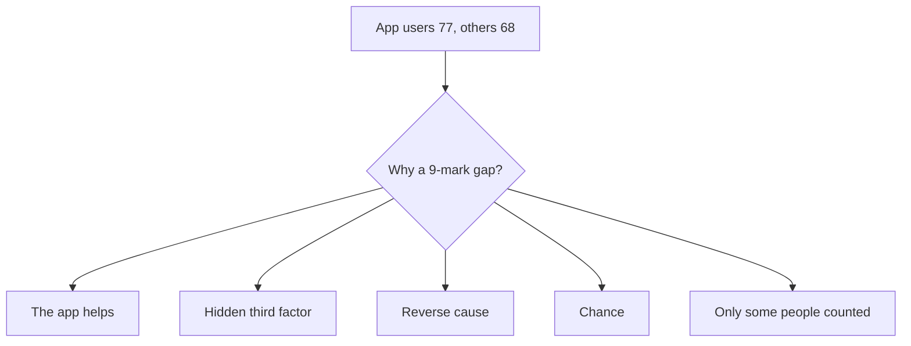

<BigWordAlert term="Correlation" plainEnglish="Two things tend to go up and down together." whyItMatters="Moving together is a clue, not proof. Before you act on a correlation, check what else could explain it." />

## A number that looks like proof

Basel is in his second year at university, studying accounting. Three afternoons a week he works for a small company that makes a study app. The app gives students practice questions and short cards to test their memory. Basel's job is to test new versions and report problems. The company, the app and everyone in this course are made up.

One morning, Rawan from the company's marketing team sends him a message. "Good news! We have numbers from your class. Students who used our app got 9 marks higher on the midterm. Can we put that in our advert? 'Use our app and score 9 marks higher.' What do you think?"

The numbers are real, in this example. After the midterm exam, Basel's teacher was curious. She asked all 40 students in the class to fill in a short form during the lecture, without names. It had two questions: "Did you use this study app during the term?" and "What was your midterm mark?" Twenty students said yes. Their average mark was 77. Twenty said no. Their average was 68. So the app users scored 9 marks higher on average.

## Why Basel hesitates

Basel likes the app. He wants it to do well, and his job depends a little on it doing well. But something in Rawan's message makes him uneasy. The numbers show that app users got higher marks. The advert says that the app gives you higher marks. Those are not the same claim.

He thinks about the students he knows. His friend Tariq uses the app every day. Tariq is also the student who sits in the library until it closes, never misses a lecture and has done every past exam paper twice. If Tariq got a high mark, was it the app? Or was it everything else Tariq does? Would Tariq have got the same mark without the app?

Then he thinks about Nada, who started using the app only after the first short quiz of the term. Nada did very well on that quiz and wanted to keep her good marks going. So in her case, the good marks came first, and the app came after. And Basel also remembers that the company's reviews page only shows reviews from people who still use the app. What about the students who tried it and gave up?

Basel realises that the 9-mark gap has several possible explanations. The app might help. But other things could make app users and high marks go together, even if the app did nothing at all.

## Moving together is a clue, not proof

There is a correlation between app use and marks in Basel's class: more app use goes with higher marks. A correlation is useful. It tells you where to look. But a correlation alone does not show that one thing causes the other.

There is also an opposite mistake. Some people learn this idea and then say "correlation never means cause", and they ignore every pattern. That is too far. A correlation can be the first clue to a real cause. The right attitude is in the middle: moving together is a clue, not proof, so you check it.

This module teaches four checks. First, a hidden third factor: is there something else, like hard work, that pushes both app use and marks? Second, reverse cause: could the marks be causing the app use, as with Nada? Third, chance and the drift back to normal: with only 40 students, could the gap be luck, and was anything unusual about the starting point? Fourth, survivors and selection: are we only seeing some of the people, such as those who stayed?

## A picture of the question

The diagram shows the 9-mark gap at the top, and the possible explanations below it. Only one of them is the app's own effect. The others are rival explanations that could make the same numbers appear.



The rival explanations do not cancel the app. Several of them can be true at once, together with a real effect of the app. The point of the diagram is that the numbers at the top cannot tell you which arrows are real. You need more evidence, and each of the next chapters shows you what evidence to look for.

## Your own wish to believe

There is one more reason Basel is careful, and it is about himself. He wants the app to work. His job is a little safer if the app sells well, and he likes the people at the company. When we want a claim to be true, we tend to check it less. We look hard at evidence against our favourite idea, and only lightly at evidence for it.

Basel knows this about himself, so he makes a decision. He will check Rawan's claim as carefully as if it came from a company he does not work for. This is a useful habit for anyone. Before you check a claim, ask yourself: "Do I want this to be true?" If the answer is yes, be a little more careful, not less. The four questions in this module work in the same way whether you like the answer or not.

## Why this matters at work

Claims like Rawan's appear in almost every job. A client says that customers who get a weekly email spend more, so you should send more emails. A manager says that teams who use a new planning tool finish projects faster, so everyone should switch. A freelancer reads that people with a video on their profile earn more per hour, so they spend a week making a video. In each case, two things move together, and someone wants to spend money or time as if one causes the other.

If you can ask the four questions calmly, you protect your client, your team and yourself from expensive mistakes. You also become someone people trust with numbers. That trust matters in remote work, where clients often cannot see your work directly and judge you by how carefully you reason.

You will meet one more source of these claims: answers from an AI chat tool. Such tools can repeat the same mistake in a very confident voice, for example by turning "app users scored higher" into "the app raises marks". The quiz in this module includes one such answer for you to check.

## What Basel decides

Basel does not say yes or no to Rawan yet. He writes back: "The numbers are interesting. Before we use them in an advert, let me check four things." Rawan is not happy with the delay, but she agrees to wait a few days.

Basel also writes the claim down exactly, the way Huda wrote down her effect in module 1. "In one class of 40, in one term, 20 students said they used the app. Their midterm average was 9 marks higher than that of the 20 who did not." Written like this, the claim is true. The advert's version, "use our app and score 9 marks higher", adds a cause that the numbers do not show.

Over the next chapters, you follow Basel as he checks each question. You will see that the 9-mark gap is mostly explained by something other than the app, and that the company's other numbers have their own problems. You will also see what Basel can honestly tell Rawan, because "we cannot say that" is not the end of the conversation. There is usually a true thing that can be said instead.

## Before you continue

Think of a claim you have heard where two things go together. Then try one other explanation for it.

```openquestion
prompt: "Write down a claim you have heard where two things go together, for example 'people who wake up early earn more'. If none comes to mind, use this one. 'Shops with more photos on their page get more orders.' Then write one other reason, apart from the obvious cause, why the two things might go together."
required: true
minWords: 25
allowSpeechInput: true
modelAnswer: "Claim: freelancers with a personal website get more clients. Another reason: freelancers who have worked for many years are more likely to have built a website, and they also have more past clients who recommend them. So experience could explain both the website and the extra clients."
```

You can use the same claim in the module checklist at the end, or choose a new one then.

## What you will practice

<LearningObjectives items={["Find a hidden third factor that could explain why two things move together", "Check whether the cause might run the other way", "Ask whether chance or a drift back to normal explains a pattern", "Spot conclusions drawn only from the people who stayed or succeeded", "Test a real claim in four ways"]} />

## Key words

| Word | Plain English |
|---|---|
| **Hidden third factor** | A third thing that pushes both of the things you are looking at |
| **Reverse cause** | The cause runs the other way from what you assumed |
| **Chance** | A pattern that appears by luck, especially with few cases |
| **Regression to the mean** | After an unusually good or bad result, the next one is usually closer to normal |
| **Survivorship bias** | Seeing only the cases that stayed or succeeded, and missing the rest |

## What is in this module

| Chapter | You will practice |
|---|---|
| 2.2 | Finding a hidden third factor, and comparing like with like |
| 2.3 | Checking for reverse cause, chance and the drift back to normal |
| 2.4 | Spotting conclusions drawn only from survivors or picked groups |
| 2.5 | A graded quiz, including an AI answer to check |
| 2.6 | Testing one real claim in four ways |


**Next:** Basel looks for a hidden third factor in his class, and learns to compare like with like.
