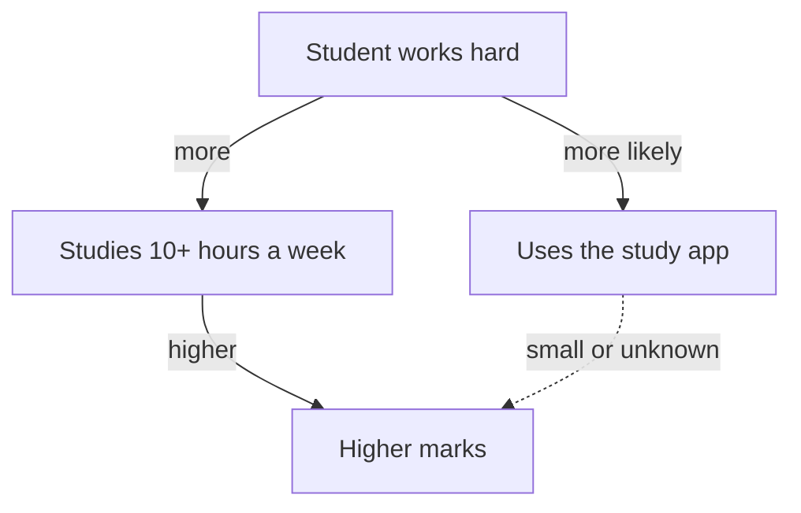

## Cold drinks and sun hats

Picture a small corner shop near a beach. On some days it sells many cold drinks, and on the same days it sells many sun hats. On other days it sells few of both. Drinks and hats are correlated: they go up and down together. Does buying a cold drink make people want a sun hat? Of course not. Hot, sunny weather pushes both up.

In that example the third thing is easy to see, because everyone knows about the weather. Here is a second one. On days when many car drivers use their windscreen wipers, there are also more car accidents. Wipers do not cause accidents. Rain does both: drivers switch on their wipers, and wet roads make accidents more likely.

The hard cases are the ones where the third thing is not obvious. That is why we call it hidden. In this chapter you learn how to look for a hidden third factor on purpose, and how to check whether it explains a pattern. You will do it with Basel's numbers from chapter 2.1. As before, Basel, the app company and every number are made up.

## The idea in plain words

You met the hidden third factor in the key words of chapter 2.1. Researchers call it a <GlossaryTerm term="confounder" definition="The research word for a hidden third factor: a factor linked to both the cause you are testing and the result." />. To count as a hidden third factor, it must be linked to both sides. It must make the first thing more likely, and it must make the second thing more likely. A factor that pushes only one side cannot create the pattern.

Here is the method in five steps. First, name the two things that move together. Second, ask: "What kind of person, day or place has more of both?" Picture the people in the group, not the numbers. Third, for each idea, check that it could push the first thing and also the second. Fourth, compare like with like: split the group by the third factor and compare inside each part. Fifth, read the result. If the gap mostly disappears inside each part, the third factor explains much of the pattern. If the gap stays, the first cause is still possible, though not yet proven.

## Basel looks for a third factor

**Step 1: name the two things.** App use and midterm marks. In Basel's class of 40, the 20 app users averaged 77 and the 20 others averaged 68.

**Step 2: who has more of both?** Basel pictures his classmates. Who uses the app? Tariq, who studies in the library every evening. Two other students who never miss a lecture. Who does not? Several students who work long hours in family shops and study only on weekends. A pattern appears. Basel writes three ideas: how hard a student works, how strong the student already was before this course, and how much free time the student has.

**Step 3: does each idea push both sides?** Hard work makes a student more likely to try every study tool, including the app. Hard work also raises marks. So it pushes both. Earlier strength pushes both too: strong students tend to look for extra practice, and they tend to score well anyway. Free time pushes both: students with more time can use the app and can also study more. All three ideas pass this test. Basel starts with the first one, because he can measure it most easily.

**Step 4: compare like with like.** Basel asks his teacher whether she can add one question to the class form. She agrees. At the next lecture, all 40 students answer one more question. "About how many hours a week do you study for this course, outside lectures?" Basel splits the class into students who study 10 hours a week or more, and students who study less. Then he compares app users with others inside each part.

Before you look at his table, make a guess.

```predict
prompt: "Basel looks only at the students who study 10 or more hours a week. Inside this group, how do you expect app users and other students to compare?"
options:
  - id: still-higher
    label: "App users still score about 9 higher"
  - id: same
    label: "Their marks are about the same"
correctOptionId: same
explanation: "Most of the 9-mark gap came from who uses the app, not from the app itself. Among students who study the same amount, the gap almost disappears, as the table below shows."
```

The stepper below splits the class and compares like with like, one group at a time. Step 2 shows whether your prediction was right.

<InteractiveCanvas slug="basel-third-factor-split" />

**What this shows:** Basel's class split by study hours, with app users compared to other students inside each group. **Try this:** at step 3, check the averages yourself. **What changed:** the gap of 9 marks became 0 among the heavy studiers and 3 among the light studiers. The count at step 3 showed why: most app users were heavy studiers to begin with. **Limits of the model:** Basel split the class by only one factor, and the study hours are what students reported, so they are rough.

Here are the same numbers in one table, in this example.

| Group | App users | Other students |
|---|---|---|
| Study 10 or more hours a week | 15 students, average 80 | 4 students, average 80 |
| Study less than 10 hours | 5 students, average 68 | 16 students, average 65 |
| Whole class | 20 students, average 77 | 20 students, average 68 |

**Step 5: read the result.** Among the students who study a lot, app users and others both average 80. There is no gap at all. Among the students who study less, app users average 68 and others 65: a gap of 3 marks. But there are only 5 app users in that group, and with so few students a gap of 3 marks can easily appear by luck. You will see why in chapter 2.3.

So where did the 9-mark gap come from? Look at who is in each column. Fifteen of the 20 app users study a lot. Only 4 of the 20 other students do. The app users were mostly hard workers to begin with. Basel checks the averages to make sure the table is consistent. For app users: 15 x 80 = 1,200 and 5 x 68 = 340, so 1,540 divided by 20 is 77. For the others: 4 x 80 = 320 and 16 x 65 = 1,040, so 1,360 divided by 20 is 68. The table agrees with the numbers from chapter 2.1.

## The third factor as a picture

The diagram shows what Basel now thinks is happening. Read it from the top. A student who works hard is more likely to use the app, and also studies more hours. Study hours raise marks. The dotted arrow from the app to marks is the claim Rawan wanted to make. It may be real, but it is small or unknown.



The diagram makes one thing clear. If you only look at the app and the marks, you see a strong link. Once you add the third box, most of that link turns out to run through hard work, not through the app. That is the whole idea of a hidden third factor in one picture.

## What Basel tells Rawan

Basel writes to Rawan: "We cannot say that the app raises marks by 9. Most of the gap is because hard-working students are more likely to use the app. Among students who study the same amount, the gap was small or zero." Rawan is disappointed. Then Basel offers something true that the company can say. "Many hard-working students in one class chose our app." That is honest, and it is still good news for the company.

He also suggests a strong way to find out whether the app helps. Let chance decide who gets the app, for example with a coin flip for each volunteer. This makes the two groups alike in the things that matter, including things nobody thought of. Researchers call this random assignment, and it is the best way to reduce the risk of a hidden third factor. Module 3 shows you how to plan a test like that.

## A second example: the profile badge

The same pattern appears in freelance work. On one freelance website, in this example, freelancers who pay for a special badge on their profile earn more per hour than those who do not. The website says: "Get the badge and earn more." Ask the second step: who has more of both? Freelancers with many years of experience can afford the badge, and they also charge more because of their experience. Experience pushes both. To compare like with like, you would compare freelancers with the same years of experience, with and without the badge.

## Where this goes wrong

**A factor that pushes only one side.** "The exam was hard" lowers everyone's marks, but it does not make anyone more likely to use the app. It cannot explain the gap between the two groups. Always check that your factor pushes both.

**Groups that are too small after splitting.** Each split makes the groups smaller. With 4 or 5 people in a group, small gaps can come from luck. Treat them as hints.

**Stopping at one factor.** Basel only checked study hours. Earlier strength and free time may also matter. You can only compare like with like for factors you thought of and measured. That is why random assignment is stronger than any number of splits.

**Mixing up a third factor and a step in the chain.** If the app made students study more hours, then study hours would be a step between the app and the marks, not a third factor. To tell them apart, check timing. Basel learns that Tariq and most heavy studiers worked this hard last year too, before they started using the app. So here, hard work came first.

**Going too far the other way.** Finding a third factor does not prove the app does nothing. It shows that the 9-mark claim is not supported. A fair test could still find a small real effect.

## Check your understanding

```quiz
type: mcq
question: "Nizar manages 8 teams at a software company in his city. In his records for one year, the teams that hold more meetings deliver more projects late. Which explanation is a hidden third factor?"
options:
  - "Meetings take time from work, so projects run late"
  - "Late projects make managers call extra meetings"
  - "Teams with more meetings also write longer reports"
  - "Hard projects need more meetings and run late"
correct: 3
explanations:
  - "This says meetings directly cause lateness. It may be partly true, but it is a direct cause, not a third factor."
  - "This says lateness causes meetings. That is the cause running the other way, which chapter 2.3 covers. It is not a third factor."
  - "Reports are not linked to lateness in the case. A third factor must push both of the things that move together."
  - "Right. Project difficulty pushes both sides: hard projects need more meetings, and hard projects are more likely to run late. Meetings and lateness move together even if meetings cause nothing."
```

```quiz
type: mcq
question: "Dina runs a small clothes shop in her town. Her 120 customers with a loyalty card spend more each month than her 300 customers without one. She suspects that people who already shop often are the ones who sign up. Which check fits best?"
options:
  - "Give the card to every customer who visits this week"
  - "Count how many loyalty cards she gave out last month"
  - "Compare card users with equally frequent shoppers"
  - "Ask card users whether they like the loyalty card"
correct: 2
explanations:
  - "Giving the card to everyone changes her shop, but it does not show whether the card or shopping habits explain the gap."
  - "The number of cards says nothing about why card users spend more."
  - "Right. This compares like with like. If frequent shoppers spend the same with or without the card, then shopping habits, not the card, explain most of the gap."
  - "Liking the card does not show that it makes people spend more. Their answers do not test the third factor."
```


**Next:** Could the marks be causing the app use? Reverse cause, chance and the drift back to normal.
