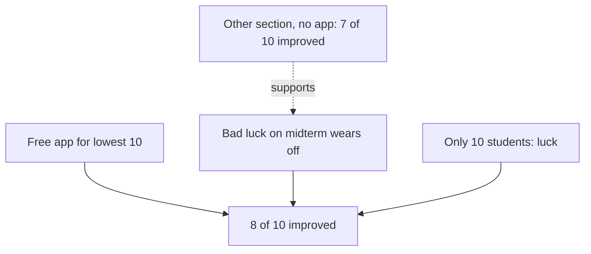

This chapter has three ideas: the cause may run the other way, a pattern may be luck, and an unusual result may drift back to normal.

## Two more claims

Rawan from the app company (a made-up company, like every organisation in this course) does not give up easily. A few days after Basel's message about hard work, she writes again. "Fine. But here is something better. After the midterm, we gave the app free to the 10 students in your class with the lowest marks. On the final exam, 8 of those 10 did better than on the midterm. So the app lifts weak students. Surely we can say that?"

At the same time, Basel has noticed something on his own. Many app users in his class did not start using it at the beginning of the term. They started after the first short quiz. And most of those were students who had done well on that quiz.

These two observations lead to three new checks. Could the cause be running the other way? Could the pattern be luck, because the groups are small? And could an unusual starting point explain the change? This chapter takes each check in turn, with Basel's case and a few everyday ones.

## Does the cause run the other way?

When A and B move together, we usually assume A causes B. But sometimes B causes A. This is the reverse cause from the key words in chapter 2.1. Here is an everyday example. A clinic with more nurses on duty has more sick people in its waiting room. The nurses do not make people sick. The sick people are the reason the extra nurses are there.

Basel checks his class. He asks the app users, through the teacher's form, when they started using the app. In this example, 12 of the 20 app users started in the week after the first quiz. Of those 12, 9 had scored above the class average on that quiz. Several told him the same thing: "I did well, so I wanted to keep it going." For these students, the good marks came first, and the app came after. Good marks led to app use.

To check for reverse cause, ask what came first, and look at results from before the supposed cause. If the "effect" was already there before the "cause" started, the arrow may point the other way. You can also simply ask people why they started. Their answers are not perfect evidence, but they often show the direction quickly.

Sometimes the cause runs both ways at once. Being fit makes running easier, so fit people run more. And running makes people fitter. Both arrows are real, and they feed each other. In module 6 you will meet loops like this, where more leads to more.

## Could it be chance?

With few cases, luck alone can make a pattern. Take a normal coin and throw it 10 times. Getting 7 heads is not rare at all. It does not mean the coin is special. Now imagine you had asked 10 students and 7 of them said yes to something. The same luck is at work.

Basel sees this in his own study group. Five friends tried a new way of revising for one week, and 4 of them did better on the weekly quiz than the week before. They were excited. But weekly quiz marks go up and down anyway. With only 5 people, 4 improving can easily happen by luck, with no help from the new method.

There are no formulas in this course, but there are some plain <GlossaryTerm term="rules of thumb" definition="Simple rules that are usually right and easy to use, but not always right." />. The fewer the cases, the bigger the part luck can play. A pattern in a small group is a hint, not proof. Look for the same pattern again, in a bigger group or a different one, before you trust it. And small effects need more cases to show clearly than big ones. Remember the gap of 3 marks among the 5 app users in chapter 2.2: with so few students, it is a hint at most.

## The drift back to normal

The third check is harder to see, and it fools many people. Try this with friends. Ask ten friends to throw a coin at a cup from a few steps away. Praise the best three. On the next throw, most of them do worse. The praise did not cause that. Their first throws were partly luck, and luck does not repeat on demand.

This is the regression to the mean from the key words in chapter 2.1. "Mean" here means the average, or what is normal for that person. Any single result is part skill and part luck. When you pick the most unusual results, the very best or the very worst, you pick the ones with the most luck in them. Next time, the luck is ordinary again, so the result moves back toward normal. After a very bad week, the next week is often better even if you change nothing.

People who do not know this pattern draw the wrong lesson from it again and again. A psychologist noticed that people who rewarded good results and punished bad ones were fooled by this pattern. After a reward, the next result was usually worse, so they thought rewards did harm. After a punishment, the next result was usually better, so they thought punishment worked. Both changes were mostly the drift back to normal.

Now look at Rawan's claim with this in mind. The company chose the 10 students with the lowest midterm marks. Some of them are always weak in this subject. But some of them had a bad day: they were ill, slept badly or misread a question. On the final, those students would probably do better anyway. So "8 of 10 did better" is exactly what you would expect even if the app did nothing. To know, Basel needs a comparison: similar students who did not get the app.

He finds one. The same course has a second section, with the same teacher and the same exams. Its 10 lowest midterm students did not get the free app. Before you read what happened to them, make a guess.

```predict
prompt: "In the other section, the 10 students with the lowest midterm marks did not get the app. What do you expect happened to them on the final exam?"
options:
  - id: stayed-low
    label: "Most of them stayed at the bottom"
  - id: improved
    label: "Most of them also improved"
correctOptionId: improved
explanation: "Students picked for their lowest marks include some who had a bad day. On the next exam, many of them move back toward their normal level, with or without the app."
```

The stepper below follows both groups from the midterm to the final. Step 5 shows whether your prediction was right.

<InteractiveCanvas slug="drift-back-to-normal" />

**What this shows:** two groups picked for their low midterm marks, one given the app and one not. **Try this:** at step 6, say what Basel can honestly tell Rawan, and what he cannot. **What changed:** the group without the app improved almost as much as the group with it. That moved the rise from "the app worked" to "most of it would have happened anyway". **Limits of the model:** each group has only 10 students, and the two sections are alike but not the same.

In this example, 7 of those 10 students also did better on the final. So most of the rise among Rawan's group would probably have happened anyway. The app group did a little better, 8 of 10 against 7 of 10, but that is a difference of one student in each group of ten. With groups this small, one student either way is well within luck. Basel cannot say the app lifted weak students. He also cannot say it did nothing. He can only say that this evidence does not show an effect.

## Three rival explanations, one picture

The diagram shows Rawan's result at the bottom and the explanations that could produce it. The evidence from the other section points at the drift back to normal. The app may still play a small part, which only a fair test can show.



What the picture teaches is that a before-and-after number on its own cannot separate these arrows. You need a comparison group that started in the same unusual place but did not get the change. Module 3 shows how to build one on purpose, instead of hoping one exists.

## Where these checks go wrong

**Picking people because they were extreme.** The trap is built when you choose the worst week, the lowest marks or the angriest customers, then apply a fix, then measure again. Things will usually look better. Before you celebrate, ask: "How were these cases chosen?"

**Thinking the drift means nothing is real.** Regression to the mean does not prove that a fix failed. It means you need a comparison group to see the fix's real size.

**Saying "it could be chance" and stopping.** Chance is a reason to look again with more cases, not a reason to give up. Repeat the check, or plan a fair test.

**Forgetting that direction can flip.** Before you say "A causes B", spend one minute asking whether B could cause A. It costs almost nothing.

## Check your understanding

```quiz
type: mcq
question: "Zeina runs a café in the main market. In June it had its worst month in two years: 9,000 shekels of sales, against a usual 14,000. She hired a new cook, and July sales were 13,500 shekels. Zeina says the cook saved the café. What is the best reply?"
options:
  - "The cook is the only change, so the cook caused the rise"
  - "Sales rose, so a second new cook would help even more"
  - "One month of sales is enough to judge the new cook"
  - "After a very bad month, sales often rise with no change"
correct: 3
explanations:
  - "Other things also change from month to month. Being the only change Zeina made does not make the cook the cause."
  - "This assumes the cook caused the rise, which has not been shown. Hiring more would build on a guess."
  - "One month after a very unusual month is weak evidence. The drift back to normal can explain it."
  - "Right. The worst month in two years was unusual. The next month would probably be closer to normal anyway, so the cook's effect is not yet known."
```

```quiz
type: mcq
question: "Leen is a new freelance translator in her city. She sees that freelancers with more than 50 five-star reviews get more job offers. She decides reviews must bring offers. Her friend says it may run the other way. Which check tests the friend's idea?"
options:
  - "Check if reviews came before or after the offers"
  - "Count the reviews of the ten best-paid freelancers"
  - "Ask clients whether they read reviews before hiring"
  - "Compare freelancers who work in different fields"
correct: 0
explanations:
  - "Right. If offers grew first and the reviews followed, then the jobs are bringing the reviews. Timing shows the direction."
  - "This shows that top freelancers have many reviews, which we already know. It says nothing about which came first."
  - "This tests the first direction, that reviews bring offers. The friend's idea is about the opposite direction."
  - "Different fields add a new factor, but they do not show whether reviews or offers came first."
```


**Next:** The company's reviews come only from people who still use the app. Survivors and selection.
