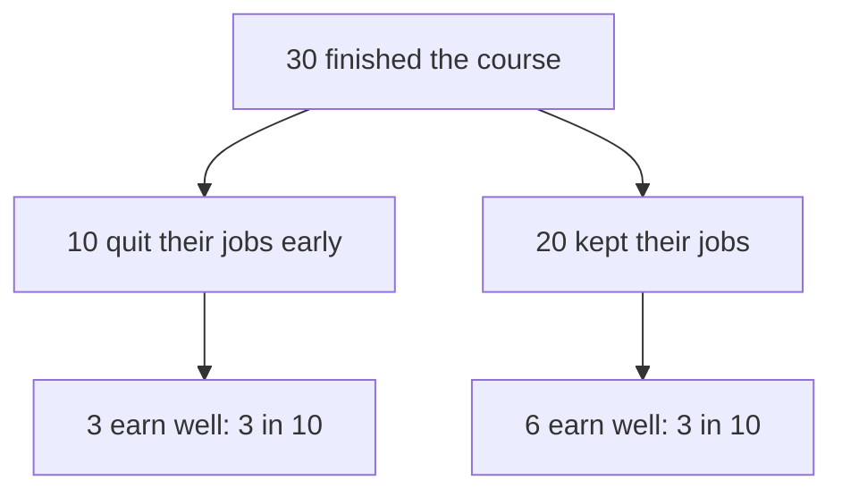

<BigWordAlert term="Selection bias" plainEnglish="The people or cases you looked at differ in a systematic way from the whole group you care about." whyItMatters="Numbers and advice drawn from a picked group can point the wrong way. You need to know how the group was picked before you trust what it shows." />

## 92 out of 100

Rawan has one last number for Basel, and she is proud of it. "Forget the marks. Look at our survey. We asked our users: 'Has the app improved your marks?' And 92 out of 100 said yes! We can put '92 percent of students say our app improves their marks' on the front page."

Basel asks one question: "Who got the survey?" Rawan checks with the team at the company, which is made up like every organisation in this course. In this example, 400 students signed up for the app last term. By the end of the term, 300 of them had stopped using it. The company sent the survey only to the 100 who were still using it. Of those 100, 92 said yes and 8 said no. The 300 who stopped were never asked.

Before you read on, ask yourself what this survey can tell the company about all 400 students who signed up.

## The idea in plain words

The problem with Rawan's survey is selection bias. "Systematic" here means it is not random: there is a reason why some people ended up in your group and others did not. That reason can be linked to the very thing you are measuring.

The survivorship bias from the key words in chapter 2.1 is one common kind of selection bias. In Rawan's survey, the "survivors" are the students who kept using the app. Students who felt the app helped them had a good reason to keep using it. Students who felt it did not help had a good reason to stop. So the survey was sent mostly to the happy ones, and of course they were happy.

This does not mean the 92 are lying. They really do feel the app helped them. The problem is what the company wants to say with their answers. It wants a claim about everyone who uses the app, from a group picked in a way that favours good answers.

## Four questions about any group

**How did these people get into the group?** Look for the filter. Who decided who was asked, counted or shown? In Rawan's survey, the filter was "still using the app at the end of the term".

**Who is missing, and why?** Name the people the filter removed. Here, 300 students. Ask why they left. If the reason could be linked to the result, the missing group matters a lot.

**Would the missing people answer differently?** You often cannot know for sure, but you can think it through. Students who stopped using a study app are less likely to say it improved their marks than students who kept using it.

**Can I find the whole group from the start?** A strong fix is to start from everyone who began, not from those who are left. All 400 students who signed up, not only the 100 who stayed.

## Basel works it through

Basel starts with the numbers. Of the 400 students who signed up, 92 said the app helped. Eight said it did not. For the other 300, nobody knows. So the survey shows that at least 92 of 400 students felt helped. That is 23 in every 100, not 92. The true number could be anywhere from 92 out of 400 up to much higher, depending on what the 300 would have said. He checks the sum: 92 + 8 + 300 = 400.

Basel also wants to hear from the 300 missing students. The company still has their email addresses, so he plans to write to 30 of them and ask one short question: why did you stop? Before you follow both paths, make a guess.

```predict
prompt: "Basel will ask 30 students who stopped using the app why they stopped. Do you expect many of them to say the app did not help?"
options:
  - id: many
    label: "Yes, many will say that"
  - id: few
    label: "No, only a few will say that"
correctOptionId: many
explanation: "Here the first guess is right. Students who felt the app helped had a reason to stay. Students who felt it did not help had a reason to leave. So the people missing from the survey are likely to be less happy."
```

The stepper below follows both paths from sign-up: the students who stayed and got the survey, and the students who left. Step 7 shows whether your guess was right.

<InteractiveCanvas slug="who-got-the-survey" />

**What this shows:** everyone who signed up, split into the students the survey reached and the students it never saw. **Try this:** at step 5, work out what share of all 400 students is known to have felt helped. **What changed:** at step 5, "92 out of 100" became "at least 92 out of 400", because three quarters of the students had left the picture. At step 7, the missing students told a different story from the survivors. **Limits of the model:** Basel heard from only 20 of the 300, and people who reply to emails are a group of their own.

In this example, 20 of the 30 reply. Eleven say the app did not help them. Six say they finished their exams and no longer needed it. Three say they simply forgot about it. That is 11 + 6 + 3 = 20 replies.

These answers are useful, but Basel notices a second filter. The 20 who replied are the people who bother to reply to emails. The 10 who did not reply may be different again. So he treats the replies as a hint: many of the students who left did not feel helped. That is enough to show that the 92 percent claim cannot stand for all users.

He suggests a true sentence the company can use instead. "Of the students who used our app for a whole term, most told us it helped their marks." It is smaller, but it is honest, and it says exactly who was asked.

## A second example: the freelancers on stage

Jana is a junior designer with a full-time job. She watches an online talk where five successful freelancers share their stories. In this example they each earn around 3,000 dollars a month, and all five say the same thing: "Quit your job early and go full-time. That is what made it work." Jana starts to think about quitting.

Ask the four questions. How did these five get on stage? They were picked because they succeeded. Who is missing? Everyone who quit early and did not succeed. Those people do not give talks. Would they tell a different story? Very likely. Can Jana find the whole group?

Suppose she can, in this example. She finds the 30 people who finished the same design course as the speakers, in the same year. Ten of them quit their jobs early. Three of those 10 now earn well as freelancers, and 7 went back to jobs. The other 20 kept their jobs while slowly building clients. Six of those 20 now earn well full-time as freelancers. So 3 in 10 succeeded in each group: 3 out of 10, and 6 out of 20. Thirty people is a small group, so this is a hint, not proof: it would be worth checking again with a bigger group. But it is enough to show that the talk's advice is not supported. The talk only showed the winners.

The diagram shows Jana's whole group. The talk showed only people like the ones in the bottom left box. The bottom right box was never on stage.



Both branches end with the same share, 3 in 10. A talk that shows only winners from the left branch makes quitting early look like the reason. Seen as a whole group, quitting early shows no advantage in this example.

## Where this goes wrong

**Assuming the missing people are like the ones you see.** This is the core mistake. Always ask why the missing people are missing.

**Forgetting that complaints are selected too.** People who complain are not like all customers either. Some unhappy customers never complain, and most happy ones never write. Complaints show where problems are, but not how common they are.

**Forgetting that replies are selected.** When you ask the missing people, the ones who answer are a group of their own, as Basel found.

**Going too far the other way.** The advice of successful people is not always wrong. Survivorship bias means their success does not prove their advice. To learn from them, compare with the people who tried the same thing and did not succeed.

**Missing selection in your own data.** In module 1, Huda messaged the regular customers who ordered less. That was the right group for her question. But she could not hear from people who looked at her page and never ordered at all. Every set of records has a filter. Know what yours is.

## Check your understanding

```quiz
type: mcq
question: "Hazem sees an advert from a training centre in his city: '90 percent of our graduates found work within six months.' Only students who finish the final project count as graduates, and many leave before it. What is the main problem with this as proof that the training works?"
options:
  - "Six months is too short a time to find good work"
  - "Ninety percent is too high a number to believe"
  - "It should count only the students who found work"
  - "Students who left early are not counted"
correct: 3
explanations:
  - "Six months may or may not be a fair time, but it is not the main problem. The question is who was counted."
  - "A high number can be true. The problem is not its size but the group it describes."
  - "Counting only people who found work would make the number even more misleading. It is the same mistake, made bigger."
  - "Right. Students who left may be the ones the training did not help. Counting only finishers shows the survivors and hides the rest."
```

```quiz
type: mcq
question: "Fadi runs a pharmacy delivery service in his town, with two drivers. This month he received 15 written complaints about slow deliveries. He decides that most of his customers are unhappy with his speed. What is the main problem with his conclusion?"
options:
  - "Fifteen complaints is too many for a small service"
  - "Complainers may not be like his other customers"
  - "He should count complaints over a whole year"
  - "Delivery speed does not matter much to customers"
correct: 1
explanations:
  - "Fifteen complaints may be worth looking into, but the number alone does not tell him what most customers think."
  - "Right. People who write complaints are a selected group. The complaints show where to look, but not how most customers feel. He needs to hear from customers who did not complain."
  - "A longer count would still only show complainers. It would not tell him about the customers who never wrote."
  - "Nothing in the case shows that speed does not matter. The problem is drawing a big conclusion from a selected group."
```


**Next:** A graded quiz on third factors, reverse cause, chance and selection, including an answer from an AI chat tool to check.
