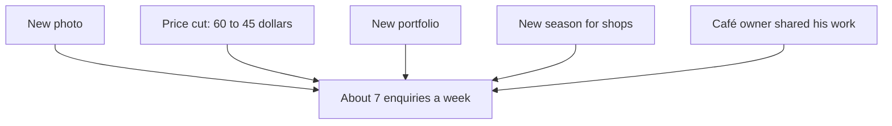

<BigWordAlert term="Fair test" plainEnglish="A test where the only planned difference between two situations is the one thing you are testing." whyItMatters="Without a fair test you cannot tell which change made the difference, so you may keep the wrong change and drop the right one." />

## Three changes in one week

Sami is a freelance designer. He makes logos and social media posts for small businesses, and he finds most of his clients on a freelance website. For two months his profile was quiet. He got about three enquiries a week, and he won about one new client a week. An enquiry is a message from someone who might hire him.

One Sunday he decided to fix his profile. In the same week he did three things. He changed his profile photo from a dark selfie to a clear, smiling photo that a friend took. He lowered his starting price for a logo from 60 dollars to 45 dollars. And he replaced his old portfolio with his six best recent designs.

Over the next four weeks, his enquiries went up to 6, 8, 7 and 7. That is 28 enquiries in four weeks, or about 7 a week. It is more than twice as many as before. He won 3, 3, 2 and 4 new clients in those weeks, which is 12 clients, or about three a week instead of one. Sami was very happy. Then his family and friends started to argue about why it worked.

## Everyone has an answer

His cousin Suha was sure it was the price. "Clients on that website compare prices first," she said. "You were too expensive before." His friend Ghassan, another designer, said it was the portfolio. "Clients hire what they can see. Your old work was weak." His sister Dalia said it was the photo. "People want to see a friendly face before they write to a stranger."

Each answer sounds reasonable, and each person has a story that fits the numbers. But they cannot all be the main cause, and Sami cannot check any of them with the numbers he has. All three changes happened in the same week. The rise in enquiries came after all three of them. From the numbers alone, the photo, the price and the portfolio look exactly the same.

This is the trap from module 1 in a new form. "It happened after, so it happened because" is a weak reason even with one change. With three changes at once, it is weaker still, because even if the changes did cause the rise, the order of events cannot tell you which of them did it.

## Why the answer matters

This is not only a curious question. Sami has to decide what to keep, and one of his changes costs money. At 45 dollars instead of 60, he earns 15 dollars less on every logo. If all three of his weekly clients order a logo, that is 45 dollars less a week, or 180 dollars less over four weeks.

If the lower price is what brought the new clients, the cut may be worth it. Three clients at 45 dollars still earn more than one client at 60. But if the clients came because of the portfolio or the photo, Sami is giving away about 180 dollars a month for nothing. He could go back to 60 dollars and keep most of his new clients.

The photo and the portfolio cost nothing to keep, so Sami does not need to test them urgently. The question that matters is narrow and practical: did the lower price bring more clients, or not? To answer it, Sami needs more than a story that sounds right. He needs a test.

## Other things changed too

There is a second problem, and it is easy to miss. Sami's three changes were not the only things that changed in those weeks. The weeks after his change were the start of a new season, when many small shops refresh their posters and pages. A past client, the owner of a small café, shared Sami's work with two friends who run shops. And Sami himself was more active: he was excited, so he replied to messages within minutes instead of hours.

Any of these could have raised his enquiries even if he had changed nothing on his profile. In module 2 you met the hidden third factor: something that pushes the result while you are looking at something else. Here there are several of them, all in the same weeks as Sami's changes.

The diagram below shows everything that changed at the same time. Every arrow points at the same result. Nothing in Sami's numbers says which arrow is strong and which is weak.



Read the diagram as a list of suspects, not a list of causes. Sami's three changes and two outside events are tangled together: mixed up so that you cannot pull them apart. Any one of them could be doing most of the work. Two of them could be working together. All five could each be adding a little. The rise in enquiries is real. The reason for it is still unknown.

```predict
prompt: "Suppose Sami had changed only his price that week, and his enquiries still rose to about 7 a week. Which suspects from the diagram could he then set aside?"
options:
  - id: photo-portfolio
    label: "The new photo and the new portfolio"
  - id: none
    label: "None of them: the season could explain it all"
correctOptionId: photo-portfolio
explanation: "The photo and the portfolio. He did not change them, so they cannot explain the rise, and the price becomes the main suspect. The season and the café owner are still possible, which is why a fair test needs a second habit, comparison, which comes next."
```

## What a fair test looks like

As the prediction showed, one change at a time makes the picture much clearer. A rise would still not be proof, because the season and the café owner could push it. But the photo and the portfolio would be out of the story. That is the first habit of a fair test: change one thing at a time, and keep everything else the same.

The second habit is to compare. Sami's real question is not "did my enquiries go up?" It is "did they go up more than they would have anyway?" To see what would have happened anyway, you need something to compare with. That can be a group, a week or a set of cases that did not get the change. It must live through the same season and the same luck.

The third habit is to plan before you look. If you decide what you will measure after you see the results, you can always find a number that went up. If you stop the test the first day you are ahead, you will often stop on luck. A fair test decides the measure and the length of the test first, and sticks to them.

None of this needs statistics or formulas. It needs care, a notebook and a little patience. In this module you will build these habits one at a time, using Sami's question about his price as the main example.

## Why this matters at work

Sami's mistake is common, and not only for freelancers. A small shop launches a new menu, new prices and a new sign in the same week. A team changes its support message, its working hours and its reply template at once. An NGO moves its training to a new time, a new room and a new poster. When the numbers move, nobody can say why. So people keep all the changes, including the ones that did nothing or did harm.

Clients and managers also ask this question directly. "Did the new design increase sales?" "Was the new price worth it?" Some fellows can only answer "I think so". A fellow who can answer "here is how we can find out, cheaply, in three weeks" is more useful. Testing a cause fairly is a skill you can offer, not only a way to think.

There is also an honest limit. Some changes only work together. A better portfolio might only help when the price is also fair. Testing pairs of changes needs bigger tests than this module covers. Changing one thing at a time is the safe habit for a beginner, and it answers most everyday questions well.

<LearningObjectives items={["Design a test that changes one thing and keeps the rest the same", "Use a comparison group to see what would have happened anyway", "Explain random assignment as letting a coin decide who gets the change", "Plan a small experiment with the measure and the length decided first", "Say how sure a small test can make you, and what would make you surer"]} />

## Key words

| Word | Plain English |
|---|---|
| **Comparison group** | Cases that did not get the change, so you can see what would have happened anyway |
| **Random assignment** | Letting chance, such as a coin flip, decide who gets the change |
| **Measure** | The number you will count to judge the result, chosen before you start |
| **A/B test** | A fair test where cases are split by chance into version A and version B |
| **Hint** | What one small test gives you: a reason to test again, not proof |

## What is in this module

| Chapter | You will practice |
|---|---|
| 3.2 | Planning a test that changes one thing and keeps the rest the same |
| 3.3 | Using a comparison group, chosen by chance, to see what would have happened anyway |
| 3.4 | Planning a small experiment: the measure and the number of cases first, no stopping early |
| 3.5 | A graded quiz with five short cases |
| 3.6 | Writing a fair test plan for a cause you want to check |

Keep Sami's question in mind as you go: did the price cut bring the clients? By the end of the module you will be able to plan a test that answers it, and to say honestly how sure that test can make him.

**Next:** How to plan a test that changes only one thing, and what "keep everything else the same" really means.
