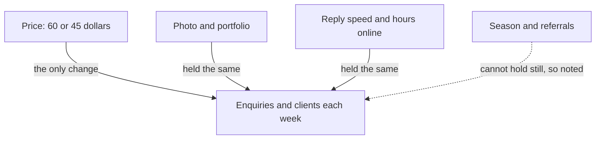

## Sami's first idea

Sami from chapter 3.1 wants to know if his price cut brought him more clients. His first idea is simple. "I will put my old profile back for one week and see if the clients stop coming." It sounds like a test. It is not a fair one.

Look at what the plan changes. In that one week, the photo goes back to the dark selfie, the price goes back to 60 dollars, and the portfolio goes back to the old designs. That is three changes again, only in the other direction. If his enquiries fall, he still will not know which of the three made them fall. He has rebuilt the same tangle he started with.

There is a second weakness. One week is very short. In module 2 you saw that an unusually good or bad week is often followed by a more normal one, even when nothing changed. A single quiet week could be bad luck, and a single busy week could be good luck. One week of anything tells Sami very little.

## The idea in plain words

A fair test changes one thing and keeps everything else the same. The one thing you change is the cause you want to check. Everything else is held still, so that if the result moves, the change you made is the main suspect.

The hard part is the phrase "everything else". It is always bigger than people think. For Sami, everything else includes the photo and the portfolio. It also includes the text on his profile, how fast he replies and how many hours he is online. It includes whether he posts his work in groups and what services he offers. And it includes the season, and whether past clients share his name. Any of these can move the number of enquiries.

So a fair test starts with a list. Write down the one change. Then write down everything else that could move the result, and sort the list into two parts. Some things you can hold still, like your reply speed. Some things you cannot hold still, like the season. For those, you write down what happens, so you can see later whether they got in the way.

## Worked example: Sami tests his price

Here is how Sami turns his question into a fair test, step by step. Notice that the reasoning matters more than the exact numbers.

**Step 1: Name the one change.** Sami's question is about money, so the change he tests is the starting price for a logo: 60 dollars or 45 dollars. He does not test the photo or the portfolio now. They cost nothing to keep, so he leaves the new ones in place for the whole test.

**Step 2: List everything else.** Sami writes his list in a notebook. It has nine items: photo, portfolio, profile text, reply speed, hours online, posts in groups, services offered, season, and referrals. He tries to be generous. A thing on the list that turns out not to matter costs nothing. A thing left off the list can spoil the test.

**Step 3: Hold still what he can.** He keeps the new photo, the new portfolio and the same profile text. He promises himself to reply within two hours during his working hours, every week. He will not post in design groups during the test, and he will not add new services. These are all things he controls, so he fixes them for the whole test.

**Step 4: Write down what he cannot hold still.** He cannot stop the season changing, and he cannot stop a past client from sharing his name. So each week he notes anything unusual: a referral, a holiday, a day with no power, a week when he was ill. If one week looks strange, the notebook may explain why.

**Step 5: Choose the order of the weeks.** Sami could run three weeks at 60 dollars, then three weeks at 45 dollars. But the season is changing as he tests, so the second block might do better just because it comes later. Instead he alternates. Weeks 1, 3 and 5 are at 60 dollars. Weeks 2, 4 and 6 are at 45 dollars. Now any slow change in the season is spread across both prices.

**Step 6: Decide what he will count.** Before the first week starts, Sami writes down two numbers to count: enquiries each week, and logo clients won each week. He also decides to look at the money he earns from those clients, because that was the reason for the test. Chapter 3.4 explains why deciding this first matters so much.

The diagram shows the shape of Sami's test. One arrow is the change he makes on purpose. The others are held still or written down.



What to notice: three of the four arrows are the same in every week of the test. The fourth is the same in every week except the ones the notebook marks. That leaves the price as the main thing that differs between a 60-dollar week and a 45-dollar week. If the two kinds of week give different results, the price is the first suspect. If they give the same results, the price was probably not doing much.

```predict
prompt: "Suppose the lower price really was what brought Sami's extra clients. What should he see in the weeks at 60 dollars?"
options:
  - id: falls-back
    label: "Enquiries fall back toward about 3 a week"
  - id: stays-same
    label: "Enquiries stay about the same as at 45 dollars"
correctOptionId: falls-back
explanation: "If the price cut caused the rise, taking it away should take the rise away too, so the 60-dollar weeks should look more like his old quiet weeks. If the 60-dollar weeks look like the 45-dollar weeks, the price was not what brought the clients."
```

Step through Sami's six weeks below. Watch the 60-dollar weeks: do they fall back toward the old three enquiries a week?

<InteractiveCanvas slug="one-change-price-weeks" />

The canvas showed the check that matters. Each 60-dollar week brought 6 or 7 enquiries, about the same as the 45-dollar weeks beside it. None of them fell back toward the quiet weeks before Sami changed his profile. The next section adds up what you just saw.


## What Sami found

In this example, here are Sami's six weeks. In the 60-dollar weeks (1, 3 and 5) he got 7, 6 and 7 enquiries, which is 20 in total. He won 3, 2 and 3 logo clients, which is 8. In the 45-dollar weeks (2, 4 and 6) he got 7, 8 and 6 enquiries, which is 21. He won 3, 3 and 3 logo clients, which is 9. His notebook shows one unusual event: in week 4, a friend of the café owner wrote to him after a recommendation.

The two kinds of week look almost the same: 20 enquiries against 21, and 8 clients against 9. Even the small gap has a possible explanation, because one of the week 4 enquiries came from a referral. The price cut did not bring back the quiet weeks when it was removed. So, in this example, the price was not the main reason his enquiries rose. Something else was doing that work: the photo, the portfolio, the season, or the referrals.

Now look at the money. Eight clients at 60 dollars is 480 dollars. Nine clients at 45 dollars is 405 dollars. The higher price earned 75 dollars more over three weeks, while bringing almost the same number of clients. Sami goes back to 60 dollars.

How sure can he be? Not completely. Three weeks of each price is a small test, and a difference of one or two enquiries a week can easily come from luck. But the decision is cheap to undo: if his enquiries fall at 60 dollars over the next month, he can lower the price again. So this result is a hint: run it again. Sami plans to repeat the test next season, and he keeps watching his enquiries until then. Chapter 3.4 shows how to make a test like this more trustworthy.

There is also something this test cannot tell him. It does not say whether the photo or the portfolio brought the clients, because both were held still the whole time. If Sami wants to know that, he needs another test that changes one of them. Since both are free to keep, he may decide it is not worth the trouble. That is a fine decision too. You do not have to test everything, only the things where the answer changes what you do.

## A second, quicker example

Layan's phone battery has been running out by mid-afternoon since she installed a new game. One evening she deletes the game, turns the screen brightness down and switches off location. The next day the battery lasts until night. Which change fixed it? She cannot say, because she made three changes at once, just like Sami.

A fair version is easy. Layan deletes only the game, and keeps brightness, location and her daily use the same. She checks the battery level at 16:00 on three ordinary weekdays before the change and three after. If the battery is clearly higher at 16:00 after the game is gone, the game is the main suspect. If it is about the same, she can then test brightness on its own. Each test answers one question, and each answer is clear.

## Where it goes wrong

The first mistake is changing something else by accident. In the middle of his test, Sami might post his work in a busy design group because a friend asks him to. Now that week has two changes. When this happens, do not hide it. Write it in the notebook, and if the week looks very different from the others, repeat it.

The second mistake is holding still only the things you thought of. If Sami had forgotten to list his reply speed, he might have replied faster in the 45-dollar weeks because he felt hopeful about them. Then the low price would look better than it is. The fix is to make the list wide before you start, and to ask, "What else could move this number?"

The third mistake is testing in two blocks while time moves on. A first block and a second block differ in the price, but also in the date, the season and the news. Alternating weeks helps. A stronger fix is to compare with a group that did not change at all during the same weeks, which is the subject of chapter 3.3.

The fourth mistake is a test that is too short. One week of each version is not enough, because one week can be unusually good or bad by luck. Run several weeks of each, and decide how many before you start.

There is an honest limit to this whole method. Sometimes two changes only work together, but that needs bigger tests than we cover here. For example, a new portfolio might bring clients only when the price is also fair. Changing one thing at a time cannot see that kind of teamwork between causes. For everyday questions, though, it is a safe place to start.

<Callout type="tip" title="Keep a test notebook">
Write the one change, the list of things you held still, and one line a week about anything unusual. It takes two minutes a week, and it is the only way to explain a strange result later.
</Callout>

## Check your understanding

```quiz
type: mcq
question: "Rasha sells handmade soap from her home in a small town, about 25 orders a month, through her online shop page. She wants to know if better product photos bring more orders. Which plan is the fairest test?"
options:
  - "Use new photos, lower prices and post daily for two weeks, then count orders"
  - "Ask ten loyal customers whether they like the old or the new photos better"
  - "Change the photos during the holiday sale week, when many people buy soap"
  - "Change only the photos, keep prices and posting the same, then count orders"
correct: 3
explanations:
  - "This changes three things at once. If orders rise, Rasha will not know whether the photos, the prices or the daily posts did it."
  - "Liking a photo is not the same as ordering. This asks for opinions instead of counting what customers actually do."
  - "A holiday sale week is unusual, so orders may rise for that reason alone. The photos would be tangled with the sale."
  - "Right. Only the photos change, and the prices and posting are held still, so a change in orders points at the photos. It is still a small test, so she should treat the result as a hint."
```

```quiz
type: mcq
question: "Tamer, a second-year student who works on an old laptop, wants to know if a cooling pad stops his laptop from slowing down. He uses the pad on Monday, Wednesday and Friday, but not on Tuesday, Thursday and Saturday. On the pad days he also does only light work. What is the main problem?"
options:
  - "Six days is too short to learn anything at all about the pad"
  - "Light work on pad days is a second change, so the two are tangled"
  - "He should have used the pad every day to give it a fair chance"
  - "Alternating days is unfair; he should use it for three days in a row"
correct: 1
explanations:
  - "Six days is short, so the result would only be a hint. But even a longer test would fail here, because of the second change."
  - "Right. Light work can also stop a laptop slowing down. On pad days two things changed, so he cannot tell which one helped. He should do the same kind of work every day."
  - "Using the pad every day leaves nothing to compare with, so he could not tell what the pad changed."
  - "Alternating days is a good idea. It spreads other changes across both kinds of day. Three days in a row would be easier to tangle with time."
```

**Next:** Even a careful one-change test can be fooled by time. Chapter 3.3 adds a group that did not change, to show what would have happened anyway.
