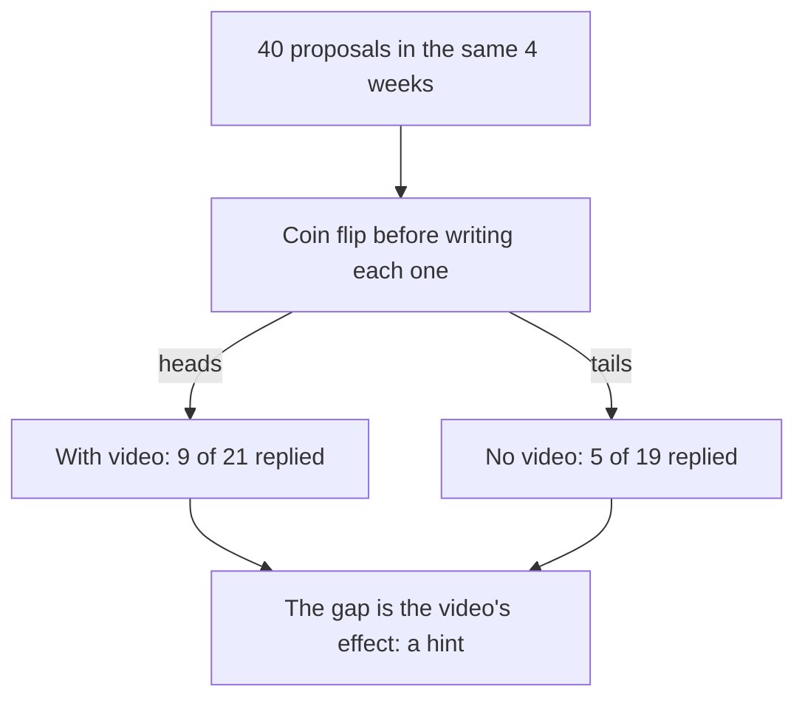

## Twelve out of twenty

A small NGO, a fictional one called Bridge to Work, runs a two-day workshop on CVs and freelance profiles. Twenty fellows attend. Two months later, the NGO asks them what happened. Twelve of the twenty have found paid freelance work. The NGO's report says, "Our workshop helped 12 of 20 fellows find work."

It is a good result, and the workshop may well have helped. But the sentence hides a question. How many of those twelve would have found work anyway, without the workshop? Fellows who sign up for a workshop on a Saturday are often the most motivated ones. They may also be sending more proposals, asking more friends and practising more. Some of them were going to find work in those two months whatever the NGO did.

So "12 of 20 found work" is not yet the effect of the workshop. To see the effect, you need to know what would have happened to similar fellows who did not attend. That is the job of a comparison group.

## The idea in plain words

You met the comparison group in chapter 3.1: cases that do not get the change. The important part is timing. A comparison group lives through the same weeks, the same season and the same luck as the group that does get the change. At the end, you compare the two groups. Anything that pushed both groups, like a busy season, shows up in both. The gap between them is your best estimate of what the change itself did.

This fixes the weakness you saw in chapter 3.2. When Sami compared weeks at one price with weeks at another, time kept moving. The season changed, and referrals came and went. Alternating the weeks helped, but it could not remove the problem. A comparison group running at the same time removes most of it, because both groups share the same calendar.

The second part of the idea is about who goes into which group. If you choose by hand, your hopes can affect the choice. People who want a test to succeed can, even without meaning to, put the promising cases into the change group. The fix is random assignment, from the key words in chapter 3.1: a coin flip or names drawn from a bowl decide who gets the change. When a coin decides, the two groups end up alike in the things that matter, including the things you never thought to check.

## Worked example: does a video note win more replies?

Sami has kept his price at 60 dollars. Now he has a new question. When he applies for a job on the freelance website, he sends a written proposal. A designer friend says that adding a short video note, one minute of Sami explaining his idea, wins far more replies. Each video takes Sami about ten minutes to record. Is it worth it?

**Step 1: Ask the question exactly.** "Does adding a one-minute video note to a proposal raise the share of proposals that get a reply?" The measure is replies, decided now, before he starts.

**Step 2: Notice the weak comparison.** Last month Sami sent 20 proposals without videos and got 4 replies, which is 1 in 5. He could add videos to every proposal this month and compare with last month. But this month is a different month. His new portfolio has been up longer, and the season is busier. Any rise would be tangled with those.

**Step 3: Notice the hand-picking trap.** He could add videos only to some proposals and compare them with the rest. But which ones? Sami admits he would record videos for the jobs he is most excited about. Those are the jobs that fit his skills best.

```predict
prompt: "Suppose Sami picks by hand which proposals get a video, and the video itself does nothing at all. Which group would you expect to get more replies?"
options:
  - id: video-group
    label: "The video group, as he picks jobs he fits best"
  - id: neither
    label: "Neither group, since all jobs are on one website"
correctOptionId: video-group
explanation: "The jobs Sami is excited about are the ones that suit him best, and clients reply more often to proposals that fit their job well. So the video group would win even if the video did nothing. The good fit is a hidden third factor, and choosing by hand let it in."
```

Step through the test below. It starts with last month, shows what picking by hand would do, and then lets a coin decide.

<InteractiveCanvas slug="comparison-group-video-test" />

The canvas showed two things. First, picking by hand would favour the video even if the video did nothing, because the good fit goes along with the video. Second, once a coin decides, the no-video group shows what happened anyway in the same weeks. The rest of this example walks through the same steps in writing.


This is why the choice must not be left to Sami. His excitement is not dishonest. It is normal. But it decides which jobs get videos, and the same thing, a good fit, also decides which jobs reply. Sami would think the video won the replies, when his good choice of jobs did.

**Step 4: Let a coin decide.** Before writing each proposal, Sami flips a coin. Heads, he adds a video. Tails, he does not. He flips before he reads the job closely, so his feelings about the job cannot change the result of the flip. Everything else stays the same: the same written template, the same price, the same reply speed.

**Step 5: Decide how many, then count.** Sami usually sends about ten proposals a week. He decides in advance to stop after 40 proposals, about four weeks, and only then to count replies. Chapter 3.4 explains why he must not stop earlier.

In this example, here is what happened. The coin gave 21 heads and 19 tails. A coin does not split exactly in half, and that is fine. Of the 21 proposals with a video, 9 got a reply. Of the 19 without a video, 5 got a reply.

## Reading the result

Turn the counts into shares so the groups can be compared. Nine out of 21 is a little over 4 in 10. Five out of 19 is a little over 1 in 4. The video group did better.

Now look at what the comparison group adds. Last month, with no videos at all, Sami's replies were 1 in 5. This month, the proposals without a video got about 1 in 4. Nothing changed in those proposals, yet they did better than last month. That rise came from something else: the season, the portfolio, or luck. Suppose Sami had used videos on every proposal and compared with last month. He would have seen replies go from 1 in 5 to about 4 in 10. He would have said, "Videos doubled my replies." The comparison group suggests that part of that rise would have happened anyway. Be careful here, though. Four replies out of 20 and five out of 19 differ by about one reply. With groups this small, that is only a hint. Sami would need to run it again to be sure the background really rose.

The real effect of the video, in this example, is the gap between the two groups this month: about 4 in 10 against about 1 in 4. For every 20 proposals, that is roughly three more replies. Each video costs ten minutes, so 20 videos cost Sami a little over three hours. Three extra replies for three hours of work is worth it for him, because a reply often turns into a paid job.

The diagram shows the shape of the test. One coin, two groups, the same weeks, and the gap between the groups is the answer.



Notice that the season, the portfolio and Sami's mood all reach both groups. Both groups run in the same weeks, and the coin, not Sami, decides which is which. That is why the gap belongs to the video. Notice too the word "hint" in the last box. Forty proposals is a small test. A gap of a few replies could still come partly from luck. Sami keeps using videos, and he plans to run the test again next season.

## A second example: the workshop, done fairly

Go back to the NGO. Next term, 40 fellows sign up for 20 places. Instead of taking the first 20 who signed up, the NGO draws 20 names from a bowl. Those fellows get the workshop now. The other 20 go on a waiting list and get the workshop next term, so nobody loses out for good.

Two months later, 12 of the 20 workshop fellows have found work. So have 9 of the 20 on the waiting list. All 40 fellows were motivated enough to sign up, and chance split them, so the two groups are alike. The workshop's effect, in this example, looks like about 3 extra fellows in work for every 20, not 12. But 20 fellows in each group is a small test, and 3 fellows can easily come from luck. So this is a hint: run it again next term. Even as a hint, it is a very different report, and a more honest one.

Compare that with a weak version of the same test. Suppose the NGO had compared its 20 workshop fellows with 20 fellows who never signed up at all. The workshop group would have looked much better, because signing up is itself a sign of motivation. Motivation would be the hidden third factor from module 2, pushing both "attended the workshop" and "found work".

## Where it goes wrong

The first mistake is choosing the groups by hand. It is a common mistake, and it usually feels reasonable at the time. "I gave the new method to the students who needed it most." "I tried the new message on our best customers first." Each choice makes the groups different before the test starts. Let a coin, a die or names from a bowl decide.

The second mistake is a comparison group from another time or place. Last year's students, last month's proposals or another city's shops did not live through the same weeks as your change group. They are better than nothing, but they let the season and the news back into the result.

The third mistake is letting the groups mix. Suppose Sami, while recording videos, learns to explain his ideas better, and starts writing better text in his no-video proposals too. Now the comparison group has changed as well, and the gap shrinks. Keep the comparison group's routine fixed until the test ends.

The fourth mistake is groups that are very small. A coin makes groups alike on average, but with three cases in each group, chance alone can make them very different. Chance works better as the groups grow. With small groups, read the result as a hint, and repeat the test.

<Callout type="info" title="Fair to people too">
When the change is something people want, like a workshop, a waiting list is a fair way to run a comparison. Everyone gets the change, and chance only decides who gets it first.
</Callout>

## Check your understanding

```quiz
type: mcq
question: "Batoul runs a fictional tutoring centre in her town with 60 students. She offers a free practice exam to any student who asks for it. Students who took it scored higher in the final exam. She wants to know if the practice exam caused this. Which check is the fairest?"
options:
  - "Compare the marks of students who took it with those who did not"
  - "Compare this year's marks with last year's, when no practice exam existed"
  - "Draw names by chance to decide who gets the practice exam, then compare"
  - "Give the practice exam only to the weakest students, since they need it most"
correct: 2
explanations:
  - "This is what Batoul already did. Students who ask for extra practice are often the most motivated, so motivation could explain the higher marks."
  - "Last year had different students, a different exam and different teachers. Time is tangled with the practice exam."
  - "Right. Chance decides who gets the practice exam, so the two groups are alike in motivation and everything else. The gap in final marks then points at the practice exam."
  - "Choosing the weakest students makes the groups different before the test starts. Their marks would differ for reasons that have nothing to do with the practice exam."
```

```quiz
type: mcq
question: "Yusra runs a small stationery shop near a school. She splits 60 regular customers by coin flip: 30 get a discount card, 30 do not. Last month all 60 spent about 90 shekels each. This month the card group spent about 120 shekels each, and the no-card group about 105. What do these numbers suggest?"
options:
  - "The card raised spending by 30 shekels, the full rise since last month"
  - "The card may add about 15 shekels each: a hint worth testing again"
  - "The card did nothing, because spending rose in both groups this month"
  - "Nothing, because a coin flip cannot make two groups of customers alike"
correct: 1
explanations:
  - "Part of that rise happened in the no-card group too, so it would have happened anyway. Only the gap between the groups belongs to the card."
  - "Right. Both groups rose, which shows something else pushed spending up this month. The card's likely effect is the gap between the groups: 120 minus 105, about 15 shekels each. With only 30 in each group, it is a hint, so she should run the test again."
  - "Spending rose in both groups, but more in the card group. The extra 15 shekels is the card's likely effect."
  - "A coin is exactly what makes the groups alike, because chance, not Yusra, decided who got a card."
```

**Next:** How to plan a small, cheap experiment: what to decide before you start, and why you must not stop early when you are ahead.
