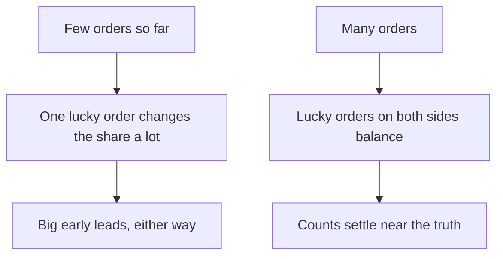

## Nine orders against four

Nadine runs a small online clothes shop, a fictional one, from her home. She has hired Sami, the designer from this module, to make a new banner for the top of her order page. Sami makes two versions. Version A is her old banner, a photo of the new collection. Version B is a clear line of text: "Free delivery on orders over 100 shekels."

Nadine wants to know which banner brings more orders. So Sami sets up her page to show each visitor one of the two banners by chance, like a coin flip for every visitor. They start on a Monday. On Wednesday evening Nadine sends Sami a message: "Version B has 9 orders and version A has only 4! B is more than twice as good. Let's stop the test and use B."

It looks like a clear win. Nadine is excited, and she wants to move on. But the test was planned to run much longer, and there are good reasons it should. This chapter explains them, and shows how to plan a small experiment so that a lucky start cannot fool you.

## The idea in plain words

A small experiment is a fair test you can run with what you already have: your own shop, your own clients, your own study group. An A/B test, from the key words in chapter 3.1, is one kind. You split people by chance into two groups, show each group a different version, and compare what they do. Chapter 3.3 showed why chance must do the splitting. This chapter is about the plan around the split.

The plan has a few rules, and all of them are about deciding things before you look at the results. Decide what you will measure, and stick to it. Decide how many cases you will wait for, or how many weeks, and stick to that too. Run for whole weeks, because weekdays and weekends can be very different. Do not stop early because one version is ahead. And when the test is small, treat a win as a hint, and run it again.

Why so much deciding in advance? Because results move around by chance, especially early on, and people are very good at finding the story they hoped for. If you choose your measure after you see the numbers, some number will always look better, just by luck. If you can stop whenever you like, you will tend to stop on a lucky day. Deciding first takes those choices away from your hopes.

## Worked example: Nadine's banner test

Here is the plan Sami and Nadine wrote before the test started. Each step has a reason.

**Step 1: Ask one exact question.** "Does banner B lead to more completed orders than banner A?" One change, the banner. Everything else on the page, including prices and photos, stays the same during the test.

**Step 2: Choose the measure first.** They count completed orders for every 100 visitors who see each banner. They write this down before the first visitor arrives. They do not choose clicks on the banner. A banner can get many clicks because it is confusing or flashy, while selling nothing. If a measure rewards a short-term trick, the trick will look like the winner. Orders are what Nadine actually needs.

**Step 3: Split by chance.** Every visitor has an equal chance of seeing A or B. Nadine does not pick who sees which, and neither does Sami.

**Step 4: Decide the length first.** Nadine's shop gets about 150 visitors a day, and about 3 visitors in every 100 place an order. That means a difference between the two banners will probably be small, a few orders a week. With few cases, chance can easily hide a small difference, so small differences need many cases. So they decide on four full weeks, Monday to Sunday, which is as long as Nadine can wait. They accept in advance that even four weeks may only give a hint.

**Step 5: Agree not to stop early.** They can look at the numbers during the test, but they agree that looking will not change the end date. The test ends after the fourth Sunday, whatever the numbers say before then.

**Step 6: Decide what they will do with each result.** If B is clearly better, use B. If the two are close, keep whichever is cheaper to run, and do not claim that it raised sales. Writing this down first stops them from arguing about it later.

Notice the order of the steps. The measure and the length come before the split, so the results cannot change them. There is no step where you look at the numbers and then decide what to do next. That decision was made at the start, before anyone knew which banner would be ahead.

```predict
prompt: "On Wednesday evening, version B has 9 orders and version A has 4. Should Nadine stop the test now and choose B?"
options:
  - id: stop-now
    label: "Yes, B already has more than twice as many orders"
  - id: keep-going
    label: "No, keep going for the four weeks she planned"
correctOptionId: keep-going
explanation: "Thirteen orders is a tiny number, and early counts swing a lot by chance. If you check every day and stop the first time one version is ahead, you will often choose a version that was only lucky. The planned four weeks protect Nadine from that."
```

Now step through the test day by day, and then week by week, to the end of the plan.

<InteractiveCanvas slug="stop-early-banner-test" />

The canvas showed the lead moving. B's lead of 5 orders on Wednesday shrank to 3 after week 1, and to 2 after week 2. After week 3, banner A was ahead, 47 to 46. Only at the planned end did the counts settle, at 66 to 61.


## What happened after Wednesday

Nadine agreed, a little unhappily, to keep going. Here is what the full four weeks showed, in this example. About 4,200 people visited her page, and the split gave each banner about 2,100 visitors. Banner A had 61 completed orders. Banner B had 66.

Both banners sold to about 3 visitors in every 100. B was ahead by 5 orders over four weeks, which is just over one order a week. That gap is small enough to be luck. The big early lead, 9 orders to 4, mostly disappeared. If Nadine had stopped on Wednesday, she would have told her friends that her new banner doubled her sales. It did not.

Why do early leads shrink? The diagram shows the reason as two short chains.



The first chain is the first few days of any small test. The second chain is what more cases give you. Stopping early means reading the first chain as if it were the second.

This is why stopping early is so risky. In the first few days, a handful of orders decides everything. Two or three lucky orders for one version make it look twice as good. As the days pass, luck on one side is balanced by luck on the other, and the counts settle near the truth. If you look every day and stop the first time you see a winner, you are very likely to stop during one of those lucky swings. The fix is not "never look". The fix is deciding the end of the test before it starts.

So what does Nadine do? Her plan already says: if the two are close, keep whichever is cheaper. Both banners cost the same, so she keeps B, but she does not claim that B raised sales. She also plans a second test next month with a bigger change: a new photo on the product pages. A bigger change is more likely to make a difference large enough to see.

## Other things a small test can get wrong

People react to new things just because they are new. Regular customers might click on a new banner because they have never seen it, and stop noticing it a week later. Other people dislike change at first and avoid the new version for a few days. Both reactions fade with time. A short test can make a new version look better or worse than it really is. Whole weeks, and more than one of them, give these reactions time to settle.

An A/B test tells you which version did better, and by about how much. It does not tell you why. If B had clearly won, Nadine still would not know whether it was the words "free delivery", the plain design, or simply the absence of the old photo. If she wants to know why, she needs another test that changes one of those things on its own.

A result also belongs to the people who were in the test. Nadine's test ran in one month, with her current visitors. If she starts selling to a new kind of customer, or the season changes a lot, the old result may not hold. Repeat a test before you trust it widely, especially with a different group. This is not because tests are useless. It is because one small test is a hint, and a hint becomes something you can rely on only when it shows up again.

Finally, a small business can always run a fair comparison, but with few customers the result will be weak. That is not a reason to skip the test. It is a reason to be honest about how sure you are. "In four weeks, the two banners did about the same" is a useful answer. It saves Nadine from believing a story about her banner that is not true.

## How sure can you be?

Every small experiment should end with two questions. How sure can I be? And what would make me surer? For Nadine, the answers are clear. She is not very sure, because the gap was small and the test was short. A second test, a longer test or a bigger change would make her surer.

You will not use formulas in this course. You will use these plain rules instead. Decide the measure first. Decide the number of cases or weeks first. Run whole weeks. Do not stop early because you are ahead. Treat one small test as a hint, and repeat it. These rules will not make every test perfect. They will stop three common ways that small tests mislead people: a lucky start, a measure chosen afterwards, and a story told too soon.

<Callout type="warning" title="No magic number">
People often ask how many customers is enough. There is no single number. It depends on how big a difference you hope to see: small differences need many more cases than big ones. Plan as long a test as you can, and be honest about what a small one can show.
</Callout>

## Check your understanding

```quiz
type: mcq
question: "Tamim runs a short online course in accounting with about 300 visitors a week. He tests two sign-up pages. After four weeks he looks at eight different numbers. Only one, the time people spent on the page, is better for page B. He reports that page B is better. What is the main mistake?"
options:
  - "He chose the measure after seeing the results, so a lucky number won"
  - "He should have tested more than two versions of the page at the same time"
  - "He should have run the test on weekdays only, when most people sign up"
  - "Time on the page is always the best measure for a sign-up page"
correct: 0
explanations:
  - "Right. With eight numbers, one or two will often look better by chance. He should have chosen one measure, such as sign-ups, before the test started."
  - "More versions would split his visitors into smaller groups and make chance even harder to see through. The problem is how he chose the measure."
  - "Weekdays only would leave out the weekend, when visitors can behave differently. Whole weeks are the safer plan."
  - "Time on a page can rise because a page is confusing. For a sign-up page, the number of sign-ups is the measure that matters."
```

```quiz
type: mcq
question: "Maha runs a juice stand near a football ground and sells about 80 cups a day. She tests two price boards, splitting the days by coin flip, from Monday to Thursday of one week. Board B sold more juice on its days. What is the best next step?"
options:
  - "Choose board B, because it sold more juice on the days it was used"
  - "Run it again for whole weeks, with weekends, and a set end date"
  - "Stop testing, because a juice stand is too small for any fair test"
  - "Use board B every day next week and compare with this week's A days"
correct: 1
explanations:
  - "Four days is a very short test, and it left out the weekend, when customers may behave differently. The win is only a hint."
  - "Right. Whole weeks include the weekend, and a set end date stops her from ending the test on a lucky day. Then she can see if the hint holds."
  - "A small business can still run a fair test. The result will be weaker, so she should be honest about how sure she is, not give up."
  - "This compares two different weeks, so the weather and other changes would be tangled with the board. Splitting days by chance in the same weeks is fairer."
```

**Next:** Five short cases to check your fair-test habits, then your own fair test plan in the module checklist.
