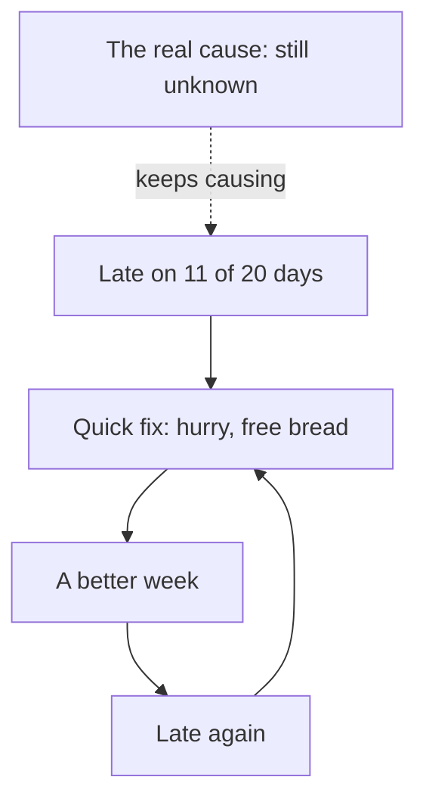

<BigWordAlert term="Root cause" plainEnglish="A cause deep enough in how things are done that fixing it stops the problem coming back." whyItMatters="If you only fix what you can see, the same problem returns, and you pay for it again and again." />

## Late again

Amal's family runs a small grocery shop on a busy street. Her father, Mahmoud, opens it every morning. Her mother, Ruwaida, and her aunt help behind the counter. Amal studies in the mornings and keeps the shop's accounts in the evenings. Last year the family started a delivery service. Customers phone in their orders in the morning, the family packs the bags, and Amal's cousin Hani delivers them on a bicycle. The shop promises that every order will arrive by 14:00.

The service is popular, but it has a problem. Hani rides one delivery round a day. Over the last 20 delivery days, the round arrived after 14:00 on 11 days. That is more than half. Some customers do not mind. Others do. Umm Rami, one of the shop's oldest customers, phoned twice in one week. Her order arrived at 14:40, after she had already gone out to buy bread somewhere else. "If you cannot bring it by two, do not promise two," she said.

Amal's family is not careless. They have tried to fix the problem three times. Each time it seemed to work for a while, and each time it came back.

## Three fixes that did not last

The first fix was a talk. Mahmoud told Hani to ride faster and to stop chatting with people on his round. Hani was hurt, but he tried. For about a week, fewer deliveries were late. Then the late deliveries came back, just as before.

The second fix was an apology. When a delivery was late, the family added a free bag of bread to the customer's next order. Customers liked the bread, and fewer of them complained. But the deliveries were still late, and the free bread cost the shop money every week. The problem had not changed. Only the complaints had become quieter.

The third fix is still being discussed. Mahmoud wants to buy Hani a faster bicycle. It would cost several hundred shekels, which is a lot of money for a small shop. Before he pays, Amal wants to be sure it will help. She has noticed something odd. On several mornings, she saw Hani sitting on the step outside the shop, waiting. He was not riding slowly. He was not riding at all.

```predict
prompt: "Mahmoud plans to buy Hani a faster bicycle. Before you read on, do you think this will stop the late deliveries?"
options:
  - id: probably-not
    label: "Probably not, the delay may start before he rides"
  - id: probably-yes
    label: "Probably yes, a faster bike makes every round shorter"
correctOptionId: probably-not
explanation: "A faster bike can only save time on the road. Amal saw Hani waiting on the step before his round, so at least part of the delay happens before he gets on the bicycle. If the bags are not ready, a faster bike means Hani waits longer and rides faster, and the customer still gets the order late."
```

## Why the problem keeps coming back

Each of the family's fixes was aimed at something they could see. They could see Hani on his bicycle, so they told him to hurry. They could see customers complaining, so they gave them bread. They can see that the bicycle is old, so they want a new one. None of these fixes asked a deeper question: what is happening before Hani leaves the shop?

The diagram shows the pattern the family is stuck in. A quick fix brings a better week, and then the problem returns, because nothing underneath has changed.



What to notice: the loop from "quick fix" to "late again" goes round and round. Each turn costs the family something: Hani's feelings, free bread, and maybe a new bicycle. The box marked "the real cause" is not part of the loop. The quick fixes never reach it. That is why the problem keeps coming back. As long as the real cause is untouched, every fix only treats the part of the problem the family can see.

This is the difference between a symptom and a root cause. A symptom is what you notice: late deliveries, angry phone calls, a tired rider. None of the family's fixes reached a root cause. Most problems have more than one root cause, and finding them takes some digging. But the digging is usually cheaper than paying for the same problem every week.

## What guessing costs

It is worth adding up what the guessing has cost so far. In this example, each free bag of bread costs the shop about 3 shekels. On the 11 late days, about 25 customers got their orders late. That is about 75 shekels of free bread in 20 delivery days, for a fix that changes nothing about the deliveries. A faster bicycle would cost several hundred shekels at once. Neither number is huge, but both are money spent on the parts of the problem the family can see.

Some costs do not show up in the accounts. Umm Rami bought her bread somewhere else on the day her order came late. If that happens often enough, she may start buying everything somewhere else. Hani has been told twice to hurry, for a delay that may not be his. And the family argues about the deliveries at dinner, because each person has a different theory and nobody has checked any of them.

## Hani's side of the story

When Amal asks Hani about the mornings she saw him waiting, he is quiet at first. Then he explains. Most days the bags are not ready until well after noon. He waits on the step, and when the bags come, he rides as fast as he can. He did not say this to his uncle. "He already thinks I am slow," Hani says. "If I say the bags are late, it sounds like I am blaming my aunt."

This is a common pattern in families and in teams. When the first answer to a problem is "whose fault is it?", the people closest to the work stop saying what they see. Hani knew something important for weeks, and nobody asked him in a way that felt safe to answer. Chapter 4.5 comes back to this. For now, notice that a very useful piece of evidence came from the person everyone was blaming.

## Why this matters at work

Amal's shop is small, but the pattern is everywhere. A website crashes every Monday, and someone restarts it every Monday. A client complains about files in the wrong size, and the designer resends them every time. A team misses deadlines, and the manager asks everyone to work late. Each fix works for a while. Nobody asks why the website crashes, why the files are wrong, or why the deadlines slip.

People who can find root causes are valuable in any job. In tech work, they write the review after a system fails and make sure it does not fail the same way twice. In client work, they fix the process instead of apologising again. In a small team or a family business, they save money and patience. This module teaches three tools for that work, and one important habit.

The three tools are simple. The first is to tell a symptom from a root cause. The second is the five whys: asking "why?" again and again, and checking each answer, to move from what you see toward a cause you can change. The third is the fishbone diagram: a way to list many possible causes in groups, so you do not stop at the first idea. The habit is to look for causes in steps, tools and information, not in a person to blame. It is also to choose a fix that changes the design, not only a reminder.

Amal's shop will stay with you through the whole module. You will follow her as she checks the delivery log and watches the shop in the morning. She digs from "Hani is late" to the cause that was really keeping the deliveries late. You will see what happens when a chain of whys stops at a person, and what a strong fix looks like.

You do not need special software for any of this. A notebook, a clock and the habit of asking "how do we know?" are enough. Every method in this module can be done on paper or on a phone, in a few minutes, with the people who do the work. The hard part is not the tools. It is the patience to check before you fix.

<LearningObjectives items={["Tell a symptom from a root cause, and explain why fixing only symptoms keeps problems coming back", "Use the five whys, checking each answer with evidence, and know where the method goes wrong", "Draw a fishbone diagram to list possible causes in groups before choosing which to check", "Find causes in steps, tools and information instead of a person to blame", "Choose a strong fix that changes the design over a weak one that asks people to remember"]} />

## Key words

| Word | Plain English |
|---|---|
| **Symptom** | What you notice when something goes wrong; not why it happened |
| **Process cause** | A cause in the steps, tools or information, not in a person |
| **Five whys** | Asking "why?" again and again, with a check each time, to reach a cause you can change |
| **Fishbone diagram** | A drawing that sorts possible causes into groups, like the bones of a fish |
| **Strong fix** | A change to the design or steps, so the mistake becomes hard to make |

## What is in this module

| Chapter | You will practice |
|---|---|
| 4.2 | Telling symptoms from root causes |
| 4.3 | The five whys, with evidence for each answer, on Amal's late deliveries |
| 4.4 | Fishbone diagrams: listing possible causes in groups, then choosing which to check |
| 4.5 | Looking for causes, not culprits, and choosing strong fixes |
| 4.6 | A graded quiz with five short cases |
| 4.7 | Five whys and a fishbone for a real or provided problem |

**Next:** How to tell a symptom from a root cause, and why the same event can be both.
