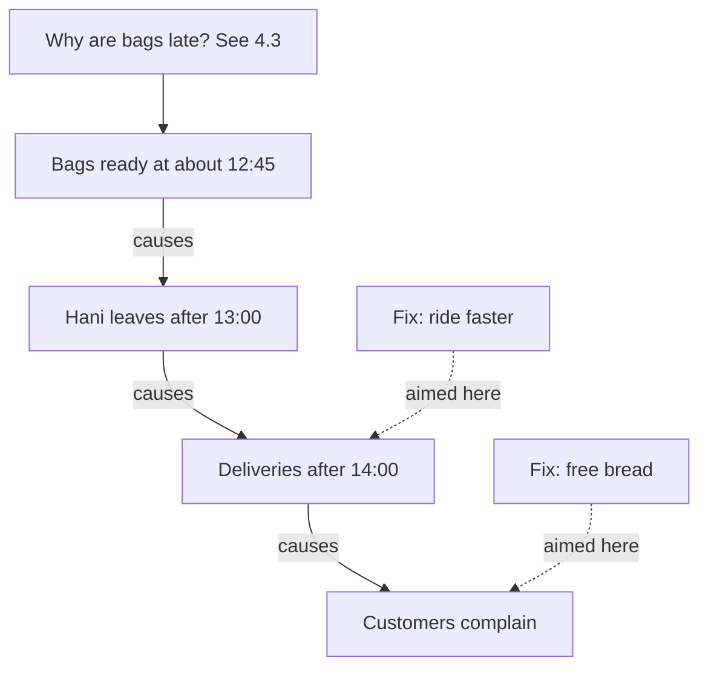

## A full phone every Wednesday

Tasneem's phone keeps running out of storage. Every Friday she spends half an hour deleting photos and videos to make space. By Wednesday the phone is full again, and it refuses to take a new photo. She has done this for two months. It works every time, and it never lasts.

One Friday, instead of deleting, she looks at what is filling the phone. Most of the new files are videos she never took. They come from a family chat group, where her cousins send many short videos every day. Her chat app has a setting that saves every video she receives into her gallery. She switches that setting off. The next Wednesday, her phone still has plenty of space.

Deleting files fixed what Tasneem could see: a full phone. Switching off the setting fixed why the phone kept filling up. The first is a fix for a symptom. The second is a fix for a root cause. Both made the phone usable, but only one stopped the problem coming back.

## The idea in plain words

You met both words in chapter 4.1. A symptom is real and it matters, but it does not tell you why the problem happened. A full phone, a late delivery, an angry client and a crashed website are all symptoms. The auto-save setting was a root cause of Tasneem's full phone: fixing it stopped the problem coming back.

Here is the part that surprises people. Symptom and cause are not fixed labels. They are positions in a chain. Every cause is also the effect of something earlier. A late delivery is a symptom that customers notice, but it is also the cause of their complaints. The rider leaving late is a cause of the late delivery, but it is also an effect of something that happens before he leaves. As you walk back along a chain, each link is the cause of the one after it and the symptom of the one before it.

So the question is not "is this a symptom or a cause?" The question is "is this deep enough?" A cause is deep enough when it passes three tests. Fixing it stops the problem coming back. It sits in a step, a tool, a rule or a piece of information that someone can change. And you can check it with evidence. If a cause fails these tests, keep digging.

Most problems also have more than one cause. Some are root causes. Others are contributing causes, which you met in chapter 1.2. A puncture on one day can make that day's round late. It contributed. But if deliveries are late on most days without a puncture, the puncture is not why the problem keeps coming back.

## Worked example: sorting Amal's list

Amal from chapter 4.1 decides to stop guessing. She writes down everything the family has noticed about the late deliveries, and then she checks each item. Her list has six items. Customers complain. The round arrived after 14:00 on 11 of the last 20 delivery days. Hani chats with people on his round. The bicycle is old. Hani leaves after 13:00 on most days. On several mornings Hani sat outside waiting for the bags.

**Step 1: Check each item with evidence.** Amal does not trust memory alone. The family keeps a delivery log, a notebook where Hani writes the time he leaves and the time of each delivery. The log shows that Hani left after 13:00 on most of the 20 delivery days, and that his round takes about an hour. It also shows one puncture in those 20 days. Then Amal watches the shop on three mornings. Each time, the packing ends at about 12:45, and Hani cannot leave before that. She also asks a few customers about the chatting. They say Hani stops to say hello, but only for a minute or two.

**Step 2: Put the items in order, cause before effect.** Bags not ready, so Hani waits. Hani leaves after 13:00. His round takes about an hour. So the later deliveries on the round arrive after 14:00. So customers complain. The old bicycle, the puncture and the chatting sit beside this chain, not in the middle of it.

```predict
prompt: "The log shows Hani leaves after 13:00 on most days. Is 'Hani leaves after 13:00' the root cause of the late deliveries?"
options:
  - id: yes-root
    label: "Yes, it is the reason deliveries arrive late"
  - id: no-deeper
    label: "No, it is the effect of something earlier"
correctOptionId: no-deeper
explanation: "Hani leaving late does cause late deliveries, but it is not deep enough. He leaves late because the bags are not ready, so if you fixed only his leaving time, he would have nothing to take. It is a cause of the late deliveries and a symptom of a problem further back."
```

Step through what happened to the family's fixes below. The path goes round more than once before anyone checks the chain.

<InteractiveCanvas slug="symptom-fix-loop" />

The canvas showed the pattern from chapter 4.1 in order. Each quick fix brought a better week, and each time the path came back to "Late again", because neither fix touched why Hani leaves late. Only checking the chain moved the path somewhere new: to the bags, ready at about 12:45. Steps 3 to 5 below test each item on Amal's list in the same way.


**Step 3: Test each item: if we fixed only this, would the problem stop coming back?** Complaints: the free bread already quietened them, and the deliveries stayed late. So complaints are the outer symptom. Riding faster: the round takes about an hour, and riding faster might save ten minutes. That explains why the "hurry" talk helped for a week, because it moved a few deliveries to just before 14:00. But Hani still leaves after 13:00, so most of the problem stays. The bicycle: one puncture in 20 days can make one round late, so it is a contributing cause at most. A new bicycle would not stop the problem on the other days. The chatting: a minute or two at a few doors is small next to a late start.

**Step 4: Find the item that the others depend on.** Everything on the chain starts with the bags not being ready until about 12:45. Hani cannot leave without them. If the bags were ready at 12:00, Hani could leave right away, and even with a slow round he would be back before 14:00. So "bags not ready until about 12:45" is deeper than anything the family has tried to fix. It passes the first test.

**Step 5: Ask whether it is deep enough.** Is "bags not ready" something the family can change directly? Not yet, because nobody knows why the bags are late. Is it packing that is slow? Is it starting late? Is something stopping the family from starting? Amal has found where to dig, but she has not reached the bottom. Chapter 4.3 follows the chain further, one why at a time.

The diagram shows Amal's chain, from the deepest point she has reached so far down to the symptom customers notice. The dotted arrows show where the family's fixes were aimed.



What to notice: both fixes were aimed at the bottom of the chain, near what people could see. Nothing was aimed at the bags, and nothing at the question above them. That is why the problem kept coming back. The takeaway is simple: a fix only lasts if it reaches a link that the rest of the chain depends on.

## Symptom fixes are not always wrong

A symptom fix is not a mistake in itself. Tasneem had to delete files on the first Friday, or she could not take photos at all. Amal's family could phone customers when a delivery is running late, so nobody waits without knowing. A symptom fix protects people for a short time while you look for the cause. The mistake is stopping there, as if the quick fix were the cure.

The goal is also not "the deepest cause possible". It is a cause that stops the problem coming back, and that you can change. Sometimes a fix close to the problem does that job well. You will see this again in chapter 4.3.

## Where it goes wrong

The first mistake is stopping at the first cause you see. "Hani is slow" was the first cause the family saw, because Hani was the person they could watch. It was not even true: his round was normal. The fix is to write down everything you have noticed and check it, as Amal did, before choosing.

The second mistake is calling a person the root cause. "Hani is slow" or "the packer is careless" are where an investigation starts, not where it ends. A person's mistake is usually made easier by a step, a tool or missing information. Chapter 4.5 is about this.

The third mistake is digging to a cause nobody can change. "Customers want everything fast" or "the street is busy" may be true, but the shop cannot change them. Keep digging toward a step, a tool, a rule or a piece of information inside the family's control. That is where a fix can live.

The fourth mistake is expecting one root cause. Many problems have two or three causes working together. If you find one, ask whether it explains all of the problem. If it explains only some of the late days, there is another cause to find.

<Callout type="tip" title="Three questions for any cause">
If we fixed this, would the problem stop coming back? Is it in a step, tool, rule or piece of information we can change? Can we check it with evidence? If any answer is no, keep digging.
</Callout>

## Check your understanding

```quiz
type: mcq
question: "Joud, a freelance designer, got the same complaint from 4 of her last 10 clients: wrong file sizes. Her brief form asks about colours and style, not sizes. She checks every file against the brief. All four were social media jobs, where each platform needs its own size. Which root cause should she check first?"
options:
  - "Her process has no step to check files before sending"
  - "Clients forget to tell her which sizes they want"
  - "She resends the files too slowly after a complaint"
  - "Her brief form never asks which sizes clients need"
correct: 3
explanations:
  - "She does check every file against the brief. The check cannot catch a wrong size, because the brief never says which size is right. The gap is earlier, in the form."
  - "This puts the cause on the clients. The form never asks them, so they have no reason to say. The step Joud controls is the question in her form."
  - "Resending is a symptom fix: it repairs each case but does not stop the next one, however fast she is."
  - "Right. The jobs need many sizes, and the form never asks for them. If the sizes are asked at the start, the wrong sizes should stop. She can check it by reading her last 10 briefs."
```

```quiz
type: mcq
question: "Malek delivers eggs from his family's farm to 40 homes. Each week, 3 or 4 homes get the wrong number of trays, and he drives back. A neighbour suggests a cause: phone orders are written on a notepad in the van, often while Malek is driving. Which question best checks that cause?"
options:
  - "How long does each trip back with the missing trays take?"
  - "Were the mistakes on days with more homes on the round?"
  - "Do the wrong deliveries match orders taken by phone?"
  - "Would a bigger van cost less than all the trips back?"
correct: 2
explanations:
  - "This measures the cost of the symptom. It does not say why the numbers are wrong."
  - "Busy days could be another cause worth checking later. But this question does not test the neighbour's idea about the notepad."
  - "Right. If the wrong deliveries are mostly phone orders written in the van, the notepad is a strong suspect. If they are spread across all kinds of orders, Malek should look elsewhere."
  - "This jumps to a fix before checking any cause. A bigger van would not change how orders are written down."
```

**Next:** The five whys: following Amal's chain from the bags to a cause the family can change, and seeing where the method goes wrong.
