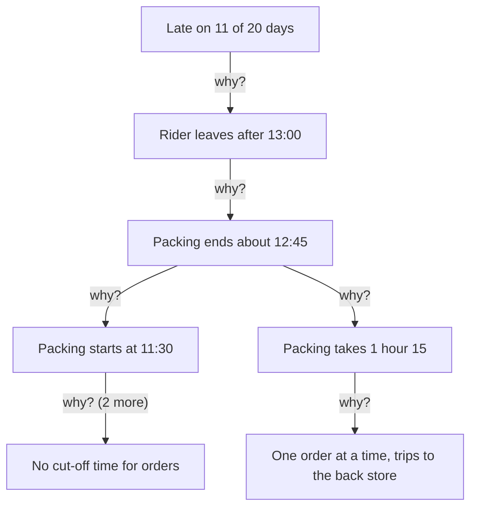

## One why, and a wrong answer

When Amal shows her father the delivery log, Mahmoud reads it and sighs. "Why are the deliveries late? Because Hani is slow. I keep telling him." For Mahmoud the question is closed. He asked why once, he got an answer, and the answer was a person.

It is a very normal way to think. Hani is the last person to touch the order before the customer gets it, so he is the person everyone sees. But chapter 4.2 already showed that Hani's round is normal and that he often waits outside for the bags. "Hani is slow" is not true. Even if it were, it would not explain why he leaves after 13:00. One why stopped the search at the person everyone could see. That is a common way for a search for causes to go wrong.

This chapter teaches a simple method for going further: the five whys, from the key words in chapter 4.1. It is easy to learn and easy to misuse, so you will learn both how it works and where it breaks.

## The idea in plain words

The five whys comes from a large Japanese car maker's factory system. One of its engineers, Taiichi Ohno, told teams to ask "why?" five times when they found a problem. The idea is that the first answer is rarely the real cause. Each answer becomes the next question, and the chain moves from what you can see toward how the work is done. The fix comes from the bottom of the chain, not from the top.

Two rules make the method work. The first is to answer each why by checking, not by guessing. A senior engineer from the same company warned that each why must be answered by looking, not guessing. Look at the log, watch the work, ask the people who do it. A guessed answer can send the whole chain in the wrong direction, and every why after it will be wrong too.

The second rule is about when to stop. Five is a habit, not a rule. Stop when you reach a cause in a process that you can change and check. Sometimes that takes three whys, sometimes six. If your chain ends at a person, at the weather, or at "that is just how customers are", you have not reached the bottom. You have reached a place where nothing can be fixed.

## Amal's problem, stated exactly

Amal starts by writing the problem down with numbers. That way, everyone agrees what they are explaining. Hani rides one delivery round a day. Over the last 20 delivery days, the round arrived after 14:00, the time the shop promises, on 11 days.

Mahmoud is still sure that the chain will end at Hani. Amal is not sure where it will end. Before you follow the chain yourself, decide what you expect.

```predict
prompt: "Before you follow Amal's chain, what kind of cause do you expect to find at the bottom of it?"
options:
  - id: missing-step
    label: "A missing step in how the shop works"
  - id: person
    label: "A person who is not doing their job well"
correctOptionId: missing-step
explanation: "The chain runs from the rider, to the packing, to the waiting, to a rule that nobody ever made: there is no cut-off time for same-day orders. Every person in the chain is doing their best with the way the shop works. The cause is in the process."
```

The stepper below walks through the chain one why at a time. Try to say the next cause before each step shows it. Step 6 shows whether your prediction was right.

<InteractiveCanvas slug="five-whys-chain" />

**What this shows:** one problem traced back through five whys, from late deliveries to a missing cut-off time, with the evidence for each step. **Try this:** count the whys, and ask whether a sixth why would still lead to something the shop can change. **What changed:** at each step, the cause moved further from what customers see and closer to how the shop works. The last step went back to the rider and showed a weaker chain, one that stops at "because the rider is slow". **Limits of the model:** real problems often have more than one chain, and five is a habit, not a rule.

## The chain in writing, with its evidence

Here is the same chain written out, so you can see the evidence behind each why. Notice that every answer was checked before Amal asked the next question.

**Why are the deliveries late?** Because Hani, the rider, leaves after 13:00 on most days, and his round takes about an hour. Evidence: the delivery log, where Hani writes his leaving time and each delivery time.

**Why does he leave so late?** Because he cannot leave until the bags are packed, and packing usually ends at about 12:45. Evidence: Amal watched three mornings and wrote down the times.

**Why does packing end so late?** Because packing only starts at 11:30, and it takes about an hour and a quarter. Starting at 11:30 and working for an hour and a quarter brings you to 12:45. Evidence: the same three mornings.

**Why does packing start so late?** Because customers phone in orders all morning, and the family waits until the calls stop, at about 11:30, before packing anything. Evidence: Amal asked her mother and aunt why they wait. "If we start early, someone always calls with another order, and we have to open the bags again."

**Why do they wait for the calls to stop?** Because the shop never set a cut-off time for same-day orders, so nobody knows when to start. This is a step in the process, and the family can change it.

The fix follows from the last why: orders received by 10:00 go out the same day, and later orders go out the next morning. Check the times. If packing starts at 10:00 and takes about an hour and a quarter, it ends at about 11:15. Hani can leave soon after, and a round of about an hour brings him back well before 14:00.

The family agrees to try it for two weeks and count the late days. They will compare with the 11 late days out of 20 before the change. That comparison has a weakness, which module 3 warned about. The 20 days before may have been unusually bad, and the next days could be better even with no change. A cheap way to make the test stronger is to repeat it later, or to alternate weeks with and without the cut-off time. Even then, two weeks is a hint, not proof.

Look at the canvas's last step again. The weak chain blames Hani, and it fixes nothing. If the family replaced him, a new rider would also leave late, because the bags would still not be ready. Blame felt like an answer, but it left every real cause in place. The strong chain never needed to blame anyone. It found a missing rule, which is much easier to fix than a person.

The "try this" question has a useful answer too. A sixth why might ask, "Why did the shop never set a cut-off time?" The answer is that the delivery service started small, with a few orders, and nobody needed one then. That is interesting, but it points to nothing new to change. The cut-off time is still the thing to fix. When a further why stops giving you something you can act on, you have gone deep enough.

## Where the method goes wrong

The five whys is popular, but popularity is not proof. A safety researcher who wrote about the method in hospital quality work points out that its wide use does not come from evidence that it works. The same researcher argues it should not be used to investigate incidents in hospitals, while agreeing it is a good way to teach that distant causes matter. That is a serious warning. It does not mean the method is useless for a shop's late deliveries. It means you should know its weak points, which are the same in a shop as in a hospital.

**It stops at blame.** A common failure is a chain that ends at a person: "because Hani is slow", "because the packer forgot". The fix that follows is a reminder or harsh words, and the problem comes back with the next person. If your chain ends at a person, ask one more why: what in the steps, the tools or the information made this easy to do?

**It runs on guesses.** If you answer each why from your desk, you will produce many possible causes and have no way to rank them. Amal checked every why with the log, her own eyes or a direct question. If you cannot check a why yet, mark it as a guess, and check it before you act on it.

**It follows one chain only.** Different people can build different chains for the same problem, and both can be valid. Real problems usually have more than one root cause. The method forces you down one path at a time, so you must look for branches on purpose.

Here is a second branch in Amal's case. At why 3, there were two facts: packing starts late, and packing takes an hour and a quarter. The main chain followed the late start. But the long packing time deserves its own why. Amal watches again and finds that the family packs one order at a time, walking to the back store for each heavy item, such as rice and oil. That is a second cause, and it has its own fix.

The diagram shows Amal's problem with both branches. Each arrow asks "why?", and the answer is in the box it points to.



At "packing ends about 12:45" the chain splits, because two different facts explain it. A single chain of five would have followed only one branch. So when one why has two true answers, follow both. The cut-off time is the main root cause in this example, because it moves packing more than an hour earlier. The packing method is a contributing cause, and fixing it would make the rest of the morning easier too.

**The deepest why is not always the best place to fix.** Suppose you ask why customers order so late in the morning. Perhaps families decide what to cook mid-morning. The shop cannot change how families plan their meals, and it does not need to. The cut-off time works whatever the reason customers order late. A fix at one link can block every cause below it.

<Callout type="tip" title="One check per why">
Next to each why, write how you know: a log, a count, something you watched, or a direct question. A why with nothing next to it is a guess.
</Callout>

## Check your understanding

```quiz
type: mcq
question: "Zaid's three-person web team looks after a client's shop website. It went offline 3 times this month. Outage 1: an unpaid bill, after the payment card expired. Outages 2 and 3: Friday nights, right after an automatic update ran with nobody watching. The team has now set a card-expiry reminder. What should they do next?"
options:
  - "Nothing more, since the chain reached a root cause and it is fixed"
  - "Ask more whys about the card, to dig deeper on the first chain"
  - "Follow a second chain: why do updates run with nobody watching?"
  - "Treat it as bad luck, since the outages had different causes"
correct: 2
explanations:
  - "The card chain explains only outage 1. Two of the three outages had a different cause, which the reminder does not touch."
  - "Digging deeper on the card chain cannot explain outages 2 and 3. They point to a different branch."
  - "Right. Outages 2 and 3 show a second pattern: unwatched Friday updates. Problems often have more than one root cause, so the team should follow this branch with its own whys."
  - "Two of the three outages share one pattern. A repeated pattern is a cause to follow, not bad luck."
```

```quiz
type: mcq
question: "Suha, Sami's cousin, works at a clinic desk. Patients waited over 30 minutes on 9 of 20 mornings. Her first why: 'the doctor starts late.' But he started on time on 7 of those 9. On those 9 mornings, 6 or more patients came in the first 15 minutes; on others, 3 or fewer. Which why next?"
options:
  - "Why does the doctor start late on so many of these mornings?"
  - "Why does signing in each patient take so long at the desk?"
  - "Why is the waiting room too small for all the patients?"
  - "Why do so many patients arrive together on those mornings?"
correct: 3
explanations:
  - "The sign-in sheet shows the doctor was on time on 7 of the 9 mornings. Her first answer was a guess, and the evidence does not support it."
  - "Sign-in is the same on every morning. On calm mornings there are no long waits, so sign-in speed does not explain the difference."
  - "Nothing in the facts points at the size of the room. This why starts from a guess, not from what she checked."
  - "Right. The long waits come on mornings when many patients arrive at once. That checked answer replaces her first guess, and the next why follows from it."
```

**Next:** Fishbone diagrams: a way to list many possible causes in groups, so you do not follow only one chain.
