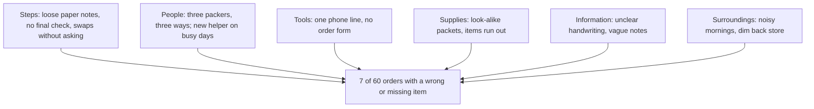

## A new problem in the shop

The cut-off time from chapter 4.3 is working well so far. In the two-week test, the round was late on only 1 of 10 delivery days, against 11 of 20 days before. Ten days is a small test, so it is a hint, and the family keeps counting. But now a different complaint is growing. Customers are finding the wrong items in their bags, or missing ones. Last month, 7 of the shop's 60 phone orders, delivered and collected, had a wrong or missing item.

Everyone has a quick answer again. Mahmoud says the new helper, Amal's younger brother Yazan, is careless. Ruwaida says the shop is too noisy in the morning. Hani says customers forget what they ordered. Each answer is one idea, from one person, about one part of the shop. After the five whys, Amal knows that following the first chain is risky. So before digging, she wants to see all the possible causes at once.

## The idea in plain words

You met the fishbone diagram in the key words of chapter 4.1. Here is how you draw one. You write the problem at the head of a fish. You draw a spine back from the head, and bones off the spine. Each bone is a group of causes. Under each group, you write every possible cause that people can think of. It is also called a cause-and-effect diagram, or an Ishikawa diagram, after Kaoru Ishikawa, a Japanese quality expert who made it widely known.

The groups matter because they push you to look in places you would skip. Ishikawa used six general groups, often listed as materials, machines, methods, measurement, people and environment. Sometimes money is added as a seventh. He encouraged teams to rename the groups so they make sense to the people using them. For a small shop or a small team, six names work well. **Steps** means how the work is done. **People**, **tools** and **supplies** mean what they say. **Information** means what people are told, and what gets written down or counted. **Surroundings** means the place and the conditions.

A fishbone only lists possible causes. It is not evidence that any of them happened. Keep that sentence in mind for the rest of the chapter. A fishbone helps you list possible causes so you do not forget any. Then you still have to check them.

## Worked example: Amal's fishbone

On a quiet afternoon, Amal sits down with her mother, her aunt, Yazan and Hani. She brings a large sheet of paper. Here is how they build the fishbone, step by step.

**Step 1: Agree the problem exactly.** At the head they write: "7 of 60 phone orders last month had a wrong or missing item." Not "packing is bad" or "Yazan makes mistakes". An exact problem keeps everyone looking at the same thing, and it does not blame anyone before they start.

**Step 2: Draw the spine and the six groups.** Amal writes steps, people, tools, supplies, information and surroundings along the bones. The groups are there so that nobody's favourite idea fills the whole page.

**Step 3: Fill each group by asking "why does this happen?"** Under steps, they write three causes. Orders are written on loose scraps of paper. Nobody checks the bag against the order before closing it. When an item has run out, the packer swaps it without calling the customer. Under people, they write two. Three people pack, each in their own way. Yazan is new and packs on busy days. Under tools: there is one phone line, so orders are taken fast during the rush, and there is no printed order form. Under supplies: some packets look alike, such as two kinds of lentils and two sizes of oil. Some items also run out. Under information: handwriting can be hard to read. Some customers just say "the usual", and nothing records what that means. Under surroundings: the shop is noisy in the morning, and the back store is dim.

**Step 4: Keep asking why for sub-causes.** Why are orders on loose scraps? Because there is no order book, and whoever answers the phone grabs the nearest paper. Why do packers swap items without calling? Because calling takes time in the rush, and nobody agreed what to do when something runs out.

**Step 5: Look where there are few ideas.** The lists in step 3 are the final ones. At first, the people bone was the most crowded, with "Yazan is careless" and "the packers do not check", and the information bone was empty. Amal asked two questions. For each people idea: what made this mistake easy to make? That turned "the packers do not check" into "no final check" under steps. For the empty bone: what do we know when we pack, and what do we not know? That question filled the information bone, and it turned out to matter most.

The diagram below shows Amal's fishbone in a phone-friendly form: each group is one box, with its possible causes inside, and every group feeds the problem.



What to notice: the drawing holds thirteen possible causes from six different places. Without it, the family would have argued about one idea each: Yazan, the noise, the customers. With it, they can see that most of the ideas are about how orders are written and passed along, not about one person. The takeaway: a fishbone gives you breadth. It shows where to look. It does not yet say where the cause is.

```predict
prompt: "Amal's fishbone now lists thirteen possible causes. Before she checks anything, what can she honestly say about them?"
options:
  - id: only-possible
    label: "Only that they are possible; none is shown yet"
  - id: mostly-real
    label: "Most are probably real, since the family knows the shop"
correctOptionId: only-possible
explanation: "A fishbone lists candidates. People who know the work are good at suggesting causes, but a suggestion is not evidence. Until Amal checks the seven wrong orders, every bone is a possibility, including the ones that sound most likely."
```

Step through the family's fishbone below, group by group, and then through Amal's checks.

<InteractiveCanvas slug="fishbone-check-evidence" />

The canvas showed the two halves of the method. Filling the bones took six steps and gave thirteen possible causes, none of them checked. Checking the seven wrong orders left two causes with evidence behind them. The next section explains how Amal chose what to check.


## Step 6: choose which causes to check, and check them

This is where many teams stop, and it is the step that matters most. Amal cannot check thirteen causes at once, so she chooses the ones that are both likely and easy to check. Luckily, the family keeps the paper notes in a box under the counter. She takes out the notes for the seven wrong orders and compares each one with what the customer said was wrong.

In this example, here is what she finds. In 4 of the 7 orders, the note was unclear: twice the handwriting was hard to read, and twice the note just said "the usual". In 2 of the 7, an item had run out and the packer swapped it without asking. In 1 of the 7, she cannot find a reason. That accounts for all seven: 4, plus 2, plus 1.

She also checks two popular ideas. Was it the noise? The seven mistakes were spread over busy and quiet mornings, 4 on busy days and 3 on quiet days, so noise does not stand out. Was it the look-alike packets? In none of the seven orders was the wrong item a look-alike of the right one. And was it Yazan? He packed 2 of the 7 orders, and the other packers packed 5. Both of his mistakes came from unclear notes, the same cause as the others.

So, from thirteen candidates, two have evidence behind them: unclear order notes, and swaps made without asking. Both sit in the steps and information groups. Neither is a person. Chapter 4.5 shows how to choose strong fixes for them.

## Using the fishbone with the five whys

The two tools do different jobs. The fishbone is wide: it spreads out every possible cause, so that one person's favourite idea does not win by being said first. The five whys is deep: it takes one cause and follows it down, one checked answer at a time. In practice they work well together. Draw the fishbone to see the options, check a few likely causes, then use the five whys on the causes that the evidence supports.

Amal could do that now. Why are the order notes unclear? Because there is no order form, so each person writes in their own way. Why is there no form? Because nobody ever needed one when the shop took only a few phone orders. That chain ends at a step the family can change.

## Where it goes wrong

A serious mistake is treating the fishbone as proof. Every bone feels true when you write it, and a drawing full of causes looks like an answer. It is not. Every fishbone task should end with the same question: which two causes will we check first, and how?

The second mistake is a fishbone with one crowded group. If almost every idea sits under people, the group is probably looking for someone to blame, not for causes. Ask what in the steps, tools and information made each of those people's mistakes easy to make. Then move the ideas to where they belong.

The third mistake is a vague head. "The shop is not doing well" will collect every complaint anyone has ever had. An exact problem, with a number and a time, keeps the bones relevant. The fourth mistake is drawing it alone. The people who do the work know causes that the manager has never seen, just as Hani knew about the waiting. And for a large, complex problem, a fishbone is one useful tool among several, not the whole investigation. For a small shop or a small team, it may be all you need.

## Check your understanding

```quiz
type: mcq
question: "Maha runs a juice stand near a football ground. On 5 of her last 12 working days, she ran out of oranges before noon. Her fishbone has six causes under people, such as 'the helpers squeeze too fast', and none under supplies or steps. What is the best next move?"
options:
  - "Fix the people causes first, since that group has the most ideas in it"
  - "Ask why under supplies and steps, where there are no ideas yet"
  - "Remove the empty groups, since the problem clearly sits with people"
  - "Pick the cause most people agree on, and start fixing it this week"
correct: 1
explanations:
  - "A crowded people group often means the team is looking for someone to blame. The number of ideas in a group is not evidence."
  - "Right. Empty groups are where nobody has looked yet. Asking why under supplies might show a cause such as an orange order that is the same size every day, whatever the weather."
  - "Empty groups are a warning sign, not proof that the cause is elsewhere. Removing them hides the places nobody checked."
  - "Agreement is not evidence. Maha should check the likely causes first, wherever they sit."
```

```quiz
type: mcq
question: "Nadine, the online clothes seller from module 3, sends about 120 parcels a month. Last month, 9 parcels came back as undeliverable. Her fishbone for this problem lists eleven possible causes. What should she do next?"
options:
  - "Fix all eleven causes at once, so nothing is missed this time"
  - "Choose the cause that sounds most likely and fix it right away"
  - "Add more groups until every possible cause is on the drawing"
  - "Pick two or three likely causes and check them with evidence"
correct: 3
explanations:
  - "Fixing everything at once costs a lot, and she will not learn which fix worked. Most of the eleven may not be causes at all."
  - "'Sounds most likely' is still a guess. A quick check could show it is wrong before she spends effort on it."
  - "More bones give more possibilities, not more evidence. Eleven is already plenty to start checking."
  - "Right. A fishbone lists candidates. The next step is to choose a few that are likely and easy to check, for example by reading the addresses on the 9 returned parcels."
```

**Next:** Causes, not culprits: why blaming a person fixes nothing, and how to choose a strong fix over a weak one.
