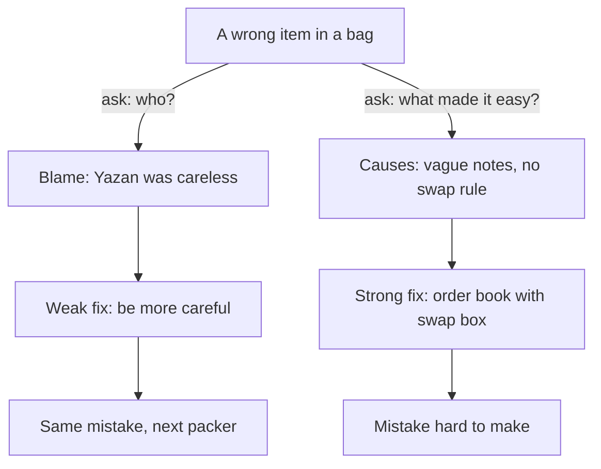

## Be more careful

When Amal shows her family the evidence from chapter 4.4, Mahmoud nods, and then turns to Yazan. "Two of those wrong orders were yours. From now on, be more careful." He also tapes a sign above the packing table: CHECK EVERY ORDER. Yazan says nothing. He feels that everyone now thinks the whole problem is his fault.

Two weeks later, a customer finds four bags of sugar in her order instead of one. This time Ruwaida packed it. The note said "1 kg sugar", but it was written in a hurry, and the 1 looked like a 4. Nobody was careless on purpose. The sign was right above the table. The mistake happened anyway, to a different person, for the same reason as before.

Blame moved from Yazan to Ruwaida, and the problem stayed exactly where it was. This chapter is about why that happens, and about what to do instead. Look for causes in how the work is done. Then choose fixes that make the mistake hard to make.

## Causes, not culprits

When something goes wrong, the first question many people ask is "who did it?". It feels like a reasonable question, and it has a quick answer. But it stops the search at the moment it should start. A person's mistake is where an investigation begins, not where it ends. The useful question is a different one: what in the steps, the tools or the information made this mistake easy to make?

There are three good reasons for asking it. First, you cannot fix people, but you can change steps and tools so that people find it easy to do the right thing. Ruwaida and Yazan were not the problem. Hurried notes on loose paper were. Second, blame makes people hide problems. If finger-pointing is normal, people stop reporting what they see, because they fear being punished. You saw this with Hani in chapter 4.1, who knew about the late bags for weeks and said nothing. Third, blame gives a false sense of being finished. "Yazan was careless" sounds like a cause, so nobody looks further.

Safety experts in hospitals and aviation have long worked this way. Their reviews after a mistake look for the causes without accusing any person, and they assume that everyone did their best with the information they had at the time. Guidance used in hospital root-cause reviews goes further: it says cause statements should focus on the system and must not blame individuals.

There is an honest limit. Without blame does not mean without responsibility. Honest mistakes, like misreading a hurried note, are treated as information about the process. Doing harm on purpose, or being reckless, is different, and it is not excused. Module 8 returns to this line. In everyday work, almost every mistake you investigate will be an honest one.

## Rewriting a cause sentence

A simple way to practise is to rewrite cause sentences. A blame sentence names a person and stops. A process sentence names what made the mistake easy, and it points at something you can change.

Take "Yazan packed the wrong lentils." Ask what made it easy, and check. The note said only "the usual", and nothing in the shop recorded what that customer's usual order was. So here is the process sentence. "The order note said 'the usual', and the shop keeps no record of regular orders." Now take "Ruwaida packed four bags instead of one." The process sentence is: "Orders are written in a hurry on loose paper, so numbers are easy to misread." Neither sentence mentions a person, and both suggest a fix.

## Strong fixes and weak fixes

Once you have a process cause, you need a fix. Not all fixes are equal. Guidance used in hospitals for root-cause reviews ranks them from weaker to stronger, and the ranking works just as well in a shop.

The **weaker fixes** ask people to do better: double checks, warnings and signs, new rules or memos, and training. The **middle fixes** add support: checklists, extra help at busy times, an alert from a computer or a phone, or a backup so one slip does not reach the customer. The **stronger fixes** change the design. They change the physical setup or the steps so the mistake becomes hard or impossible. They simplify the process. Or they make tools and materials the same everywhere, so there is less to get wrong.

The plain way to say it is this. A reminder asks people to remember. A better design means they do not have to. Mahmoud's sign was a warning, one of the weakest fixes. It asked busy people to remember, at the busiest moment of the day, something they already wanted to do.

This does not mean weak fixes are useless. Training and clear rules are often needed. But used alone, they are unlikely to be enough. The same guidance gives a simple target: for each cause, aim for at least one strong or middle fix.

```predict
prompt: "Which fix do you expect to do more to stop wrong items? One is a big sign above the packing table saying 'Check every order!'. The other is a printed order book with a line for each item."
options:
  - id: sign
    label: "The sign, because everyone will see it every single day"
  - id: order-book
    label: "The order book, as it changes how orders are written"
correctOptionId: order-book
explanation: "The sign asks tired people to remember at a busy moment, and it was already above the table when the sugar mix-up happened. The order book removes the hurried scrap of paper, which was the cause. It changes the design, so people do not have to remember."
```

Try it below. Change how much each test of a good fix matters, and watch which fix comes out ahead.

<InteractiveCanvas slug="weak-strong-fixes" />

The canvas showed the order book ahead at the starting weights: 39 points, against 25 for the checklist and 15 for the sign. Even when cheapness matters most and everything else matters a little, the sign does not win. It gets 19 points, and the other two tie at 20. A sign is cheap because it changes nothing about the work, and that is also why it fails at the busy moment.


## Worked example: fixing the wrong items

Amal has two checked causes from chapter 4.4: unclear order notes, and swaps made without asking. She works through each one with her family, listing fixes from weaker to stronger before choosing.

**Cause 1: unclear order notes.** The weaker fix is what Mahmoud already tried: ask everyone to write clearly, and put up a sign. A middle fix is a checklist habit: the packer ticks each item on the note as it goes into the bag, so a skipped or unclear line stands out. The stronger fix changes the design. The shop prints a small order book. Each page already lists the 30 items customers order most, with a space for the quantity, and a few blank lines for anything else. The person on the phone ticks and writes numbers instead of words. Each regular customer also gets a page that records "the usual", written once, calmly, with the customer, so nobody ever has to guess it.

**Cause 2: swaps made without asking.** The weaker fix is a rule: "always phone before swapping". It sounds fine, but in the rush, phoning is exactly what gets skipped. The stronger fix moves the decision to a calmer moment. Every order in the book has a small box with three choices. "If an item has run out: call me, swap for something similar, or leave it out." The person taking the order asks the customer when they phone. Now the packer never has to decide. The answer is already written down.

**Choose and combine.** The family chooses three fixes. The order book with the swap box is the strong fix for both causes. The tick-as-you-pack habit is a middle fix. A short talk to explain the new way is a weak fix, but a needed one. Notice the combination. The talk alone would change little. The order book alone might be used badly if nobody explained it. Together, they cover each other.

**Test it.** The family will use the order book for a month and count wrong or missing items, to compare with the 7 of 60 orders last month. Without that count, they will not know whether the book worked. But comparing with last month has a weakness, as module 3 showed: last month may have been unusually bad, and next month may be better anyway. A cheap way to make it stronger is to repeat the count for a second month, or to compare with a few weeks of paper notes. Either way, one month is a hint.

Look back at the late deliveries too. "Ride faster" was a weak fix: it asked Hani to try harder. The cut-off time was a strong fix: it simplified the morning so that packing could start early without anyone needing to remember or hurry.

The diagram shows the two roads a family or a team can take after a mistake. The road on the left starts with "who?", and the road on the right starts with "what made it easy?".



What to notice: both roads start from the same mistake. The blame road ends where it started, with the same mistake made by a new person, because nothing about the work changed. The process road ends with a change to the work itself. The takeaway: the question you ask first decides which road you take.

## Where it goes wrong

The first mistake is a fix that only looks strong. A new form that nobody uses, or a checklist that people tick without looking, changes nothing. A strong fix has to fit the work. Amal tested the order book with her mother for two mornings before printing fifty of them. She moved the items customers order most often to the top of the page, because her mother looked there first.

The second mistake is blaming "the system" in general. "It is the system's fault" is as useless as "it is Yazan's fault", because it points at nothing you can change. Name the step, the tool or the missing piece of information.

The third mistake is reading "without blame" as "nobody is responsible". Somebody still owns each fix. In Amal's shop, Ruwaida owns the order book and Amal checks the monthly count. Responsibility moves from "who caused it?" to "who will make the change happen?".

<Callout type="info" title="A sign is a warning, not a fix">
If your fix is a sign, a memo or "be more careful", ask one more question: what could we change so that nobody needs to remember this?
</Callout>

## Check your understanding

```quiz
type: mcq
question: "Ghassan, Sami's designer friend, shares a small studio with two other freelancers. Last quarter, 5 of their 30 client invoices had wrong totals. They add the totals by hand. Which fix is the strongest?"
options:
  - "Send everyone a message asking them to add up totals carefully"
  - "Ask a second person to check every invoice before it is sent"
  - "Use an invoice template that adds up the total by itself"
  - "Hold a training session on how to write a correct invoice"
correct: 2
explanations:
  - "This is a reminder, one of the weakest fixes. It asks busy people to remember, which is what failed before."
  - "A double check helps catch some mistakes, but it is still a weaker fix: the second person can miss the same error."
  - "Right. The template changes the design: nobody adds totals by hand, so that mistake becomes very hard to make."
  - "Training is often useful, but used alone it is a weaker fix. People still add totals by hand under time pressure."
```

```quiz
type: mcq
question: "Murad volunteers at a small NGO in his city. Last week he sent a training invite with the wrong date to 40 people. He had typed the message fresh, as everyone does, and nobody checked it. The draft review says: 'Root cause: Murad was careless.' Which cause sentence is better?"
options:
  - "Murad did not pay attention when he typed the date in the message"
  - "Invites are typed fresh each time, and no step checks the date"
  - "Volunteers in general are less careful than paid staff members"
  - "Mistakes like this happen sometimes, so there is no cause to find"
correct: 1
explanations:
  - "This is the same blame in longer words. It points at Murad, and the fix would be 'pay more attention', a weak fix."
  - "Right. It names the process that made the mistake easy, and it suggests strong fixes, such as a saved invite with the date in one clear place. If Murad had sent a wrong date on purpose, that would be a different matter."
  - "This blames a whole group of people instead of one, with no evidence. It still points at nothing the NGO can change."
  - "Honest mistakes do happen, but this one had a cause in how invites are made. Finding it stops the next one."
```

**Next:** Five short cases to check your root-cause habits.
