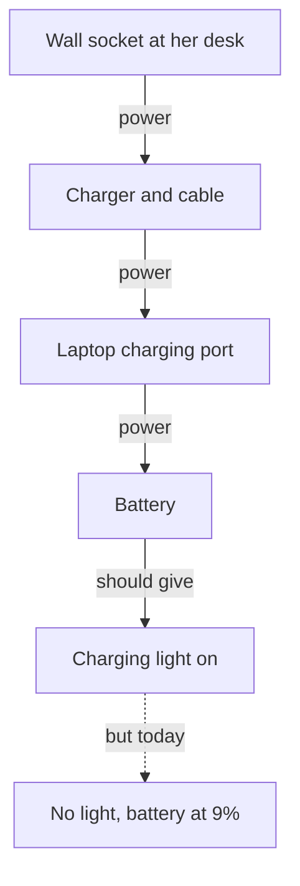

<BigWordAlert term="Troubleshooting" plainEnglish="Finding the cause of a fault step by step: describe it exactly, list the possible causes, and test them one at a time." whyItMatters="Guessing at a fault wastes money and time, and even a lucky guess teaches you nothing. A step-by-step search finds the cause and tells you how you found it." />

## A laptop at 9%

Nour is a freelance translator. She turns English reports into Arabic for a small NGO (in this course, a fictional one). Her next job is due tomorrow at 10:00. The client pays $120 for it, and they have said they will send more work if this one goes well. She has about three hours of work left.

On Tuesday morning Nour sits at her desk and opens her laptop. The battery icon says 9%. The charger is plugged in, as it always is, but the small charging light on the side of the laptop is off. She unplugs the charger and plugs it in again. Nothing changes. The number does not go up.

At 9% she guesses she has about half an hour of work before the battery runs out. That is not enough to finish the job. For the first few minutes she just looks at the light and waits for it to come on by itself. It does not.

This is the moment this module is about. Something has stopped working. Time is short. Money depends on it. And Nour does not yet know what is wrong.

## Five guesses in ten minutes

Nour tells her family, and everyone has an answer. Her brother Faisal looks at the laptop and says, "The battery is dead. Laptops die after three years. You need a new one." A new laptop would cost her several months of freelance pay.

Her mother says, "The electricity in this room is weak today. Wait until the evening." Her friend Dima sends a message: "Chargers break all the time. The shop in the market sells new ones for 90 shekels." The trip to the market and back would take about two hours.

Nour also asks an AI chat tool. It gives her a long list of ten things to try. The first one is "update your laptop's software and restart it." The list is not wrong, exactly, but it is not about her laptop. It does not know what she has already seen.

The fifth idea is Nour's own, and it comes from panic. "I will try everything at once," she thinks. "Another socket, my cousin's charger, a restart, the update. Something will work." If the laptop then charges, she will be happy. But she will not know which of the four changes fixed it. She will not know what to do if it happens again next month.

Look at the five guesses together. Each person picked one part and blamed it: the battery, the electricity, the charger, the software. None of them asked a question about what Nour had seen. None of them suggested a check that takes one minute. This is the single-cause trap from module 1 again, and this time there is a deadline too.

<Callout type="warning" title="Safety first">
One guess that people often make is "open the laptop and look at the battery." Never open a laptop, a phone or a charger yourself. You can get hurt, and you can turn a small fault into a large one. Every check in this module is something you can do safely from the outside. Some faults need a repair shop, and that is fine.
</Callout>

## Why guessing costs so much

Guessing feels fast because it gives you something to do at once. But each wrong guess has a price. If Nour buys a new charger and the charger was not the problem, she has lost 90 shekels and two hours. The laptop still does not charge. If she believes her brother, she may spend months of income on a laptop she did not need.

There is a second, quieter cost. Even when a guess works, you learn nothing you can use again. Imagine Nour borrows her cousin's charger and the laptop charges. Was her own charger broken? Or did she push the plug in harder this time? Or did the problem go away by itself? Without knowing, she will guess again next time.

There is a third cost too. Changing many things at once can hide the real cause or add a new problem. Suppose she starts a large software update on 9% battery, and the laptop switches off in the middle. Now she may have two problems instead of one.

## The chain where the fault could be

A better start is to think about the path the power takes. Electricity has to travel through several parts, one after another, before the charging light can come on. If any one link breaks, the whole chain stops. The diagram below shows Nour's chain.



Power leaves the wall socket, goes through the charger and its cable, enters the laptop through the charging port, and fills the battery. When everything works, the light comes on. Today, somewhere in that chain, something stopped the power.

Now compare the diagram with the five guesses. Each guess points at one box and ignores the others. The diagram shows four places where the fault could be, so it asks a better question. Which link is broken, and how can Nour find out without buying anything? That question has an answer, and finding it is a skill.

## How a detective starts

A good detective does not name a suspect in the first minute. She looks closely at the scene, writes down what she sees, and only then starts to check each possible explanation. Problem solving at work and at home can follow the same order.

Nour notices one more fact while she thinks. Her phone is charging normally, from another socket in the same room.

```predict
prompt: "Nour's phone charges normally from another socket in the same room. Does this fact help her find what is wrong with the laptop?"
options:
  - id: helps
    label: "Yes, it already makes some causes less likely"
  - id: no-help
    label: "No, a phone and a laptop are different devices"
correctOptionId: helps
explanation: "The phone is a different device, but it shares the room and the electricity. If the power in the room were weak, the phone would have trouble too. So one fact about something that still works has already moved her mother's guess to the bottom of the list."
```

The first step is to describe the problem exactly. "The laptop is broken" is not a description. "No charging light, battery at 9%, since this morning, at my desk, and my phone still charges from another socket in this room" is a description. Each part of it is a clue. The last part, what still works, is often a very useful clue.

The second step is to list the possible causes and test them one at a time. This course gives you a <GlossaryTerm term="rule of thumb" definition="A practical guide that usually works well but is not a law. You can break it when you have a good reason." /> for choosing the first test. Think about two things: how likely each cause is, and how cheap it is to check. A cheap check of a likely cause is a good first move. Plugging a lamp into a socket costs nothing and takes a minute. A new laptop costs a great deal and takes days.

The third step is a shortcut. When the fault is somewhere along a chain, one well-chosen test in the middle can rule out half of the chain at once. Nour will find a test like that, and it will save her most of her half hour.

The last habit is simple, and people often skip it: write things down. A short log says what the problem was, each test in order, what each test ruled out, and what fixed it. It takes two minutes. If the same fault comes back in a month, the log tells you where to look first. You do not have to repeat the whole search. It also lets you explain the problem to a repair shop or a client in a few clear lines.

## Why this matters at work

You will not only use this with laptops. A client says the website form is "not working". A teammate says the shared file is "broken". A shop owner says the card machine "keeps failing". In every case the same steps apply. Describe it exactly, list the causes, test one at a time, and keep a short record of what you tried.

These steps matter even more when you work remotely. A client cannot see your screen. Imagine you tell the client: "The form works on my phone but not on my laptop. It started on Monday, and only orders over 10 items fail." The client sees that you can handle the problem. If you say "it's broken, I tried everything," the client learns nothing.

The steps also protect you from an expensive mistake: fixing the wrong thing. Every chapter in this module is about choosing your next check well. That way you spend your time and money on the cause, not on a guess.

<LearningObjectives items={["Describe a problem by what, where, when and how much, and by what is not affected", "List possible causes and test them one at a time", "Choose a first test by weighing how likely and how cheap it is", "Confirm a fix with a test instead of assuming it worked", "Split a chain of steps in half to find a fault in fewer tests", "Keep a short log of what you tried and what it ruled out"]} />

## Key words

| Word | Plain English |
|---|---|
| **Describe exactly** | Say what, where, when and how much, not just "it is broken" |
| **Is and is not** | What the problem affects, and what it could affect but does not |
| **Test** | A check that gives a clear answer about one possible cause |
| **Split in half** | Test the middle of a chain to rule out half of it at once |
| **Log** | A short written record of each test and what it showed |

## What is in this module

| Chapter | You will practice |
|---|---|
| 5.2 | Describing a problem exactly, including what is not affected |
| 5.3 | Testing causes one at a time and confirming the fix, with Nour's laptop |
| 5.4 | Splitting a chain of steps in half to find a fault fast |
| 5.5 | A graded quiz, including an AI answer to check |
| 5.6 | A problem-solving log for a real or provided problem |

By the end of chapter 5.3 you will know what was really wrong with Nour's laptop. The answer cost her nothing to find, and it was not any of the five guesses.

**Next:** How to describe a problem so exactly that some causes rule themselves out.
