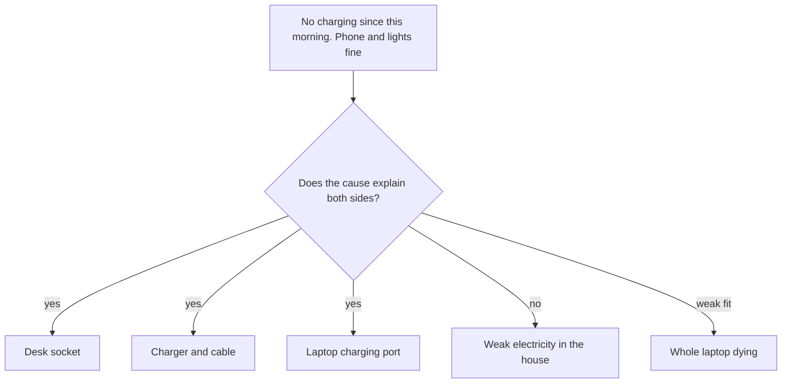

## "It's broken"

Imagine you help at the front desk of a small sports club. A member comes to you: "The door card reader is broken. Please fix it today." You walk over with your own card. The reader beeps, the light turns green, and the door opens. You go back to the desk. An hour later another member says: "It's still broken!"

The members were not lying. Something really was wrong. But "broken" told you nothing about what, where or when. It turned out that only the new cards, given out since Monday, did not open the door. The old cards worked. With that description you would have looked at the new cards, not the reader, and saved two trips.

Most problems arrive like this. People report how a problem feels ("it's broken", "nothing works", "the client is angry") instead of what they saw. This chapter teaches you to turn a feeling into a description. A good description does half the detective work, because some causes simply do not fit it.

## Four questions, and one more

Start with four plain questions. Each one turns a vague complaint into a fact you can check.

1. **What** exactly is wrong? Name the thing and the fault: "no charging light", not "the laptop is broken".
2. **Where** does it happen? Which room, which device, which page, which customer?
3. **When** did it start, and when does it happen? Since this morning? Every time, or only in the afternoon?
4. **How much?** How big is the problem? One order or twenty? Every page or one page in ten?

Each answer narrows the search. "Since this morning" points you toward anything that changed yesterday or overnight. "Only at my desk" points you toward the desk, not the whole house. "One order in twenty" tells you the fault comes and goes. That needs a different kind of test from a fault that happens every time.

Then ask a fifth question, which people often forget. **What is not affected, but could have been?** This is the "is and is not" idea from the key words in chapter 5.1. For every "is", look for a near neighbour that is fine. Which other device, room, time or customer could have the same problem but does not?

The "is not" side is useful because it is a comparison. Suppose two things are alike in almost every way, and only one of them has the problem. Then the cause is probably hiding in the small difference between them. You do not need to know anything about laptops or card readers to use this. You only need to look carefully.

## Nour's description, step by step

In chapter 5.1, Nour's laptop would not charge the day before a deadline. Here is how she turns "my laptop is broken" into a description. Each line is a fact she can see, not a guess about the cause.

**What:** There is no charging light, and the battery is at 9%. The number does not go up when the charger is plugged in. The laptop itself still works on battery: the screen, the keyboard and her files are all fine.

**Where:** At her desk, with the charger plugged into the wall socket next to the desk.

**When:** Since this morning. Last night, before she went to bed, the laptop was charging normally. Yesterday afternoon she carried it in her bag to a study session at a friend's house.

**How much:** It is not slow charging or charging now and then. There is no charge at all, every time she plugs in.

**Is not:** Her phone charges fine from another socket in the same room. The lights in the room work. The laptop works normally on battery.

Look at what this description does before Nour touches anything. Her mother thought the electricity in the house was weak. But the room lights work and the phone charges in the same room. That cause does not explain the "is not" side, so it drops to the bottom of the list. Her brother thought the laptop was dying. But it works on battery; only charging has stopped. That does not prove the battery is fine, but it makes "the whole laptop is dying" a weak story.

Other causes still fit. The socket at her desk is a different socket from the one her phone used, so the desk socket is still a suspect. The charger and cable are still suspects. The laptop's charging port is still a suspect. And "since this morning" leads to a useful follow-up question: what changed between last night and this morning? The only change she can think of is the trip in her bag.

## Testing causes against the description

There is a simple way to use a description once you have it. Take each possible cause and ask: **does this cause explain both what is happening and what is not happening?** A good cause explains both sides. A weak cause explains the problem but not the exceptions.

The diagram below shows Nour's list after this check. Causes that explain both sides stay on the list. Causes that do not explain the "is not" side drop down.



The description sits at the top, because every cause is judged against it. Three causes pass the check and stay on the list to be tested: the desk socket, the charger and cable, and the charging port. One cause fails, because the lights and the phone work. One is a weak fit, because the laptop works on battery.

So Nour has ruled out one cause and weakened another without a single test, and without spending a shekel. She did it only by writing down what she saw. The three causes that are left will be tested one at a time in chapter 5.3.

The description did not tell her which cause is right. It told her where to look. That is the job of a description: to shrink the list, not to give the answer.

## A second example: a warm fridge

The same method works in a very different place. Majed runs a small pharmacy (fictional, like every business in this course). Medicines that must stay cold are kept in two fridges in the back room. On Sunday morning his assistant tells him, "The fridges are getting old." That is a feeling, not a description.

Majed writes it down instead. **What:** the thermometer in fridge 2 shows 12 degrees Celsius. It should show between 2 and 8. **Where:** fridge 2, on every shelf. **When:** since Thursday, when the morning check first showed 11 degrees. **How much:** it stays at 11 to 12 degrees all day. **Is not:** fridge 1 stands next to it, on the same power strip, and shows 4 degrees. The light inside fridge 2 still works, and its motor still hums.

```predict
prompt: "Majed's assistant says the back room got too hot this week. Is a hot room a likely cause of fridge 2's problem?"
options:
  - id: hot-room
    label: "Yes, because a hot room makes any fridge warm up inside"
  - id: not-room
    label: "No, because fridge 1 in the same room still stays cold"
correctOptionId: not-room
explanation: "A hot room could make a fridge work harder. But fridge 1 stands in the same room and stays at 4 degrees. The cause must be something that is different about fridge 2."
```

Now step through Majed's checks below. At each step, say which cause the new fact rules out before you read the note.

<InteractiveCanvas slug="is-and-is-not-fridge" />

Here is what the stepper showed. A hot room does not fit the "is not" side, because fridge 1 shares the room and stays cold. "The power is weak" fails too. Fridge 1 uses the same power strip and works, and fridge 2's light and motor are on. "The thermometer is wrong" was possible, so Majed put a second thermometer in fridge 2 for an hour. It also showed 12 degrees, so that cause was ruled out. What was left had to be something about fridge 2 itself.

Then he asked what changed on Thursday. A large delivery arrived that day, and some boxes were stacked on the bottom shelf of fridge 2. The boxes stopped the door from closing fully. He moved the boxes and closed the door. The next morning, fridge 2 showed 5 degrees, and it stayed there for the rest of the week.

The fridge was fixed, but the medicines inside had been kept too warm for days. Majed put them aside. He will not sell them until the supplier or a pharmacist says they are safe. Fixing the cause does not undo what the problem already did, so the description also tells him which medicines to check.

Majed did not open anything or buy anything. If the boxes had not been the cause, he could still call the repair shop with a clear description. "Fridge 2, since Thursday, 12 degrees on every shelf, light and motor on. Fridge 1 on the same power strip is fine." The repair person would know where to start, and the visit would be shorter and cheaper.

## Where descriptions go wrong

A common mistake is describing the feeling instead of the fault. "The client is unhappy" is a feeling. "The client says two of the last five invoices had the wrong total" is a fault you can check. When you catch yourself writing a feeling, ask: what did I actually see, and how would someone else see it too?

The second mistake is putting a guess inside the description. "The charger stopped working this morning" is not a description, because it already names a cause. "No charging light this morning" is a description. Keep causes out until the description is finished. Otherwise you will only collect facts that agree with your first guess.

The third mistake is skipping the "is not" side because it feels like extra work. Many people only describe what is wrong. But useful clues often come from comparing the problem with something nearby that is fine: another socket, another fridge, another customer, another day.

The fourth mistake is stopping at "when did it start" without asking "what changed just before then?" A problem that starts suddenly usually follows a change: a move, an update, a new supplier, a trip in a bag, a delivery of boxes. Write down every change you can think of, even small ones. You are not blaming the change yet. You are making sure it is on the list.

<Callout type="tip" title="Ask for a description, kindly">
When a client or teammate reports a problem, you can ask the five questions for them. "What exactly do you see? Where? Since when? How often? Is there anything similar that still works?" Most people are happy to answer, and you save both of you time.
</Callout>

## Check your understanding

```quiz
type: mcq
question: "Mais works at the front desk of a small clinic with three doctors. Since Monday, text reminders for the dentist's patients do not arrive. Reminders for the two family doctors' patients still arrive as usual. Which cause does the 'is not' side make weakest?"
options:
  - "The reminder setting for the dentist's list was switched off"
  - "Phone numbers on the dentist's list were saved in a new format"
  - "A change made on Monday affected only the dentist's patient list"
  - "The clinic's message system has stopped sending any reminders"
correct: 3
explanations:
  - "This fits both sides: it would stop the dentist's reminders and leave the other two lists alone. It stays on the list to test."
  - "This also fits both sides, because only the dentist's list would be affected. It stays on the list to test."
  - "This fits both sides and matches 'since Monday'. Mais should ask what changed on Monday."
  - "Right. If the whole system had stopped, the family doctors' patients would miss their reminders too. They still get them, so this cause fails the 'is not' check."
```

```quiz
type: mcq
question: "On Wednesday, Mais writes to the clinic's computer helper about the appointment computer at desk 1. Which message gives him the most exact description to start from?"
options:
  - "Since Sunday desk 1 is very slow; it is old and it probably needs replacing now"
  - "Desk 1 opens files in about 2 minutes. It has been like this for a long time"
  - "Since Sunday, files open in 2 minutes at desk 1 and in 5 seconds at desk 2"
  - "Desk 1 is slow since Sunday, so the new program put on it Sunday is the cause"
correct: 2
explanations:
  - "This gives a start day but no size, and it adds a guess about the cause. The helper cannot tell how slow it is, or what still works."
  - "This gives a size, but 'a long time' is not a start day, and there is no 'is not' side to compare with."
  - "Right. It says what is slow, when it started, how much, and what is not affected: desk 2. It names no cause, so the helper can test causes against it."
  - "This puts a cause inside the description. The new program is worth checking, but the description should come first."
```

**Next:** Nour has three suspects left. In chapter 5.3 she tests them one at a time, and you will see how she chooses the order.
