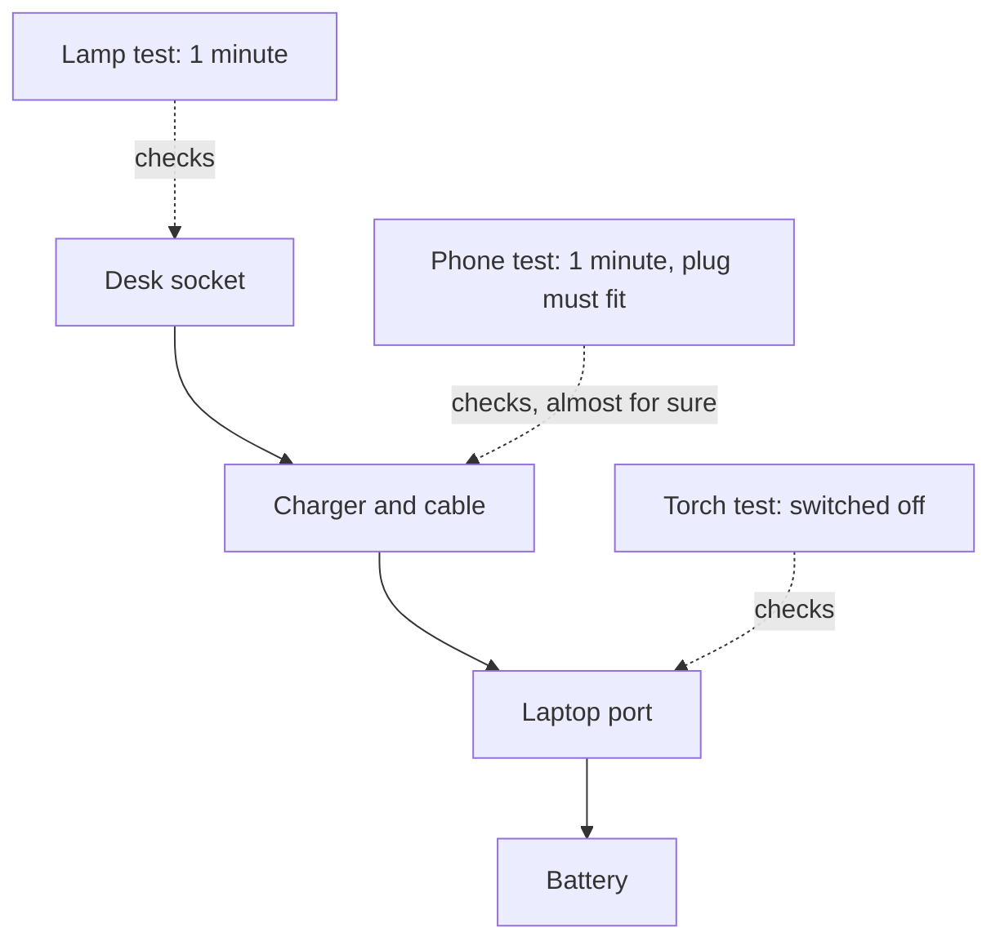

## Three suspects and half an hour

At the end of chapter 5.2, Nour had a clear description of her problem. No charging light, battery at 9%, since this morning, at her desk. Her phone charges fine from another socket in the same room. The description ruled out weak electricity in the house. Three suspects were left: the socket at her desk, the charger and its cable, and the laptop's charging port. The battery was still possible, but a weak fit.

Her cousin Jamil comes in and offers to help. "Let's do everything at once," he says. "Move to the other socket, use my charger, restart the laptop, and blow into the port. One of them will work." It sounds efficient. It is the opposite. If the laptop charges after four changes, nobody will know which change mattered. If it does not charge, they will not know which suspects are cleared. A new problem from one change could hide a fix from another.

This chapter teaches a method that looks slower but is usually faster: guess, test, repeat. You make one guess at a time, you test it with one change, you read the answer, and only then do you pick the next guess.

## The method in plain words

The method has five parts. You have already done the first two in chapter 5.2.

1. **Describe the problem exactly,** including what is not affected.
2. **List the possible causes** that fit the description.
3. **Pick one cause and test it** with a single change that gives a clear yes or no.
4. **Repeat** with the next cause until a test finds the fault.
5. **Confirm the fix with a test,** then write a short log.

Step 3 has a choice inside it: which cause do you test first? Use the rule of thumb from chapter 5.1. Think about two things: how likely the cause is, and how cheap it is to check. A cheap check of a likely cause is a good first move. "Cheap" means more than money. It also means time, safety and the risk of making things worse.

A test is good when it changes one thing and gives a clear answer. Plugging a lamp into a socket changes nothing about the laptop, and the answer is easy to read: the lamp lights or it does not. "Restart and see" is a weaker test, because a restart changes many things at once and the answer is often unclear.

There is one more habit inside the method: **answer each question by looking, not only by thinking.** Sitting at a desk and reasoning about which part "probably" failed feels like work, but it produces opinions. A test that you can see, such as a light, a sound or a number on a screen, produces a fact. When you can look, look.

## Likely, cheap, or both?

Nour lists her suspects with a quick note on each: how likely it is, and what it costs to check.

| Suspect | How likely? | What the check costs |
|---|---|---|
| Desk socket | Unlikely: it worked last night | One minute with a lamp |
| Charger and cable | Possible | One minute with her phone |
| Laptop charging port | Likely: it started after the trip in her bag | Ten minutes: save, switch off, look |
| Battery | Possible: the laptop is three years old | A repair shop: a day and money |

The table does not give the same answer on both columns. The port is the most likely suspect, but checking it means saving her work and switching off a laptop with 9% battery. The socket is unlikely, but its check is almost free. The battery is possible, but its check is slow and costly. This is where the rule of thumb has to be weighed, not just followed.

```predict
prompt: "Before you read Nour's plan, decide which suspect she should test last, using the rule of thumb: weigh how likely each one is against how much its check costs."
options:
  - id: battery-last
    label: "The battery: possible, but its check costs a day and money"
  - id: socket-last
    label: "The socket: of the four suspects, it is the least likely one"
correctOptionId: battery-last
explanation: "The socket is unlikely, but checking it takes one minute and costs nothing, so there is no reason to leave it to the end. The battery check needs a repair shop, a day and money. It makes sense only if all the cheap checks come back clear."
```

Here is Nour's plan, with the reasons. The socket goes first, even though it is unlikely. Its check takes one minute and nothing else, so clearing it costs almost nothing. The phone test goes second: it takes one minute too, and it checks two links at once. The port goes third. It is the most likely suspect, but its check takes longer and means switching off. If the port check were as quick as the lamp, she would start with the port. The battery goes last, because only a repair shop can check it.

Test 1: she plugs a lamp into the same socket at her desk. The lamp lights up. The socket works, so it is ruled out. One test, one change, a clear answer.

## Step through Nour's search

The stepper below follows Nour's whole search, from the description to the log. It shows how a few cheap tests, in a sensible order, find a fault without guessing. The stepper asks you to predict what the phone test can rule out before it shows you, so make your guess before step 4.

<InteractiveCanvas slug="laptop-charging-detective" />

Here is what the stepper showed. Test 2 worked because of one lucky detail: Nour's laptop charger has the same kind of plug as her phone. This test only works when the plug fits. She plugged the charger into the desk socket and charged her phone, and the phone charged.

That result almost certainly clears the charger and the cable. It is strong evidence, but not proof. A phone takes much less power than a laptop, so a charger could, in theory, manage a phone and still fail a laptop. Still, with one test Nour has set aside everything before the laptop: half of the chain. The fault is very probably at the laptop's end, and she will find out for sure when she checks the fix.

Test 3 was the charging port. Before looking, Nour saved her work, switched the laptop off and unplugged it. Then she shone her phone torch into the port. It was packed with dust and fluff from her bag. This fits everything in her description. It started after the trip in her bag, it affects only the laptop, and the socket, phone and charger are all fine.

Then came a step that people often skip. Nour removed the dust gently with a wooden toothpick, never anything metal, and without pushing hard. If the dust had not come out easily, her next step would have been a repair shop. It came out. She plugged the charger in again, and the charging light came on. She did not say "fixed" because she cleaned the port. She said "fixed" because a test showed the light was on and the number started to rise. That test also confirmed what the phone test had only suggested: the charger works with the laptop.

Last, she wrote a short log: the problem, each test in order, what each test ruled out, and the fix. If it happens again, she will start at the port and save an hour. The whole search took about fifteen minutes and cost nothing. Every guess from chapter 5.1 was wrong: not the battery, not the electricity, not the charger, not the software.

The stepper has limits, and so does this story. Here the first good guess was right, and each test gave a clear answer. Real faults can have two causes at once, or a test that only works some of the time. Then you repeat the test and keep the log. And never open a device or a charger yourself: some faults need a repair shop.

## What each test can see

Each test looks at only part of the chain. The diagram below shows which links each of Nour's tests checked. The solid arrows are the power chain. The dotted arrows show what each test can see.



The lamp test sees only the socket. The phone test sees the socket and the charger and cable together, because power must pass through both to reach the phone. That is why it was worth doing second: one minute, two links. The torch test sees only the port. No safe test at home sees the battery, which is why it stays at the bottom of the list. When you plan your own tests, draw this kind of picture. It shows you which test covers the most links for the least cost.

## Where guess, test, repeat goes wrong

The first trap is changing several things at once, as Jamil wanted. It feels faster, but you lose the answer. If you must try a fix quickly, try one change, check the result, and then try the next. You will often find the fault after the first or second change anyway.

The second trap is believing "the problem went away, so I fixed it." Some faults come and go. A loose cable may work for an hour and then fail again. After a fix, test it. If the fault was the coming-and-going kind, test it again later. Only a repeated, clear result counts.

The third trap is testing by thinking. "It is probably the charger, because chargers often break" is a guess that sounds like a test. It is not one until you plug the charger into something and look.

The fourth trap is treating "cheapest first" as a law. A free check that almost never finds the fault is not always a good first test. Nour's lamp test was worth it only because it took one minute. A slightly more expensive test that clears half the chain may be better. Weigh how likely and how cheap together.

One more useful kind of test is a <GlossaryTerm term="swap test" definition="Swap a part for an identical one that you know works, and see whether the problem moves with the part or stays where it was." />. Suppose Nour's phone test had failed. She could then have tried Jamil's identical charger on the laptop. If the laptop charged with Jamil's charger, the fault was in her own charger. Swapping only works with identical parts, and you change only that one part.

<Callout type="warning" title="Safe tests only">
Every test in this chapter is done from the outside. Switch a device off and unplug it before you look into or clean a port. Use something wooden or plastic, never metal, and do not push. Never open a laptop, phone or charger. If the safe tests do not find the fault, take it to a repair shop and bring your log.
</Callout>

## Check your understanding

```quiz
type: mcq
question: "Yahya takes phone bookings for a wedding hall, about 40 calls a day, with wired headphones on his laptop. Since yesterday the headphones are silent, but the laptop speakers work. His suspects: the headphones, the laptop's headphone socket, a sound setting. Which test is cheap, likely and clears the most?"
options:
  - "Buy a new pair of headphones and see if the sound comes back"
  - "Reinstall the laptop's sound software, then restart it twice"
  - "Try the sound setting, the socket and new headphones in turn"
  - "Plug the headphones into his phone and play a short song"
correct: 3
explanations:
  - "This costs money and a trip, and if the headphones were fine, he has wasted both. A free test can answer the same question first."
  - "This is slow, changes many things, and does not test the headphones at all. Keep it for later, if the cheap tests point to the laptop."
  - "Testing one thing at a time is right, but this order puts a purchase before the free phone test. The phone test can rule out the headphones first."
  - "Right. It is free and takes a minute. If the headphones work on the phone, they are cleared and the fault is on the laptop side. If not, the headphones are the fault."
```

```quiz
type: mcq
question: "Lana takes bookings for a taxi rank with 12 drivers. Since 7:00 her booking app shows nothing new, but two customers say they booked at 8:00. Other apps on her phone work. A driver's phone, with the same app and account, shows both bookings. What is the best next check?"
options:
  - "Ask both customers to make their bookings again in the same app"
  - "Buy a new phone today, because this one is now unreliable"
  - "Close and reopen the booking app on her phone, then look again"
  - "Wait until the afternoon to see whether the bookings appear"
correct: 2
explanations:
  - "The driver's phone already shows both bookings, so they were received. Booking again would only create two more."
  - "Other apps work on her phone, so the phone itself is not the likely cause. A new phone costs money before any cheap check."
  - "Right. The bookings exist, and her phone's internet works for other apps. The fault is likely in the app on her phone, and reopening it is a free, one-minute check."
  - "Waiting tests nothing, and two customers are already waiting for a taxi. A one-minute check can answer the question now."
```

**Next:** Nour's phone test set aside half the chain at once. In chapter 5.4 you will turn that move into a method for any long chain of steps.
