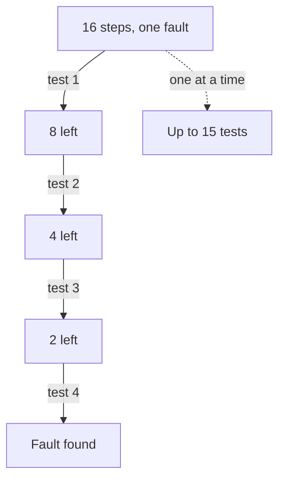

## Bookings that vanish

Hadi runs a small barber's shop (fictional, like every business in this course). He cuts hair for about 25 customers a day. Customers book a time through a form on the shop's page, and Hadi gets an alert on his phone for each booking. On Thursday morning, a customer walks in and says: "On Monday I booked a haircut for 10:00 today. Why is someone else in the chair?" Later a second customer says the same thing. Then a third. Hadi has seen no bookings at all since Sunday.

He starts at the beginning. He opens the form himself and it loads. He fills it in and it accepts his text. He presses Send and sees the "thank you" page. Each check takes time, and so far each one says "fine". He is walking down the chain one step at a time, from the first step toward the last, and the fault could be at the very end.

There is a faster way. In chapter 5.3, Nour charged her phone from her laptop charger. That worked only because the charger has a phone-type plug. One test almost certainly cleared the socket, the charger and the cable at once. She did not test each link in turn. She tested near the middle of the chain. This chapter turns that move into a method you can use on any chain of steps.

## The idea: test the middle

When a problem travels along a chain, where each step feeds the next, the fault is in one of the steps. Instead of testing them in order from the start, you test in the middle. You ask one question: **is everything fine up to here?**

If the answer is yes, the fault is in the second half, and you can set the first half aside. If the answer is no, the fault is in the first half, and you can set the second half aside. Either way, one test has ruled out half of the chain. Then you do the same thing again with the half that is left: test its middle, rule out half again. You keep going until only one step is left.

This is the "split in half" idea from the key words in chapter 5.1. Technicians call it half-splitting. The same idea is built into a common tool that programmers use. A bug may appear somewhere in a long list of changes to their code. The tool tests the middle change, then the middle of the half that is left, and so on. With about 675 changes to check, it needs roughly 10 steps.

Before you can split a chain, you need to see the chain. Write each step on its own line, in order, from where the thing starts to where it should end up. This alone helps, because it shows you places to test that you had not thought of.

## Hadi's chain

Hadi writes down his chain. A booking passes through eight steps before he sees it:

1. A customer opens the booking form.
2. The customer fills it in.
3. The customer presses Send.
4. The form saves the booking in Hadi's booking sheet.
5. The sheet sends an alert email.
6. The email arrives in his inbox.
7. His phone shows a notification.
8. Hadi reads the booking and keeps the time free.

Before he tests anything, he describes the problem exactly, as in chapter 5.2. **What:** no booking alerts at all. **When:** since Sunday; before that, alerts came normally. **How much:** every booking since Sunday, as far as he knows. **Is not:** other emails, from family and from his supplier, still reach his phone as usual. That last fact is already a clue: his phone and inbox work for other emails.

The middle of eight steps is between step 4 and step 5. So Hadi's first test is to open his booking sheet and look for the bookings from this week.

```predict
prompt: "Hadi opens his booking sheet and finds all three bookings there. How much of his 8-step chain does that one look clear?"
options:
  - id: first-half
    label: "Steps 1 to 4: the whole first half of the chain"
  - id: only-four
    label: "Only step 4, the one step that saves to the sheet"
correctOptionId: first-half
explanation: "A booking can only reach the sheet if the form opened, was filled in, was sent and was saved. So finding the bookings in the sheet shows that steps 1 to 4 all work. One look clears half the chain."
```

Now step through Hadi's search. After each test, count the steps that are still under suspicion before you read the note.

<InteractiveCanvas slug="halving-booking-chain" />

Here is what the stepper showed. **Test 1** was the booking sheet. All three bookings were there, with their Monday, Tuesday and Wednesday dates. So steps 1 to 4 all work. The form is fine, and the customers did nothing wrong. Four steps were ruled out with one look.

**Test 2** was the middle of what was left. Steps 5, 6, 7 and 8 were left, and the middle is between step 6 and step 7. The question was: are the alert emails in his inbox? He searched his inbox for the word "booking" and found nothing since Sunday. So the fault was in step 5 or step 6. Either the sheet did not send the alerts, or they were sent and did not reach the inbox.

**Test 3** was the last split. The question was: were the alerts sent at all? He searched every folder in his email, including the spam folder, where unwanted mail goes. All three alerts were there, in spam. So step 5 works: the sheet sent them. The fault was step 6. Since Sunday, his email had been putting the alerts in the spam folder.

**The fix, and the check.** Hadi marked the three alerts as "not spam" and added the sheet's address to his contacts. Then he did what chapter 5.3 taught: he confirmed the fix with a test. He sent a test booking through his own form. A minute later the alert was in his inbox, and his phone showed the notification. He sent another test booking the next morning, and it arrived too. He phoned the three customers, gave each of them a free time on Friday, and wrote a short log.

## Counting the tests

How many tests did halving save Hadi? Think about his first approach: testing each step in order from the start. If the fault had been at step 8, he would have tested steps 1 to 7 and found them all fine. Only then would he know step 8 was the fault. That is up to 7 tests for 8 steps. Halving needed 3.

The diagram below shows the same counting for a longer chain of 16 steps. On the left, each test halves what is left. On the right is the worst case for testing one step at a time from the start.



With 16 steps, the first test leaves 8, the second leaves 4, the third leaves 2, and the fourth leaves 1. So halving needs at most 4 tests. Testing step by step from the start could need up to 15. With 32 steps, halving needs only 5 tests. Every time the chain doubles in length, halving needs just one more test. That is why programmers can search hundreds of changes in about ten steps.

This is also why it pays to find the real middle. A test at step 2 of 8 only rules out two steps when it says "fine". A test at step 4 rules out four steps, whatever the answer. A test in the middle tells you more than a test near either end.

## Where splitting in half goes wrong

Half-splitting works on a chain, where each step feeds the next and one broken step stops everything after it. It is less useful when causes act together. Suppose customers stopped ordering because of a price rise, a busy season and a new competitor. There is no single broken link to find. For problems like that, use the cause maps from module 4 instead.

It is also less useful when you cannot test the middle, or when testing it is expensive or unsafe. Never open a device, cut a cable or take apart a charger to "test the middle". If the only way to check the middle is unsafe, test a safe point nearby. Or take the device to a repair shop with your log.

A third problem is faults that come and go. If a step fails only some of the time, one test in the middle may say "fine" by luck. Then you will search the wrong half. When a fault is like this, repeat each test a few times, or test over a longer time, before you trust the answer.

Last, halving does not replace good sense about likely causes. Your description may point clearly at one step, for example "it started right after I changed the email settings on Sunday". Then test that step first. Use halving when you have no clear clue, or when the clues have run out. Hadi's "is not" fact was that other emails still reached his phone. That already suggested the trouble was with these alerts, not his phone. Combining that clue with halving made his search even shorter.

<Callout type="tip" title="Write the chain before you test">
List every step on paper first, in order. Many people find the fault while writing the list, because they spot a step they had forgotten, such as a spam folder, a second socket or a setting that changed.
</Callout>

## Check your understanding

```quiz
type: mcq
question: "Nidal drives a school bus for 40 pupils. Each Thursday he saves next week's timetable as a file, puts it in a shared folder and sends parents the link. This week parents say the file will not open. Where is the best first test?"
options:
  - "Ask every parent to restart their phone and then try once more"
  - "Write the whole timetable again from the start this week"
  - "Check the first step: is the timetable he wrote correct?"
  - "Open the file from the shared folder, on a different phone"
correct: 3
explanations:
  - "This tests the very end of the chain, with many people and a lot of time. A test near the middle rules out more with one check."
  - "This changes things before finding the fault. If the problem is in the link, a new timetable will not open either."
  - "Starting at the first step can mean testing almost every step in turn. The middle rules out half the chain with one test."
  - "Right. This tests the middle of the chain. If the file opens, the fault is after the folder: in the link or on the parents' side. If not, the fault is in the file or the folder."
```

```quiz
type: mcq
question: "Khadija's farm stall sold 120 kilos of tomatoes a week in March and 70 in April. In April she raised her price, it rained for two weeks, and a new stall opened nearby. Her brother says: 'Split the problem in half.' Why is that a poor fit here?"
options:
  - "Halving only works when a chain has exactly 8 or 16 steps"
  - "She should test the first step in the chain, not the middle"
  - "The causes may act together; there is no one broken step"
  - "A fall to 70 kilos is too small to need any test at all"
correct: 2
explanations:
  - "Halving works on a chain of any length. The 8 and 16 step examples only show how the count of tests grows."
  - "Starting at the first step would not help either. The problem is not where to start, but that these causes are not a chain."
  - "Right. The price, the rain and the new stall can all lower sales at the same time. There is no step-by-step path with one broken link, so a cause map from module 4 fits better."
  - "Sales fell by 50 kilos a week, which is a large drop worth finding out about."
```

**Next:** Put describing, testing and splitting together in a graded quiz, including an AI answer to check.
