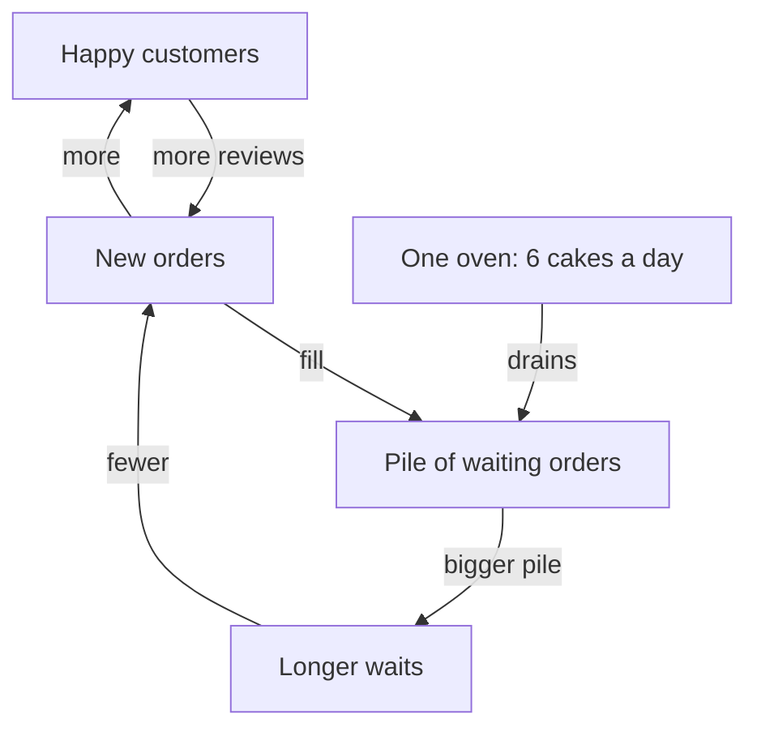

<BigWordAlert term="Feedback loop" plainEnglish="A chain of causes that comes back round to where it started, so that an effect becomes a new cause of itself." whyItMatters="When causes run in loops, the obvious fix often does nothing or makes things worse. Seeing the loops tells you where a change will really work." />

## Three good months

You met Huda in module 1, last summer. Since then her home bakery has grown and changed. Last summer she sold cakes, date biscuits and pastries, about 60 orders a month. This spring she sells mostly cakes. She takes orders by phone and message and bakes in her kitchen. Her sister Wiam decorates the cakes, and her son delivers them on his bicycle.

This spring something good happened. A neighbour ordered three cakes for her daughter's engagement party. The guests liked them. Several of them posted photos and kind words in the neighbourhood message group, and some of them ordered cakes for their own families. Then their guests did the same.

Huda wrote down her numbers every week. In this example, they looked like the table below. "Waiting" is the number of orders still waiting for the oven at the end of the week. "Extra wait" is how many extra days a new order waits before it reaches the oven. The oven bakes 6 cakes a day, so the extra wait is the waiting orders divided by 6.

| Week | Asked for | Delivered | Waiting | Extra wait |
|---|---|---|---|---|
| 1 | 8 | 8 | 0 | none |
| 4 | 12 | 12 | 0 | none |
| 8 | 18 | 18 | 0 | none |
| 12 | 27 | 27 | 0 | none |
| 14 | 34 | 34 | 0 | none |
| 15 | 38 | 36 | 2 | under 1 day |
| 16 | 40 | 36 | 6 | 1 day |
| 17 | 42 | 36 | 12 | 2 days |
| 18 | 42 | 36 | 18 | 3 days |
| 19 | 40 | 36 | 22 | almost 4 days |
| 20 | 37 | 36 | 23 | almost 4 days |
| 21 | 36 | 36 | 23 | almost 4 days |

For three months, every number went up, and each jump was bigger than the one before. From week 1 to week 4 the cakes asked for went up by 4. From week 8 to week 12 they went up by 9. Huda was proud and tired and happy. She started to think about renting a small shop.

## Then it stopped

Around week 15 the growth stopped. Look at the "Delivered" column. It reached 36 and stayed there, week after week, even when more people asked for cakes. Then the "Asked for" column also stopped rising and fell back to 36. Meanwhile the extra wait for a cake grew from nothing to almost four days.

Huda did not understand it. Her cakes were as good as before. The reviews were still mostly kind, although a few now said "nice cake, but I waited four days." Nothing big had changed in her life or her kitchen. Yet the bakery would not grow past 36 cakes a week, however hard she worked.

Her family had answers, as they did last summer. Her brother said, "People are bored of your cakes. Try new flavours." Her aunt said, "Your prices are too low. People think cheap cakes are not special." Her cousin said, "You need adverts. Pay for an advert in the big city group and the orders will come back." Wiam, who decorated every cake, said nothing. She was too busy.

Each person looked for one cause, the same single-cause habit you met in module 1. And the numbers already answer the first guess. People were not bored: from week 15 to week 19 they asked for more cakes than Huda delivered. Something else was holding the bakery at 36.

## Reading the table closely

The table has two columns that look alike but tell different stories. "Asked for" is how many cakes customers wanted. "Delivered" is how many Huda actually baked and sent out. Until week 14 the two columns were the same: every cake that was asked for was delivered. In week 15 they split. Customers asked for 38, and Huda delivered 36. The 2 extra orders did not disappear. They waited.

That is why the last two columns matter. When more cakes are asked for than delivered, orders start to queue. Every new order has to wait behind the ones already waiting. By week 18, 18 orders were waiting. At 6 cakes a day, that is 3 days of baking before a new order even reaches the oven. A customer who wants a cake for a birthday on Thursday may not be able to wait that long. Some of them ordered from someone else, or bought a cake from a shop.

Look at weeks 19 to 21 with that in mind. The cakes asked for fell from 42 to 40, then 37, then 36. That is not because the cakes got worse. It is because a wait of almost four days made some customers decide not to order. The demand came down to meet what the bakery could deliver.

Huda tried to work through it. She answered customer messages late at night, so that no order was missed. She got up early to mix batter before anyone else was awake. She even made a list of new flavours to offer. She felt exhausted, and the numbers did not move: still 36. Each of her efforts made one part of the bakery faster or bigger. None of them changed how many cakes came out at the end of the week.

Wiam was busy too, but sometimes she sat and waited for the next cake to come out of the oven before she could start decorating. That small detail is a clue. Hard work was not what was missing. Something in the way the bakery was built set the limit, and working harder in the wrong place did not change it.

## A different way to look

In earlier modules, you followed causes in a line: this caused that, which caused the next thing. A line works well for a laptop that will not charge. But Huda's bakery is not a line. It is a system: a set of parts that affect each other, where a change in one part travels round and comes back.

The diagram below shows Huda's bakery as a system. Read the arrows as "affects". Some arrows go round in a circle and come back to where they started. These circles are the feedback loops.



Start with the circle at the top. More new orders mean more happy customers, and happy customers post reviews that bring more new orders. That loop explains the fast growth: more led to more. It also explains why each jump was bigger than the one before, because every new customer could bring others.

Now follow the lower path. New orders fill a pile of waiting orders. Only one thing drains that pile: the oven, which bakes 6 cakes a day. When orders arrive faster than the oven can bake, the pile grows, waits get longer, and some people decide not to order. That second loop pulls the bakery back toward what the oven can do. Six cakes a day for six days a week is 36 cakes. That is exactly where the bakery stopped.

So the limit is not a mystery after all. It is the oven, together with a loop that slowly sends customers away when the oven cannot keep up. No single person or event caused the stall. The system did.

```predict
prompt: "Huda's cousin says she should pay for an advert to bring in more orders. If she does, what will happen to the number of cakes she delivers each week?"
options:
  - id: stays
    label: "It stays near 36, and the waits get longer"
  - id: rises
    label: "It rises, because more people will order cakes"
correctOptionId: stays
explanation: "The advert adds new orders to the pile, but the oven still bakes only 6 cakes a day, which is 36 in a six-day week. More orders only make the pile bigger and the waits longer. After a while, the long waits send some customers away, and Huda has paid for the advert for nothing."
```

## Why this matters at work

You will meet systems like Huda's in many places. A home cook who gets good ratings gets more customers, until she has so many that her work gets slower and the ratings fall. A support team that answers slowly gets more "any news?" messages, which makes it answer even more slowly. A shop that runs short of stock loses customers, earns less, and can afford even less stock.

In each case, the obvious fix often fails. Pushing harder on the part you can see, such as more adverts, more hours or lower prices, can make the loop work against you. The useful question is not "what is the one cause?" It is "what loops are running here, and where is the limit?"

This module gives you four tools for that question. The first is the loop where more leads to more, which can make things grow fast or collapse fast. The second is the loop that pulls back toward a limit. The third is the delay: the time between a cause and its effect, which makes people overshoot. The fourth is the bottleneck: the one slow step that sets the pace of a whole process. Huda's bakery has all four, and you will see each one in turn.

A system can look calm while its loops are working. Huda's 36 cakes a week looked steady. Under that number, one loop was trying to grow the bakery and another was holding it back. When you learn to see both, you can choose a change that works with the system instead of against it.

<LearningObjectives items={["Draw a loop where more leads to more, and explain how it can grow or collapse", "Draw a loop that pulls back toward a limit", "Explain how a delay causes overshoot", "See a pile of waiting work as a stock that fills and drains", "Find the slowest step in a process and expect it to move once you fix it"]} />

## Key words

| Word | Plain English |
|---|---|
| **Reinforcing loop** | A loop where more leads to more, or less leads to less |
| **Balancing loop** | A loop that pulls something back toward a goal or limit |
| **Stock** | An amount that builds up, like water in a tank or a pile of orders |
| **Delay** | Time between a cause and its effect |
| **Bottleneck** | The slowest step, which sets the pace of the whole process |

## What is in this module

| Chapter | You will practice |
|---|---|
| 6.2 | Drawing a loop where more leads to more, growing or collapsing |
| 6.3 | Loops that pull back, delays that cause overshoot, and stocks |
| 6.4 | Finding the bottleneck, and seeing it move once you fix it |
| 6.5 | A graded quiz, including an AI answer to check |
| 6.6 | A loop diagram of a system in your life or work |

**Next:** Look closely at the loop that made Huda's bakery grow so fast, and see how the same loop can run in reverse.
