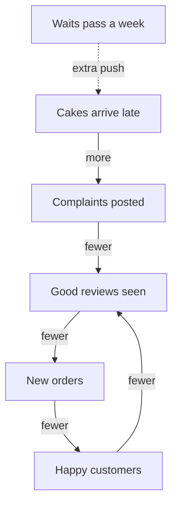

## Why did growth speed up?

Look again at Huda's first twelve weeks from chapter 6.1. She went from 8 cakes a week to 12, then 18, then 27. The jumps were 4, then 6, then 9. Nothing in her kitchen changed in that time. She did not pay for adverts, cut her prices or add a flavour. Yet each month, the growth was bigger than the month before.

A cause in a straight line cannot explain this. If one engagement party had simply sent her a fixed number of extra customers, the numbers would have jumped once and then stayed flat. If a steady trickle of new people found her each month, the numbers would have grown by the same amount each month. Neither of those happened. The growth itself was growing.

The answer is a loop. The effect of the first party, new customers, became a cause of more new customers. This chapter teaches you to see loops like this, to draw them, and to know what they do over time. That includes an unwelcome fact: they can run backwards.

## A cause that feeds itself

In earlier modules you drew causes as chains: A causes B, B causes C. The feedback loop from chapter 6.1 is a chain that bends round and joins its own start. The last effect in the chain feeds back into the first cause.

When a loop makes more of something lead to more of the same thing, it is called a reinforcing loop. "Reinforce" means to make stronger. The plain-words version is: **more leads to more**. And because it works in both directions, less also leads to less.

Some books call this a "positive" loop. Be careful with that word. Here, "positive" does not mean "good". It only means that the loop pushes in the same direction it is already going. A reinforcing loop can push a business up fast, and it can push it down just as fast. This course uses "reinforcing" or "more leads to more" to avoid the confusion.

A reinforcing loop does not need a big push to start. It needs only a small push and enough time. Each turn of the loop adds a little to the next turn, so the effects add up. That is why reinforcing loops often look slow and unimportant at the start. Later they seem to grow very fast "suddenly", even though nothing sudden happened.

## Huda's review loop, step by step

Here is the loop that grew Huda's bakery. Read it as a circle, starting anywhere.

1. More customers enjoy her cakes.
2. More happy customers post photos and reviews in the neighbourhood group, and tell their friends.
3. More people see the reviews and decide to order.
4. More customers enjoy her cakes, and the loop goes round again.

Now put numbers on it. In this simple example, every four weeks the review loop brings in new orders equal to about half of what Huda is already selling. So the weekly orders grow by half every four weeks.

Start at 8 cakes a week. Half of 8 is 4, so four weeks later she sells 8 + 4 = 12. Half of 12 is 6, so four weeks after that she sells 12 + 6 = 18. Half of 18 is 9, so at week 12 she sells 18 + 9 = 27. Half of 27 is 13.5, so by week 16 customers ask for about 27 + 13 = 40. These are the numbers in Huda's table.

```predict
prompt: "Suppose nothing held Huda's loop back: no oven limit and no waits. About how many cakes a week would customers ask for by week 20?"
options:
  - id: sixty
    label: "About 60, because each jump keeps getting bigger"
  - id: fifty
    label: "About 50, by adding about 10 more every four weeks"
correctOptionId: sixty
explanation: "Each four weeks the loop adds half of what she already sells. Half of 40 is 20, so week 20 would bring about 60. Adding a fixed 10 would treat the loop as a straight line, but each jump depends on how big things already are."
```

Now step through the loop. Go round it with Huda, and watch the number on each turn before you read the note.

<InteractiveCanvas slug="huda-review-loop" />

Here is what the stepper showed. The jumps were 4, then 6, then 9, then about 13. Each one is bigger than the last, because each one is half of a bigger number. With no limit, the next jump would be half of 40, which is 20, so week 20 would bring about 60 cakes a week. That is the sign of a reinforcing loop. It does not add the same amount each time. It adds an amount that depends on how big things already are.

The stepper also showed where the growth started and where it stopped. The engagement party started the loop, but it is not why the bakery kept growing. Once the loop was turning, the loop did the work. And by week 16 the loop met the oven, which bakes 36 cakes a week. Chapters 6.3 and 6.4 are about that limit.

This changes where you look for a cause. If you ask "what caused the growth in week 12?", there is no single event to point to. The growth in week 12 came from the customers in week 8, whose growth came from the customers in week 4. The cause is the loop itself.

## Compare with a straight line

A simple comparison makes the difference clear. Imagine a second baker, Lamia, who gets 4 new regular customers every four weeks from a sign outside her house. The sign does not depend on how many customers she already has. Both bakers start at 8 cakes a week, and both gain 4 in the first four weeks.

After four weeks they are level at 12. After eight weeks Lamia has 16 and Huda has 18, which looks like a small difference. After twelve weeks Lamia has 20 and Huda has 27. By week 16 Lamia would have 24, while Huda's customers ask for 40. The two lines start together, and then the gap between them grows faster and faster.

This is why people are often surprised by reinforcing loops. In the first weeks they look like ordinary steady growth, and nobody pays attention. When the gap finally becomes clear, it seems to have come from nowhere.

## The same loop in reverse

Now the unwelcome part. A reinforcing loop can run in either direction. The same review loop that grew Huda's bakery can shrink it.

In chapter 6.1 this did not happen. The waits of almost four days held orders at about 36. Some customers went elsewhere, but quietly, and the reviews stayed mostly kind. That is a balancing pull, and it is the subject of the next chapter. For the review loop to run backwards, it needs an extra push.

Here is the kind of push that would do it. Suppose Huda keeps saying yes to every order, and the pile of waiting orders keeps growing. The waits pass a week. Now cakes arrive after the birthdays they were ordered for. Those customers do not just stop ordering. They post complaints in the same neighbourhood group that once praised her. Fewer people see good reviews, so fewer people order. Fewer customers means fewer happy customers to recommend her, and the loop turns again, downwards.

The diagram below shows the loop running the other way. The dotted arrow is the extra push. The three boxes at the bottom are the same loop as before, but now every arrow says "fewer".



The push does not have to be large. Once complaints replace good reviews, the loop carries the fall by itself, turn after turn. That is why it matters which way the loop is running, not only that it exists.

Put numbers on it, in this example. Suppose that once the complaints start, orders fall by a third every four weeks. From 36 cakes a week, a third is 12, so four weeks later she sells 24. A third of 24 is 8, so next she sells 16. A third of 16 is a little over 5, so next she sells about 11. In twelve weeks, the bakery could lose more than two thirds of its orders, with no single disaster to blame.

Reinforcing loops running downwards are common. A small shop runs short of stock. Customers find empty shelves and go elsewhere. With less money coming in, the owner can buy even less stock, and the shelves get emptier. A sign painter who misses two deadlines gets two poor ratings. Fewer customers trust her, so she takes any low-paid job to keep going. She rushes, and her ratings fall again.

The good news is that the loop also tells you where to act. You do not need to fight every part of it. You need to break or reverse one link. For the shop, a small loan to restock the shelves can turn the loop back upwards. For Huda, stopping the waits from passing a week stops the complaints before they feed the loop.

## Where people go wrong with these loops

The first mistake is expecting a reinforcing loop to grow forever. It never does. Every loop where more leads to more meets a limit in the end: an oven, a number of customers, a person's hours. Huda's loop met her oven. When you see fast growth, ask: what limit will this run into, and when? The next chapter is about those limits.

The second mistake is judging a loop by its first few weeks. Early numbers from a reinforcing loop look small and steady. People decide it is "nothing special" and stop watching, then are surprised later. If you suspect a loop, compare the jumps, not just the totals. Jumps that keep getting bigger are a clear sign.

The third mistake is looking for one cause. When a loop is running, asking "what caused this week's growth?" leads you to last week, and then to the week before. There is no single cause to find. Draw the circle instead, and name each link.

The fourth mistake is ignoring the reverse direction. Many people are glad of the loop that is lifting them and forget that it can turn round. The links that brought customers in, such as reviews, friends telling friends and ratings, are the same links that can send them away.

## Check your understanding

```quiz
type: mcq
question: "Zahra sells handmade bags at a weekend market stall, about 15 a week. Good online ratings brought more buyers, and more buyers brought more ratings, so sales grew faster each month. Then two late orders bring two poor ratings. What does a reinforcing loop suggest could happen next?"
options:
  - "Nothing much, because two poor ratings are only a small number"
  - "Her sales will speed up, because she is now so much busier"
  - "Her sales will settle back at the level they were at before"
  - "Fewer buyers, fewer good ratings, then fewer buyers again"
correct: 3
explanations:
  - "A small push can start a reinforcing loop, in either direction. That is why early signs are worth acting on."
  - "Being busier is part of why the orders were late. It does not turn poor ratings into more buyers."
  - "Settling back toward a level is what a balancing loop does. The ratings loop here is a reinforcing one."
  - "Right. The same loop that grew her sales can run in reverse. Poor ratings mean fewer new buyers, and fewer buyers mean fewer good ratings to win the next ones."
```

```quiz
type: mcq
question: "Sanaa's small grocery shop serves about 80 families. This month she ran low on stock. Customers found empty shelves and shopped elsewhere. With less money coming in, she could buy even less stock. What kind of loop is this, and which way is it running?"
options:
  - "A balancing loop pulling the shop back to its normal level"
  - "Not a loop at all, just a bad month of sales by chance"
  - "A reinforcing loop running down: less leads to less"
  - "A reinforcing loop running up, since more leads to more"
correct: 2
explanations:
  - "A balancing loop would push the shop back toward a level. Here each turn makes the shelves emptier, not more normal."
  - "Each step causes the next, and the last step feeds back into the first. That circle is what makes it a loop, not chance."
  - "Right. Less stock means fewer customers, less money and even less stock. It is the same kind of loop that grows a business, running downwards."
  - "It is a reinforcing loop, but it is running downwards. Every link here is 'less', not 'more'."
```

**Next:** What stopped Huda's loop at 36 cakes a week? Meet the loop that pulls back toward a limit, and the delays that make people overshoot.
