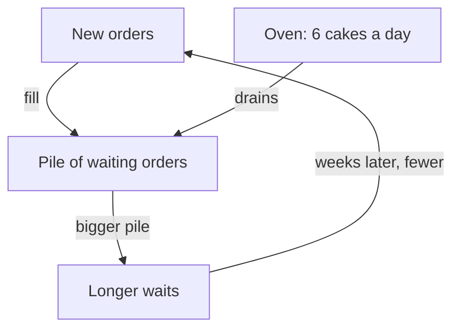

This chapter has three ideas: a stock is a tank that fills and drains, a balancing loop pulls back toward a limit, and a delay makes people overshoot.

## A pile that would not shrink

Look again at Huda's table in chapter 6.1. In week 18, customers asked for 42 cakes, and her oven baked 36. In week 19, they asked for 40. Huda felt relieved. "Things are calming down," she told Wiam. "The waiting list will start getting shorter now."

It did not. At the end of week 19, more orders were waiting than ever, and customers were waiting longer than ever. Huda could not understand it. Orders had gone down, so why had the waiting list gone up?

This chapter answers that question, and two more. Why did the growth from chapter 6.2 stop at 36 cakes a week? And why do people so often react too much, too late, and end up with the opposite problem? The answers are stocks, balancing loops and delays.

## A stock is a tank

Start with the pile of waiting orders. It is the stock from the key words in chapter 6.1, and it behaves like water in a tank. New orders flow in, like water from a tap. Baked and delivered cakes flow out, like water down the drain. The flows in and out change the level in the tank.

The rule for a tank is simple. If more flows in than flows out, the level rises. If more flows out than flows in, the level falls. If the two are equal, the level stays where it is, however high or low that is. What matters is the gap between the inflow and the outflow. It does not matter whether the inflow is going up or down.

Now look at Huda's busy weeks a day at a time. In week 18, customers asked for 42 cakes, which is 7 a day over six days. The oven baked 6 a day. At the end of week 17, 12 orders were waiting. One more order came in than went out each day, so after week 18 the pile was 18.

```predict
prompt: "Suppose orders now fall from 7 a day to 6 a day, and Huda still bakes 6 a day. What happens to the pile of 18 waiting orders?"
options:
  - id: shrinks
    label: "It starts to shrink, because fewer orders come in now"
  - id: stays
    label: "It stays at 18, as many come in as go out"
correctOptionId: stays
explanation: "With 6 orders in and 6 cakes out each day, the gap is zero, so the pile stays where it is: 18. Orders fell, but the pile did not. It only shrinks when fewer than 6 orders a day arrive."
```

Now try it in the model below. It starts at Huda's week 18: 7 new orders a day, 6 cakes baked a day, and 12 orders waiting. Move one slider at a time, and read the "What changed" line each time.

<InteractiveCanvas slug="order-pile-stock-flow" />

Here is what the model showed. With 7 in and 6 out, the pile grows by 1 a day: from 12 to 18 after six days, and to 36 after four weeks. At 6 orders a day, as many orders come in as cakes go out, so the pile stays where it is. Orders fell, and the pile did not shrink. At 5 a day, the pile shrinks by 1 a day, and the 12 waiting orders are gone by day 12. The gap between in and out decides what the pile does, not whether orders are going up or down.

In the real week 19, customers asked for 40 cakes, fewer than the 42 of week 18. But 40 is still more than the 36 the oven bakes in a week. So the pile grew by 4, from 18 to 22. Orders slowed down, and the pile still grew.

The wait follows the pile. With 22 orders waiting and the oven baking 6 a day, a new order waits almost 4 days before its cake even goes into the oven. For the pile to shrink, new orders must fall below 36 a week. At 30 a week it would shrink by 6 a week, and it would take about four weeks to empty.

This is a common mistake with systems. People expect the stock to move the same way as the flow: orders go down, so the pile goes down. But a stock adds up the flow over time. It keeps rising for as long as the inflow is bigger than the outflow, even while the inflow is falling. Many well-educated adults get this wrong when they first meet it, so do not worry if it felt strange.

Stocks are common once you look for them. Money in a savings box, unanswered messages in an inbox, unread chapters in a course, flour in a cupboard. In each case, ask two questions: what flows in, and what flows out? The answer tells you whether the stock is rising or falling, whatever it feels like.

## A loop that pulls back

Now the second question: why did Huda's growth stop at 36? Chapter 6.1 gave the outline, and the stock makes it clearer. As the pile grew, the wait grew. As the wait grew, some customers decided not to order, or ordered elsewhere. Fewer new orders meant the pile grew more slowly. The loop pushed the number of orders back down toward what the oven could bake.

This is the balancing loop from the key words in chapter 6.1. In plain words, it **pulls back toward a limit**. The further things move from the limit, the harder the loop pulls. Some books call it a "negative" loop. That does not mean "bad". It means the loop works against the direction of change.

The classic everyday example is a heater with a thermostat. You set the goal, say 22 degrees Celsius. The thermostat notices the gap between the room and the goal. When the room is too cold, it turns the heater on. When the room reaches the goal, it turns it off. Every balancing loop has those three parts: a goal or limit, a way to notice the gap, and a way to respond.

In Huda's bakery, nobody designed the loop. The limit is the oven: 6 cakes a day, 36 a week. The way to notice the gap is the wait: customers hear "almost four days" and think about their plans. The response is that some of them decide not to wait. The loop is real even though nobody planned it.

The diagram below shows the two flows and the loop that meet in Huda's pile of waiting orders.



New orders fill the pile, and the oven drains it. A bigger pile means longer waits, and longer waits bring fewer new orders. That last arrow closes the loop, and it pulls new orders back toward the oven's 36 a week. Look at the words on that last arrow: "weeks later". The pull-back is real, but it is slow, and that slowness causes the next problem.

## Delays cause overshoot

A delay is the time between a cause and its effect, as the key words in chapter 6.1 say. Delays cause many mistakes. People react to what they see now, and what they see now is the result of what happened earlier.

Here is an example of our own. You turn on a shower. The water is cold, so you turn the tap toward hot. Nothing changes, because the hot water takes half a minute to arrive through the pipes. Still cold, so you turn it further. Still cold, further again. Then the hot water arrives, all at once, and it is far too hot. You turn the tap back hard, and soon it is too cold. You have made an <GlossaryTerm term="overshoot" definition="Going past the level you wanted, because you kept acting before your first action had shown its effect." />: gone past what you wanted, in both directions.

Huda had the same problem with flour earlier this spring. Her rule was: every Sunday, buy enough flour for the cakes I sold last week. In week 10 she sold 24 cakes, so she bought flour for 24. Week 11 was a holiday week, and customers asked for 32. She had flour for only 24. On Thursday it ran out, and she had to turn away 8 orders.

On Sunday she was upset. She bought flour for 32 cakes, plus flour for 10 more "to be safe": enough for 42. In week 12 the holiday was over, and customers asked for 27, as the table in chapter 6.1 shows. She used flour for 27, and flour for 15 cakes sat in the cupboard. Some of it went stale before she could use it. In two weeks she swung from too little to far too much.

The problem was not that Huda was careless. Her rule reacted to last week's news, and her worry added extra on top. A better rule uses information that arrives sooner. Her pile of waiting orders is exactly that. On Sunday, the pile already tells her how many cakes are booked for the coming days. A stock that you can see gives an early warning, if you look at it.

You can see the same kind of overshoot in the model above. Set the orders to 8 a day and the starting pile to 0, then turn on "Customers react a week late". The pile rises to 17, then falls. Customers decide by the waits they heard about a week earlier, so they keep ordering while the pile grows. Later they keep staying away after it has started to shrink. The delay makes the pile go further than it would if customers saw today's wait.

## Where people go wrong

The first mistake is confusing the stock with the flow, as Huda did with the waiting list. "Fewer new orders" does not mean "a shorter list". Always compare the inflow with the outflow.

The second mistake is pushing harder against a balancing loop. Long waits are what hold Huda at 36. An advert only adds new orders to the pile, the pile grows, waits grow, and the loop pushes the orders back down. She would pay for the advert and end up where she started. The useful change is to the limit itself, such as the oven, which is the subject of the next chapter.

The third mistake is acting again before the first action has had time to work. With a delay, the right move is usually a smaller change, then patience. Decide in advance how long the effect should take to show. Wait that long before you change anything again.

The fourth mistake is forgetting that delays work in the other direction too. When Huda shortens her waits, the few poor reviews she already has will keep showing for a few weeks. Orders may dip after the fix, before they recover. If she expects that, she will not panic and undo a good change.

## Check your understanding

```quiz
type: mcq
question: "Ilham delivers water to about 50 homes from a 2,000 litre tank. He wants to refill before it falls below 300 litres, but he only learns the level when the tap spits air. Twice this month he ran dry halfway down a street. Which part of his balancing loop is weak?"
options:
  - "The goal: 300 litres is too high a level to try to keep"
  - "The response: refilling does not bring the tank level back up"
  - "None: running dry twice a month shows the loop works well"
  - "The way to notice the gap: he sees it only when it is empty"
correct: 3
explanations:
  - "The goal is reasonable: it leaves water for the last homes. The trouble is that he cannot see when the level falls below it."
  - "Refilling does bring the level back up. The response works; it just comes too late, because he notices the gap too late."
  - "Running dry means the loop failed to keep the goal. A working loop would refill before the tank fell below 300 litres."
  - "Right. A balancing loop needs a way to notice the gap between the level and the goal. A tap that spits air only tells him when the tank is already empty. A simple level mark he can check would fix this part."
```

```quiz
type: mcq
question: "Ihab runs a stationery shop that serves about 200 families. He orders stock every Monday, based on last week's sales, and the supplier delivers a week later. His shelves keep swinging between empty and overfull. What is the most likely cause of the swings?"
options:
  - "His customers buy at random, so the swings cannot be explained"
  - "His supplier sends the wrong products in every second delivery"
  - "His prices are too low, so customers buy more than they need"
  - "He reacts to old sales news, and orders take a week to arrive"
correct: 3
explanations:
  - "The swings have a pattern, from empty to overfull and back. A delay explains that pattern without assuming customers are random."
  - "Nothing in the case says the products are wrong. The swings come from when and how much he orders."
  - "Low prices might raise sales, but they do not explain swings from empty to overfull and back."
  - "Right. Two delays add up: he uses last week's news, and the stock arrives a week later. Reacting late to old information leads to overshoot in both directions."
```

**Next:** Huda's limit is her oven. Find the slowest step in a process, see why speeding up the others does not help, and watch the limit move once you fix it.
