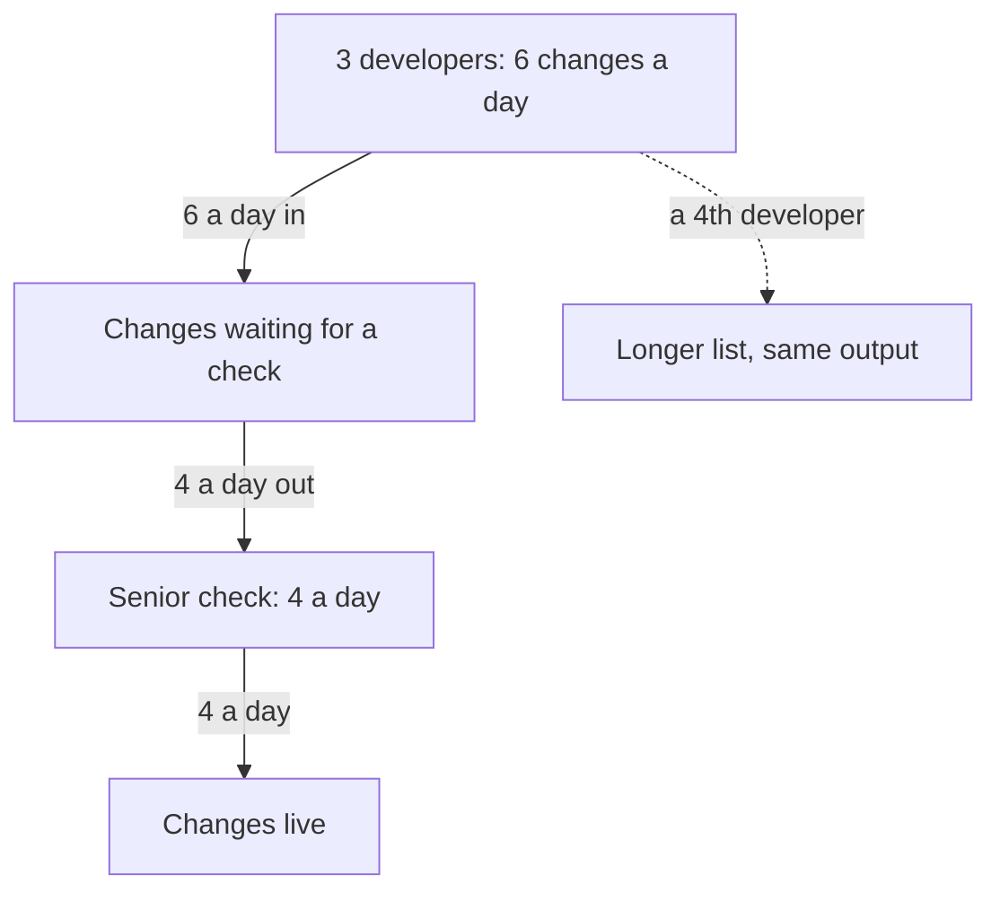

## Everyone is busy, nothing changes

Huda's whole family wants to help her bakery grow past 36 cakes a week. Her son offers to deliver faster on his bicycle. Wiam says she can decorate more cakes each day if she starts earlier. Huda's mother offers to answer customer messages so that Huda has more time. Everyone is willing, everyone is busy, and everyone is tired.

After two weeks of this extra effort, Huda counts the cakes. Still 36 a week. Her son now waits at the door for cakes that are not ready. Wiam sometimes sits with her piping bag, waiting for the next cake to cool. The extra effort did not disappear. It turned into waiting.

This chapter explains why. In any process made of steps, one step is slower than all the others. That step sets the pace for the whole process. No amount of effort anywhere else can make the process go faster than it.

## The slowest step sets the pace

Think of water poured from a bottle. However big the bottle is, the water comes out only as fast as the narrow neck allows. The neck is the bottleneck from the key words in chapter 6.1. In a process, the bottleneck is the step that can handle the fewest items in a given time. Everything else can only go as fast as it does.

This idea is the main idea of an approach called the theory of constraints, introduced by Eliyahu Goldratt in his 1984 book. A "constraint" is the same thing as a bottleneck: the thing that limits how much the whole system can do. The approach gives five steps. First, find the constraint. Second, get the most out of it. Third, make everything else serve it. Fourth, only after that, add more capacity to it. Fifth, start again, because once you fix it, another step may become the slowest.

There is one rule inside those steps that surprises many people. Making a step that is not the bottleneck faster does not raise the output of the whole process. It only piles up more work waiting in front of the bottleneck. Busy people are not the same as a fast process.

## Find Huda's bottleneck

Huda writes her process as a chain of steps, as in module 5. Next to each step she writes how many cakes it can handle in a day. In this example, the numbers are:

| Step | Who or what | Cakes per day |
|---|---|---|
| Take orders | Huda, by phone and message | 20 |
| Mix batter | Huda | 12 |
| Bake | One oven, one cake at a time | 6 |
| Decorate | Wiam | 10 |
| Deliver | Her son, by bicycle | 15 |

The slowest step is clear: the oven bakes only 6 cakes a day. Over a six-day week, that is 6 times 6, which is 36 cakes. It is exactly the number where the bakery stalled. Every other step could handle more. Mixing could do 12, decorating 10, delivery 15. They spend part of each day waiting for the oven.

Orders arrive and are mixed faster than the oven can bake them, so a pile builds up in front of the oven. After the oven, every step is faster than the oven, so there is no pile: decorating and delivery simply wait. That gives you a practical test you can use anywhere. **Look for the pile.** Work waits in front of the slowest step.

Huda's family were trying to help, but every offer was for a step after the oven, or before it. Faster delivery cannot deliver cakes that have not been baked. Faster decorating cannot decorate cakes that are still waiting for the oven. If Wiam decorated 15 cakes a day instead of 10, she would just wait longer between cakes. More orders only make the pile in front of the oven taller and the waits longer. As chapter 6.3 showed, that sends customers away.

## Fix it in the right order

Before buying anything, Huda watches the oven for a whole day. In this example, it can bake one cake an hour, and she uses it for 8 hours a day. But it bakes only 6 cakes.

```predict
prompt: "Huda's oven can bake one cake an hour for 8 hours, but it bakes only 6 cakes a day. Can she get more cakes out of the same oven without buying anything?"
options:
  - id: yes-more
    label: "Yes, by making sure the oven is never empty"
  - id: no-more
    label: "No, an oven can only bake what it bakes now"
correctOptionId: yes-more
explanation: "Eight hours at one cake an hour is 8 cakes, but she gets only 6. So for about two hours a day the oven is empty. Filling those two hours gives her 2 more cakes a day with the same oven."
```

Now step through the five steps for Huda's oven. Before each new number appears, say what you expect it to be.

<InteractiveCanvas slug="bakery-bottleneck-moves" />

Here is what the stepper showed, one step at a time.

**Find the constraint.** Done: the oven, at 6 cakes a day.

**Get the most out of it.** For about two hours each day, the oven sits empty. Huda is mixing the next batter, washing a tin, or answering a phone call. An empty oven means lost cakes, because the oven is the one step that sets the pace. If the next batter is always ready before the oven door opens, the oven can bake 8 cakes in 8 hours instead of 6.

**Make everything else serve it.** Huda's mother takes over the phone during baking hours. Huda mixes each batter while the cake before it is baking, so the oven never waits. The other steps now work to the oven's timing, not their own. The oven now bakes 8 a day: 48 cakes a week, without buying anything. It is still the slowest step, but it is a faster slowest step.

**Add capacity, only after that.** Some weeks later, customers again ask for more than 48 cakes a week. Now Huda buys a second-hand oven. With two ovens, baking can handle 16 cakes a day. This is the expensive step, and it comes last on purpose. If she had bought it first, she might have paid for it while the first oven still sat empty two hours a day.

**Start again.** Now look at the table with two ovens. Taking orders: 20. Mixing: 12. Baking: 16. Decorating: 10. Delivery: 15. The slowest step is no longer the oven. It is decorating, at 10 cakes a day. The bottleneck has moved to Wiam. The bakery can now deliver at most 10 a day, which is 60 a week. If Huda does not notice, a new pile will build up, this time in front of Wiam's table, with baked cakes waiting to be decorated.

So the work is never finished in one go. Each time Huda fixes the slowest step, she looks again. One day the slowest step might not be inside the bakery at all. It might be how many customers want cakes. Then the limit is demand, and the review loop from chapter 6.2 matters again.

## The same pattern in a team

Bottlenecks are not only in kitchens. Picture a small web team of four (fictional, like every team in this course). Three developers write changes, and one senior developer checks every change before it goes live. Each developer can finish two changes a day, so six changes a day are ready. The senior developer can check four a day. The team's output is four changes a day, however hard the three developers work.

The diagram below shows the team's process with the numbers on it. Compare it with Huda's table: the shape is the same, only the work is different.



Six changes a day go into the waiting list and only four come out, so the list grows by two every day. The dotted arrow shows the tempting fix. A fourth developer adds more changes to the list, but the number that goes live stays at four.

The pile is easy to see in real life too: a list of changes "waiting for review" that grows every week. Getting the most out of the checking step comes first. That means no meetings during checking hours, and small, clear changes, so each check is faster. After that, the team can teach a second person to check. Then they look again, because the slowest step may now be somewhere else.

## Where people go wrong

The first mistake is speeding up the wrong step. It feels productive, because the person working on it is busy and proud. But the output does not change, and the pile in front of the bottleneck grows. Before you improve any step, ask: is this the slowest one?

The second mistake is finding the bottleneck by guessing. People often blame the step that complains most or the person they like least. Instead, look for the pile, or count what each step can handle in a day. The answer is a fact you can see.

The third mistake is buying more capacity before getting the most out of what you have. A second oven is expensive. An oven that sits empty for two hours a day gives away cakes Huda could bake for free. Watch the bottleneck for a day before you spend money on it.

The fourth mistake is believing the job is done once the bottleneck is fixed. Fixing the slowest step always makes another step the slowest. That is not a failure. It is the next place to look.

The fifth mistake is judging the process by how busy everyone is. In Huda's busiest weeks, everyone was exhausted and the output stayed at 36. Some idle time at the steps that are not the bottleneck is normal. Those steps need spare time, so that work is always ready for the bottleneck.

<Callout type="tip" title="Look for the pile">
In any process, from a kitchen to a team's task list, work waits in front of the slowest step. Find where things pile up, and you have usually found your bottleneck.
</Callout>

## Check your understanding

```quiz
type: mcq
question: "Rima's workshop makes school uniforms. Per day: cutting 20, sewing 16 (two machines, 8 each), ironing 30, packing 25. One machine stands empty about 2 hours a day while its worker irons and packs. Orders are waiting. What should Rima do first?"
options:
  - "Buy a third sewing machine this month, to raise sewing"
  - "Buy a faster iron, so that ironing takes half the time"
  - "Cut more pieces each day, so sewing always has work ready"
  - "Have others iron and pack, so both machines sew all day"
correct: 3
explanations:
  - "Sewing is the right step, but buying comes after getting the most out of the machines she has. One machine is still empty 2 hours a day."
  - "Ironing can already do 30 a day. A faster iron only gives the ironing step more waiting time."
  - "Cutting already does 20 a day, more than sewing can use. More cut pieces only make the pile in front of sewing taller."
  - "Right. Sewing, at 16 a day, is the slowest step, and one machine is empty 2 hours a day. Keeping both machines sewing all day raises output without buying anything."
```

```quiz
type: mcq
question: "Months later, Rima adds a third sewing machine, so sewing rises to 24 uniforms a day. Cutting is still 20, ironing 30 and packing 25. What is the most the workshop can now finish in a day?"
options:
  - "20"
  - "24"
  - "25"
  - "30"
correct: 0
explanations:
  - "Right. Cutting, at 20 a day, is now the slowest step. The bottleneck has moved from sewing to cutting."
  - "Sewing can now do 24, but it only receives 20 cut uniforms a day. It is no longer the slowest step."
  - "Packing can do 25, but it cannot pack more than the earlier steps send it."
  - "Ironing is the fastest step. The whole process can only go as fast as its slowest step."
```

**Next:** Test what you know about loops, delays and bottlenecks in a graded quiz, including an AI answer to check.
