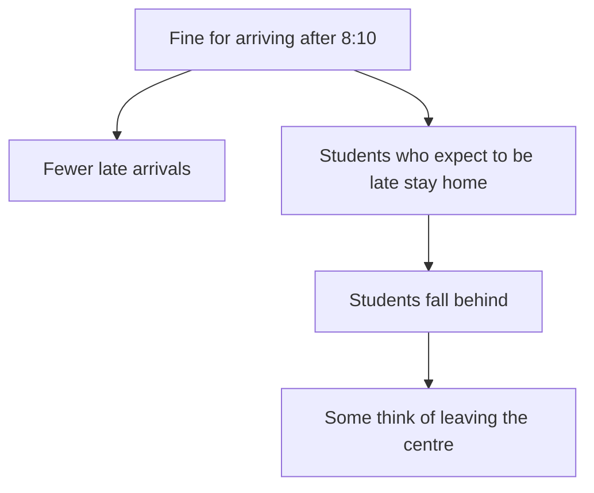

<BigWordAlert term="Second-order effect" plainEnglish="The effect of the effect: what happens next because of the first change." whyItMatters="Most decisions look good if you stop at the first effect. The problems usually appear one or two steps later." />

## A fair rule

Manal runs Hilltop Study Centre, a small study centre (a fictional centre) that helps secondary school students prepare for their final exams. Forty students are enrolled. They come for a morning session three days a week, from 8:00 to 11:00, in two rooms above a sweet shop. Two teachers, Khalil and Samar, share the lessons.

Lateness was Manal's biggest worry. On a normal morning about 9 students arrived after 8:00. Each one opened the door, found a chair and asked a friend what they had missed. The teachers often repeated the start of the lesson. The students who came on time lost those minutes too, and some of them complained.

Manal talked it over with Khalil and Samar. They agreed on a simple rule. From the first day of the next month, any student who arrived after 8:10 would pay a fine of 5 shekels. The money would go into a box to buy books for the centre. The rule was clear, and it was announced a week ahead. Everyone in the room expected it to work.

```predict
prompt: "After the fine started, what do you think happened to the number of students in the room each morning?"
options:
  - id: fewer-came
    label: "It went down, because some students who would be late stayed home"
  - id: more-came
    label: "It went up, because students made a bigger effort to arrive on time"
correctOptionId: fewer-came
explanation: "The room got emptier. A student who expected to be late now had two choices: come late and pay, or stay home and pay nothing. Many chose to stay home. The rule changed what was cheapest for them, and they reacted to that."
```

## What the numbers showed

Manal kept a simple register before and after the rule. Here are the averages for the four weeks before the fine and the four weeks after it, in this example.

| Each session, on average | 4 weeks before the fine | 4 weeks after the fine |
|---|---|---|
| Students in the room | 34 | 26 |
| Late arrivals | 9 | 3 |
| Students on time | 25 | 23 |

The fine did what it was designed to do. Late arrivals fell from 9 a session to 3. If Manal had looked only at that line, she would have called the rule a success and moved on.

Now look at the first line. Before the fine, about 34 of the 40 students came to each session. After it, about 26 came. Eight more students were missing every morning. The last line holds the real surprise. The number of students who arrived on time also fell, from 25 to 23. The rule was meant to bring more students in on time. It brought in fewer.

Check the sums yourself, because a story is only as good as its numbers. Before the fine, 34 students came and 9 were late, so 34 minus 9 gives 25 on time. After the fine, 26 came and 3 were late, so 26 minus 3 gives 23 on time. The fall in lateness is real. So is the fall in learning time.

## Why it went wrong

Manal wanted to understand, so Khalil phoned six students who had stopped coming most days. Their answers were similar. Most of them depended on shared taxis, and in the morning a taxi does not leave until it is full. Some had to take a younger brother or sister to school first. None of them could promise to be on time every day.

On a day when they knew they would be late, these students now had two choices. They could arrive late and pay 5 shekels, or stay at home and pay nothing. Many chose to stay home. From where they stood, this was a sensible choice. The rule had made missing the whole session cheaper than missing ten minutes of it.

So the rule did more than one thing. One direct effect was the one Manal wanted: fewer students walking in late. Another direct effect was one nobody planned: students who expected to be late stopped coming at all. Both came straight from the rule, so both are first effects. The second effect followed from the one nobody planned: students who missed sessions fell behind. A third effect was starting to show. Two of them told Khalil they were thinking of leaving the centre, because they could no longer follow the lessons.

Notice that nobody in this story was careless or unkind. Manal wanted students to learn. The teachers wanted calm lessons. The students wanted to come, but they could not control the taxis. The problem was not a bad person. It was a good decision that had been thought through only one step.

## Two wrong lessons to avoid

It is easy to take the wrong lesson from Manal's story. The first wrong lesson is "fines never work" or "rules make things worse". That is too big a jump from one case. A rule like this can work well where people control their own arrival time, for example in an office next to a bus stop with buses every five minutes. The lesson is narrower: a rule works through people's choices, so you have to ask what those choices are.

The second wrong lesson is to blame the students. Someone at the centre said, "They are just lazy. They were looking for an excuse." But the same students had come most days before the fine. Nothing about them changed. What changed was the rule, and with it the cost of each choice. When a group of people all change their behaviour at the same time, look first at what changed around them, not inside them. You met this idea in module 4, when you looked for causes in steps and systems instead of in a person to blame.

## The story as a chain

The diagram below draws Manal's rule as a small map of effects. Read it from the top. The rule leads to two different effects, and only one of them was planned.



The left branch is the planned first effect. It is short, quick and easy to measure, so it is the one everyone looks at. The right branch is longer. It starts with a first effect nobody planned: what students did once the rule changed their choices. Then come the second and third effects. Each step on it takes more time to appear, and each step is further from what Manal wanted.

This shape is common. The first effect of a decision is close and visible. The later effects grow out of how people respond, and they show up in different numbers, often weeks later. If you only measure the first effect, the map tells you that you will miss everything on the right.

## Why this matters at work

Rules, prices, targets and rewards are all decisions about people. Each one changes what people find easy, cheap or rewarding. People then adjust, often in ways the person who made the decision did not picture. A freelancer who adds a fee for late changes may get fewer late changes, and also fewer repeat clients. A team that rewards fast replies may get fast replies that say very little.

You have already met some of the tools for this. In module 6 you saw how effects can loop back on themselves and how delays hide them. In module 3 you learned to test a change fairly before you trust it. This module adds one habit before you act: ask "and then what?" Then ask it again, and think about who will react.

The question is not a reason to do nothing. Most good decisions still have side effects. The point is to see the likely ones early, change the plan where you can, and decide what you will watch. Then a bad surprise is caught in two weeks, not two months.

Manal's rule could have been checked this way before it started. She could have asked one question. "A student knows they will be late, and the fine is 5 shekels. What is the easiest thing for them to do?" The honest answer, stay home, was not hard to find. She did not need data for that step. She needed one more question.

## What you will practice

<LearningObjectives items={["Find the first, second and third effects of a decision", "Ask who will react to a change, and how", "Spot a target or reward that changes behaviour in ways nobody wanted", "Plan a small first try and decide in advance what to watch", "Check an AI answer for the effects it missed"]} />

## Key words

| Word | Plain English |
|---|---|
| **Unintended consequence** | A result nobody planned. It can be bad, and sometimes it is good |
| **Incentive** | A reward or a cost that pushes people to act in a certain way |
| **Target** | A number people are asked to reach, often with a reward attached |
| **Side effect** | An extra effect of a change, beside the one you wanted |
| **Pilot** | A small, short first try of a change, easy to stop or undo |

## What is in this module

| Chapter | You will practice |
|---|---|
| 7.2 | Asking "and then what?" to find second and third effects |
| 7.3 | Spotting when a target or reward changes behaviour |
| 7.4 | Predicting reactions, starting small and deciding what to watch |
| 7.5 | A graded quiz, including an AI answer to check |
| 7.6 | A consequence map for a real or provided decision |

The chapters build on each other. First you learn to follow effects forward from a decision. Then you look at one kind of decision that causes surprises again and again: targets and rewards. Then you learn how to try a change in a small, safe way so that side effects show up early.


**Next:** A simple way to follow a decision forward, step by step, and see who reacts.
