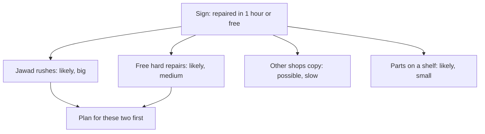

<BigWordAlert term="Consequence map" plainEnglish="A simple drawing or list that follows a decision forward: its first effect, the reactions it causes, and what those reactions lead to." whyItMatters="It writes down the effects you would normally miss, while you can still change the plan." />

## A promise on a sign

Hamza runs a small bicycle repair shop (a fictional shop) on a busy street. His cousin Jawad does most of the repairs. On a normal day they fix about 12 bicycles. Most jobs are a flat tyre, a loose chain or a brake cable that needs changing. These take 20 to 40 minutes each. A few jobs are harder. A damaged wheel that must be rebuilt can take two or three hours.

Two other repair shops have opened in the same street this year. Hamza wants a way to stand out. One evening he writes a new sign for the window: "Repaired in one hour, or the repair is free." He shows it to Jawad. "Customers will love it," he says. "Most of our repairs take less than an hour anyway."

Hamza is right about the first effect. People will notice the sign, and more customers will come. But a sign like this is not one decision with one effect. It changes what customers expect, how Jawad works, what other shops do and which bicycles arrive at the counter. Each of those changes leads somewhere. This chapter gives you a simple way to follow them.

## The idea: follow the decision forward

Think of the effects of a decision as links in a chain. The first effect is what the decision does directly. In chapter 7.1 you met the second-order effect: the effect of the effect. It is whatever the first effect causes next, very often through somebody's reaction. A third effect is the effect of the second one. After three links, the steps are usually too uncertain to be useful.

So the order of an effect is only its place in the chain. It says nothing about whether the effect was planned, or whether it is good or bad. Hamza's "more customers" is a first effect, because it comes straight from the sign. What those extra customers then cause is a second effect.

This is not a new idea. Frédéric Bastiat was a French writer on economics in the nineteenth century. He made the point that an act, a habit, a rule or a law produces not one effect but a series of effects. His essay was about "what is seen and what is not seen". The first effect is usually the one that is seen. The later ones are easy to miss.

The question this course uses to find them is short: "and then what?" You ask it once to move from the decision to its first effect. You ask it again for each reaction. A consequence map is the place where you write down the answers.

## Six steps for a consequence map

1. **Write the decision and its goal.** One sentence each.
2. **Write the first effect.** What happens straight away, if the plan works?
3. **List who will react.** Customers, staff, family, clients, competitors, suppliers, and you.
4. **Ask how each one will react.** What is the easiest way for them to get what they want under the new rule?
5. **Ask "and then what?"** for each reaction, usually up to the third step.
6. **Mark what matters.** Circle the effects that are both likely and big. Change the plan for those, or decide to watch them.

Step 4 does most of the work. People do not simply follow your plan. They do what makes sense from their own point of view, and that is often the easiest path, not the one you hoped for. Manal's students in chapter 7.1 did exactly this. Asking "what is the easiest way for them now?" usually finds the reaction faster than asking "what should they do?"

Step 6 keeps the map useful. A map can grow forever, so you need a way to choose. An effect that is likely but tiny can wait. An effect that would be big but is very unlikely can wait too. The ones that are both likely and big are where your planning time should go.

A map does not need a big meeting or special software. Ten minutes with a pen and the people who know the work is usually enough. The people who will live with the decision are often good at step 4, because they already know the easy paths. Jawad, not Hamza, was the one who said, "If there is a clock on every job, I will rush."

## Worked example: Hamza's sign

Here is the map Hamza and Jawad made together, one step at a time, before the sign went up.

**The decision and goal.** Promise every repair in one hour, or it is free. The goal is more customers than the two new shops.

**The first effect.** More people come in. This is likely, at least for a few weeks, because the promise is easy to understand.

**Who will react, and how.** Hamza and Jawad went through each group and asked what the easiest path would be for them.

```predict
prompt: "Hamza thinks his biggest risk is that other shops will copy the promise. Which effect is more likely to hurt him first?"
options:
  - id: other-shops-copy
    label: "Other shops copying the promise and taking their customers back"
  - id: jawad-rushing
    label: "Jawad rushing and making mistakes that bring bicycles back"
correctOptionId: jawad-rushing
explanation: "Jawad starts working against the clock on the first day, inside Hamza's own shop. Other shops need time to notice, decide and change their signs. Effects inside your own work, close in time, usually show up first."
```

Now step through Jawad's branch of the map, one link at a time. At each step, ask "then what?" before you press Next.

<InteractiveCanvas slug="and-then-what-chain" />

The canvas showed why the order of an effect is only its place in the chain. Jawad rushing comes straight from the sign, so it is a first effect, even though nobody planned it. Small mistakes are the effect of that effect, so they are a second effect. Bicycles coming back are a third effect, and by then the chain is far from Hamza's goal. Then the chain closed into a loop: returned bicycles make the queue longer, and a longer queue puts more pressure on Jawad. This is a loop of the kind you met in module 6. It also showed something about safety: a badly adjusted brake is a real risk for the rider, not only a cost for the shop.

**Customers.** The easiest path for a customer with a hard repair is to try the promise. A wheel rebuild that takes three hours now costs nothing. And then what? The hardest jobs, the ones that cost Hamza the most time and parts, become the ones he does for free. On a busy day, they also push easy jobs past the hour.

**The other shops.** Their easiest path is to copy the sign. And then what? Within a few weeks Hamza's promise may no longer be special, but he still carries its costs. This one is possible, but slower and less certain than the first two.

**Hamza himself.** To fix bicycles within an hour, he needs parts in stock. And then what? He buys tyres, chains and cables ahead, and money he could have used for other things is now spent on parts that wait on a shelf.

Now step 6. The Jawad loop is likely and big. The free hard repairs are likely and medium. Copying is possible but slower. The money spent on parts ahead of time is likely but small. So Hamza changes the plan before he puts up the sign. The promise now covers only the listed repairs (tyres, chains and brakes) on bicycles handed in before 4 pm. Wheel rebuilds get a time estimate instead. He also decides what to watch: how many bicycles come back within a week. Before the sign, about 1 bicycle in 20 came back. If that rises, the loop has started.

## The whole map, and what to plan for

The canvas followed one branch. The diagram below shows the whole map Hamza and Jawad made, with all four groups, and the mark each effect got at step 6. It argues something the canvas does not: which branches deserve planning time.



Two branches lead into the planning box, and two do not. That is step 6 at work. The other shops and the parts on the shelf are still on the map, and Hamza will look at them again in a month. But a map with every branch treated the same would leave no time for the two that matter. Without any map at all, Hamza would have measured "customers per day", seen it rise, and missed both important branches until they hurt.

## Where the method goes wrong

**Stopping at the first effect.** This is a common mistake, and it is the one Manal made. The first effect is real, so it feels like the answer. Always ask the question at least twice.

**Picturing people as you wish they would act.** "Customers will be honest about hard repairs" is a hope, not a prediction. Ask what the easiest path is for each group, and assume many people will take it.

**Going too far.** Each step is less certain than the one before. By the fifth or sixth "and then what?", you are writing stories, not predictions. For most everyday decisions, three steps are enough. Spend the extra time on the likely and big effects instead.

**Forgetting the good surprises.** Effects nobody planned can be good as well as bad. Customers who came for a quick tyre repair might also buy a lock or a lamp. Put those on the map too, because they can change which plan is best.

**Treating the map as fact.** Every line on the map is a guess. It tells you what to watch and what to test, using the fair tests from module 3. It does not tell you what will happen.

## Check your understanding

```quiz
type: mcq
question: "Hiyam runs a children's sports club in a town hall, with 40 members and 2 coaches. To get more children to join, she makes the first month free for new members. Which question would find a second-order effect?"
options:
  - "How many new children will sign up for the free first month?"
  - "Which posters will reach the families who live near the club hall?"
  - "Do free first months work well for sports clubs in general?"
  - "How will two coaches cope if many new children arrive at once?"
correct: 3
explanations:
  - "This asks about the first effect, the direct result Hiyam is aiming for. It is worth knowing, but it does not follow the chain to the next link."
  - "This is a question about how to carry out the plan. It does not follow the decision forward to any effect."
  - "This is a general question about clubs everywhere. A consequence map looks at this decision, these people and their reactions."
  - "Right. It asks what the first effect (more new children) causes next. Two coaches with a much bigger group may give each child less attention, and that can lead to further effects."
```

```quiz
type: mcq
question: "Zuhair manages a car hire office with 4 clerks. He plans a rule: every rental contract is checked by a second clerk before the keys are handed over. He has time to plan for one effect. Which should he plan for first?"
options:
  - "Customers may one day ask to check their own contracts at the desk"
  - "A clerk may feel pleased when a check finds no mistake at all"
  - "Queues grow at busy hours, because each contract waits for a check"
  - "The office may later grow so big that one checker is not enough"
correct: 2
explanations:
  - "This could happen, but it is unlikely. An effect that is unlikely can wait while likely ones are planned for."
  - "This is likely, and even pleasant, but it is small. It does not need a plan."
  - "Right. This effect is likely, because every contract now waits for a second person, and it is big, because it touches every customer at busy hours. Likely and big comes first."
  - "This is far in the future and depends on other decisions. It is not where his planning time should go now."
```

**Next:** One kind of decision surprises people again and again: a target with a reward attached.
