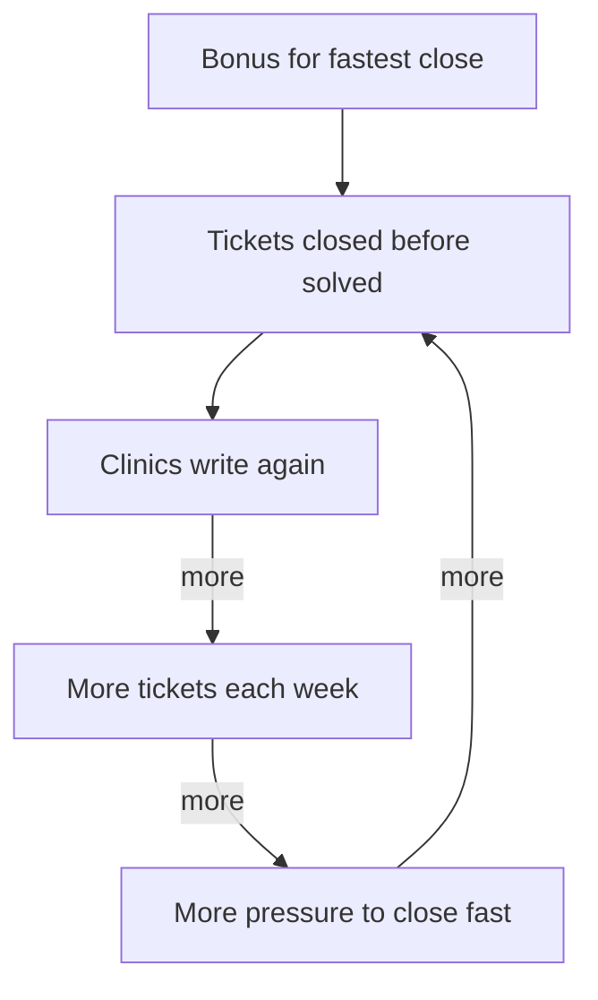

<BigWordAlert term="Goodhart's law" plainEnglish="When a number becomes a target, people change what they do to hit the number, and the number stops telling the truth." whyItMatters="Almost every team uses numbers to check its work. If you know how this happens, you can set targets that help instead of hurt." />

## A team that looked faster

Sawsan leads a team of five support agents at a small software company (a fictional company). The company makes a booking app for clinics. When a clinic has a problem, it sends a help request, called a ticket. The support team answers the ticket, solves the problem and then marks the ticket as closed.

Clinics had been complaining that help was slow. So Sawsan's manager set a target: close every ticket within 24 hours. To make the target matter, he added a reward. Each month, the agent with the shortest average time to close would get a bonus. Everyone agreed this was fair. Fast help was exactly what the clinics wanted.

After a month, the main number looked wonderful. The average time to close a ticket had fallen from 40 hours to 14 hours. The manager sent a message to the whole company to thank the team. Sawsan was less sure. Her phone was busier than ever, and two clinics had called her directly, angry.

```predict
prompt: "The average time to close a ticket fell from 40 hours to 14 hours. What do you think happened to the number of tickets each week?"
options:
  - id: tickets-went-up
    label: "It went up, because unsolved problems came back as new tickets"
  - id: tickets-went-down
    label: "It went down, because faster help meant fewer clinics had to write"
correctOptionId: tickets-went-up
explanation: "Tickets were being closed before the problem was solved. The clinic still had the problem, so it wrote again. Faster closing made more work, not less."
```

Now step through what happened in Sawsan's team, from the target to the clinics and back. Watch which messages reach the manager, and which do not.

<InteractiveCanvas slug="target-looks-good" />

The canvas showed two paths of feedback. The good news travelled one way: the agents closed tickets fast, and the manager saw the average fall from 40 hours to 14. The bad news travelled another way: the clinics wrote again, and their anger reached Sawsan's phone, not the manager's report. Nothing in the one number showed the reopened tickets. That is how a number can improve while the real work gets worse, and nobody involved has to lie.

## What really happened

Sawsan pulled the numbers for the four weeks before the target and the four weeks after it. Here they are, for this example.

| Each week, on average | Before the target | After the target |
|---|---|---|
| Tickets received | 200 | 260 |
| Average hours to close | 40 | 14 |
| Tickets reopened by the clinic | 10 | 78 |
| Customer rating, out of 5 | 4.4 | 3.6 |

Before the target, 10 tickets in 200 were reopened: 5 in every 100. After it, 78 in 260 were reopened: 30 in every 100. Check it: 260 divided by 100 is 2.6, and 2.6 times 30 is 78. So, in proportion, six times as many tickets came back unsolved. The rating fell too.

Sawsan read a sample of closed tickets and found the pattern quickly. Many had been closed after one short reply, such as "Please restart the app and try again," with no check that it worked. Hard problems were passed to the developers and then closed, so the clock stopped. Nobody had broken a rule. Every support agent was doing what the target and the bonus rewarded: closing fast.

## Why targets change behaviour

A target is a number that stands for something you care about. Sawsan's company cared about clinics getting their problems solved quickly. That is hard to see directly, so they chose a number that was easy to see: hours to close. Most of the time, the two move together. Solve problems faster, and the hours go down.

The trouble starts when a reward is attached to the number. The reward is an incentive, as you saw in chapter 7.1. It makes people look for the quickest way to move the number. Sometimes that means doing the real work better. Often there is a cheaper way that moves the number alone. Closing a ticket is much quicker than solving the problem behind it. Once people take the cheaper way, the number and the real goal separate. The number keeps improving while the work gets worse.

There is an old observation about this, often called Goodhart's law, after an economist, Charles Goodhart. A common way to say it is: when a measure becomes a target, it stops being a good measure. Be careful with the words, though. That short sentence is not Goodhart's own. His original point was about numbers used to control money in an economy.

An anthropologist, Marilyn Strathern, wrote the short version in a paper about universities in 1997. An anthropologist is a person who studies how groups of people live and work. She gave the example of exam grades: the more a particular grade is expected, the worse it gets at telling students apart.

A researcher, Donald Campbell, made a similar warning. When a number is used to make big decisions, people feel pressure to make it look good, even when the work is not good. In the end, the number can change the very work it was meant to measure. Sawsan's team shows both halves. The number was pushed to look good, and the real work changed shape around it.

## Three ways to hit a number without doing the work

**Moving the number alone.** The agents closed tickets that were not solved. A teacher who rewards students for the number of pages they read may find that they turn pages without reading them.

**Dropping what is not measured.** Nothing in the target counted whether the clinic was happy, so careful explanations stopped. Anything a target ignores tends to shrink, because time spent on it no longer earns anything.

**Choosing the easy cases.** People pick the work that moves the number most cheaply. The same teacher may see students choosing thin books with big print, because a thin book adds pages faster than a hard one.

Once you know these three patterns, you can check any target before it starts. Ask one plain question: "How could someone hit this number without doing what we want?" Call it the shortcut question. If you can find an answer in two minutes, so will the people working under the target.

## Worked example: a better target for Sawsan

Sawsan does not want to drop targets. Without any number, nobody could see that help was slow in the first place. The lesson is not "targets are bad". It is: expect people to aim at the number, watch for side effects, and use more than one measure. Guides on running fair tests online make the same point: choose measures that do not reward short-term tricks.

So she works through it step by step.

**Step 1: name the real goal.** Clinics get their problem solved, quickly, and are happy with the help.

**Step 2: ask the shortcut question about the old target.** How could someone close fast without solving? By closing after one reply. By passing hard problems on and closing them. Both happened.

**Step 3: add measures that catch each shortcut.** Next to time to close, she adds tickets reopened within seven days, and the clinic's rating. A ticket closed too early now shows up as a reopened ticket. A rushed, unhelpful reply shows up in the rating. To hit all three numbers at once, the easiest path is to really solve the problem.

**Step 4: change what the reward is for.** The bonus now goes to the whole team when all three numbers are good for the month. This removes the race between agents to grab the quickest tickets.

**Step 5: decide what to watch.** Sawsan will read ten closed tickets every Friday, not only the numbers. Reading real work is a good way to spot a new shortcut early.

After two months, the average time to close settled at 22 hours. Reopened tickets fell back to about 6 in 100, and the rating rose to 4.5. The time to close was longer than in the "fast" month, but the help was much better for the clinics. Two months is a short time, so Sawsan treats this as a hint and keeps watching the same three numbers.

## The trap as a loop

The diagram shows why the first target made things worse over time, not just once. It is a loop of the kind you met in module 6.



Follow the arrows. Closing early creates more tickets. More tickets create more pressure. More pressure leads to more early closing. The bonus only starts the loop; the loop keeps itself going. This is why a number that is pushed to look good often gets worse each week instead of staying the same. Sawsan's extra measures break the loop at the second box, because an early close now costs the team on the reopened number.

## Where people go wrong

**Calling the team cheats.** It is tempting to say the agents were dishonest. But they did what the reward asked. As in module 4, look for the cause in the system: the target paid for speed alone.

**Adding a new rule for every shortcut.** "No closing after one reply" will lead to two short replies. Measuring closer to the real goal works better than blocking shortcuts one at a time.

**Picking a second number that is just as easy to push.** "Number of replies per ticket" can be raised with empty replies. A good second measure is one that the shortcut makes worse, like reopened tickets.

## Check your understanding

```quiz
type: mcq
question: "Marwan runs a farm stall that delivers vegetable boxes, with 3 drivers. He starts paying a bonus for every box delivered above 15 a day. Boxes per driver rise from 14 to 19 a day. What should he check next?"
options:
  - "Whether the drivers would like a bigger bonus for even more boxes"
  - "Whether other farm stalls in the area pay their drivers this way"
  - "How many boxes each driver delivered on their best day this month"
  - "How many boxes arrived damaged or wrong since the bonus started"
correct: 3
explanations:
  - "This asks how to push the number higher. It does not check whether the number still reflects good deliveries."
  - "What other stalls do does not tell Marwan what his own bonus has changed."
  - "This is the same number in another form. It cannot show a side effect that the number itself does not measure."
  - "Right. A bonus per box rewards speed. The thing it does not measure, care with each box, is what tends to shrink. Damaged or wrong boxes would show it."
```

```quiz
type: mcq
question: "Rasmi runs a hotel front desk with 3 staff. New target: every booking call ends within 2 minutes. A month later, calls average 1.8 minutes (they were 4). Bookings stay at 60 a day. Guests arriving on the wrong date rose from 3 to 14 a week. What do these facts support?"
options:
  - "The target worked: calls are shorter, and bookings have not dropped"
  - "Rushed calls miss details, so more guests come on the wrong date"
  - "The hotel is busier now, so the staff have less time for each call"
  - "Guests have become careless and mix up their own booking dates"
correct: 1
explanations:
  - "This ignores the wrong-date arrivals, which rose almost five times. The work got worse while the number improved."
  - "Right. Calls got much shorter, bookings stayed the same, and wrong-date arrivals rose. The likely link is that details are lost in rushed calls."
  - "Bookings stayed at 60 a day, so the hotel is not busier. The shorter calls come from the target, not from more work."
  - "Nothing changed for the guests. What changed was the target at the desk, so look there first."
```

**Next:** How to predict people's reactions before a change, start small, and catch side effects early.
