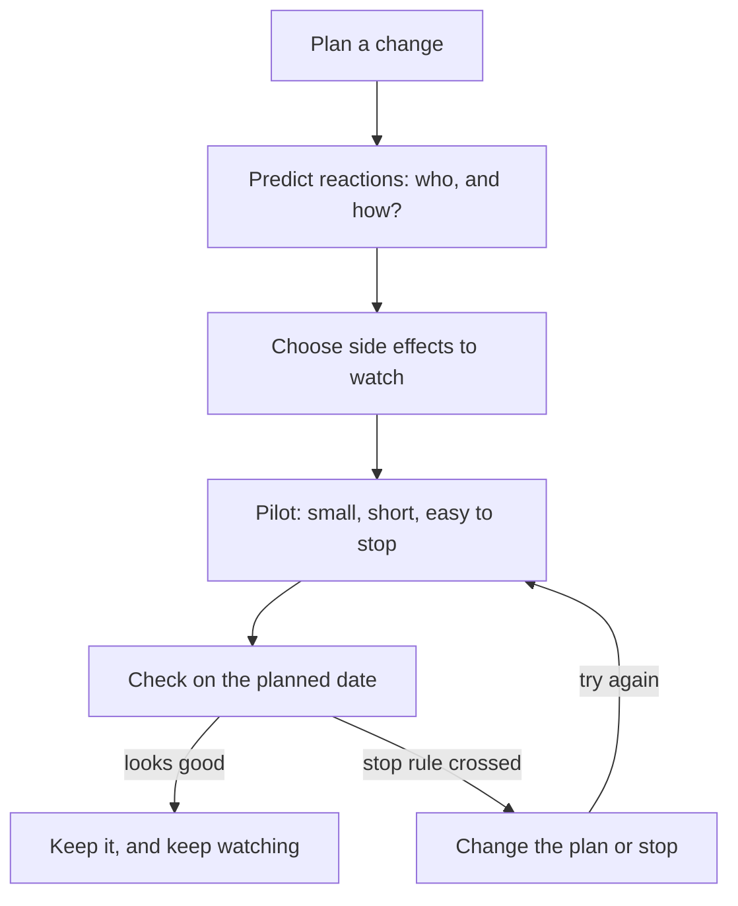

<BigWordAlert term="Stop rule" plainEnglish="A line you set before a change starts: if a number crosses it, you stop or change the plan." whyItMatters="Once a change has started, it is hard to admit it is going wrong. A line drawn in advance makes the decision for you." />

## Free delivery, and a pile of coasters

Yara sells hand-painted mugs from home through an online shop (a fictional shop). Her mugs cost 80 to 150 shekels. Her sister paints small matching coasters, which sell for 25 shekels. Customers pay 15 shekels for delivery on every order, and a local delivery service collects the parcels each evening.

Yara wanted bigger orders. Most customers bought one mug and nothing else. So she planned an offer: free delivery on any order of 100 shekels or more. She would pay the 15 shekels herself on those orders. She hoped that a customer looking at an 80-shekel mug would add a coaster to reach 100.

Before she started, Yara remembered chapters 7.2 and 7.3. She knew the offer would change what was easiest for her customers, and that people would react in ways she might not want. She did not want to find out two months later. This chapter shows the plan she made, and the method behind it.

## The idea: predict, start small, watch

Every change has side effects, the extra effects you met in chapter 7.1. Most side effects are small. A few matter. You cannot avoid them all, and you cannot predict them all. What you can do is make them show up early, while they are still cheap to fix. That needs three habits.

The first habit is to predict reactions. Use the consequence map from chapter 7.2: list who is touched by the change, and ask what the easiest path is for each of them now. Pick the side effects that are both likely and harmful.

The second habit is to start small. A pilot, the small first try from chapter 7.1, limits the change in time, in people or in place. It is labelled as a try, so stopping it does not feel like failure. A small start keeps any damage small too.

The third habit is to decide in advance what you will watch. Write three things down before the pilot starts. The first is the main measure for the goal. The second is one or two watch measures for the side effects you fear. The third is a stop rule. Add a date when you will look. You learned in module 3 to fix the measure before a test. This is the same rule, applied to side effects.

## Worked example: Yara's pilot

**Step 1: who will react, and how?** Yara listed four groups. Customers who planned to spend 80 shekels could add a coaster to reach 100. Customers who wanted only a coaster might wait and join a friend's order. Her sister would need to paint more coasters. The delivery service would carry slightly heavier parcels, which did not matter.

```predict
prompt: "Yara expects bigger orders. Do you think the average order will really rise during the pilot?"
options:
  - id: average-rises
    label: "Yes, many customers will add a coaster to reach 100 shekels"
  - id: average-stays
    label: "No, most customers will keep buying one mug, just as before"
correctOptionId: average-rises
explanation: "The offer makes it cheaper to add a coaster than to pay 15 shekels for delivery, so many customers will do it. The goal will probably be met. The question is what else happens, and that is why Yara also watches for side effects."
```

Now step through Yara's pilot in the order she ran it. Notice when the watch list is written, and what happens after the goal is met.

<InteractiveCanvas slug="pilot-with-a-stop-rule" />

The canvas showed that a pilot can meet its goal and still need to change. The average order did rise, as most people expect. But the side effect, returned coasters, showed up in the same two weeks, and it crossed a line Yara had drawn before she started. Because the line was already written, she did not have to argue with herself about it. The steps below go through the same pilot in more detail.

**Step 2: choose the side effects to watch.** The easiest path for an 80-shekel customer is to add the cheapest item, whether they want it or not. So returns of unwanted coasters were likely, and each return costs Yara two deliveries and her time. Coasters running out was also likely. Fewer small orders was possible but less harmful.

**Step 3: plan the pilot.** Two weeks, announced as "for two weeks only", so it would be easy to end. She chose whole weeks, because weekends and weekdays sell differently.

**Step 4: write the watch list before starting.** Yara wrote three lines in her notebook. Main measure: average order value. Watch measures: returned orders out of every 100, and coasters in stock each Sunday. Stop rule: if returns go above 10 in every 100 orders, change the plan.

**Step 5: check on the planned date.** After two weeks, she compared the pilot with the two weeks before it. In this example, the numbers look like this.

| | 2 weeks before | 2-week pilot |
|---|---|---|
| Orders | 60 | 66 |
| Average order, shekels | 95 | 112 |
| Returned orders | 3 | 10 |
| Returns per 100 orders | 5 | about 15 |

The goal was met. The average order rose from 95 to 112 shekels. But returns rose from 3 in 60 orders (5 in 100) to 10 in 66 orders (about 15 in 100). That crossed the stop rule. Yara looked at the 10 returns. Eight of them were coasters added to an 80-shekel mug and sent back unused.

**Step 6: decide.** Without the stop rule, Yara might have seen the bigger orders, felt happy, and kept going. With it, the decision was already made: change the plan. She lowered the free delivery line to 80 shekels, so any mug alone would qualify and nobody had to add a coaster they did not want. Then she asked "and then what?" again. Average orders might fall back a little, and she might pay delivery on more orders. She ran a second two-week pilot with the same watch list.

Two weeks is a small test. Yara treats each result as a hint, not proof, which is what module 3 taught. Her comparison also has a weakness. She compared the pilot with the two weeks just before it, and orders move up and down on their own. If those two weeks were unusually quiet, the next two might have been busier anyway: the drift back to normal you met in module 2. A cheap way to make the check fairer is to switch the offer on and off in alternate weeks, or to repeat the pilot later. If the second pilot looks good, she will keep watching the same numbers for another month before she calls it settled.

## The cycle as a picture

The diagram shows the method as a cycle. Notice that it does not end at "check". A crossed stop rule sends you back to a new, small try.



The important arrow is the one from "Choose side effects to watch" down to the pilot. The watch list is written before the pilot starts, not after. If you choose what to look at after you see the results, you will tend to look at whatever went well. Yara would have looked at average orders, seen 112, and stopped there.

## Manal's rule, done again

The same method fits the study centre from chapter 7.1. Suppose Manal had asked, before the fine, how each group would react. The easiest path for a student stuck in a late taxi is to stay home. That side effect is likely and harmful, so it goes on the watch list.

A pilot could then look like this. For three weeks, the first 15 minutes of each session become quiet revision time, so a late student misses little and the teachers start the new lesson at 8:15. Main measure: students in the room on time for the new lesson. Watch measure: students in the room at all. Stop rule: if average attendance falls below the level before the change, about 34, change the plan. Nobody can promise this pilot would work. But if it failed, Manal would know in three weeks, and she would know why.

## Where it goes wrong

**Watching only the goal.** The goal measure tells you whether the change worked. It cannot tell you what else the change did. Manal's late arrivals and Sawsan's time to close both improved while the real work got worse.

**No stop rule, or one set later.** A line drawn after you see the numbers is easy to move. Write it first. If you are not sure where to draw it, use the level before the change: "If returns are worse than before, we look again."

**A pilot that is too short.** People react to something new just because it is new, and some react against change at first. A few days can mislead in both directions. Run whole weeks, and look again later.

**A pilot group that is not like everyone.** If Yara had offered free delivery only to her most loyal customers, she would have learned how loyal customers react. That is selection, from module 2. Try the change on a group like the people who will live with it.

**A pilot that cannot be undone.** If Yara had printed "free delivery forever" on every mug, stopping would have been costly. Keep the first try easy to end.

**Missing the good surprises.** Some customers posted photos of their mug and coaster together, and Yara got new followers. Write good side effects down too. They may be a reason to keep part of a plan.

## Check your understanding

```quiz
type: mcq
question: "Basma manages a school canteen with 4 staff and about 300 pupils. To cut the lunch queue, she plans to take lunch orders on paper slips the day before. Which plan best follows this chapter?"
options:
  - "Start with every class now, and ask the staff how it feels after a month"
  - "Try two classes for a month, then pick numbers that show how it went"
  - "Try two classes for a month, watching only the minutes spent queueing"
  - "Try two classes for a month; watch queue time and pupils with no lunch"
correct: 3
explanations:
  - "This is not a pilot: every class is in it at once. It also has no measure or stop rule chosen in advance."
  - "Choosing the numbers afterwards makes it easy to look only at what went well. The watch list comes before the start."
  - "Queue time is the goal measure. It cannot show side effects, such as pupils who forgot to order and get no lunch."
  - "Right. A small group, a fixed time, the goal measure, and a watch measure for a likely side effect, all chosen before the start."
```


**Next:** A graded quiz on consequences, targets and side effects, including an AI answer to check.
