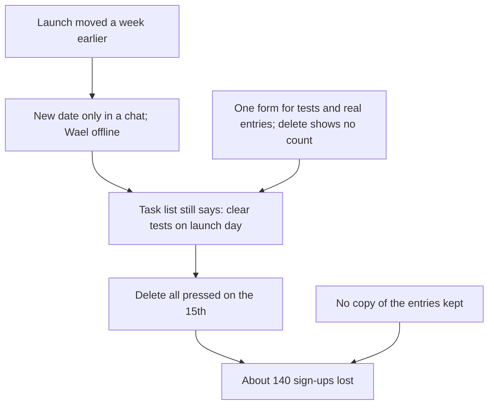

<BigWordAlert term="Review without blame" plainEnglish="A short review after a problem that looks for causes in steps, tools and information, not for a person to punish." whyItMatters="People keep reporting problems when they are not afraid. Then the team can fix what made the mistake easy, before it happens again." />

## A week of sign-ups, gone

Young Coders Club is a small NGO (a fictional organisation) that runs free coding courses for young people. This term it planned a course with 60 places. Three people did most of the work. Ruba coordinates the course. Wael, a volunteer, builds the online forms. Nadia runs the NGO's social media pages.

Wael built the sign-up form on a Tuesday. To save time, he copied last year's form and changed the dates. He and Nadia then filled it in six times with made-up names, to test it. The team's shared task list said: "Wael: on launch morning, clear the test entries." The launch was planned for Sunday the 15th.

On Thursday the 5th, a partner school asked whether sign-ups could open a week earlier. Ruba and Nadia agreed on a short voice call. That evening Ruba posted the new date, Sunday the 8th, in the team chat. Wael had exams that week and was offline for three days. Nobody changed the task list.

Nadia posted the form on Sunday the 8th. Many sign-ups arrived every day that week. Young people shared the post with friends, and teachers at the partner school sent it to their classes. Then, on the morning of Sunday the 15th, Wael opened the form to do the task on his list. He wanted to clear the six test entries. He went straight to the form's settings page, where the entries themselves are not shown. The only button for clearing entries was "Delete all responses." He pressed it. A box asked, "Are you sure?" It did not say how many entries would go. He was sure, because as far as he knew, the form had not opened yet.

That afternoon, Ruba opened the list of sign-ups to send welcome messages. It held three entries, all from that day. Over the next hour, many messages arrived on her phone: "Did you get my form?" From the messages and the number of shares, the team made a guess. About 140 young people had signed up during the week. There was no copy of their entries anywhere.

## The first reaction

The team chat that evening was painful to read. "Wael deleted everything," someone wrote. Another person suggested that Wael should no longer have access to any NGO forms. Wael apologised again and again. Late that night he messaged Ruba to say he would leave the team, because he had let everyone down.

It is easy to understand this reaction. The loss was real and it had a clear moment: one person pressed one button. But stop and ask the question this course has trained you to ask. Is the person who pressed the button the cause, or the place where several causes met?


## Many causes, one moment

Look at the story again, the way you learned in module 4. Several things had to be true at the same time for the entries to be lost. The date changed, but the change lived only in a chat message. The task list still said "launch morning", tied to the old date. Wael was offline at exactly the wrong time, for an ordinary reason. Test entries and real entries were in the same form, so there was no way to clear one without the other. The form offered only "Delete all", from a page that did not show the entries, and its warning gave no count. And nobody kept a copy of the entries as they came in.

The diagram puts these together. Read it from the top down to the loss at the bottom.



Notice how many arrows lead into the loss, and how few of them are about Wael. If he had not pressed the button that day, someone else could have cleared the form for another reason. If the team had kept a copy, the button would have caused a bad hour, not a lost week. Pressing the button was the last step in the chain. It was not the only cause, and it was not the deepest one.

This does not mean nobody did anything wrong. It means the useful question is not "who did it?" It is "what made this easy to do, and hard to notice?" That question leads to changes that protect the next course, whoever the volunteers are.

## What Ruba did next

```predict
prompt: "Nadia posts an honest apology and asks everyone to fill in the form again. Of the about 140 young people who signed up, how many do you think will sign up again within four days?"
options:
  - id: most-sign-up-again
    label: "Most of them, since they still want a place on the course"
  - id: few-sign-up-again
    label: "Only a few, because people who lose a form usually give up"
correctOptionId: most-sign-up-again
explanation: "The young people still wanted the course, and the partner school helped to spread the message again. Most of them came back. But not all, and that is part of the cost."
```

Ruba did two things before she thought about causes at all. First, she limited the damage. That same evening Nadia posted an honest apology on the NGO's pages and asked everyone to fill in the form again. Teachers at the partner school sent the new message to their classes. Within four days, 95 young people had signed up again. About 45 of the original sign-ups never came back, and the team could not reach them, because their details were gone.

Second, Ruba phoned Wael the next morning. She told him she did not want him to leave, and that the team would look at what happened together, on Wednesday, in a short meeting. She asked him to come and to explain exactly what he saw on the screen that morning, because nobody else knew that part.

That phone call matters more than it seems. Wael is the only person who knows what the form looked like and what he believed at that moment. If he leaves, or stays but goes silent, the team loses the evidence it needs. A review without blame is not only kinder. It is also how you keep the facts.

## Why this matters at work

Every team you join will have a week like this. A client's files get overwritten. A deadline is missed because two people thought the other one had it. A payment goes to the wrong account. What happens next decides whether the same thing happens again.

If the team looks for someone to blame, two things tend to follow. The person leaves, or stops speaking up. And everyone learns that it is safer to hide problems than to report them. Teams who run large websites have published guidance on exactly this: when finger-pointing is normal, people stop reporting problems, because they fear punishment. The next mistake is found later, when it is bigger.

Chapter 8.2 teaches a different way: a short review without blame. It records what happened and finds the causes in steps, tools and information. It writes down what will change, and who owns each change. In chapter 8.2 you will see that review, step by step, on the Young Coders Club case. You will also see the limit of "without blame". It does not mean "without responsibility". Then, in the course gate, chapter 8.5, you will write a short review of your own.

## The capstone

The rest of this module brings the whole course together. In the capstone, chapter 8.4, you investigate one problem from start to finish. You can choose a real problem from your study, work or daily life. Or you can choose one of three provided cases, each with a small table of data and an answer from an AI chat tool that makes one causal mistake. Nobody has to share anything personal.

Your investigation has five parts, one for each big habit in the course. You describe the problem exactly, as in module 5. You map its possible causes, with a fishbone or a chain from modules 1 and 4. You find the root cause with evidence, and you check the AI answer for the traps from module 2. You plan a fair test of your fix, as in module 3. And you ask "and then what?" about your fix, as in module 7. Then you walk a mentor through it in five minutes.

Before the capstone, chapter 8.3 gives you five short, mixed cases, one each from modules 2 to 6. For each one you choose which habit to use first. That is the skill the capstone needs, so the quiz is practice for it.

The capstone is about 110 minutes of work. You do not need to finish it in one sitting. Work part by part, and save as you go.

## What you will practice

<LearningObjectives items={["Run a short review after something goes wrong, without blaming a person", "Write what happened, its impact, its causes and what will change", "Tell an honest mistake apart from deliberate harm", "Investigate one problem from description to root cause, with evidence", "Plan a fair test of a fix and predict its side effects"]} />

## Key words

| Word | Plain English |
|---|---|
| **Timeline** | The events in order, with dates and times, written before anyone explains them |
| **Impact** | Who was hurt by the problem, and how much |
| **Action owner** | The one person who makes sure a planned change really happens, by a set date |
| **Near miss** | Something that almost went wrong but did not, which usually has the same causes as a real loss |
| **Capstone** | The final project, where you use every habit from the course on one problem |

## What is in this module

| Chapter | You will practice |
|---|---|
| 8.2 | A review without blame, with responsibility |
| 8.3 | A mixed quiz: which habit to use first on fresh cases |
| 8.4 | The capstone: a full investigation of one problem |
| 8.5 | A short review of your own, the course checklist and your toolkit |


**Next:** How to run a short review without blame, using the Young Coders Club case.
