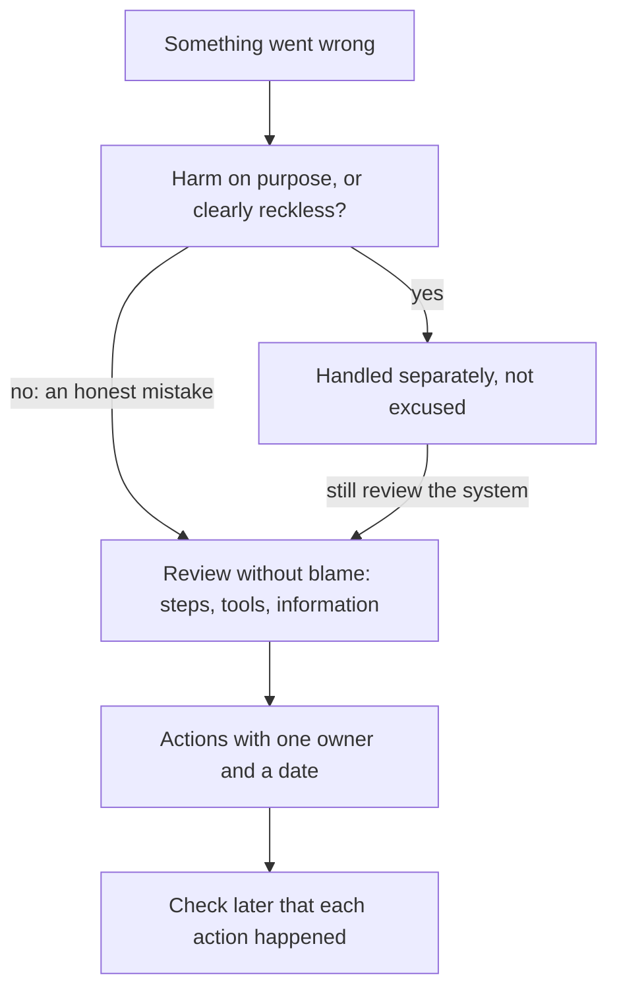

<BigWordAlert term="Just culture" plainEnglish="A way of working where people are not punished for honest mistakes, but deliberate or reckless harm is not excused." whyItMatters="It keeps reviews without blame fair: people feel safe to report mistakes, and doing harm on purpose is still not acceptable." />

## A meeting that starts the wrong way

On Wednesday, the Young Coders Club team from chapter 8.1 met to talk about the lost sign-ups. Five people joined the call. Before Ruba could say anything, a board member opened with a question: "So, Wael, why did you press the button?"

Wael went quiet. Everyone could feel the meeting turning into a trial. Ruba stepped in. "Let's not start there," she said. "Wael did what the task list told him, on the date he believed. I want to understand why the task list was wrong, why one button could delete a week of work, and why we had no copy. Wael, can you tell us exactly what you saw on the screen?"

That change of question is the whole idea of this chapter. "Why did you do it?" asks a person to defend themselves. "What did you see, and what did you know?" asks for evidence. The first question gets you an apology. The second gets you the facts you need to stop it happening again.

## The idea

You met the review without blame in chapter 8.1. It looks for the contributing causes of a problem without accusing any person or team. It starts from one assumption: everyone involved acted with good intentions and did the right thing with the information they had. If that is true, then the question becomes: what was wrong with the information, the steps or the tools?

Teams who run large websites publish guidance on this, and safety experts in hospitals and aviation have long worked this way. Their reasoning is simple. If finger-pointing is normal, people stop bringing problems to light, because they fear punishment. And you cannot fix people. You can change systems and steps so that the right choice is easier to make.

This connects to what you learned in module 4. A person's mistake is where an investigation starts, not where it ends. "Human error" is never a root cause. It is a sign that something in the process made the error easy to make and hard to notice.

## The parts of a review

A short review records five things. You can write it in one page.

1. **What happened.** A timeline: the events in order, with dates and times.
2. **Impact.** Who was hurt, and how much.
3. **What was done at once.** How the team limited the damage.
4. **Causes.** The contributing causes, written about steps, tools and information.
5. **What will change.** Each action with one owner and a date, and a check later that it happened.

Write the timeline first, before anyone explains anything. People remember events in the order that suits their story. A plain timeline, built from messages, screens and notes, keeps everyone looking at the same facts.

Before the full review, make a prediction about the Young Coders Club case from chapter 8.1. Then step through the review in the order Ruba ran it.

```predict
prompt: "Which cause statement is more likely to lead to a change that protects the next course?"
options:
  - id: wael-should-check
    label: "Wael should have checked the chat before deleting anything"
  - id: task-list-old-date
    label: "The task list kept the old date after the launch moved"
correctOptionId: task-list-old-date
explanation: "The first statement can only be fixed by asking Wael to be more careful, which is a weak fix and does not help the next volunteer. The second points at a step the team can change: where dates live and how a change reaches every task owner."
```

<InteractiveCanvas slug="review-without-blame-steps" />

The canvas showed the order of a review and the one move it refuses. The timeline and the impact come before anyone explains anything. When the review reached the causes, the statement that ended at Wael was turned away, because the only fix it allows is "be more careful". The causes that stayed were about information, a tool and a missing safety net, and each led to an action with one owner and one date. The worked example below goes through the same review in detail, with the evidence for each part.

## Worked example: the Young Coders Club review

**What happened.** Ruba built this timeline from the team chat, the task list and Wael's account.

| When | What happened |
|---|---|
| Tue 3rd | Wael builds the form by copying last year's form; he and Nadia add 6 test entries |
| Thu 5th | Ruba and Nadia agree on a call to open on Sun 8th; Ruba posts the new date in the chat |
| Thu 5th to Sat 7th | Wael is offline for exams |
| Sun 8th | Nadia posts the form; Wael is back, but the date message is far up a busy chat |
| Sun 15th, morning | From the settings page, which hides the entries, Wael presses "Delete all responses" |
| Sun 15th, morning | The warning asks "Are you sure?" with no count; Wael confirms, as the task list says |
| Sun 15th, afternoon | Ruba finds 3 entries and many worried messages |
| Thu 19th | 95 young people have signed up again |

**Impact.** About 140 sign-ups were lost. 95 came back within four days. About 45 young people lost their chance, because the team had no way to contact them. The team also lost a week of work and some trust from the partner school.

**What was done at once.** An honest apology was posted the same evening, with the form shared again, and the partner school passed it on.

Now the hardest part: the causes.


**Causes.** The team asked "why?" with evidence, as in module 4, and found three branches, not one.

The first branch is about information. The launch date changed in a voice call and a chat message, but the task list still said "launch morning" with the old date in mind. The team had no single place for dates, and no step to tell each task owner when a date moved. The second branch is about the tool. Test entries and real entries lived in the same form, and the only way to clear the tests was a button that deleted everything. That button sat on a settings page that did not show the entries. Its warning asked "Are you sure?" but did not say how many entries would go. Nothing on the screen told Wael that 140 people were in the form. The third branch is about safety nets. Nobody kept a copy of the entries as they came in, so a single click could not be undone.

Wael being offline is on the timeline too, but it is written as a fact, not a fault. People will always be offline sometimes, for exams, for illness, for power cuts. A process that only works when everyone reads every message is a weak process.

**What will change.** The team ranked its ideas the way module 4 taught: a better design is stronger than a reminder.

- **Strong:** test on a separate copy of the form, so the live form never holds test entries. Owner: Wael. Date: before the next course opens.
- **Strong:** save a copy of all entries automatically every evening. Owner: Nadia. Date: end of this month.
- **Middle:** all dates live only in the task list; a date change is made there, and each task owner confirms it. Owner: Ruba. Date: next week.
- **Rejected as the only action:** "Remind everyone to be careful with forms." A reminder asks people to remember. A better design means they do not have to.

Look at why the two strong actions are strong. With a separate test copy, there are no test entries in the live form, so there is nothing to clear and no reason to press "Delete all" at all. The mistake becomes impossible, not just less likely. With a copy saved every evening, a wrong click costs at most one day of entries, and even those can be found from the messages. Neither action depends on anyone remembering anything.

The middle action matters too, because the date problem will come back in other forms: a changed room, a moved deadline, a new trainer. One place for dates, with a confirmation from each owner, protects every task, not only this one. The rejected reminder would have felt like action in the meeting and changed nothing a month later.

Ruba will check each action on its date, at the start of the team's weekly call. A review whose actions never happen is only a story about the past.

## Without blame is not without responsibility

There is a limit to "without blame", and it matters. Safety experts describe it with the idea of a just culture: honest mistakes are not punished, but harm done on purpose is not excused. In a just culture, people are not blamed for honest errors. But deliberately breaking a clear rule, or being reckless in a way anyone could see was dangerous, is not excused. Experts in this area describe a pure "no blame at all" approach as neither possible nor wanted.

So, without blame does not mean without responsibility. Honest mistakes are treated as information. Doing harm on purpose is different. If Wael had deleted the entries because he was angry with the team, that would not be an honest mistake. The team would still fix the form and the task list. But Wael's action would be handled separately, by the NGO's leaders, not inside the review.

Responsibility in a review looks like this: tell the truth about what you saw and did, own the actions you agree to, and finish them by the date. Wael did all three. He explained exactly what the screen showed, and he took one of the strong fixes as his own.

The diagram shows where the line falls. Both paths still fix the system.



Most problems take the left path. The right path is rare, and even then the review still happens, because a system that allowed deliberate harm also needs fixing.

## Where reviews go wrong

**The review becomes a trial.** Questions that start with "why did you" make people defend themselves. Ask "what did you see?" and "what did you know at that moment?" instead.

**Blame hidden in the wording.** "The entries were carelessly deleted" names no person, but it still blames one. Write causes about steps, tools and information.

**Only weak actions.** A list of reminders and "be more careful" feels like action, but it changes nothing in the system.

**Actions with no owner or date.** "We should keep backups" will not happen. "Nadia, daily copy, by the 30th" will.

**Reviewing only disasters.** A near miss, such as a form that almost lost its entries, usually has the same causes as a real loss. A short review of a near miss is a cheap lesson, because nobody was hurt.

## Check your understanding

```quiz
type: mcq
question: "Nuha runs a spice shop in a market, with 4 staff. Last week two customers' orders went home in the wrong bags. Her review lists four possible actions. Which one is ready to go into the review as written?"
options:
  - "Everyone in the shop will check the bags more carefully from now on"
  - "Nuha will print an order number on each bag at weighing, by 1 March"
  - "We should think about a better way to label bags quite soon"
  - "Nuha will remind all the staff about labels at every Monday meeting"
correct: 1
explanations:
  - "This has no owner and no date, and it is a weak fix: it asks people to remember."
  - "Right. It has one owner and a date, and it is a strong fix. The label goes on the bag when the spices are weighed, so nobody has to remember at the end of a busy day."
  - "This has no owner and no real date. 'Think about' is not an action anyone can check later."
  - "This has an owner, but it is a weak fix. A reminder asks people to remember; a better design means they do not have to."
```

```quiz
type: mcq
question: "Doha runs a laundry with 5 workers. Four things went wrong there last month. Which one should she handle separately, as well as fixing the system?"
options:
  - "A worker misread a smudged ticket and returned the wrong shirts"
  - "A new worker used an old price list that was still on the wall"
  - "A worker lost a list of orders when the power cut out at noon"
  - "A worker hid a broken dryer from Doha so as to sell its parts"
correct: 3
explanations:
  - "This is an honest mistake made easy by a smudged ticket. A review without blame fits it well."
  - "This is an honest mistake made easy by an old list left on the wall. Fix the system: remove old lists."
  - "This is an ordinary event, not a fault. The fix is in the system, for example keeping the order list somewhere that does not need power."
  - "Right. Hiding a fault to sell parts is deliberate, not an honest mistake. It is not excused, though the laundry should still ask how it went unnoticed."
```

**Next:** A mixed quiz: five fresh cases from every module, and for each one, the habit to use first.
