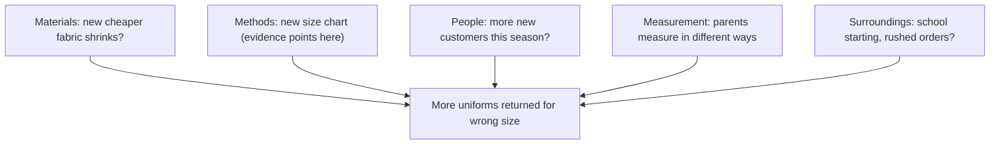

## Your turn

This is the capstone of the course. You will investigate one problem from start to finish, the way a careful detective would. You will not need new tools. You will use the habits you already have, in order, on one problem, and write down what you find.

You can choose a real problem from your study, work or daily life. Or you can choose one of three provided cases further down this page. Each provided case has a small table of data and an answer from an AI chat tool that makes one causal mistake from the course. The provided cases are there so that nobody has to share anything personal. Choosing one is not an easier path; the data takes real work to read.

Plan for about 110 minutes. You do not need to finish in one sitting. Read the worked example first, then choose your problem, then write the five parts one at a time. When you are done, you will walk a mentor through your investigation in about five minutes.

## The five parts

1. **Describe it exactly.** What, where, when, how much, and what is not affected.
2. **Map the causes.** A fishbone list (groups and causes) or a cause chain.
3. **Find the root cause with evidence.** Five whys or a chain, each step backed by evidence. Say what the AI answer got wrong.
4. **Test the fix fairly.** One change, a comparison, and the measure and the time decided in advance.
5. **And then what?** Two likely side effects of the fix, and the one you will watch.

Each part comes from a module. The exact description is from module 5. The cause map uses the chains from module 1 and the fishbone from module 4. The root cause uses the five whys from module 4 and the traps from module 2: a hidden third factor, reverse cause, chance and selection. The fair test is module 3, and the side effects are module 7. The order matters. If you skip the description, your cause map fills with guesses. If you skip the evidence, your root cause is just your favourite cause.

## Worked example: Jumana's returned uniforms

Jumana sews children's school uniforms at home and sells them through messages (a fictional business). Parents choose a size and she delivers within three days. A parent can return a uniform within a week if it does not fit or has a fault. For three weeks, returns were rare. Then they jumped.

Two things changed at the start of week 4. First, she started buying fabric from a new, cheaper supplier. Second, she posted a new size chart on her page, with sizes by the child's height instead of by age. Here is her record for six weeks.

| Week | Uniforms sold | Returned: wrong size | Returned: seam or fabric fault |
|---|---|---|---|
| 1 | 40 | 1 | 1 |
| 2 | 42 | 2 | 1 |
| 3 | 38 | 1 | 1 |
| 4 | 41 | 7 | 1 |
| 5 | 40 | 8 | 2 |
| 6 | 39 | 7 | 1 |

**Part 1: describe it exactly.** What: uniforms returned because they are the wrong size, both too big and too small. When: from week 4, every week since. How much: in weeks 1 to 3, 4 of 120 uniforms came back for size, about 3 in every 100. In weeks 4 to 6, 22 of 120 did, about 18 in every 100.

Where: of those 22, 20 came from parents who chose a size from the new chart. Parents who reordered a size they already knew returned only 2. What is not affected: returns for seams or fabric stayed low, 3 in weeks 1 to 3 and 4 in weeks 4 to 6. Sales did not change, 120 in each half. That last line is already doing detective work. If the new fabric were the problem, fault returns would rise. They did not.

**Part 2: map the causes.** Jumana listed possible causes in groups, as a fishbone, before choosing any. The diagram shows her map, with the group where the evidence pointed marked.



The map includes causes she later ruled out. That is the point of a map. It makes you look at each one, instead of jumping to the first idea.

**Part 3: find the root cause with evidence.** Jumana asked "why?" and answered each step by checking, not guessing.

Why were uniforms returned? Because they did not fit when tried on. Evidence: the return messages. Most parents said the child tried it on the day it arrived, before any washing. Shrinking fabric would make uniforms too small only after washing, and only too small. But 9 of the 22 were too big. So the fabric is ruled out.

Why did they not fit? Because parents chose the wrong size. Evidence: 20 of the 22 came from parents who used the new chart. More new customers is also ruled out, because sales stayed level and the problem followed the chart, not the customer.

Why did the chart lead to wrong choices? Jumana looked at the chart again. Its height ranges overlapped: size 8 was 115 to 130 cm and size 10 was 125 to 140 cm. A child of 125 to 130 cm fitted both, so parents had to guess. There was also no line saying how to measure. She then sorted the 22 returns by asking each parent two questions: the child's height, and whether the child wore shoes when measured.

The counts came out like this. In 14 of the 22, the child's height was inside the overlap. In 5 more, the child was outside the overlap but had been measured in shoes. In the last 3, neither was true. Three returns in three weeks is about the usual number before the new chart, about one a week. So the overlap explains the most returns, and it is the main cause. The missing measuring line explains fewer, and it is a contributing cause.

Why was the chart like that? Jumana had copied it quickly from a pattern book that used different sizes, and posted it the same day. Nobody tried it with real customers first. That is the root cause in the process: a new chart went live with no check.

**Part 4: test the fix fairly.** The strong fix is a better design: a chart with no overlaps (size 8 up to 127 cm, size 10 from 128 cm). Jumana tests this one change first, and leaves the measuring line for a second test. If she changed both at once, she could not tell which one helped. New customers with an even order number get the new chart, and odd numbers keep the old one, so she does not choose who gets which.

She decides in advance. The measure is wrong-size returns per 100 uniforms in each group. The test runs for four whole weeks, about 75 uniforms per group. If she is wrong about the cause, both groups will return about the same. About 75 per group is small, so the result is a hint: she will run it again before she trusts it. She also adds a step to her process: any new chart is first tried with five repeat customers.

**Part 5: and then what?** Two likely side effects. Parents may send more questions about sizes, which takes Jumana's time. And some parents whose child is near the new border may order the bigger size "to be safe", so "too big" returns could rise. She will watch one thing: "too big" returns each week, checked every Saturday. If they go above 3 a week for two weeks, she will add a note about what to do between sizes.

## Choosing your problem

If you choose a real problem, pick one that is yours and that has happened more than once. Its causes should be mostly inside your control or your team's. Good examples are a study routine, a delivery step, a device or a way of working with clients. Avoid problems whose main cause is something nobody in the story can change. Change any names, and leave out private details about other people.

You also need some evidence. It does not have to be a big table. A week of notes, a list of dates, a count of messages or a few answers from people involved are all evidence. If you have none yet, collect some for a few days before you write part 3.

For part 3 you also need an AI answer to check. Ask an AI chat tool why your problem is happening. Then check its answer for the traps from the course, just as you would for a provided case.

## Provided case 1: Huda's weekend orders

Huda runs the home bakery you met in modules 1 and 6. This case happens this autumn. Since the spring, Huda has had a second oven. The case counts all her weekend orders: cakes, date biscuits and pastries. Her weekend orders have fallen over six weeks, and three things happened in that time.

At the start of week 2, she raised all her prices by 10 percent, for every customer. At the start of week 3, a new bakery shop opened near the market. At the start of week 4, the door seal on one of her two ovens broke. The oven still works, but it loses heat, so every batch in it takes much longer. The repair part has been ordered but has not arrived. Huda writes down every weekend order she has to turn down because there is no oven time left.

Most of her customers live either near the market or in other parts of town. Her notebook shows this.

| Week | Requests: market area | Requests: other areas | Turned down: no oven time | Orders baked |
|---|---|---|---|---|
| 1 | 20 | 30 | 0 | 50 |
| 2 | 20 | 29 | 0 | 49 |
| 3 | 16 | 30 | 0 | 46 |
| 4 | 15 | 30 | 17 | 28 |
| 5 | 15 | 29 | 16 | 28 |
| 6 | 14 | 30 | 16 | 28 |

Huda asked an AI chat tool what went wrong. Here is its answer.

> Your weekend orders started to fall right after you raised your prices in week 2, and they have kept falling since. Customers notice price rises. The price rise is the cause. Lower your prices back to where they were, and your orders will recover.

## Provided case 2: Aya's study group

Aya leads a study group of 12 university students. It meets twice a week, on Sunday at 4 pm and on Wednesday at 4 pm, in a room at the university library. Attendance has fallen over six weeks.

At the start of week 3, the Wednesday session moved to 8 am, because the room was no longer free in the afternoon. The Sunday session did not move. In the same week, a new member, Nabil, joined. He talks a lot, and one member once said he "takes over". Nabil has come to every session since week 3. In weeks 5 and 6, most members had mid-term exams.

The table counts only the 12 original members, so Nabil is not in it. There are 24 places a week: 12 on Sunday and 12 on Wednesday. In week 4, Aya messaged the 7 members who missed the Wednesday session. Six said 8 am clashed with work, classes or travel, and one was ill. In week 5, two members wrote that they were staying home to revise. Here is the register.

| Week | Sunday, 4 pm | Wednesday | Total, out of 24 |
|---|---|---|---|
| 1 | 11 | 11 (4 pm) | 22 |
| 2 | 10 | 11 (4 pm) | 21 |
| 3 | 11 | 6 (8 am) | 17 |
| 4 | 10 | 5 (8 am) | 15 |
| 5 | 9 | 5 (8 am) | 14 |
| 6 | 9 | 4 (8 am) | 13 |

Aya asked an AI chat tool why people stopped coming. Here is its answer.

> Attendance started to fall in week 3, the same week Nabil joined. One member has already complained that he takes over. New members can change how a group feels. Nabil is probably the reason people stopped coming. Ask him to talk less, or to leave the group.

## Provided case 3: Lama's client ratings

Lama is a freelance video editor. She makes short videos for small businesses to post online. Clients rate each job from 1 to 5 stars, and her ratings have dropped over six weeks.

From week 3, she started accepting rush jobs with a two-day deadline, which pay 60 dollars instead of 40. Also from week 3, she started using a new editing app on some jobs while she learns it, and the old app on others. In week 4, a new client, a restaurant, joined. The restaurant asked for many changes on every draft. Clients on two of the rush jobs left comments about small mistakes: a spelling error in a caption, and a logo shown at the wrong size.

Here are her twelve jobs. Every deadline is either five days or two days.

| Job (week) | Deadline, client | App | Rating |
|---|---|---|---|
| 1 (1) | 5 days, clinic | Old | 5 |
| 2 (1) | 5 days, shop | Old | 5 |
| 3 (2) | 5 days, gym | Old | 4 |
| 4 (2) | 5 days, bakery | Old | 5 |
| 5 (3) | 2 days, shop | Old | 3 |
| 6 (3) | 5 days, clinic | New | 5 |
| 7 (4) | 2 days, gym | New | 3 |
| 8 (4) | 5 days, restaurant | Old | 2 |
| 9 (5) | 2 days, bakery | Old | 2 |
| 10 (5) | 5 days, restaurant | New | 2 |
| 11 (6) | 2 days, shop | New | 2 |
| 12 (6) | 5 days, clinic | New | 5 |

Lama asked an AI chat tool why her ratings dropped. Here is its answer.

> Your ratings fell from week 3, the same week you started the new editing app. The 5 jobs you made with the new app average 3.4 stars. Your first 4 jobs, all made with the old app, averaged 4.75 stars. The new app is lowering the quality of your work. Go back to your old app.

For every provided case, the numbers in the AI answer and the dates in the story are true. The mistake is in the reasoning. Your job in part 3 is to find which trap from the course it fell into, and to show with the table what the data really points to. Look for one main cause and one contributing cause, and say which possible cause the data rules out.

Your mentor may give you a case by your learner number, for example by its last digit, so that a group works on all three. If your mentor does this, use the case you are given, or your own problem.

## How your mentor will read it

Your mentor uses the table below, one line for each part. Each line has three levels. They are not looking for perfect English. They are looking for evidence that you used each habit. Two different investigations of the same case can both be Met if each step is backed by the data.

| Line | Met | Partly | Not yet |
|---|---|---|---|
| 1. Description | What, when and how much with numbers, and one thing not affected | Numbers given, but nothing on what is not affected | A feeling or a guess, with no numbers |
| 2. Cause map | Four or more causes in groups or a chain, including one later ruled out | Two or three causes, or only the ones you kept | One cause only |
| 3. Root cause | Main and contributing cause, each with a number or fact; one ruled out; the AI's trap shown with data | Right causes, but one has no evidence, or the trap is named without data | No evidence, or you agree with the AI |
| 4. Fair test | One change, a comparison, measure and time set in advance, and the result that would prove you wrong | One of these is missing | No test, or several changes at once |
| 5. Side effects | Two likely side effects, one to watch, with a measure and a date | Side effects listed, but nothing to watch or no date | No side effects |

To pass, lines 1, 3 and 4 must be Met, and no line can be Not yet.

For line 4, sometimes no comparison group is possible. A bakery with one broken oven cannot repair the oven for only half of its customers. In that case, say why no comparison is possible. Then use a before-and-after comparison, decided in advance, and plan to repeat it. For example, compare three weeks after the repair with the three weeks before, and check again three weeks later. That still meets line 4.

For a real problem of your own, your mentor cannot check your data. So say where each piece of evidence comes from: a count, a list of dates, a message, a note. Evidence that names its source can meet line 3.

## Your five-minute walk-through

After your mentor reads your answer, you will talk them through it in about five minutes. Spend about one minute on each part. Your mentor will then ask some of these questions. Prepare a short answer to each one before you meet. The right column shows what a good answer does.

| Defence question | A good answer |
|---|---|
| What evidence rules out your second-best cause? | Names that cause, and one number or fact from the data that does not fit it |
| What would your fair test show if you were wrong? | Describes the result in plain terms, for example "both groups return about the same" |
| Why is your fix strong, not weak? | Shows the fix changes a step, a tool or a design, so people do not have to remember |
| What will you watch for, and when? | Gives one measure, the number that would worry you, and a date to check |

The questions are not traps. They are the same questions a good manager or client would ask before trusting your explanation. If you cannot answer one yet, that tells you which part of your investigation to strengthen.

If your answer does not pass yet, your mentor replies with one or two short questions about the weakest line. You answer them in writing, or in the walk-through, and your mentor reads the line again. One round of questions is normal. It is part of the work, not a failure.

## Submit your investigation

Write the five parts in order, with a short heading or number for each. Short sentences and lists are fine. If writing is hard today, you can add a voice note link and keep the written part shorter, as long as it still covers all five parts.

```openquestion
prompt: "Investigate one problem: your own, or provided case 1, 2 or 3 (say which). Write five parts. 1. Describe it exactly: what, where, when, how much, and what is not affected. 2. Map the causes: a fishbone list or a cause chain, with at least four possible causes. 3. Find the root cause with evidence. Give a main cause and a contributing cause, each step backed by evidence, one cause ruled out, and what the AI answer got wrong. 4. Test the fix fairly: one change, a comparison, and the measure and the time decided in advance. 5. And then what? Give two likely side effects of the fix and the one you will watch, with when you will check."
required: true
minWords: 250
allowSpeechInput: true
allowUrl: true
urlRequired: false
urlLabel: "Voice note link (optional)"
urlHint: "An audio link your mentor can open without signing in. Audio only is fine."
modelAnswer: "Mentor key for the provided cases. Case 1, Huda: baked weekend orders fell from 50 to 28. Main cause: the broken oven seal. From week 4, 16 to 17 orders a week are turned down for lack of oven time, which is 16 of the 22 lost orders by week 6. Contributing cause: the new bakery near the market. Market-area requests fall from 20 to 14 to 15 from week 3, about 5 to 6 orders a week. Ruled out: the price rise. Requests from other areas stay at 29 to 30 after week 2, and the market area is flat in week 2. Accept for the AI's trap: after is not because (the main one), the single-cause trap, or ignoring what is not affected, if the learner shows it with the other-areas column. Fair test: no comparison group is possible for one repaired oven, so accept before-and-after with a repeat. Case 2, Aya: attendance fell from 22 to 13 out of 24. Main cause: the Wednesday move to 8 am. Wednesday falls from 11 to 6 and 5 in weeks 3 and 4, while Sunday stays at 10 to 11, and 6 of the 7 absent members named the time. Contributing cause: exams in weeks 5 and 6, about 1 to 1.5 fewer per session, plus two members who wrote they were revising. Ruled out: Nabil. He came to both sessions, but Sunday attendance did not change in weeks 3 and 4. Accept for the AI's trap: blaming a person (the main one), or after is not because, if the learner uses the Sunday column. Fair test: move Wednesday back to an afternoon while Sunday stays the same, as a comparison, after the exams. Case 3, Lama: average rating fell from 4.75 in weeks 1 and 2 to 3.0 in weeks 3 to 6. Main cause: two-day rush jobs. All four are rated 3 or lower, average 2.5, against about 4.8 for five-day jobs for other clients. Contributing cause: the restaurant, whose two five-day jobs are both rated 2. Ruled out: the app. Rush jobs average 2.5 on either app, the restaurant gives 2 on either app, and clinic jobs get 5 on either app. Accept for the AI's trap: a hidden third factor, correlation taken as cause, or an unfair comparison, if the learner shows that the groups differ in deadline and client. Fair test: stop or limit two-day jobs for several weeks and compare ratings with the weeks before, with the app unchanged. With so few jobs this is a hint, so it must be repeated. For a learner's own problem, use the same table: look for evidence with a named source for each step."
```

**Next:** The course checklist, a short review of your own, your cause-and-effect toolkit, and a look back at your first chain from module 1.
