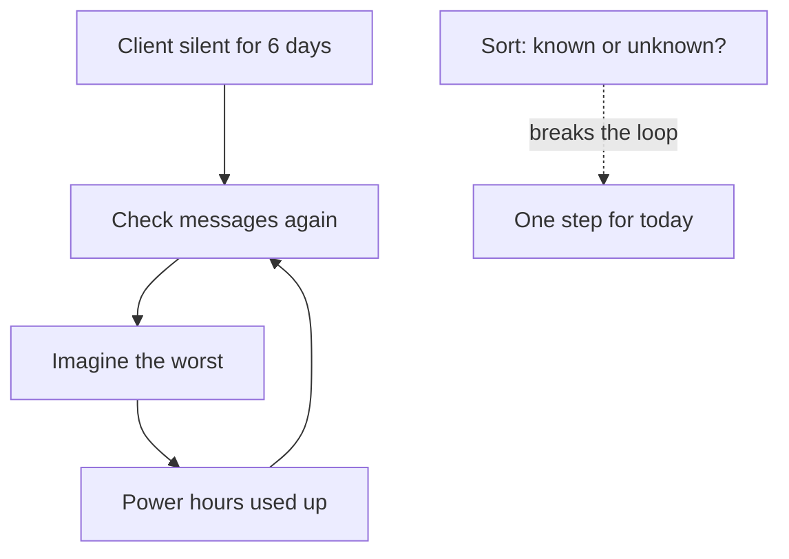

<BigWordAlert term="Ghayb (the unseen)" plainEnglish="Everything hidden from us, such as tomorrow, the result of an application or what a client will decide. Only Allah fully knows it." whyItMatters="Most worry is about the unseen. When you know which part of a situation belongs to the unseen, you can stop trying to solve it and put your effort into the part that is yours." />

## A week of waiting

Yasmin is 24. She builds websites for clients abroad, and she has done this work for two years. She works from home, at a small desk by the window. Her area gets grid power about six hours a day, and the hours change from week to week. So she plans her laptop work around the power. When the power comes, she codes. When it goes, she reads, plans on paper, or helps her mother.

Three weeks ago, a new client hired her. He runs an online bookshop abroad, and he wanted a new website with five pages. They agreed a price of $400 for the whole project. He paid half at the start, $200, and he will pay the other $200 when he approves the final version. Yasmin was happy. It was her biggest project this year.

On Sunday at 11:00, she sent him the first draft. She had worked on it for ten days. She wrote a short, polite message with a link to the draft and three questions about colours and photos. Then she waited.

On Monday there was no reply. That is normal, she told herself. On Tuesday there was still nothing. She opened the draft again and found small things to change, but she did not want to send a second version before he answered the first. On Wednesday she started to imagine reasons. Maybe he hated the design. Maybe he had found someone cheaper. Maybe he would never pay the second half.

There was a second wait in her week too. Two months ago, Yasmin applied for a scholarship to study for a master's degree in software engineering. The result is due in three weeks. Every time she thought about the client, she also thought about the scholarship. If the client was unhappy, was her work not good enough for a master's? The two worries fed each other.

## Where the power hours went

On Saturday morning, Yasmin did something honest. She looked back at the week and asked where her power hours had gone. The grid had given her about 36 hours of power in six days. She had used about 14 of them for real work on another small task. And she had spent many hours, she could not say exactly how many, checking her messages, reading the draft again, and searching online for "how long do clients take to reply".

She had not applied for any new work. She had told herself that she should wait, in case the client replied and needed changes. She had not prepared for the scholarship interview that might come if she was shortlisted. One night the power came at 02:00, and she woke up to check her messages instead of sleeping.

Nothing in her week was a disaster. A client was quiet. A result was not yet out. The power was short, as it often is. But the waiting had taken over the week, and the things she could have done were left undone.

```predict
prompt: "Think about Yasmin's week. Before you read on, which do you expect would help her most?"
options:
  - id: plan-now
    label: "Plan today's steps now, before any reply"
  - id: wait-first
    label: "Wait for the replies, then plan the next step"
correctOptionId: plan-now
explanation: "Waiting sounds sensible, because it seems wise not to act before you know. But the replies may take days or weeks, and nobody can make them come sooner. Meanwhile some steps are hers whatever the replies say: a polite follow-up, new proposals, notes for an interview. Those steps do not need the future to be clear first."
```

## The Saturday circle

Every Saturday evening, Yasmin meets online with a small study circle of fellows and their mentor, Reem. The call is short, because data is expensive and the power can go at any time. Each person shares one thing from their week.

Yasmin told them about the silent client and the scholarship. She said she felt stuck, and a little ashamed of how much time she had spent worrying. Reem did not tell her to stop worrying. She asked her two questions instead. "What do you know for certain this week? And what can nobody know yet, not even the client?"

Yasmin started to answer. She knows she sent the draft on Sunday. She knows the client paid $200 and that the work is good. She knows the scholarship result is due in three weeks. She does not know when the client will reply, what he will say, or what the scholarship committee will decide. Nobody in the circle could know that either.

Then Reem shared a verse. Allah tells us that only He knows when the Hour, the Day of Judgement, will come; He sends the rain and knows what is in the womb, and no soul knows what it will earn tomorrow, or in which land it will die (Quran 31:34). She read the Arabic of the key phrase:

> وَمَا تَدْرِي نَفْسٌ مَّاذَا تَكْسِبُ غَدًا

Meaning: no soul knows what it will earn tomorrow.

Yasmin smiled at that. "What it will earn tomorrow" is exactly a freelancer's question. Will the second $200 come? Will the scholarship come? The verse does not answer those questions. It tells her who knows the answer, and it tells her that not knowing is part of being human. She is not failing because she cannot see tomorrow. Nobody can.

## What the worry was doing

The diagram shows the pattern Yasmin was caught in. The worry did not start with a bad event. It started with something unknown, and it went round and round.



What to notice: the loop from "check messages" to "power hours used up" has no exit, because every turn asks the same unknown question. Checking more often cannot make the reply exist. The box "sort: known or unknown?" sits outside the loop. It does not answer the unknown question. It asks a different one: which part of this is mine? That question has an answer, and the answer is a step.

The takeaway: worry about the unseen grows when we treat it as a problem we must solve. It loses its hold when we hand it back to the One who knows it, and turn to what is ours.

## Why this matters for your work

Yasmin's week is ordinary for anyone building a career in remote work. A client goes quiet after a draft. A job application gets no answer. An exam result is late. A scholarship committee takes months. The power schedule changes. Most of the future we care about is hidden from us, and much of it depends on other people's decisions.

There are two easy mistakes in a week like this. The first is to treat the unknown as if worry could solve it: to check, imagine and replay until the time is gone. The second is the opposite. It is to say "it is all in Allah's hands" and then to do nothing, as if belief in the unseen meant there was nothing left to do. Islamic belief gives us something better than both. It tells us clearly what belongs to Allah alone, and it tells us just as clearly that we still have a part to play.

This module gives you four anchors for weeks like Yasmin's. An anchor here means a belief you can hold on to when the future is unclear, so you stay steady and keep working. The first anchor is the difference between what only Allah knows and what is yours to do. The second is that life is a test with a purpose, and that a hard week is not a sign that Allah is angry with you. The third is belief in *qadr* (Allah's decree) held together with full effort, as the Prophet, peace be upon him, taught his companions when they asked about it. The fourth is a habit to drop: the "if only" that keeps us looking back after a setback.

You will follow Yasmin through the rest of her month. You will see her sort her worries, read a hard week in a different way, and face a real setback. None of it is dramatic. That is the point. The anchors are for ordinary weeks, because most of life is made of them.

You do not need anything special for this module except a notebook and a few minutes a day. You will not be asked to share your own worries with anyone. When a task invites a personal situation, it is always optional, and there is always a provided case you can use instead.

<LearningObjectives items={["Sort an uncertain situation into what only Allah knows and decides, and what is yours to do today", "Explain from the Quran why life is a test with a purpose, and why hardship is not a sign of Allah's anger", "Explain why belief in qadr does not cancel effort, using the Prophet's answer to his companions", "Replace an 'if only' thought after a setback with acceptance and a next step", "Write one small step for today in a situation you cannot control"]} />

## Key words

| Word | Plain English |
|---|---|
| **Qadr** | Allah's decree: Allah knows and has decided all things |
| **Iman** | Faith: believing in Allah, His angels, His books, His messengers, the Last Day and qadr |
| **Dua** | Calling on Allah: asking Him for what you need, in any language, at any time |
| **Test** | In the Quran: what happens to us in ease and hardship, which shows how we act |
| **"If only"** | Looking back at a setback and saying "if only I had done this, it would have been different" |

## What is in this module

| Chapter | You will practise |
|---|---|
| 1.2 | Sorting a situation into what only Allah knows and what is yours to do, and finding today's step |
| 1.3 | Reading a hard week as a test with a purpose, not as a sign of Allah's anger |
| 1.4 | Holding belief in qadr and full effort together, and dropping "if only" |
| 1.5 | Sorting one real or provided situation, with your next step and a dua |

**Next:** How to sort a worrying week into what only Allah knows and what is yours to do today.
