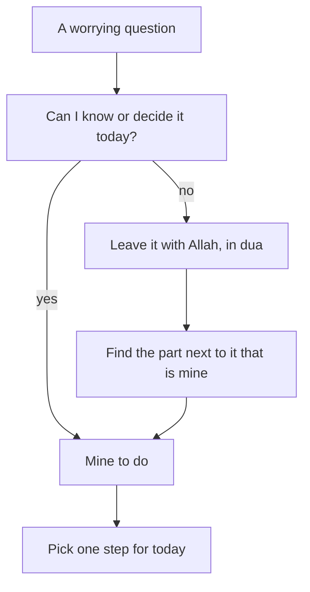

## Six questions in a notebook

On Sunday morning, a week after she sent the draft, Yasmin's client has still not replied. The Saturday circle helped her see the loop she was caught in. Now she wants to do something about it. Before the power comes at 09:00, she opens her notebook and writes down every question that has been going round in her head.

She ends up with six. When will the client reply? Does he like the draft? Will he pay the second $200? Will I get the scholarship? When will the power come tomorrow? Should I look for new work while I wait?

Seeing them on paper already helps a little. In her head, the questions felt like one big cloud. On paper, they are six separate things, and they are not all the same kind of question. Some of them nobody can answer today. One of them she can answer herself, right now.

This chapter teaches the belief behind that difference. The Quran is clear that some things are known only to Allah. It is just as clear that we have our own part to play. Holding both together is the first anchor of this course.

## What the Quran says about the unseen

In chapter 1.1 you met the *ghayb*, the unseen. Three verses set out what it means.

The first is the verse Reem shared in the circle. Only Allah knows when the Hour will come; He sends the rain and knows what is in the womb; and no soul knows what it will earn tomorrow, or in which land it will die (Quran 31:34). The verse names ordinary things: rain, birth, earnings, the place of death. These are not secrets that clever people can find out. They belong to Allah's knowledge alone.

The second verse describes how complete that knowledge is. Allah holds the keys of the unseen, and only He knows them. He knows what is on land and in the sea, and not a leaf falls without His knowledge (Quran 6:59).

> وَعِندَهُ مَفَاتِحُ الْغَيْبِ لَا يَعْلَمُهَا إِلَّا هُوَ

Meaning: with Him are the keys of the unseen; no one knows them except Him.

The third verse makes it general. Allah tells the Prophet, peace be upon him, to say: no one in the heavens or the earth knows the unseen except Allah (Quran 27:65). Not a client, not a scholarship committee, not an expert who writes about job markets. They can plan and guess, as we all can. But the outcome of tomorrow is not in anyone's hands except His.

## What only Allah decides

There is a second side to this. Allah does not only know what will happen. What reaches us comes by what He has written. The Prophet taught his companion Ibn Abbas, may Allah be pleased with him, a set of words to hold on to. Be mindful of Allah and He will protect you. When you ask, ask Allah. When you seek help, seek it from Allah. If all people gathered to benefit you with something, they could only benefit you with what Allah has written for you. And if they gathered to harm you, they could only harm you with what Allah has written against you (Jami' at-Tirmidhi 2516, graded hasan sahih).

> وَاعْلَمْ أَنَّ الأُمَّةَ لَوِ اجْتَمَعَتْ عَلَى أَنْ يَنْفَعُوكَ بِشَيْءٍ لَمْ يَنْفَعُوكَ إِلاَّ بِشَيْءٍ قَدْ كَتَبَهُ اللَّهُ لَكَ

Meaning: know that if all people gathered to benefit you with something, they could only benefit you with something Allah has already written for you.

Think about what this means for Yasmin. Her client feels like the person who holds her income in his hands. The scholarship committee feels like the people who hold her future. The hadith puts them in their right place. They are real people making real decisions, and she should deal with them well. But they are not the source of what reaches her. They can only bring what Allah has written.

This does not mean that she should ignore people or never ask anyone for help. Later in this course you will see the Prophet himself ask people for advice. It means that her heart can stop hanging on one man's inbox. When she seeks help, she seeks it from Allah first, and then she takes the steps that are hers.

## The part that is yours

If the story stopped there, someone might say: then there is nothing for me to do. That is not what the Prophet taught. In another hadith, which chapter 1.4 looks at closely, he told believers to be keen on what benefits them, to seek Allah's help, and not to give up (Sahih Muslim 2664). Knowing that the outcome belongs to Allah is not a reason to stop. It tells you where to put your effort: into the part that is yours.

Here is a simple way to say it, which this course will use often. Only Allah knows what tomorrow brings. Our part is today's step.

So the sort has two moves, not one. The first move asks of each question: can I know or decide this today? If the answer is no, it belongs to the unseen. You leave it with Allah and ask Him for good in it. The second move is the one people often forget. Next to almost every unseen question, there is a part that is yours. You find it, and you choose one piece of it for today.

```predict
prompt: "Yasmin is deciding how to use Sunday's power hours. Before you step through the canvas, which do you expect will move her week forward more?"
options:
  - id: know-reply
    label: "Knowing when the client will reply"
  - id: know-step
    label: "Knowing her next step for today"
correctOptionId: know-step
explanation: "Knowing when the client will reply would feel good, but it would not change what she can do, and it cannot be known today anyway. Knowing her next step changes the day at once: a follow-up message, new proposals, interview notes. That knowledge is always available, because the step is hers."
```

Step through Yasmin's Sunday below. Watch what happens to each question when she sorts it.

<InteractiveCanvas slug="worry-or-next-step" />

The canvas showed the two moves in order. Five of Yasmin's six questions belong to the unseen: the reply, his opinion, the $200, the scholarship and the power. She cannot answer them, so she leaves them with Allah. But every one of them has a part next to it that is hers. The last step showed what happens if she skips the sort: she tries to answer the unseen questions by guessing, and the loop starts again.

## Worked example: Yasmin's full sort

Here is the sort in full, with the reasoning for each question.

**When will the client reply?** She cannot know this. It depends on his week, his health and his own plans, all hidden from her. So it goes to the unseen. The part next to it is hers: she can send one short, polite follow-up. She writes: "Hello, I hope you are well. I wanted to check that the draft reached you. I am happy to make changes when you are ready." It is not a complaint, and it does not ask him to hurry. It is simply her part.

**Does he like the draft?** Also unknown. But she can prepare. She lists the three things she is least sure about in the design, so that if he asks for changes, she can make them calmly and fast.

**Will he pay the second $200?** She cannot decide his choice. She can check what they agreed in writing: half at the start, half on approval of the final version. That is her part. She keeps the agreement ready and stays polite.

**Will I get the scholarship?** Only Allah knows. The committee will decide in three weeks. Her part is to prepare notes for an interview, in case she is shortlisted, and to look for one other scholarship that opens later this year.

**When will the power come tomorrow?** Unknown. Her part is to ask in her neighbours' group for this week's schedule and to keep her laptop charged whenever the grid is on.

**Should I look for new work while I wait?** This one is not unseen at all. It is hers to decide, and the answer is yes. She was waiting for the client's reply before applying elsewhere, but nothing in her agreement stops her. Two proposals this week are well within her power.

Then she chooses. She cannot do six things today. She picks the follow-up message, sends it at 10:00 while the power is on, and plans the two proposals for Monday. That is the whole of today's step. The rest she leaves with Allah in dua, in her own words, in Arabic, the language she prays in.

## The sort as a rule

The diagram below turns the sort into a rule you can use on any worrying question. Read it from the top.



What to notice: both answers to the question in the middle end in the same place. A "yes" leads straight to something you can do. A "no" leads to dua, and then on to the part next to it that is yours. No path ends at "wait and check again". That is the difference between this rule and the worry loop from chapter 1.1. The takeaway: the unseen is not a dead end. It is where you hand a question to Allah before you turn to your own part.

## Where people go wrong

The first mistake is to stop after the first move. A person sorts the question into "only Allah knows" and then waits with nothing in their hands. That sounds like trust, but it skips half of the teaching. The Prophet told us to be keen on what benefits us and not to give up. A sort that ends without a step is only half done.

The second mistake is the opposite: to treat everything as yours. Some people answer the unseen questions by working harder and harder at them. They check the client's online profile every hour, or they write three follow-up messages in a day. That effort is not taking a step. It is trying to force an answer that only Allah has. You can spot this mistake when an action is repeated many times and changes nothing.

The third mistake is to think that, once you know the outcome belongs to Allah, you should not feel worried at all. Worry is human. Yasmin still felt a knot in her stomach after she sent the follow-up. The sort does not switch feelings off. It gives the worry somewhere to go: the unseen part to Allah in dua, and the rest into a step.

<Callout type="tip" title="A quick test">
If you have done the same thing three times today and nothing has changed, ask: am I trying to answer a question only Allah can answer?
</Callout>

## Check your understanding

```quiz
type: mcq
question: "Ruba applied for a remote support job. The company said it would reply within two weeks, and today is day ten. She spends her evenings rereading her application. Which step is hers today?"
options:
  - "Reread the application again to find the mistake in it"
  - "Prepare for an interview and apply for two more jobs"
  - "Stop thinking about any jobs until this company replies"
  - "Message the company every day until somebody answers her"
correct: 1
explanations:
  - "Nothing shows there is a mistake to find. Rereading is a way of trying to answer an unseen question: will they say yes? It changes nothing today."
  - "Right. Their decision belongs to the unseen. Preparing for an interview and applying elsewhere are parts that are hers, whatever the company decides."
  - "This sorts the question correctly but stops after the first move. Leaving the outcome with Allah still leaves her own steps to take."
  - "One polite follow-up after the two weeks would be her part. Daily messages try to force an answer that is not hers to give."
```

```quiz
type: mcq
question: "Iyad, a junior developer, believes his whole future depends on one manager who might recommend him for a job. He is afraid to ask her anything. What does the hadith Ibn Abbas was taught (Jami' at-Tirmidhi 2516) suggest he should do?"
options:
  - "Stop contacting her, since only what is written can reach him"
  - "Agree with whatever she says, so that she stays pleased with him"
  - "Ask her politely, with his heart relying on Allah, not on her"
  - "Avoid asking any person and rely on making dua alone instead"
correct: 2
explanations:
  - "The hadith tells us who the source is. It does not tell us to stop taking steps. Asking her politely is still his part."
  - "This makes his heart hang on a person. The hadith says people can only benefit him with what Allah has written, so he does not need to please her at any cost."
  - "Right. The manager is a real person and asking her is a sensible step. The hadith frees his heart from fearing her, because what reaches him is what Allah has written."
  - "The same hadith says to ask Allah and seek help from Him. It does not forbid asking people. Dua and a polite question go together."
```

## This week

Choose one situation that is on your mind this week. It can be small. Write down every question it raises, as Yasmin did. Sort each one: can I know or decide this today? Next to each unseen question, write the part that is yours. Then choose one step and do it before the end of the day. If you prefer not to use your own life, sort Yasmin's scholarship question again and write her step for next week.

**Next:** Why the Quran calls life a test, and why a hard week is not a sign of Allah's anger.
