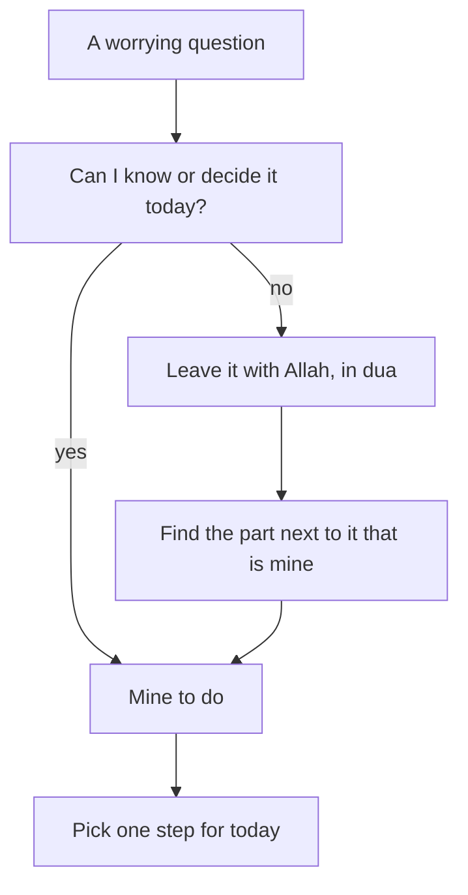

## Six questions in a notebook

On Sunday morning, a week after she sent the draft, Yasmin's client has still not replied. The Saturday circle helped her see the loop she was caught in. Now she wants to do something about it. Before the power comes at 09:00, she opens her notebook and writes down every question she has been thinking about again and again.

She ends up with six. When will the client reply? Does he like the draft? Will he pay the second $200? Will I get the scholarship? When will the power come tomorrow? Should I look for new work while I wait?

Seeing them on paper already helps a little. In her head, the questions felt like one large, unclear worry. On paper, they are six separate things, and they are not all the same kind of question. Some of them nobody can answer today. One of them she can answer herself, right now.

This chapter teaches the belief behind that difference. The Quran is clear that some things are known only to Allah. It is just as clear that we have our own part to play. Holding both together is the first anchor of this course.

## What the Quran says about the unseen

Three verses set out the unseen, the ghayb you met in chapter 1.1.

The first is the verse Reem shared in the circle. Only Allah knows when the Hour will come. He sends the rain and knows what is in the womb. No soul knows what it will earn tomorrow, or in which land it will die (Quran 31:34). The verse names ordinary things: rain, birth, earnings, the place of death. These are not secrets that clever people can find out. They belong to Allah's knowledge alone.

The second verse describes how complete that knowledge is. Allah holds the keys of the unseen, and only He knows them. He knows what is on land and in the sea, and not a leaf falls without His knowledge (Quran 6:59).

> وَعِندَهُ مَفَاتِحُ الْغَيْبِ لَا يَعْلَمُهَا إِلَّا هُوَ

Meaning: with Him are the keys of the unseen; no one knows them except Him.

The third verse makes it general. Allah tells the Prophet, peace be upon him, to say: no one in the heavens or the earth knows the unseen except Allah (Quran 27:65). That includes a client, a scholarship committee and an expert who writes about job markets. They can plan and guess, as we all can. But the outcome of tomorrow is not in anyone's hands except His.

## What only Allah decides

There is a second side to this. Allah does not only know what will happen. What reaches us comes by what He has written. The Prophet taught his companion Ibn Abbas, may Allah be pleased with him, a set of words to hold on to. Be mindful of Allah and He will protect you. When you ask, ask Allah. When you seek help, seek it from Allah. If all people gathered to benefit you with something, they could only benefit you with what Allah has written for you. And if they gathered to harm you, they could only harm you with what Allah has written against you (Jami' at-Tirmidhi 2516, graded hasan sahih).

> وَاعْلَمْ أَنَّ الأُمَّةَ لَوِ اجْتَمَعَتْ عَلَى أَنْ يَنْفَعُوكَ بِشَيْءٍ لَمْ يَنْفَعُوكَ إِلاَّ بِشَيْءٍ قَدْ كَتَبَهُ اللَّهُ لَكَ

Meaning: know that if all people gathered to benefit you with something, they could only benefit you with something Allah has already written for you.

Think about what this means for Yasmin. Her client feels like the person who holds her income in his hands. The scholarship committee feels like the people who hold her future. The hadith puts them in their right place. They are real people making real decisions, and she should deal with them well. But they are not the source of what reaches her. They can only bring what Allah has written.

This does not mean that she should ignore people or never ask anyone for help. Later in this course you will see the Prophet himself ask people for advice. It means that her heart does not need to depend on one man's reply. When she seeks help, she seeks it from Allah first.

## A prediction about someone else

So the unseen belongs to Allah, and what reaches us is what He has written. A natural question follows: if so much is unseen, is anything left for us to do today? Make a prediction about a different person before you look at Yasmin's notebook again.

```predict
prompt: "Rami, a junior data analyst, did a technical task for a remote job. He writes five worries: Will they choose me? When will they reply? Will my cracked phone stop working before they call? Should I help in my cousin's shop meanwhile? Will I ever find remote work? He says: 'Most of these are in the unseen, so today I can only wait.' Do you expect that to be true?"
options:
  - id: most
    label: "Yes, most of them are out of his hands"
  - id: none
    label: "No, each worry has a part he can do"
correctOptionId: none
explanation: "Four of Rami's worries are about the unseen, and he cannot answer them. But next to each one is something he can do. He can prepare for a second interview and plan one polite follow-up. He can give the company an email address in case the phone fails, and apply for other roles. The fifth worry, the shop, is his to decide. The worked example below sorts all five."
```

Now step through Yasmin's Sunday below. At each step, notice what happens to a question once it is sorted.

<InteractiveCanvas slug="worry-or-next-step" />

The canvas showed two moves in order. Five of Yasmin's six questions belong to the unseen: the reply, his opinion, the $200, the scholarship and the power. She cannot answer them, so she leaves them with Allah. But every one of them has a part next to it that is hers. The last step showed what happens if she skips the sort: she tries to answer the unseen questions by guessing, and the loop starts again.

## The part that is yours

If the teaching stopped at the unseen, someone might say: then there is nothing for me to do. That is not what the Prophet taught. In another hadith, which chapter 1.4 looks at closely, he told believers to be keen on what benefits them, to seek Allah's help, and not to give up (Sahih Muslim 2664). Knowing that the outcome belongs to Allah is not a reason to stop. It tells you where to put your effort: into the part that is yours.

Here is a simple way to say it, which this course will use often. Only Allah knows what tomorrow brings. Our part is today's step.

So the sort has two moves, not one. The first move asks of each question: can I know or decide this today? If the answer is no, it belongs to the unseen. You leave it with Allah and ask Him for good in it. The second move is the one people often forget. Next to almost every unseen question, there is a part that is yours. You find it, and you choose one piece of it for today.

## Worked example: Rami sorts his five worries

Go back to Rami from the prediction. He is 26, and he has been looking for remote work as a data analyst for four months. Last week he did a technical task for a small company abroad. They said they would reply by the end of next week. Here is how he sorts his worries, with his reasoning.

**Will they choose me?** This is unseen. It depends on the other people who applied and on what the company needs, and Rami can see none of that. The part next to it is his. He writes down the two things he would improve in his task, so that he can talk about them calmly in a second interview.

**When will they reply?** Also unseen. But they gave a date. His part is to wait until that date, and then send one short, polite follow-up if he has heard nothing. He writes the date in his notebook, so he does not need to think about it every day.

**Will my cracked phone stop working before they call?** He cannot know how long the phone will last. His part is practical. He asks the repair shop for a price, and he sends the company a short note with his email address as a second way to reach him.

**Should I help in my cousin's shop meanwhile?** This one is not unseen. It is his to decide. He decides yes, two mornings a week. The money helps his family, and his afternoons stay free for applications.

**Will I ever find remote work?** This is the heaviest worry, and it is the most unseen of all. Nobody knows his whole future. His part is the next small piece of it: two more applications this week, and one hour a day on a skill the job adverts keep asking for.

Then he chooses. Today's step is the note to the company with his email address, because a broken phone would be the worst way to miss a reply. He sends it at 11:00. The other parts go into the week. The five questions are still there, but none of them is a loop any more. Each one is either with Allah, or in his notebook with a day next to it.

## The sort as a rule

The diagram below turns the sort into a rule you can use on any worrying question. Start at the top and follow both arrows out of the middle box.



Both answers end in the same place. A "yes" leads straight to something you can do. A "no" leads to dua, and then on to the part next to it that is yours. No path ends at "wait and check again", which is the difference between this rule and the worry loop from chapter 1.1. The unseen is not a dead end. It is where you hand a question to Allah before you turn to your own part.

## Where people go wrong

The first mistake is to stop after the first move. A person sorts the question into "only Allah knows" and then waits with nothing in their hands. That sounds like trust, but it skips half of the teaching. The Prophet told us to be keen on what benefits us and not to give up. A sort that ends without a step is only half done.

The second mistake is the opposite: to treat everything as yours. Some people answer the unseen questions by working harder and harder at them. They check the client's online profile every hour, or they write three follow-up messages in a day. That effort is not taking a step. It is trying to force an answer that only Allah has. You can spot this mistake when an action is repeated many times and changes nothing.

The third mistake is to think that, once you know the outcome belongs to Allah, you should not feel worried at all. Worry is human. Yasmin still felt worried after she sent her follow-up, and so did Rami after his note. The sort does not switch feelings off. It gives the worry somewhere to go: the unseen part to Allah in dua, and the rest into a step.

<Callout type="tip" title="A quick test">
If you have done the same thing three times today and nothing has changed, ask: am I trying to answer a question only Allah can answer?
</Callout>

## Check your understanding

```quiz
type: mcq
question: "Ruba applied for a remote support job, and the company said it would reply within two weeks. It is day ten. She has sent nothing more, but she opens the company's page about twenty times a day to look for news. What is she doing?"
options:
  - "Taking her part, since watching for news is a step she can take"
  - "Trying to answer an unseen question by checking it again and again"
  - "Leaving the outcome with Allah, since she has not written to them again"
  - "Preparing well, so that she can reply the moment any news comes"
correct: 1
explanations:
  - "Watching once a day is reasonable. Twenty times a day changes nothing, because the decision is not in the page. Her part lies elsewhere, such as preparing for an interview."
  - "Right. Their decision belongs to the unseen. Repeating the same check many times is trying to force an answer that is not hers to know yet."
  - "Not writing to them is fine. But her attention is still fixed on the unseen question, so the outcome has not really been left with Allah."
  - "Replying quickly is useful, but the checking does not prepare her for anything. Preparing would be notes for an interview or new applications."
```

```quiz
type: mcq
question: "Iyad, a junior developer, thinks his future depends on one manager who might recommend him for a job. He is afraid to ask her anything. Which response fits the words the Prophet taught Ibn Abbas (Jami' at-Tirmidhi 2516)?"
options:
  - "Wait for her to notice his work, since what is written will reach him"
  - "Keep her pleased by agreeing with her, so the chance is not lost"
  - "Ask her politely, and let his heart rely on Allah rather than on her"
  - "Ask Allah in dua instead of asking her, since help is sought from Him"
correct: 2
explanations:
  - "The hadith tells us who the source is. It does not tell us to stop taking steps, and a polite question is a step."
  - "This makes his heart depend on one person. The hadith says people can only benefit him with what Allah has written, so he does not need to please her at any cost."
  - "Right. The manager is a real person, and asking her is a sensible step. The hadith frees his heart from fearing her, because what reaches him is what Allah has written."
  - "The hadith does say to seek help from Allah. But it does not forbid asking people. Dua and a polite question go together."
```

## This week

Choose one situation that is on your mind this week. It can be small. Write down every question it raises, as Yasmin and Rami did. Sort each one: can I know or decide this today? Next to each unseen question, write the part that is yours. Then choose one step and do it before the end of the day. If you prefer not to use your own life, sort Yasmin's scholarship question again and write her step for next week.

**Next:** Why the Quran calls life a test, and why a hard week cannot be read as proof that Allah is angry with you.
