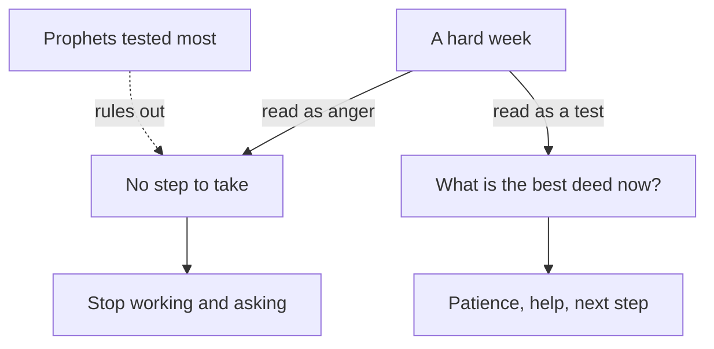

## A thought late at night

It is now ten days since Yasmin sent the draft. She sent her polite follow-up on Sunday, and that has had no answer either. This week the power schedule changed again, and the grid comes mostly at night, from 01:00 to 07:00. Her younger brother has a fever, so she sits with him in the evenings and brings him water and soup. Since Saturday she has done only two hours of paid work.

On Wednesday night, sitting by her brother's bed, a thought comes to her. Maybe Allah is angry with me. Maybe I did something wrong, and that is why everything is stuck. The thought is quiet, but it is heavy. Once it arrives, everything in the week seems to fit it. The silent client, the night power, her brother's fever: all of it starts to look like a message.

Many sincere believers have had this thought. It usually comes when we are tired and the hard things pile up. It feels humble, even religious. But it is not what the Quran and the Sunnah teach about hardship. This chapter looks at what they do teach, and at what changes when you read a hard week the way they describe it.

## Life is a test with a purpose

The Quran describes life itself as a test. Allah created death and life to test which of you is best in deeds (Quran 67:2).

> الَّذِي خَلَقَ الْمَوْتَ وَالْحَيَاةَ لِيَبْلُوَكُمْ أَيُّكُمْ أَحْسَنُ عَمَلًا

Meaning: the One who created death and life to test which of you is best in deeds.

Notice what the test is about. It is not about how much hardship you have, or how lucky your week is. It is about deeds: what you do with what you are given. A week with a silent client and a sick brother is not a failed test. It is a page of the test, and the question on that page is: what is the best thing to do now?

The Quran also tells us that the test is for everyone who believes. Do people think they will be left alone to say "we believe" without being tested? Those before them were tested too (Quran 29:2 to 3). So a test does not mean that something has gone wrong in your faith. It means you are a believer, living the life believers have always lived.

And the test has a purpose. Allah created jinn and humans only to worship Him (Quran 51:56). Worship here is wider than prayer. In module 6 you will see how a good intention turns daily work, study and caring for family into worship. For now, hold this: your life is not a series of random events. It has a purpose, and every page of it, easy or hard, is part of that purpose.

## Who is tested most?

If life is a test, it is natural to ask who gets the hardest pages. Many people assume that hardship goes to those who have done something wrong. One of the companions asked the Prophet, peace be upon him, this very question.

```predict
prompt: "The Prophet was asked which people are tested most severely. Before you step through the canvas, which answer do you expect he gave?"
options:
  - id: prophets
    label: "The prophets, then those most like them"
  - id: wrongdoers
    label: "The people who have done the most wrong"
correctOptionId: prophets
explanation: "He said the prophets, then those most like them, and so on, and that a person is tested according to the strength of his religion (Jami' at-Tirmidhi 2398). Hardship comes to the best people. So a hard week cannot be read as proof that Allah is angry with you."
```

Step through Yasmin's week below. The week stays the same. Watch what each reading of it leads her to do.

<InteractiveCanvas slug="a-hard-week-two-readings" />

The canvas started from the same facts both times. Read as "Allah is angry with me", the week led Yasmin to close her laptop and stop asking Allah for anything. Read as a test with a purpose, the same week led her to ask her cousin for help, to make dua, and to use two hours of night power for the proposals she had planned. The hardship did not change. Her reading of it changed what she did.

## Hardship is not a sign of Allah's anger

The hadith from the canvas deserves a closer look. Sa'd ibn Abi Waqqas, may Allah be pleased with him, asked the Prophet which people are tested most severely. He answered: the prophets, then those most like them, and so on. A person is tested according to the strength of his religion (Jami' at-Tirmidhi 2398, graded hasan sahih).

The prophets were the people closest to Allah, and they had the hardest lives. If hardship were a sign of Allah's anger, this could not be true. So the hadith closes the door on the late-night thought. A hard week is not a message that Allah is angry with you. The best people who ever lived had harder weeks than yours.

Be careful with what this hadith does not say. It does not explain why a particular hardship came to a particular person. Only Allah knows that. It does not say that your loss is a gift, or that a hard thing happened because Allah loves you. When someone you know is suffering, do not use this hadith to explain their pain to them. It is a truth about believers in general. Its job is to remove a false idea, so that a person can turn to what helps now.

## Not more than you can carry

The Quran adds a mercy to the test. Allah does not place on any soul more than it can bear (Quran 2:286). This is about what Allah asks of us: the duties He sets are within our capacity. It is a comfort.

Sadly, this verse is sometimes used the wrong way. Someone tells a tired person: "Allah does not burden a soul beyond its capacity, so stop complaining and cope." That is not what the verse is for. The same verse goes on with duas in which believers ask Allah not to burden them with more than they can bear. So the verse itself shows us asking for help. You are allowed to ask Allah for help, and you are allowed to ask people for help. Yasmin asking her cousin to sit with her brother is not a lack of patience. It is part of carrying the test well.

## With hardship comes ease

The last verse in this chapter is one many people know by heart. With hardship comes ease; truly, with hardship comes ease (Quran 94:5 to 6).

> فَإِنَّ مَعَ الْعُسْرِ يُسْرًا

Meaning: so truly, with hardship comes ease.

One translation renders it this way: "with hardship [will be] ease" (Quran 94:5, Sahih International). Keep the word "with". People often quote it as "after hardship comes ease", but the Arabic word here is *ma'a*, which means with. The verse places ease with the hardship. In Yasmin's week, she could already find small eases inside the hard days: a cousin who could help, two hours of power at 05:00, a brother whose fever was going down.

## Worked example: the same Thursday, two ways

On Thursday morning, Yasmin tries something Reem suggested. She takes one page of her notebook and reads her week twice, on purpose, step by step.

**Step 1: the facts.** Ten days without a reply. Night power. A sick brother. Two hours of paid work. She writes only what is true, with no explanations.

**Step 2: reading 1.** "Allah is angry with me." She asks: what does this reading tell me to do today? The honest answer is: nothing. If the hardship is a punishment she cannot name, there is no next step. She can only wait for it to end. She writes: "This reading closes the laptop."

**Step 3: check reading 1 against the sources.** The prophets were tested most (Jami' at-Tirmidhi 2398). So hardship is not proof of anger. Reading 1 fails the check. It came from tiredness, not from the Quran.

**Step 4: reading 2.** "This is a page of the test, and the test is about the best deed now (Quran 67:2)." She asks the same question: what does this reading tell me to do today? Now there are answers. Look after her brother well, because that is a good deed. Ask for help where she needs it, because Allah does not ask more than she can carry. Use the night power for the proposals. Make dua.

**Step 5: choose.** She chooses the reading that passed the check and gives her a next step. That night she sets an alarm for 05:00 and sends the two proposals before the power goes at 07:00.

The diagram below shows the rule behind her page.



What to notice: the anger reading does not only feel worse. It leads nowhere, because it gives no question you can act on. The test reading gives a question with an answer: what is the best deed now? And the dotted line shows why you are allowed to drop the first reading: the hadith about the prophets rules it out. The takeaway: when a hard week starts to feel like a message of anger, ask which reading the sources support, and which one gives you a step.

## Where people go wrong

The first mistake is the one Yasmin almost made: reading hardship as anger. You can spot it when a hard week makes you stop praying for good things, or stop trying, because "there is no point".

The second mistake is the opposite one, and it often comes from kind people. They tell someone in pain that their loss is a gift, or that Allah took something because He loves them. The sources do not tell us to explain anyone's hardship. Say what the sources say in general terms, then turn to what helps now: being present, practical help, dua.

The third mistake is to use 2:286 as a reason to carry everything alone. The verse is a mercy, and it sits next to duas asking for relief. Asking for help is part of the test, not a failure of it.

## Check your understanding

```quiz
type: mcq
question: "Fadi, a freelance video editor, lost two clients in one month, and his laptop screen cracked. His aunt says: 'Maybe Allah is angry with you. Think about what you did.' Which reply fits what the Prophet taught in Jami' at-Tirmidhi 2398?"
options:
  - "Hardship comes to the best people too, so it is not a sign of anger"
  - "His aunt is right, and he must find the sin behind the cracked screen"
  - "Hardship only reaches people who complain too much about their lives"
  - "A hard month means he should stop working until the month is over"
correct: 0
explanations:
  - "Right. The prophets were tested most, then those most like them. Hardship cannot be read as proof of Allah's anger, so Fadi can turn to his next step."
  - "The hadith rules this out. Fadi can always turn back to Allah for his mistakes, but a cracked screen is not a sign that tells him he has sinned."
  - "Nothing in the sources says this. The prophets were tested most, and they were the best of people."
  - "The test in Quran 67:2 is about the best deeds. Stopping work gives up the very thing the test asks about."
```

```quiz
type: mcq
question: "Haneen cares for her grandmother and studies for exams. She tells a friend she is exhausted. The friend says: 'Allah does not burden a soul beyond what it can bear, so you must cope alone.' What is the better reading of that verse?"
options:
  - "Her tiredness shows that she is not trying hard enough yet"
  - "She should give up the exams, since this is more than she can bear"
  - "Her friend is right: the verse means she should not ask anyone"
  - "It is a mercy about what Allah asks, and she may ask for help"
correct: 3
explanations:
  - "The verse says nothing about tiredness being a failure. Feeling tired while carrying two duties is human."
  - "The verse does not tell her to drop her duties. It tells her that what Allah asks of her is within her capacity, and that she can ask for help with it."
  - "The same verse goes on with duas asking Allah not to burden us. Asking Allah, and people, for help fits the verse."
  - "Right. Quran 2:286 is a comfort about what Allah requires, not an order to cope alone. She can ask Allah, her family and her friend for help."
```

## This week

The next time a hard day starts to feel like a message, do what Yasmin did. Write the facts of the day in two or three lines. Then read them twice: once as "Allah is angry with me", and once as "a page of the test: what is the best deed now?". Check which reading the sources support, and write down the one step the second reading gives you. If you prefer, do this for Fadi's month from the quiz instead of your own.

**Next:** Belief in qadr and full effort together, and why the Prophet answered "act" when his companions asked "then why try?".
