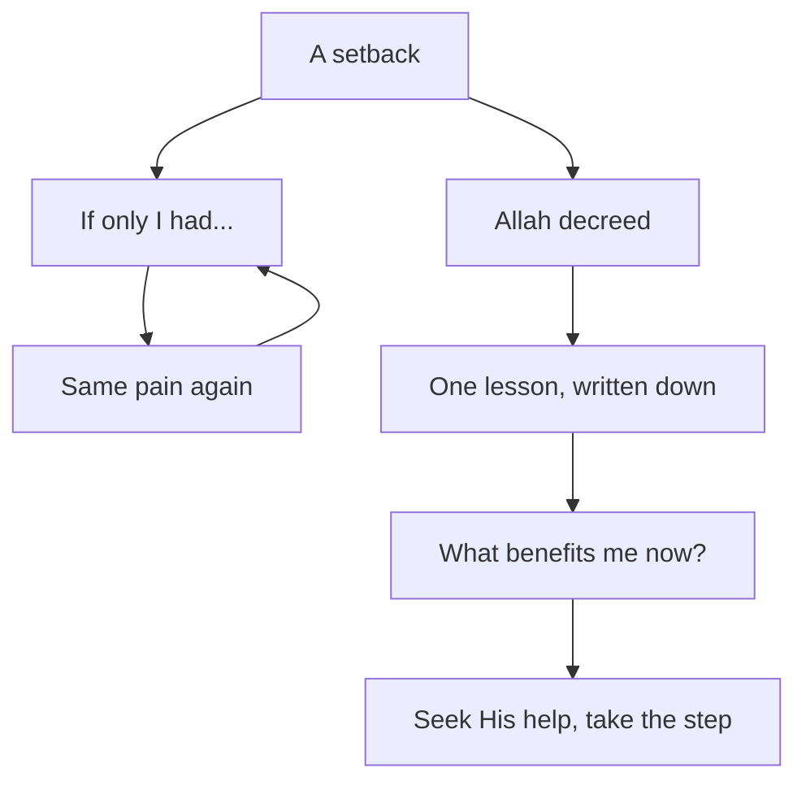

## The reply comes

Twelve days after she sent the draft, the client finally replies. His message is polite. He thanks Yasmin for her work, and he says the draft was good. But he has decided to work with another developer, whose design was closer to what he had imagined. The $200 he paid at the start covers the draft. He will not need the final version, so the second $200 will not come.

Yasmin reads the message three times. Then she puts the phone down and sits very still. She is sad, and that is normal. A lost project is a real loss, and $200 is a lot of money for her family this month.

What happens next is also normal, but it is not helpful. Her mind starts to replay the last three weeks. If only I had sent the draft two days earlier. If only I had used the colours from his old site. If only I had asked him more questions at the start. If only I had never taken this client. Each sentence feels like it is teaching her something. In fact, each one sends her back into the same sadness.

This chapter is about that moment, right after a setback. It brings together two beliefs that some people think pull against each other: belief in qadr, and full effort. The Prophet, peace be upon him, held them together and taught his companions to do the same.

## Qadr is part of faith

In chapter 1.1 you met qadr: Allah's decree, His knowledge of all things and His decision over them. Belief in it is not an extra. It is part of iman itself.

In the well-known hadith in which the angel Jibril, peace be upon him, asks the Prophet about faith, the Prophet answers that iman is to believe in Allah, His angels, His books, His messengers and the Last Day, and to believe in qadr, its good and its bad (Sahih Muslim 8). So a believer accepts that what happens, the welcome and the painful, happens by Allah's decree.

That raises an honest question. If everything is already decreed, why should anyone try? Why prepare for an interview, if Allah already knows the result? People have asked this for centuries, and some have written long debates about it. This course does not go into those debates. It does something simpler. It looks at the moment the companions asked the Prophet this exact question, and at the answer he gave.

## The companions asked "then why act?"

Ali ibn Abi Talib, may Allah be pleased with him, tells us what happened. At a funeral, the Prophet told the people around him that every person's place is already written. The companions asked: should we not then rely on what is written and leave our deeds? He answered: act, for everyone is eased toward what he was created for (Sahih al-Bukhari 4949).

> اعْمَلُوا فَكُلٌّ مُيَسَّرٌ لِمَا خُلِقَ لَهُ

Meaning: act, for each person is made able to do what he was created for.

Look at how short the answer is. The companions asked the very question that troubles many of us: then why try? The Prophet did not tell them to stop. He did not give them a long theory. He said "act". Belief in qadr is given here as a reason to keep doing good, not as a reason to stop.

## Be keen, seek help, do not give up

The second hadith is the centre of this chapter, and of much of this course. The Prophet said: the strong believer is better and more beloved to Allah than the weak believer, and there is good in both. Be keen on what benefits you, seek Allah's help, and do not give up. If something befalls you, do not say "if only I had done this, it would have been that", but say "Allah decreed, and He did what He willed", for "if only" opens the door to the work of Satan (Sahih Muslim 2664).

> وَإِنْ أَصَابَكَ شَىْءٌ فَلاَ تَقُلْ لَوْ أَنِّي فَعَلْتُ كَانَ كَذَا وَكَذَا
> وَلَكِنْ قُلْ قَدَرُ اللَّهِ وَمَا شَاءَ فَعَلَ فَإِنَّ لَوْ تَفْتَحُ عَمَلَ الشَّيْطَانِ

Meaning: if something befalls you, do not say "if only I had done this, it would have been such and such", but say "Allah decreed, and He did what He willed", for "if only" opens the work of Satan.

Read it as a set of instructions, because that is what it is. Before the event: be keen on what benefits you, seek Allah's help, do not give up. That is full effort with dua. After the event, if it does not go your way: do not replay it with "if only". Accept it as Allah's decree, and turn back to the first instruction. Be keen on what benefits you now.

So the hadith joins the two beliefs in one breath. Effort before. Acceptance after. Then effort again. Qadr does not replace the effort. It holds the result, so that you can let go of it and work on the next thing.

## Before you step through

```predict
prompt: "After the client says no, Yasmin keeps asking herself what she should have done differently. Do you expect going over it again and again to help her do better next time?"
options:
  - id: more-review
    label: "Yes, going over it more teaches her more"
  - id: one-lesson
    label: "Only if she takes one lesson, then stops"
correctOptionId: one-lesson
explanation: "Learning from a setback is good, and the course returns to it in module 6. But learning takes one clear look: what will I do differently? After that, going over it again does not teach anything new. It only brings back the pain. That repeated looking back is the 'if only' the hadith warns about."
```

Step through Yasmin's evening below. Watch which arrows go back to the past, and what each one brings back.

<InteractiveCanvas slug="act-not-if-only" />

The canvas showed three trips to the past. Two of them, "if only I had..." and the same pain coming back, brought nothing she could use. The third was different. She looked back once, wrote one lesson, and stopped. Then every arrow went to today: what benefits her now, Allah's help, and the next step. The sadness did not vanish. But the evening ended with two proposals sent, not with the same sentence playing for the tenth time.

## Worked example: turning "if only" into a step

The next morning, Yasmin takes her four "if only" sentences and works through them with the hadith, one at a time. Here are three of them.

**"If only I had sent the draft two days earlier."** First she asks: is there a lesson here, or only regret? She checks the facts. The client never mentioned speed. He chose another design because of how it looked. So there is no lesson in this sentence, only regret. She says "Allah decreed, and He did what He willed", and she lets it go. Her next step has nothing to do with this sentence.

**"If only I had asked him more questions at the start."** This one has a real lesson inside it. The client had a picture in his head that she never saw. So she writes one lesson, in a form she can use: "In the first week of a project, send a simple sketch of the home page and ask: is this close to what you imagine?" Then she stops. The lesson is written down. Saying the "if only" again would add nothing to it.

**"If only I had never taken this client."** She looks at the facts again. He paid $200 for ten days of work. She now has a finished draft she can show, if she rebuilds it with her own text and images, and a clearer way to start projects. Wishing the past away is not a lesson. It is a door to more regret. She says "Allah decreed" and turns to today.

Then she applies the first part of the hadith. What benefits her now? Two new proposals, using the sketch-first method. A short, kind reply to the client asking for one line of feedback. Her notes for the scholarship interview, because that result is still to come. She makes dua for help with all of it, and she starts.

The diagram below shows the two paths after any setback.



What to notice: the left path is a loop. "If only" leads to the same pain, and the pain leads back to "if only", because the past cannot change. The right path is a line. It looks back once, for one lesson, and then it only moves forward. The takeaway: the difference between regret and learning is not whether you look back. It is whether you come back with something you can do, and then stop.

## Where people go wrong

The first mistake is to read qadr as "effort is pointless". You can spot it in sentences like "it is all written, so why prepare?". The companions asked exactly this, and the answer was "act" (Sahih al-Bukhari 4949).

The second mistake is to read qadr as "what I did does not matter". After a setback caused by a real mistake, someone says "it was written" and moves on without learning anything. The hadith does not say that. It says to be keen on what benefits you, and learning one lesson benefits you. Qadr frees you from torturing yourself, not from taking responsibility. Chapter 6.4 returns to this.

The third mistake is to think that saying "Allah decreed" means you should feel nothing. Yasmin was sad, and she was right to be. Accepting qadr is about what you say and do, not about switching off your feelings. Later in the course you will see that the Prophet himself wept at a loss.

<Callout type="info" title="Learning or 'if only'?">
Ask one question: does this thought give me something to do differently? If yes, write it down once. If no, say "Allah decreed, and He did what He willed", and turn to today.
</Callout>

## Check your understanding

```quiz
type: mcq
question: "Salwa missed a paid internship by two points on a coding test. The next round opens in two months. Which response follows the teaching of Sahih Muslim 2664?"
options:
  - "If only I had studied one more week, I would have passed it"
  - "It was written for me, so there is nothing at all to learn here"
  - "Allah decreed it; I will note my weak topic for round two"
  - "I will go over every question I got wrong each night this month"
correct: 2
explanations:
  - "This is the 'if only' the hadith warns against. It replays the past without giving her a step."
  - "Accepting the decree is right, but the hadith also says to be keen on what benefits you. One lesson for round two would benefit her."
  - "Right. She accepts the result as Allah's decree, takes one lesson, and turns to what benefits her now: the next round."
  - "One careful look at her mistakes is useful. Going over them every night turns learning back into regret, with no new step in it."
```

```quiz
type: mcq
question: "Nizar has a job interview on Monday. He says: 'If Allah already knows whether I will get this job, why should I prepare?' Which answer is closest to what the Prophet told his companions in Sahih al-Bukhari 4949?"
options:
  - "You are right, so you can rest and wait for what is written"
  - "Act, for each one is made able to do what he was created for"
  - "Prepare hard, because in the end your effort decides it all"
  - "Prepare only if you feel sure that this job is written for you"
correct: 1
explanations:
  - "The companions asked this very question, and the Prophet did not tell them to rest. He told them to act."
  - "Right. When the companions asked whether to rely on what is written and leave their deeds, the Prophet answered: act."
  - "Preparing is right, but this answer forgets the other half. The result is Allah's decree, not Nizar's alone."
  - "Nobody can know what is written before it happens. The Prophet's answer was to act in every case, not only when we feel sure."
```

## This week

Think of one small setback from the last month: a late reply, a lost task, a low mark. If you prefer, use Salwa's coding test from the quiz. Write down every "if only" sentence it brings. For each one, ask: is there a lesson here? If there is, write the lesson once, in a form you can use. If there is not, say "Allah decreed, and He did what He willed". Then write one thing that would benefit you now, and do it this week.

**Next:** The module 1 checklist, and one situation of your own or a provided case, sorted.
