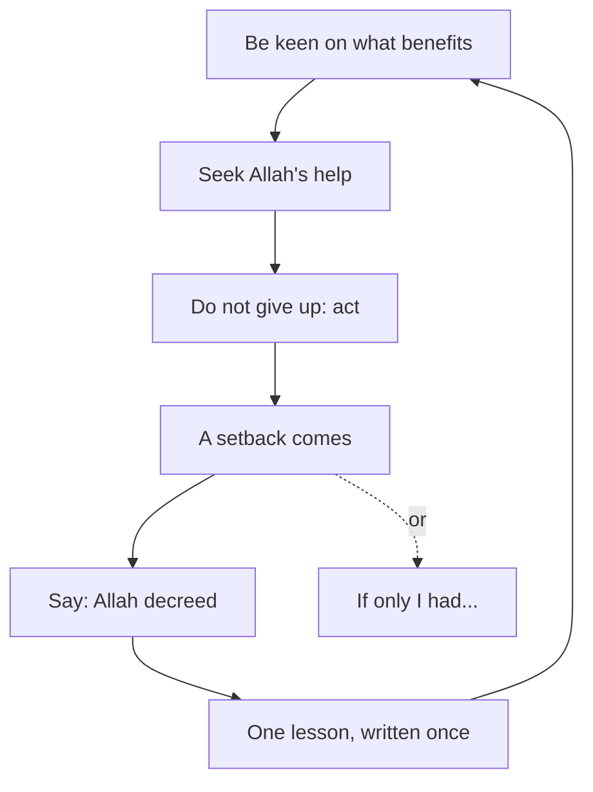

## The reply comes

Twelve days after she sent the draft, the client finally replies. His message is polite. He thanks Yasmin for her work, and he says the draft was good. But he has decided to work with another developer, whose design was closer to what he had imagined. The $200 he paid at the start covers the draft. He will not need the final version, so the second $200 will not come.

Yasmin reads the message three times. Then she puts the phone down and sits very still. She is sad, and that is normal. A lost project is a real loss, and $200 is a lot of money for her family this month.

What happens next is also normal, but it is not helpful. Her mind starts to replay the last three weeks. If only I had sent the draft two days earlier. If only I had used the colours from his old site. If only I had asked him more questions at the start. If only I had never taken this client. Each sentence feels like it is teaching her something. In fact, each one sends her back into the same sadness.

This chapter is about that moment, right after a setback. It brings together two beliefs that some people think pull against each other: belief in qadr, and full effort. The Prophet, peace be upon him, held them together and taught his companions to do the same.

## Qadr is part of faith

Belief in the qadr you met in chapter 1.1 is not an extra. It is part of iman itself.

There is a well-known hadith in which the angel Jibril, peace be upon him, asks the Prophet about faith. The Prophet answers that iman is to believe in Allah, His angels, His books, His messengers and the Last Day. It is also to believe in qadr, its good and its bad (Sahih Muslim 8). So a believer accepts that what happens, the welcome and the painful, happens by Allah's decree.

That raises an honest question. If everything is already decreed, why should anyone try? Why prepare for an interview, if Allah already knows the result? People have asked this for centuries, and some have written long debates about it. This course does not go into those debates. It does something simpler. It looks at the moment the companions asked the Prophet this exact question, and at the answer he gave.

## The companions asked "then why act?"

Ali ibn Abi Talib, may Allah be pleased with him, tells us what happened. At a funeral, the Prophet told the people around him that every person's place is already written. The companions asked: should we not then rely on what is written and leave our deeds? He answered: act, for everyone is eased toward what he was created for (Sahih al-Bukhari 4949).

> اعْمَلُوا فَكُلٌّ مُيَسَّرٌ لِمَا خُلِقَ لَهُ

Meaning: act, for each person is made able to do what he was created for.

Look at how short the answer is. The companions asked the very question that troubles many of us: then why try? The Prophet did not tell them to stop. He did not give them a long theory. He said "act". Belief in qadr is given here as a reason to keep doing good, not as a reason to stop.

## After the setback

So qadr does not cancel effort before an event. But what about after it, when the effort did not bring the result you hoped for? That is where Yasmin is now. Make a prediction before you step through her evening.

```predict
prompt: "After the client says no, Yasmin keeps going over what she should have done differently. Do you expect going over it again and again to help her do better next time?"
options:
  - id: more-review
    label: "Yes, each time she goes over it, she learns more"
  - id: one-lesson
    label: "No, after one lesson it only brings back pain"
correctOptionId: one-lesson
explanation: "Learning from a setback is good, and the course returns to it in module 6. But learning takes one clear look: what will I do differently? After that, going over it again does not teach anything new. It only brings back the pain. That repeated looking back is the 'if only' the Prophet warned about, as the next section shows."
```

Step through Yasmin's evening below. Watch which arrows go back to the past, and what each one brings back.

<InteractiveCanvas slug="act-not-if-only" />

The canvas showed three trips to the past. Two of them, "if only I had..." and the same pain coming back, brought nothing she could use. The third was different. She looked back once, wrote one lesson, and stopped. Then every arrow went to today: what benefits her now, Allah's help, and the next step. The sadness did not vanish. But the evening ended with two proposals sent, not with the same sentence playing for the tenth time.

## Be keen, seek help, do not give up

The words Yasmin used in the canvas come from the hadith at the centre of this chapter, and of much of this course. The Prophet said: the strong believer is better and more beloved to Allah than the weak believer, and there is good in both. Be keen on what benefits you, seek Allah's help, and do not give up. If something befalls you, do not say "if only I had done this, it would have been that". Say instead "Allah decreed, and He did what He willed", for "if only" opens the door to the work of Satan (Sahih Muslim 2664).

> وَإِنْ أَصَابَكَ شَىْءٌ فَلاَ تَقُلْ لَوْ أَنِّي فَعَلْتُ كَانَ كَذَا وَكَذَا
> وَلَكِنْ قُلْ قَدَرُ اللَّهِ وَمَا شَاءَ فَعَلَ فَإِنَّ لَوْ تَفْتَحُ عَمَلَ الشَّيْطَانِ

Meaning: if something befalls you, do not say "if only I had done this, it would have been such and such". Say instead "Allah decreed, and He did what He willed", for "if only" opens the work of Satan.

Read it as a set of instructions, because that is what it is. Before the event: be keen on what benefits you, seek Allah's help, do not give up. That is full effort with dua. After the event, if it does not go your way: do not replay it with "if only". Accept it as Allah's decree, and turn back to the first instruction. Be keen on what benefits you now.

So the one hadith joins the two beliefs together. Effort before. Acceptance after. Then effort again. Qadr does not replace the effort. It holds the result, so that you can let go of it and work on the next thing.

## Worked example: Ghassan after the final interview

Here is the hadith at work in a different setback. Ghassan is 27. He applied to be a teaching assistant for an online coding course, and he reached the final interview. Last week the course chose someone else. He has four "if only" sentences, and he works through them one at a time.

**"If only I had worn my better shirt."** First he asks: is there a lesson here, or only regret? The interview was a video call, and nobody commented on his clothes. There is no lesson in this sentence. He says "Allah decreed, and He did what He willed", and he lets it go.

**"If only I had prepared an example lesson."** This one has a real lesson inside it. The interviewer asked him to explain a loop to a beginner, and he was not ready. So he writes one lesson he can use: "Before any teaching interview, prepare one five-minute example lesson." Then he stops. The lesson is written down, and saying the "if only" again would add nothing to it.

**"If only I had applied to the other course instead."** He cannot know what would have happened there. That question belongs to the unseen from chapter 1.2, even though it sounds like a regret. He says "Allah decreed" and turns to today.

**"If only I were a better teacher."** He looks at the facts. He reached the final interview out of many applicants, so his teaching is not weak. The sentence is not a lesson. It is a judgement on himself, and it leads nowhere.

Then Ghassan applies the first part of the hadith. What benefits him now? He records his five-minute example lesson this week, while the interview is fresh in his mind. He asks the course for one line of feedback. He applies for the next teaching role that opens. He makes dua for help with all of it, and he starts on Monday.

## The circle of the hadith

The diagram below draws Sahih Muslim 2664 as a circle you can go round many times. Start at the top.



Follow the solid arrows and you come back to the start: after a setback, you are keen on what benefits you again, with one more lesson than before. Follow the dotted arrow and you reach "if only", which has no arrow out. That is why the Prophet warned against it. Looking back is not the problem. Looking back with no way forward is.

## Where people go wrong

The first mistake is to read qadr as "effort is pointless". You can spot it in sentences like "it is all written, so why prepare?". The companions asked exactly this, and the answer was "act" (Sahih al-Bukhari 4949).

The second mistake is to read qadr as "what I did does not matter". After a setback caused by a real mistake, someone says "it was written" and moves on without learning anything. The hadith does not say that. It says to be keen on what benefits you, and learning one lesson benefits you. Qadr frees you from torturing yourself, not from taking responsibility. Chapter 6.4 returns to this.

The third mistake is to think that saying "Allah decreed" means you should feel nothing. Yasmin was sad, and she was right to be. Accepting qadr is about what you say and do, not about switching off your feelings. Later in the course you will see that the Prophet himself wept at a loss.

<Callout type="info" title="Learning or 'if only'?">
Ask one question: does this thought give me something to do differently? If yes, write it down once. If no, say "Allah decreed, and He did what He willed", and turn to today.
</Callout>

## Check your understanding

```quiz
type: mcq
question: "Salwa missed a paid internship by two points on a coding test. The next round opens in two months. Which response follows the teaching of Sahih Muslim 2664?"
options:
  - "If only I had studied one more week, I would have passed it"
  - "It was written, so there is no need to look at what went wrong"
  - "Allah decreed it; I will note my weak topic for round two"
  - "Allah decreed it; I will sit round two the same way as before"
correct: 2
explanations:
  - "This is the 'if only' the hadith warns against. It replays the past without giving her a step."
  - "Accepting the decree is right, but the hadith also says to be keen on what benefits you. One lesson for round two would benefit her."
  - "Right. She accepts the result as Allah's decree, takes one lesson, and turns to what benefits her now: the next round."
  - "She accepts the decree and tries again, which is good. But she takes no lesson, and noting her weak topic is what would benefit her."
```

```quiz
type: mcq
question: "Yamen, a freelance designer, missed a client's call because he did not check the client's time zone. The client was upset. Yamen says: 'It was decreed.' What fits this chapter best?"
options:
  - "It was decreed, so the matter is closed for him and the client"
  - "Accept it as decreed, apologise, and set a reminder for time zones"
  - "Keep asking himself how he could forget, so he learns it well"
  - "Accept it as decreed, and wait for the client to raise it first"
correct: 1
explanations:
  - "Qadr frees him from torturing himself, not from responsibility. The hadith also says to be keen on what benefits you."
  - "Right. He accepts what happened as Allah's decree, puts right what he can with the client, and takes one lesson so it does not happen again."
  - "Asking once is the lesson. Asking again and again is the 'if only' loop, and it does not add anything after the first answer."
  - "Accepting the decree is right, but waiting leaves a real wrong to the client unmentioned. Being keen on what benefits means acting first."
```

## This week

Think of one small setback from the last month: a late reply, a lost task, a low mark. If you prefer, use Salwa's coding test from the quiz. Write down every "if only" sentence it brings. For each one, ask: is there a lesson here? If there is, write the lesson once, in a form you can use. If there is not, say "Allah decreed, and He did what He willed". Then write one thing that would benefit you now, and do it this week.

**Next:** The module 1 checklist, and one situation of your own or a provided case, sorted.
