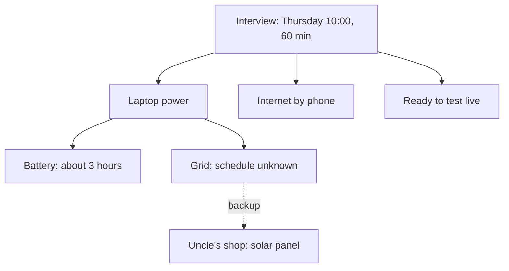

<BigWordAlert term="Tawakkul" plainEnglish="Trusting Allah with your heart while you do the work with your hands." whyItMatters="Without it, you either sit still and call it trust, or you carry every outcome alone and wear yourself out. With it, you plan fully and rest your heart on Allah." />

## The invitation

Khalil is 25. He is a junior software tester. He finished a testing course last year and has been looking for remote work ever since. A software tester checks that an app works as it should: he tries every button and form, looks for mistakes, and writes clear reports so the developers can fix them. Khalil is good at it. He is patient, and he notices small things.

In the last three months, in this example, he has applied for 30 remote jobs. Most companies never replied. Two sent a short "no". Then, on Sunday, an email arrived from a small company abroad that builds booking apps. They want to interview him for a junior tester role. The interview is next Thursday at 10:00, by video call, and it will last 60 minutes.

The email explains the plan for the hour. For the first 20 minutes they will talk about his experience. For the next 30 minutes he will share his screen and test a sample sign-up page while they watch, then write two short bug reports. The last 10 minutes are for his questions. Khalil read the email twice and felt his heart jump. It is his first interview in three months.

## Everything that could go wrong

By Sunday evening, the joy has a shadow. Khalil starts listing everything that could go wrong on Thursday, and the list is long.

The power is the first problem. The grid schedule in his area changes from week to week, and nobody knows next week's schedule yet. Some weeks the power comes in the morning. Some weeks it comes at night. His laptop battery lasts about 3 hours on a video call; he timed it last month. If the grid is off on Thursday morning and the battery is low, the call could end in the middle of the test.

The internet is the second problem. Khalil connects his laptop to the internet through his phone, using mobile data. Inside the flat the signal is weak. By the window it is better. A video call with screen sharing uses a lot of data, and data is expensive.

The third problem is the interview itself. He has never tested an app while other people watched. He is not sure he remembers how to write a bug report quickly under pressure.

There is one piece of good news on the list. His uncle Nabil has a small shop fifteen minutes' walk away, and the shop has a solar panel on the roof. The panel powers the lights and the fridge, and there is a quiet back room. But Khalil has not asked his uncle anything yet.

## Two voices

That evening Khalil tells his mother about the interview. She is very happy. She puts her hand on his shoulder and says: "Trust Allah, my son. If this job is written for you, it will come." Khalil loves her for it, and he believes it. But part of him hears something else in her words: if it is written, then planning does not matter.

His friend Shadi says something similar, in a different way. "Why are you worrying about the power? You cannot control the grid. Just pray and see what happens on Thursday."

Inside Khalil there is a third voice, and it says the opposite. It tells him that everything depends on him. If he does not prepare perfectly, he will lose this chance, and it may be the only one this year. So he stays up until 02:00 reading testing notes. He checks the neighbourhood power group every hour. He wakes up tired and starts again. By Tuesday he has slept badly for three nights, and his notes are not getting better. They are getting longer.

```predict
prompt: "On Monday, Khalil says: 'I have prayed and made dua about Thursday, so I will trust Allah about the power.' Before you read on, do you think his plan is complete?"
options:
  - id: needs-plan
    label: "No, he also needs a power plan"
  - id: trust-enough
    label: "Yes, dua and trust are enough now"
correctOptionId: needs-plan
explanation: "His dua and his trust are real and good. But the power on Thursday morning is something he can plan for: charging the laptop, a backup place with power, a way to rejoin the call. Trust does not replace those steps. The rest of this module shows why the Prophet, peace be upon him, always put the two together."
```

## The Saturday circle

On Saturday, Khalil joins the online study circle with his mentor, Reem, and the other fellows. He tells them about the interview, the power, and his three bad nights. He admits that he does not know what tawakkul asks of him this week. Is it to stop worrying and leave it to Allah? Or is it to plan every detail?

Reem listens, and then she asks him a question. "Where is your heart this week, and where are your hands?" Khalil thinks about it. His hands are busy, too busy: he is doing everything at once and sleeping little. His heart is not resting on Allah. It is resting on the grid, the battery and his own notes. And the voices around him are asking his hands to stop.

Then Reem reads a short phrase from the Quran. Whoever is mindful of Allah, He makes a way out for him and provides for him from where he does not expect; and whoever puts his trust in Allah, Allah is enough for him (Quran 65:2 to 3).

> وَمَن يَتَوَكَّلْ عَلَى اللَّهِ فَهُوَ حَسْبُهُ

Meaning: whoever puts his trust in Allah, He is enough for him.

"Allah is enough for you," Reem says. "That is where your heart can rest. But this week will still need your hands. The rest of the module is about how the two work together."

## What the case shows

The diagram shows what Khalil's Thursday really needs. It is not a list of fears. It is a list of things he can plan, with one unknown in the middle.



What to notice: only one box, the grid schedule, is truly unknown. Everything else is something Khalil can count, prepare or arrange: the battery, the data, the practice, the back room at his uncle's shop. The dotted line shows that even the unknown box has a backup. The takeaway: most of what frightened Khalil on Sunday evening can be planned. The part that cannot be planned is the part his heart can leave with Allah.

## Why this matters for your work

Khalil's week is a small picture of a big question. In a life with power cuts, weak connections, silent companies and changing plans, a believer has to decide what trust in Allah means in practice. There are two easy ways to get it wrong, and Khalil's week shows both.

The first is trust without means: to pray, say "it is written", and skip the planning. It sounds like faith. But the Quran and the Sunnah never describe trust like that. You will meet people in the time of the Prophet who travelled without food and called it trust, and you will see what the Quran told them.

The second is means without trust: to plan and work as if everything depended on you alone. It sounds like responsibility. But it wears you out, and it leaves your heart hanging on things that can fail. Khalil's three bad nights are a sign of it. When the heart has nowhere to rest, the hands do not get better. They only get more tired.

This module teaches the third way, which the Prophet, peace be upon him, lived. You will learn what tawakkul is from its sources, and how to recognise the two ways it goes wrong. You will make a real means plan for Khalil's interview, with the hours counted honestly and a backup ready. You will see Hajar, peace be upon her, trust Allah completely and still run between two hills looking for water. And you will follow the Prophet's careful planning of the Hijra, step by step, and see the trust he showed in the cave.

You will not be asked to share any personal plans with anyone. The module's tasks always offer a provided case. If you choose to use your own goal, it can be small: an exam, a deadline, a trip to an office, a call you need to make.

<LearningObjectives items={["Explain tawakkul as trust of the heart with the means taken by the hands, from the Quran and the Sunnah", "Spot the two ways tawakkul goes wrong: trust without means, and means without trust", "Plan the means for a goal, count what you need honestly, and add a backup plan", "Follow the planned steps of the Hijra and the trust in the cave, and apply the pattern to a plan of your own", "Write a means plan with a backup for one real or provided goal"]} />

## Key words

| Word | Plain English |
|---|---|
| **Taking the means** | Doing your part: the steps, tools and people through which things usually happen |
| **Backup plan** | What you will do if your first plan fails, decided before you need it |
| **Rizq** | Provision: everything Allah gives you to live on, including income, food, health and people |
| **Hijra** | The Prophet's emigration from Makkah with Abu Bakr, may Allah be pleased with him, planned with great care |

## What is in this module

| Chapter | You will practise |
|---|---|
| 2.2 | What tawakkul is and is not, and the two ways it goes wrong |
| 2.3 | Tying the camel: a means plan with a backup for Khalil's interview, and Hajar's search for water |
| 2.4 | The Prophet's planning in the Hijra, step by step, and the trust in the cave |
| 2.5 | A graded quiz with five short cases |
| 2.6 | A means plan with a backup for one real or provided goal |

**Next:** What tawakkul is, what it is not, and the birds that go out every morning.
