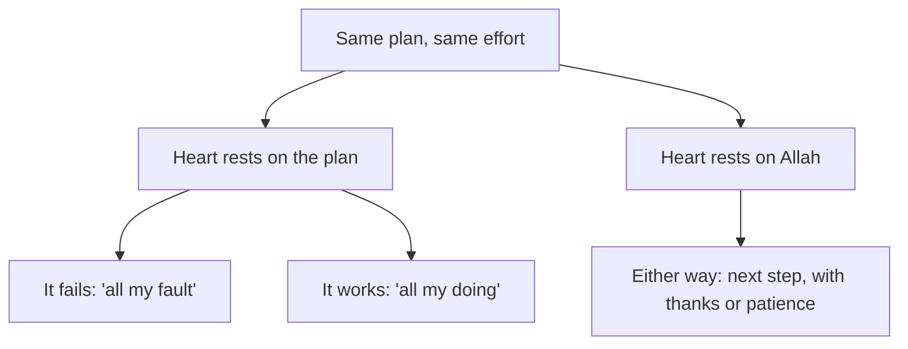

## Which voice is right?

On Monday morning, Khalil sits by the window, where the phone signal is best, and thinks about the weekend. His mother told him to trust Allah. His friend Shadi told him not to bother planning, since he cannot control the grid. And his own tired mind told him that everything depends on him, so he must not stop.

All three voices use the word trust, or argue about it. Khalil realises that he has never really learned what tawakkul means. He knows the word. He says it often. But he cannot say what it asks him to do on a Monday, three days before an interview.

This chapter answers that question from the sources. It looks at what a classical scholar said tawakkul is, and at a verse that gives the order of planning and trust. It looks at a hadith about birds. And it looks at a group of people in the time of the Prophet, peace be upon him, who got it wrong. By the end, Khalil can see which part of each voice was right, and which part was not.

## Trust in the heart, work in the hands

The short definition of tawakkul you met in chapter 2.1 is built on what classical scholars wrote.

The scholar Ibn Rajab, in his well-known commentary on a collection of hadith, explained it like this, as quoted by Egypt's Dar al-Ifta. Real tawakkul does not contradict striving in the means through which Allah has decreed that things happen. Striving with the limbs is obedience to Allah, and relying on Him with the heart is faith in Him. The same article quotes another scholar, al-Qushayri: the place of tawakkul is the heart, and the movement of the body does not contradict it.

Notice that this explanation puts tawakkul in a place: the heart. The heart leans on Allah, not on the grid, the battery or the company's decision. The hands are given a different job. They take the means, in the sense you met in 2.1. The scholars do not see these two as rivals. Working with the hands is itself a kind of obedience to Allah, and trusting with the heart is an act of faith. A believer does both at once.

## Consult, decide, then trust

The Quran gives the same order in one verse. Allah tells the Prophet: consult them in the matter, and once you have decided, put your trust in Allah; Allah loves those who trust Him (Quran 3:159).

Look at the order of the verse. First comes consulting people. Then comes a decision. Only then comes trust. Trust is not placed before the planning, as a reason to skip it. It comes with the decision, so that once you have done your part, your heart can rest. Module 5 comes back to this verse when it looks at decisions.

## A hadith people quote both ways

There is a famous hadith about birds that many people quote when they talk about rizq. Some quote it to mean "plan less". Others quote it to mean "go out and work". Before you read it, make a prediction about a new person.

```predict
prompt: "Mazen has been out of work for four months. His cousin says: 'Rizq is written, so why go to job fairs?' Before you step through the canvas, do you expect the birds hadith to support his cousin?"
options:
  - id: cousin
    label: "Yes, the birds are fed without working"
  - id: go-out
    label: "No, the birds still fly out every morning"
correctOptionId: go-out
explanation: "The hadith says the birds go out hungry in the morning and come back full in the evening. Their provision comes from Allah, and they still fly out to meet it. So the hadith pictures trust with movement. Mazen's cousin is right that rizq is from Allah, and wrong that this means staying home."
```

Step through the three ways of meeting a need below. Watch where each one ends.

<InteractiveCanvas slug="birds-go-out" />

The canvas showed one need and three paths. On the left, people skipped the means and called it trust, and they ended up asking others for food. On the right, Khalil acted as if every outcome depended on him, and he ended up worn out. In the middle, the birds did what neither group did. They trusted Allah for their provision, and they flew out every morning to find it.

## The birds go out

Here is the hadith from the last step. Umar ibn al-Khattab, may Allah be pleased with him, reported what the Prophet said. If you relied on Allah as He truly deserves, He would provide for you as He provides for the birds. They go out hungry in the morning and come back full in the evening (Jami' at-Tirmidhi 2344, graded hasan sahih).

> لَوْ أَنَّكُمْ كُنْتُمْ تَوَكَّلُونَ عَلَى اللَّهِ حَقَّ تَوَكُّلِهِ لَرُزِقْتُمْ كَمَا تُرْزَقُ الطَّيْرُ تَغْدُو خِمَاصًا وَتَرُوحُ بِطَانًا

Meaning: if you relied on Allah as He truly deserves, you would be provided for as the birds are. They go out hungry in the morning and return full in the evening.

People often quote this hadith to mean "do not worry about your rizq". That is part of it. But the picture in the hadith is of birds moving. Their provision is from Allah, and their wings still do their part every morning.

## Trust without means: the pilgrims from Yemen

The first way tawakkul goes wrong is to skip the means and call it trust. This is not a new mistake. Ibn Abbas, may Allah be pleased with him, reported that some people of Yemen used to come for Hajj without taking provisions. They said: we are the ones who trust Allah. When they arrived, they asked people for food. So Allah revealed: take provisions, and the best provision is taqwa (Sahih al-Bukhari 1523, with Quran 2:197).

> وَتَزَوَّدُوا فَإِنَّ خَيْرَ الزَّادِ التَّقْوَىٰ

Meaning: take provisions, and the best provision is taqwa.

The verse does two things at once. It tells them to pack food, which is the means. And it reminds them of a deeper provision, <GlossaryTerm term="taqwa" definition="Being mindful of Allah, so that you stay careful in what you do and avoid what displeases Him." />, which is in the heart. Allah did not praise their empty bags as strong faith. He told them to fill the bags.

You can recognise this mistake in sentences like "if it is written, it will come, so why prepare?" or "I trust Allah, so I do not need a backup". Shadi's advice to Khalil was this kind of trust. It sounds humble, but it leaves out the half of tawakkul that the hands are given to do.

## Means without trust: when everything seems to depend on you

The second way tawakkul goes wrong is quieter, and many hard-working people fall into it. It is to take every means and forget that the result is not yours. The heart rests on the plan, the effort and your own cleverness, instead of on Allah.

You can recognise it by how it feels. There is no rest. Every unknown becomes something you must control. Khalil checking the power group every hour, and reading notes until 02:00 for three nights, is this mistake. His effort was not wrong. But his heart had nothing to rest on except his own effort, so he could not stop.

This way also goes wrong after the result. If things fail, a person whose heart rests only on himself blames only himself, and he can sink into despair. If things succeed, he may think it was only his own doing. Remember the hadith from chapter 1.2: if all people gathered to benefit you, they could only benefit you with what Allah has written for you (Jami' at-Tirmidhi 2516). Your effort is a means. It is not the source.

One more thing about this second way. Feeling worried does not mean you lack tawakkul. Worry is human. Tawakkul is what you do with the worry: you take your part, and you hand the rest to Allah. Khalil does not need to stop caring about Thursday. He needs to stop carrying it alone.

## Worked example: Dalia checks her plan

Here are the two questions at work in a different week. Dalia is 26 and works as a freelance data analyst. Next Tuesday she must present a sales report to a new client by video call. This is her plan on Thursday evening, and her check of each item.

For each item, she asks two questions. Is this a real means? And where is my heart resting?

**"I will rebuild every chart three times, to be safe."** Is this a means? Checking the charts once is. Rebuilding them three times is her worry trying to hold the result. She changes it to one careful check on Saturday, with a friend who reads the report as if she were the client.

**"I will not practise speaking. If Allah wills, the words will come."** Here the means is missing. She has never presented to this client, and her English is better on paper than out loud. She adds two practice runs on Sunday and Monday, each 20 minutes, recorded on her phone.

**"I cannot control the client's mood, so there is no point preparing for questions."** Half of this is true: his mood is not hers to control. The other half is not. She can list the five questions he is most likely to ask, and prepare short answers.

**"If he does not like it, I have failed as an analyst."** This sentence shows where her heart was resting: on his reaction. She rewrites it: "I will do my part well. If he does not like it, Allah decreed it, and I will take one lesson." Those are the words from chapter 1.4.

Dalia's plan ends up with the same number of hours, used differently. Less time goes into repeating what is done, and more into what was missing. And she leaves Tuesday's result with Allah before Tuesday comes.

## Where the heart rests decides the ending

The prose so far has described the two mistakes before an event. The diagram below looks at what happens after it. The same plan and the same effort can end in two very different places, depending on where the heart was resting.



Look at the two arrows out of "heart rests on the plan". One leads to despair and one leads to pride, and neither is a good place to start the next week. The single arrow out of "heart rests on Allah" covers both results. If it works, the believer is grateful. If it fails, the believer is patient and takes the next step. The effort in both boxes at the top is identical. The difference is not in the hands.

## Where people go wrong

The first mistake is to think that more worry means more responsibility. A sleepless night is not a means. Rest is often part of the plan.

The second mistake is to think that planning shows weak faith. The verse puts trust after the decision, and the Prophet described the birds going out. Planning is part of trust, not a sign that it is missing.

The third mistake is to measure another person's tawakkul. Only Allah knows what is in a heart. Use these ideas to check your own plans, not to judge your friend, your parent or anyone else.

## Check your understanding

```quiz
type: mcq
question: "Basel is bidding for a large web project. He works sixteen hours a day on the proposal and cannot sleep. He says: 'If I lose this bid, it is my fault and mine alone.' What has gone wrong for him?"
options:
  - "His plan is sound; worry this strong shows he takes the bid seriously"
  - "He is not doing enough; more hours on the bid would ease his mind"
  - "He has forgotten dua; a prayer each night would set his plan right"
  - "His heart rests on his own effort, so the result feels his alone"
correct: 3
explanations:
  - "Taking the bid seriously is good. But not sleeping and blaming himself in advance show that his heart has nothing to rest on except his effort."
  - "Sixteen hours a day is a great deal of work. More hours would only make him more tired, because the problem is not the amount of work."
  - "Dua is good, and he may already make it. The deeper problem is where his heart rests: on his effort, as his sentence shows."
  - "Right. His hands are working, but he believes the result is his alone. That is means without trust, and it leaves him sleepless."
```

```quiz
type: mcq
question: "Dana is studying hard for a certificate exam. She tells her friend: 'All this studying shows I am relying on myself, not on Allah.' Which reply fits Ibn Rajab's explanation of tawakkul?"
options:
  - "Studying is obedience to Allah, and her reliance on Him is in her heart"
  - "Studying is fine, but the less she studies, the more she relies on Allah"
  - "Studying is her part, so her trust in Allah can wait until the results"
  - "Studying and trusting are separate, so she should choose one for now"
correct: 0
explanations:
  - "Right. Ibn Rajab said striving with the limbs is obedience to Allah, and relying on Him with the heart is faith. Her study does not compete with her trust."
  - "Studying less does not make trust stronger. The pilgrims who brought no food thought something similar, and the Quran told them to take provisions."
  - "Trust is not only for after the work. It is in the heart while the hands work, so she can rely on Allah during her study too."
  - "This is the assumption Ibn Rajab answers: striving and trusting do not contradict each other. She does both at once."
```

## This week

Take one goal you have this month, small or large. If you prefer, use Basel's bid from the quiz. Write down everything you are doing for it. Next to each item, ask the two questions Dalia asked: is this a real means, and where is my heart resting? Drop one item that is only worry, and add one means you have been skipping. Then write one sentence you will say to yourself if it does not work out.

**Next:** Tie the camel and trust: a full means plan for Khalil's interview, with the hours counted and a backup ready, and Hajar's search for water.
