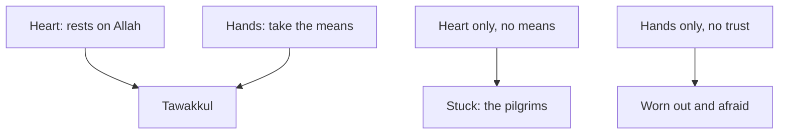

## Which voice is right?

On Monday morning, Khalil sits by the window, where the phone signal is best, and thinks about the weekend. His mother told him to trust Allah. His friend Shadi told him not to bother planning, since he cannot control the grid. And his own tired mind told him that everything depends on him, so he must not stop.

All three voices use the word trust, or argue about it. Khalil realises that he has never really learned what tawakkul means. He knows the word. He says it often. But he cannot say what it asks him to do on a Monday, three days before an interview.

This chapter answers that question from the sources. It looks at what a classical scholar said tawakkul is, at a hadith about birds, at a verse that gives the order of planning and trust, and at a group of people in the time of the Prophet, peace be upon him, who got it wrong. By the end, Khalil can see which part of each voice was right, and which part was not.

## Trust in the heart, work in the hands

In chapter 2.1 you met the course's short definition: tawakkul is trusting Allah with your heart while you do the work with your hands. That wording is built on what classical scholars wrote.

The scholar Ibn Rajab, in his well-known commentary on a collection of hadith, explained it like this, as quoted by Egypt's Dar al-Ifta. Real tawakkul does not contradict striving in the means through which Allah has decreed that things happen. Striving with the limbs is obedience to Allah, and relying on Him with the heart is faith in Him. The same article quotes another scholar, al-Qushayri: the place of tawakkul is the heart, and the movement of the body does not contradict it.

Notice that this definition puts tawakkul in a place: the heart. The heart leans on Allah, not on the grid, the battery or the company's decision. The hands are given a different job. They take the means: the steps, tools and people through which things usually happen. The scholars do not see these two as rivals. Working with the hands is itself a kind of obedience to Allah, and trusting with the heart is an act of faith. A believer does both at once.

## Consult, decide, then trust

The Quran gives the same order in one verse. Allah tells the Prophet: consult them in the matter, and once you have decided, put your trust in Allah; Allah loves those who trust Him (Quran 3:159).

Look at the order of the verse. First comes consulting people. Then comes a decision. Only then comes trust. Trust is not placed before the planning, as a reason to skip it. It comes with the decision, so that once you have done your part, your heart can rest. Module 5 comes back to this verse when it looks at decisions.

## The birds go out

The best-known hadith on tawakkul uses a picture from nature. Umar ibn al-Khattab, may Allah be pleased with him, reported that the Prophet said: if you relied on Allah as He truly deserves, He would provide for you as He provides for the birds. They go out hungry in the morning and come back full in the evening (Jami' at-Tirmidhi 2344, graded hasan sahih).

> لَوْ أَنَّكُمْ كُنْتُمْ تَوَكَّلُونَ عَلَى اللَّهِ حَقَّ تَوَكُّلِهِ لَرُزِقْتُمْ كَمَا تُرْزَقُ الطَّيْرُ تَغْدُو خِمَاصًا وَتَرُوحُ بِطَانًا

Meaning: if you relied on Allah as He truly deserves, you would be provided for as the birds are: they go out hungry in the morning and return full in the evening.

People often quote this hadith to mean "do not worry about your rizq". That is part of it. But read the picture carefully before you step through the canvas.

```predict
prompt: "In the hadith, Allah provides for the birds. Before you step through the canvas, what do you expect the hadith says the birds do?"
options:
  - id: stay
    label: "They stay in their nests until it comes"
  - id: go-out
    label: "They fly out each morning to find it"
correctOptionId: go-out
explanation: "The hadith says the birds go out hungry in the morning and come back full in the evening. Their provision comes from Allah, and they still fly out to meet it. The hadith pictures trust with movement, not trust instead of movement."
```

Step through the three ways of meeting a need below. Watch where each one ends.

<InteractiveCanvas slug="birds-go-out" />

The canvas showed one need and three paths. On the left, people skipped the means and called it trust, and they ended up asking others for food. On the right, Khalil carried every outcome on his own shoulders, and he ended up worn out. In the middle, the birds did what neither group did. They trusted Allah for their provision, and they flew out every morning to find it.

## Trust without means: the pilgrims from Yemen

The first way tawakkul goes wrong is to skip the means and call it trust. This is not a new mistake. Ibn Abbas, may Allah be pleased with him, reported that some people of Yemen used to come for Hajj without taking provisions. They said: we are the ones who trust Allah. When they arrived, they asked people for food. So Allah revealed: take provisions, and the best provision is taqwa (Sahih al-Bukhari 1523, with Quran 2:197).

> وَتَزَوَّدُوا فَإِنَّ خَيْرَ الزَّادِ التَّقْوَىٰ

Meaning: take provisions, and the best provision is taqwa.

The verse does two things at once. It tells them to pack food, which is the means. And it reminds them of a deeper provision, <GlossaryTerm term="taqwa" definition="Being mindful of Allah, so that you stay careful in what you do and avoid what displeases Him." />, which is the heart. Allah did not praise their empty bags as strong faith. He told them to fill the bags.

You can recognise this mistake in sentences like "if it is written, it will come, so why prepare?" or "I trust Allah, so I do not need a backup". Shadi's advice to Khalil was this kind of trust. It sounds humble, but it leaves out the half of tawakkul that the hands are given to do.

## Means without trust: when it all hangs on you

The second way tawakkul goes wrong is quieter, and many hard-working people fall into it. It is to take every means and forget that the result is not yours. The heart rests on the plan, the effort and your own cleverness, instead of on Allah.

You can recognise it by how it feels. There is no rest. Every unknown becomes something you must control. Khalil checking the power group every hour, and reading notes until 02:00 for three nights, is this mistake. His effort was not wrong. His heart had nowhere to put the weight, so his body carried it.

This way also goes wrong after the result. If things fail, a person whose heart rests only on himself blames only himself, and he can sink into despair. If things succeed, he may think it was only his own doing. Remember the hadith from chapter 1.2: if all people gathered to benefit you, they could only benefit you with what Allah has written for you (Jami' at-Tirmidhi 2516, graded hasan sahih). Your effort is a means. It is not the source.

One more thing about this second way. Feeling worried does not mean you lack tawakkul. Worry is human. Tawakkul is what you do with the worry: you take your part, and you hand the rest to Allah. Khalil does not need to stop caring about Thursday. He needs to stop carrying it alone.

## Worked example: Khalil checks his week

On Monday afternoon, Khalil takes his notebook and checks his plans against the two ways tawakkul goes wrong. For each item he asks two questions. Is this a real means? And where is my heart resting?

**Praying and making dua about Thursday.** This is part of tawakkul, and he keeps it. But he notices that he had been using it to skip the next item. Dua stays, and it is joined by the means.

**"I cannot control the grid, so there is nothing to plan."** He checks this sentence. It is true that he cannot control the grid. It is not true that there is nothing to plan. He can control when he charges the laptop, whether he asks his uncle about the shop, and whether he buys enough data. This sentence was trust without means, and he drops it.

**Reading notes until 02:00.** He asks: is this a means? Partly. Practice is a means. But practice at 01:00, after three bad nights, is not making him better. He changes it to 45 minutes of practice each morning while the power is on, testing a real sign-up page and writing two bug reports, and he stops work at 23:00.

**Checking the power group every hour.** Is this a means? Once a day, it is: it tells him the schedule. Every hour, it is his heart trying to hold the grid. He changes it to one check each evening.

**What will I tell myself if Thursday fails?** This is the question that shows where his heart rests. He writes: "If I do my part and it does not work out, then Allah decreed it, and He did what He willed." You met those words in chapter 1.4. They let him work hard without needing the result to be in his hands.

By the end of the afternoon his plan is shorter, calmer and more useful. Chapter 2.3 turns it into a full means plan with the hours counted and a backup ready.

The diagram shows the relationship the chapter has argued.



What to notice: tawakkul has two arrows going into it, and it needs both. Take away the hands, and you get the pilgrims with empty bags. Take away the heart, and you get Khalil at 02:00. The takeaway: when you ask "am I trusting Allah?", check both arrows. Is my heart resting on Him? And are my hands doing their part?

## Where people go wrong

The first mistake is to think that more worry means more responsibility. A sleepless night is not a means. Rest is often part of the plan.

The second mistake is to think that planning shows weak faith. The verse puts trust after the decision, and the Prophet described the birds going out. Planning is part of trust, not a sign that it is missing.

The third mistake is to measure another person's tawakkul. Only Allah knows what is in a heart. Use these ideas to check your own plans, not to judge your friend, your parent or anyone else.

## Check your understanding

```quiz
type: mcq
question: "Basel is bidding for a large web project. He works sixteen hours a day on the proposal, cannot sleep, and says: 'If I lose this bid, it is all my fault.' Which way has tawakkul gone wrong for him?"
options:
  - "Trust without means: he is not doing enough real work yet"
  - "It has not gone wrong: hard work is all that trust needs"
  - "Laziness: he should add more hours to the proposal work"
  - "Means without trust: his heart rests on his own effort"
correct: 3
explanations:
  - "Basel is doing a great deal of work. The means are there. What is missing is somewhere for his heart to rest."
  - "Hard work is the hands' part. Tawakkul also needs the heart to rest on Allah, and 'it is all my fault' shows that it does not."
  - "Sixteen hours a day is not laziness. More hours would only make him more tired."
  - "Right. His hands are working, but he believes the result is his alone. That is means without trust, and it leaves him sleepless."
```

```quiz
type: mcq
question: "Mazen has been out of work for four months. His cousin says: 'Rizq is written, so why go to job fairs or send more applications?' Which reply is closest to the birds hadith (Jami' at-Tirmidhi 2344)?"
options:
  - "The birds go out each morning, so Mazen should keep going out"
  - "The birds are fed in their nests, so Mazen can wait at home"
  - "The birds show that rizq depends only on how hard one tries"
  - "The hadith is only about birds, so it says nothing about jobs"
correct: 0
explanations:
  - "Right. The birds are provided for by Allah, and they still fly out hungry each morning. Trust and going out belong together."
  - "The hadith says the opposite: the birds go out in the morning and come back full in the evening."
  - "The hadith begins with relying on Allah as He truly deserves. Rizq comes from Allah; the going out is the means."
  - "The Prophet used the birds as a picture for people: 'He would provide for you as He provides for the birds'."
```

## This week

Take one goal you have this month, small or large. If you prefer, use Basel's bid from the quiz. Write down everything you are doing for it. Next to each item, ask the two questions Khalil asked: is this a real means, and where is my heart resting? Drop one item that is only worry, and add one means you have been skipping. Then write one sentence you will say to yourself if it does not work out.

**Next:** Tie the camel and trust: a full means plan for Khalil's interview, with the hours counted and a backup ready, and Hajar's search for water.
