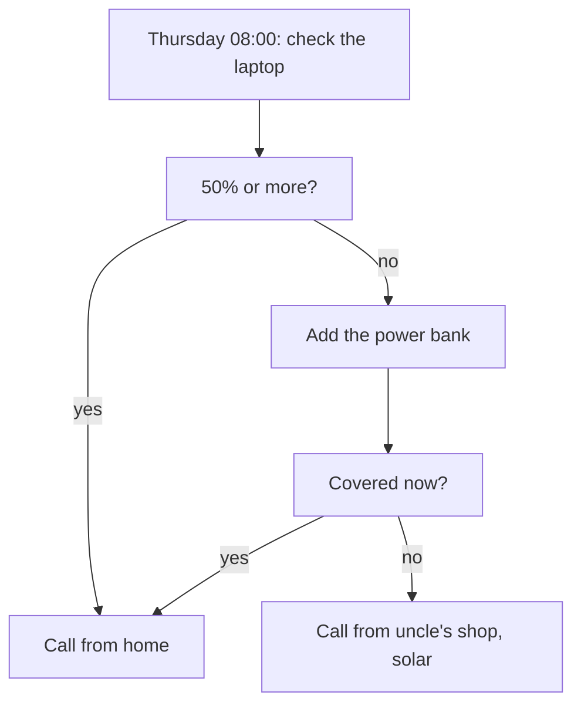

## Tuesday: from worry to a plan

It is Tuesday, two days before the interview. In chapter 2.2, Khalil checked his week against the two ways tawakkul goes wrong. He dropped the sleepless nights and the hourly checking, and he stopped telling himself there was nothing to plan. Now he has to do the harder part: build a real plan for Thursday at 10:00.

He opens his notebook and writes three headings: power, internet, and the interview itself. Under "power" he writes the facts he knows. The interview lasts 60 minutes. He wants 15 minutes before it to test the call. A full battery lasts about 3 hours on a video call. The grid schedule for Thursday is unknown. His uncle Nabil's shop, fifteen minutes away, has a solar panel.

Then he stops and asks himself an honest question. Is making a backup plan a sign that he does not trust Allah? If he trusted Allah fully, would he need a Plan B at all? This chapter answers that question with a short hadith and a long story.

## Tie it and trust

Anas ibn Malik, may Allah be pleased with him, reported that a man came to the Prophet, peace be upon him, with a question. Should I tie my camel and trust Allah, or leave it loose and trust Allah? The Prophet answered: tie it and trust (Jami' at-Tirmidhi 2517 and Sahih Ibn Hibban 731, graded hasan).

> اعْقِلْهَا وَتَوَكَّلْ

Meaning: tie it, and trust.

The man's question had a hidden assumption: that tying the camel and trusting Allah were two different choices, and he had to pick one. The answer put them together in two words. Tie it: that is the means, the work of the hands. And trust: that is the heart, resting on Allah. Tying the camel did not make the man's trust smaller. It was part of his trust.

A short note on the source, because it is honest to give it. Scholars have discussed the chains of this hadith. It is graded hasan, and it is supported by a second narration recorded by Ibn Hibban. That is why the course always gives both references together.

For Khalil, the answer to his question is now clear. A backup plan is not a sign of weak trust. It is tying the camel. The camel in his case is a laptop, a battery and a call that must not drop.

## Hajar: trust and running in the same day

The second source is a story, and it is one of the most moving in the Sunnah. Ibn Abbas, may Allah be pleased with him, told it (Sahih al-Bukhari 3364). It is told here plainly, as the hadith tells it.

Ibrahim, peace be upon him, left Hajar, peace be upon her, and her baby son Isma'il, peace be upon him, in the valley of Makkah. There was no one living there, and no water. He left them a bag of dates and a skin of water. Hajar followed him and asked why he was leaving them in a place with no people and nothing in it. He did not turn back. Then she asked: has Allah commanded you to do this? He said yes. She said: then He will not abandon us. And she went back.

> إِذًا لاَ يُضَيِّعُنَا

Meaning: then He will not abandon us.

That is complete trust. But the story does not end there. When the water ran out and the baby was in distress, Hajar did not sit and wait. She climbed the hill of Safa to look for anyone who could help. Then she ran across the valley to the hill of Marwa and looked again. She did this seven times. The hadith says this is the origin of people walking between Safa and Marwa.

Then she heard a voice, and she saw an angel at the place of Zamzam, digging the earth until water flowed. The angel told her not to fear being neglected, for Allah never neglects His people.

Look at what Hajar did on that one day. In the morning she said, with full trust, "then He will not abandon us". In the afternoon she ran seven times between two hills, searching with everything she had. Her trust did not stop her running. And her running did not mean her trust was weak. Help came after she had done all she could. The course does not promise that help always comes in the same way or at the same time. But it shows that trust and full effort belong in the same person on the same day.

## Count before you trust the count

Khalil's first backup question is about the battery. He knows a full battery lasts about 3 hours on a video call. On Thursday morning he might not have a full battery.

```predict
prompt: "Suppose Khalil's laptop is at 40% at 10:00 on Thursday, and the grid is off. A full battery lasts about 3 hours on a video call. He needs 75 minutes: the 60-minute call and 15 minutes to test it first. Before you move the sliders, will 40% cover it?"
options:
  - id: yes-enough
    label: "Yes, 40% of 3 hours is over an hour"
  - id: just-short
    label: "No, it falls a few minutes short"
correctOptionId: just-short
explanation: "40% of 180 minutes is 72 minutes. He needs 75. So 40% sounds like plenty, and it is 3 minutes short. That is enough to lose the end of the interview. Counting the minutes, instead of trusting a feeling about the number, is the camel tied."
```

Change the sliders below. Start with the charge, then add the power bank, then try the grid.

<InteractiveCanvas slug="interview-power-plan" />

The canvas started 3 minutes short: 72 minutes of battery against 75 needed. Adding his uncle's power bank at 30 minutes covered the call with 27 minutes to spare. A charge of 50% covered it alone, with 15 minutes to spare. And when you added grid power during the call, the plan looked safe. But nobody knows Thursday's grid schedule this week. A plan that only works if the grid comes is a camel left loose.

## Worked example: Khalil's means plan

Here is the plan Khalil writes on Tuesday evening, with his reasoning for each part.

**Power, plan A: a full battery.** Whenever the grid comes on Tuesday or Wednesday, he charges the laptop to 100%. Then he shuts it down, so it does not drain overnight. The canvas gave him a simple rule: at 10:00, 50% or more covers the 75 minutes alone. He writes "50% at 08:00, or move to plan B" at the top of the page.

**Power, plan B: the power bank.** On Tuesday he walks to his uncle's shop and asks to borrow a power bank. Charged from the shop's solar panel, in this example, one power bank adds about 30 minutes of laptop time, and the two the shop owns add about 60. With 40% and one power bank, he would have 102 minutes, 27 more than he needs. He collects it on Wednesday afternoon, fully charged.

**Power, plan C: the uncle's shop.** If the battery and the power bank together are still short at 08:00, he will go to his uncle's shop. He will take the call from the quiet back room, on solar power. This is the most important backup, because it does not depend on the grid at all. So he does not leave it to Thursday morning. He asks his uncle on Tuesday. On Wednesday at 10:00, the same hour as the interview, he visits the back room to check the noise and the phone signal.

**Internet.** He buys a bigger data bundle on Tuesday than he thinks he will need, and he charges his phone fully on Wednesday. His sister agrees that he can use her phone to share the internet if his own phone fails. He also writes a short, professional email to the interviewer on Wednesday: he looks forward to the call, and if the connection drops, he will rejoin within two minutes. It is honest, and it shows he has planned.

**The interview.** He keeps the 45 minutes of practice each morning from chapter 2.2: testing a real sign-up page and writing two bug reports. On Wednesday he stops at 22:00 and sleeps.

**The trust.** After all of this, he makes dua in his own words. He writes one sentence under the plan: "I have tied the camel. The rest is with Allah, and He is enough for me." He means it. The plan is not what he trusts. Allah is. The plan is his part.

The diagram shows his power plan as the decision he will make at 08:00 on Thursday.



Every path in this diagram ends in a call that happens. There is no box that says "hope the grid comes". The grid can still help, if it comes, but the plan does not need it. A backup plan is decided before you need it, and it covers the thing most likely to fail. That is what "tie it" looks like in a week with an unknown power schedule.

## Where people go wrong

The first mistake is to treat a backup plan as a lack of trust. "Tie it and trust" answers this directly. The camel tied and the heart trusting are one act, not two rivals.

The second mistake is to trust a feeling about a number instead of counting. "40% is plenty" felt true, and it was 3 minutes short. Counting the hours is not doubting Allah. It is taking the means honestly.

The third mistake is the opposite: making backups for the backups until the planning becomes the worry loop again. Khalil chose one backup for each thing most likely to fail, power and internet, and then he stopped. Full effort is large, but it has an end, and then the heart rests.

## Check your understanding

```quiz
type: mcq
question: "Ola has a 90-minute online exam on Sunday. She has written backups for a broken laptop, a lost password, a noisy room, a power cut and a closed road, and she adds more each evening. At her last two exams, the only problem was a power cut. What should she do now?"
options:
  - "Keep adding backups, since each new one makes the plan a little safer"
  - "Drop most of the backups, since a long list shows weak trust in Allah"
  - "Arrange the power backup now, then stop planning and rest her heart"
  - "Arrange a backup for each item on the list first, then trust Allah"
correct: 2
explanations:
  - "Each new backup adds less than the one before, and the evenings of planning have become the worry loop. Tying the camel does not mean tying it ten times."
  - "A backup plan is not weak trust; 'tie it and trust' says so. Her problem is not having backups but having no end to them."
  - "Right. A backup covers the thing most likely to fail, and here that is clearly the power. Once it is arranged, her part is done and her heart can rest."
  - "This sounds balanced, but it keeps her planning for unlikely problems all week. The trust is pushed to the end, after a plan that never finishes."
```

```quiz
type: mcq
question: "Bayan's younger brother needs a medicine that two pharmacies have run out of. She says, 'Allah will not leave us', and then she walks to a third pharmacy across town and calls a clinic. Her aunt tells her that if she really trusted Allah, she could rest at home and wait. What fits this chapter?"
options:
  - "Her aunt is right, since trust would let her rest and wait at home"
  - "She should keep searching, but stop saying that Allah will not leave them"
  - "Her trust is good, but one pharmacy is the means; more is worry"
  - "Her words and her search go together, as they did for Hajar"
correct: 3
explanations:
  - "Hajar said 'then He will not abandon us', and then she searched seven times between Safa and Marwa. Resting at home was not what her trust looked like."
  - "Her words of trust are not the problem. Hajar said almost the same words and still ran. The words and the search belong together."
  - "Searching a little more for a needed medicine is a reasonable means, not a sign of worry. Hajar did not stop after one hill."
  - "Right. Like Hajar, Bayan trusts fully and searches fully on the same day. Her search is part of her trust, not a lack of it."
```

## This week

Choose one thing you need to happen soon that depends on power, internet or a device: a call, a submission, an online exam. If you prefer, use Ola's exam from the quiz, and count her power for a 90-minute exam. Count what you need in minutes, and count what you have. If there is a gap, decide your backup now and arrange one part of it this week. Then write the sentence Khalil wrote: "I have tied the camel. The rest is with Allah."

**Next:** The Prophet's own planning in the Hijra, step by step, and the trust he showed in the cave.
