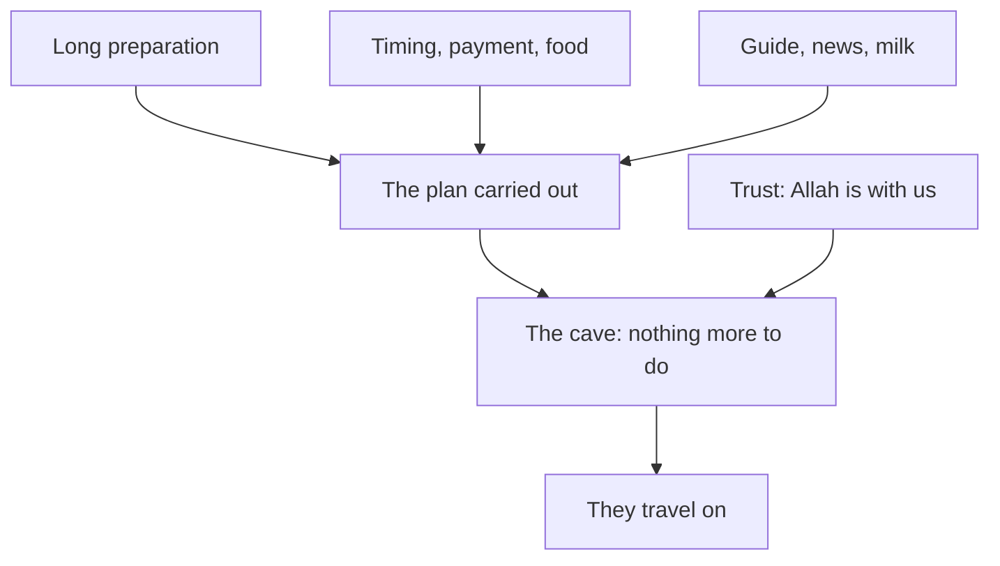

## A question from his sister

On Wednesday evening, Khalil's plan for the interview is ready. The power bank is charged. His uncle has said yes to the back room. The data bundle is bought. Khalil reads the plan again, and he feels calmer than he has all week.

His younger sister, Lama, looks over his shoulder at the notebook. "Did the Prophet, peace be upon him, plan like this?" she asks. "Or did he just trust Allah?" She is not teasing. She really wants to know. Khalil opens his mouth to answer and realises that he is not sure. He knows the Hijra in outline, and he has heard many stories about it. But he has never read what the sound hadith actually say.

This chapter does what Khalil does next. It goes to one long hadith in Sahih al-Bukhari and follows the Hijra step by step, as Aisha, may Allah be pleased with her, told it. It adds only what other sound sources say about the same events. Then it looks at the moment in the cave, when every plan had done all it could.

## One long hadith

The Hijra you met in chapter 2.1 was made by the Prophet together with Abu Bakr, may Allah be pleased with him. The most detailed sound account of it is a long narration from Aisha, recorded by al-Bukhari (Sahih al-Bukhari 3905). It reads almost like a list of preparations. The rest of this chapter stays inside that hadith and three other sources: Sahih al-Bukhari 2979, Sahih al-Bukhari 3653, and Quran 9:40.

Before you read the steps, make a prediction about one of them.

```predict
prompt: "For the journey, the Prophet and Abu Bakr needed someone who knew the way. Before you step through, who do you expect they chose as their guide?"
options:
  - id: own-family
    label: "A trusted Muslim from their own family"
  - id: skilled
    label: "A skilled guide who was not then a Muslim"
correctOptionId: skilled
explanation: "They hired a skilled guide from the tribe of Banu ad-Dil, who was not a Muslim at the time (Sahih al-Bukhari 3905). They trusted him with their camels because he was skilled and reliable for this task. Many people expect the guide to come from their own circle. The hadith shows he was chosen for his skill."
```

Step through the Hijra below. Check your prediction at the guide, and count the planned steps before you reach the cave.

<InteractiveCanvas slug="hijra-planned-steps" />

The canvas showed nine steps, and seven of them were planning: the camels, the timing, the payment, the food, the guide, the news and the milk. Only one step was about trust alone, and it came in the cave, after everything else was in place. Then the plan moved on. The Hijra was not trust instead of planning. It was planning, carried out by many people, with trust at its heart.

## What each step teaches

**A long preparation.** Abu Bakr wanted to emigrate, and the Prophet, peace be upon him, asked him to wait. Abu Bakr did not sit idle while he waited. He fed two she-camels for four months, so that they would be strong when the time came. Preparation started long before the day.

**Timing and care.** When the time came, the Prophet went to Abu Bakr's house at noon, at an hour when he did not usually visit, with his head covered. Before he spoke about the plan, he asked that everyone present leave. Abu Bakr said that only his family was there. A plan that matters is handled with care: the right time, and the right people in the room.

**Paying fairly.** Abu Bakr offered the Prophet one of the two camels. The Prophet accepted it only with payment. Even among the closest friends, and even in a hurry, the plan was fair.

**Food packed.** The family prepared the baggage quickly and put food in a leather bag. Asma bint Abi Bakr, may Allah be pleased with her, cut a piece of her waist-belt to tie the bag. For that reason she was given the name Dhat an-Nitaq, the one with the belt. In her own report, she says she cut her belt in two: one piece for the water-skin and one for the food (Sahih al-Bukhari 2979). The practical things were not left to chance.

**An expert, chosen for skill.** They hired a skilled guide from the tribe of Banu ad-Dil. The hadith says plainly that he was not a Muslim at the time. They trusted him and gave him their camels, and after three nights he brought the camels to them. He was chosen because he was skilled and trustworthy for this task.

**A safe place to wait.** They stayed in a cave on Mount Thawr for three nights.

**A source of news.** Abdullah ibn Abi Bakr, may Allah be pleased with him, whom the hadith describes as a sharp and intelligent young man, spent the nights with them. He left before dawn, was among the people of Makkah by morning, and brought them every piece of news after dark.

**Supplies nearby.** Amir ibn Fuhayra, may Allah be pleased with him, Abu Bakr's freed slave, grazed a flock of sheep near them. He brought them milk each evening and led the sheep away before dawn.

**The plan moves on.** After three nights, the guide came with the camels and took them along the coast road.

## The trust in the cave

Now look at the one step that was not planning. In the cave, Abu Bakr was afraid. He said that if one of them looked down at his own feet, he would see them. The Prophet answered with a question: what do you think, Abu Bakr, of two when Allah is the third of them? (Sahih al-Bukhari 3653).

> مَا ظَنُّكَ يَا أَبَا بَكْرٍ بِاثْنَيْنِ اللَّهُ ثَالِثُهُمَا

Meaning: what do you think, Abu Bakr, of two when Allah is the third of them?

The Quran records the same moment. When the two of them were in the cave, he said to his companion: do not grieve, Allah is with us. And Allah sent down His calm upon him (Quran 9:40).

> لَا تَحْزَنْ إِنَّ اللَّهَ مَعَنَا

Meaning: do not grieve; Allah is with us.

Notice where this trust appears. It does not appear at the start, as a reason to skip the camels, the food and the guide. It appears in the cave, at the point where every means had been taken and nothing more could be done with the hands. That is where the heart's trust carried them. The course's own way of saying it: the Prophet planned every step and still put his trust in Allah. Planning is part of trust.

## Worked example: the pattern in Khalil's plan

That night, Khalil answers his sister properly. He takes the steps of the Hijra and checks his own plan against them, one by one. His plan is much smaller, of course. But the pattern is the same.

**A long preparation.** Abu Bakr's camels were fed for four months. Khalil's version is smaller but real: 45 minutes of testing practice every morning since Monday, not one long night before the interview.

**Timing and care.** The Prophet chose an unusual hour and the right people. Khalil visited his uncle's back room on Wednesday at 10:00, the same hour as the interview, to check the noise and the signal. He has not posted about the interview online, because it is not yet anyone else's business.

**Paying fairly.** The camel was taken only with payment. Khalil's uncle will not take money for the room or the power bank. So Khalil offers something fair in return: he will help in the shop on Friday morning.

**Food packed.** The bag was packed and tied. Khalil's version: his phone charged to 100%, his notes on one printed page, a glass of water by the laptop.

**An expert, chosen for skill.** The guide was hired for his skill. Khalil asked Ayman, a senior tester he met in an online testing group, for a 30-minute practice interview on Tuesday. Ayman is not from Khalil's circle or his city. Khalil chose him because he is skilled at exactly this.

**News and supplies.** Abdullah brought news; Amir brought milk. Khalil checks the neighbourhood power group once each evening, and his uncle's power bank is his supply.

**The trust.** After all of this, Khalil writes: "Allah is with me." He knows the plan cannot decide the result. It can only get him to 10:00 on Thursday, ready, with power. What happens after that is the cave: the place where only trust is left.

The diagram shows the relationship between the plan and the trust.



Three groups of planning lead to one place, the cave. The plan could take them that far and no further. At that point a second arrow comes in: trust. They travel on only after both have arrived. Trust does not replace the plan, and the plan does not replace trust. The plan takes you as far as human effort can go. From there, the heart's trust in Allah is what remains.

## Where people go wrong

The first mistake is to think the Prophet did not need to plan because Allah was with him. The hadith shows the opposite. Allah was with him, and he planned every step: camels, timing, payment, food, a guide, news and supplies.

The second mistake is to think that so much planning means the trust was small. The cave shows that the trust was complete. The plan and the trust were in the same person, in the same days.

The third mistake is to add to the story. Many popular versions of the Hijra add details that are not in the sources this course has checked. This course stays with the sound hadith and the verse. The lesson does not need more than they give.

The fourth mistake is to believe a good plan guarantees a good result. In the cave, the plan had done all it could, and the outcome was with Allah. A plan gets you ready. It does not hold the result.

## Check your understanding

```quiz
type: mcq
question: "Fares has a scholarship interview in four months. He plans to start preparing in the last week, so that everything is fresh in his mind. Which part of the Hijra speaks most directly to his plan?"
options:
  - "The trust in the cave, since in the end the heart matters more than plans"
  - "The camels fed for months, so he can start a little each week from now"
  - "The visit at noon, since what matters most is choosing the right moment"
  - "The news after dark, so he should first find out how others prepared"
correct: 1
explanations:
  - "The trust in the cave came after months of planning, not instead of it. It does not tell Fares to leave his preparation to the last week."
  - "Right. Abu Bakr fed the camels for four months before the journey. A small amount of preparation each week, starting now, follows that pattern."
  - "Timing mattered in the Hijra, but the visit at noon was one step in a long preparation. Good timing does not replace starting early."
  - "News was useful during the three nights in the cave. Finding out how others prepared can help, but it is not the step his plan is missing."
```

```quiz
type: mcq
question: "Huda has planned her trip to an office to hand in documents. She has made copies, booked the appointment, checked the route and chosen a backup day. On the morning she still feels anxious. What does the moment in the cave suggest?"
options:
  - "Having planned, she can rest her heart, since Allah is with her"
  - "Her anxiety shows the plan is weak, so she should add steps"
  - "She should have planned less, since trust is what calms the heart"
  - "Her anxiety shows weak trust, so she should pray before she goes"
correct: 0
explanations:
  - "Right. In the cave, every step had been planned and Abu Bakr was still afraid. The Prophet's answer was trust: do not grieve, Allah is with us. Huda's plan is done, and her heart can rest."
  - "Abu Bakr felt fear even after the careful plan of the Hijra. Fear after planning is human. It is not a sign that more steps are needed."
  - "The Hijra shows planning and trust together. Less planning is the mistake of the pilgrims who came without provisions."
  - "Praying before she goes is good. But her anxiety is not proof of weak trust: Abu Bakr was afraid in the cave, and the Prophet answered him gently."
```

## This week

Choose one plan you have for the coming weeks. If you prefer, use Huda's trip to the office from the quiz. Check it against the steps of the Hijra. Does the preparation start early? Is there care with timing, and fairness to the people who help? Are the practical things packed? Is the right person doing the skilled part? Is there a source of news, and a supply in reserve? Add one step you were missing. Then write one sentence of trust for the moment when your plan has done all it can.

**Next:** Five graded cases on tawakkul, backup plans and the two ways trust goes wrong.
